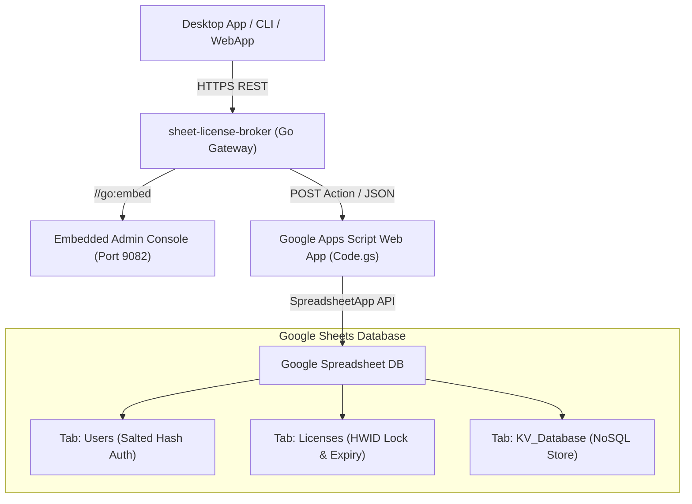

# Sheet-License-Broker

<p align="center">
  <strong>Serverless Authentication, License Entitlement & NoSQL Database Gateway Powered by Google Sheets & Google Apps Script</strong>
</p>

<p align="center">
  
  
  
  
</p>

---

## 💡 Overview

**`sheet-license-broker`** turns any Google Spreadsheet into an authenticated, production-ready serverless backend for desktop applications, CLI utilities, and indie SaaS tools. 

Instead of paying for expensive cloud database instances or managing Docker containers just to handle user logins and software license keys, `sheet-license-broker` pairs a **Google Apps Script (GAS)** cloud engine with a **high-speed Go bridge and embedded Web UI**.

### Why Google Sheets as a Backend?
- **Zero Cost ($0/mo)**: Leverages Google Drive and Apps Script free quotas (up to 20,000 requests/day).
- **Human-Readable Admin Panel**: Your Google Sheet is your database. View, edit, ban, or grant licenses directly in real-time.
- **Hardware-Locked Protection (HWID)**: Locks license keys to specific machine hardware IDs on first boot.
- **Salted SHA-256 Authentication**: Passwords are cryptographically salted and hashed before persistence.
- **Embedded Web Dashboard**: Self-contained single binary (`sheet-license-broker.exe`) with an emerald-dark management console.

---

## 🏛️ Architecture



---

## 🚀 Quick Start

### 1. Run the Local Gateway & Dashboard

Ensure Go 1.22+ is installed on your workstation:

```bash
# Clone the repository
git clone https://github.com/kLauncher1/sheet-license-broker.git
cd sheet-license-broker

# Build and run the single binary
go run .
```

Open your browser at **`http://localhost:9082`** to access the live administration console.

---

## 📋 Google Sheets Setup (3 Minutes)

You can connect `sheet-license-broker` directly to your Google account with zero external servers.

1. **Create a Google Spreadsheet**:
   - Go to [Google Sheets](https://sheets.new) and create a new blank spreadsheet.
2. **Open Apps Script**:
   - In the top menu, navigate to **Extensions > Apps Script**.
3. **Copy `gas/Code.gs`**:
   - Replace the default code with the contents of [`gas/Code.gs`](file:///gas/Code.gs).
4. **Deploy as Web App**:
   - Click **Deploy > New deployment**.
   - Select type: **Web app**.
   - Set **Execute as**: `Me (your email)`.
   - Set **Who has access**: `Anyone`.
   - Click **Deploy** and copy your **Web app URL** (`https://script.google.com/macros/s/.../exec`).

Your Google Sheet will automatically generate three dedicated tabs on first request:
- **`Users`**: `user_id`, `username`, `password_hash`, `salt`, `role`, `created_at`
- **`Licenses`**: `license_key`, `bound_hwid`, `max_devices`, `status`, `expires_at`, `created_at`
- **`KV_Database`**: `collection`, `doc_id`, `payload`, `updated_at`

---

## 📡 REST API Specification

### Authentication

#### Register User
```http
POST /api/users/register
Content-Type: application/json

{
  "username": "developer",
  "password": "SecurePassword123!",
  "role": "admin"
}
```

#### Authenticate / Login
```http
POST /api/users/login
Content-Type: application/json

{
  "username": "developer",
  "password": "SecurePassword123!"
}
```

---

### License Management

#### Issue License Key
```http
POST /api/licenses
Content-Type: application/json

{
  "days": 30,
  "max_devices": 1
}
```
**Response:**
```json
{
  "license_key": "KEY-7F2A-9C4B-E108",
  "bound_hwid": "",
  "max_devices": 1,
  "status": "ACTIVE",
  "expires_at": "2026-11-12T12:00:00Z",
  "created_at": "2026-10-13T12:00:00Z"
}
```

#### Validate & Bind HWID
```http
POST /api/licenses/validate
Content-Type: application/json

{
  "license_key": "KEY-7F2A-9C4B-E108",
  "hwid": "WIN-B829-94AA-0123"
}
```
*Note: If the license is active and unbound, it locks to the submitted `hwid`. Subsequent calls from matching hardware succeed; calls from mismatched hardware are rejected.*

---

### NoSQL Key-Value Store

#### Store Document
```http
POST /api/docs
Content-Type: application/json

{
  "collection": "user_settings",
  "doc_id": "usr_9918",
  "payload": "{\"dark_mode\":true,\"telemetry\":false}"
}
```

#### Fetch All Documents
```http
GET /api/docs
```

---

## 💻 Client Integration Example (Go)

```go
package main

import (
	"bytes"
	"encoding/json"
	"fmt"
	"net/http"
)

func verifyLicense(key, hwid string) bool {
	payload, _ := json.Marshal(map[string]string{
		"license_key": key,
		"hwid":        hwid,
	})

	resp, err := http.Post("http://localhost:9082/api/licenses/validate", "application/json", bytes.NewBuffer(payload))
	if err != nil || resp.StatusCode != http.StatusOK {
		return false
	}
	defer resp.Body.Close()

	var result struct {
		Valid bool `json:"valid"`
	}
	json.NewDecoder(resp.Body).Decode(&result)
	return result.Valid
}

func main() {
	if verifyLicense("KEY-7F2A-9C4B-E108", "WIN-B829-94AA-0123") {
		fmt.Println("License valid. Launching application...")
	} else {
		fmt.Println("Unauthorized or expired license key.")
	}
}
```

---

## 🛠️ Verification & Build

Run the automated verification suite:

```bash
# Execute unit tests
go test -v ./...

# Compile standalone production binary
go build -ldflags="-s -w" -o sheet-license-broker.exe .
```

---

## 📄 License

Licensed under the [MIT License](LICENSE).
