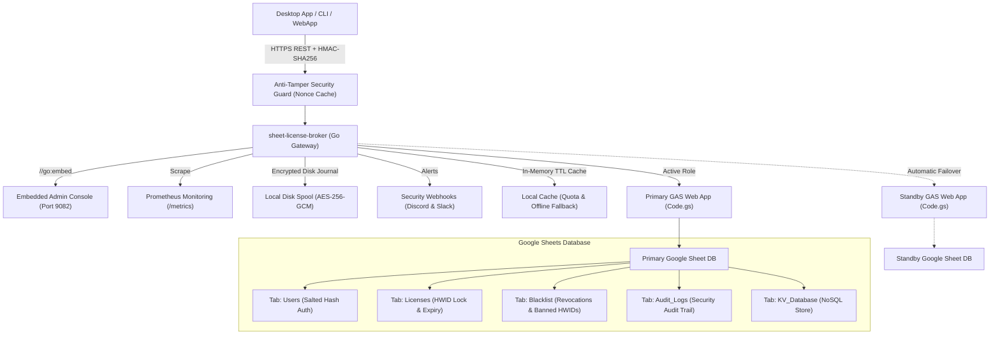

# Sheet-License-Broker

<p align="center">
  <strong>Serverless Authentication, License Entitlement & NoSQL Database Gateway Powered by Google Sheets & Google Apps Script</strong>
</p>

<p align="center">
  
  
  
  
  
  
  
  
  
  
</p>

---

## 💡 Overview

**`sheet-license-broker`** turns any Google Spreadsheet into an authenticated, production-ready serverless backend for desktop applications, CLI utilities, and indie SaaS tools. 

Instead of paying for expensive cloud database instances or managing Docker containers just to handle user logins and software license keys, `sheet-license-broker` pairs a **Google Apps Script (GAS)** cloud engine with a **high-speed Go bridge, Cloudflare Edge Gateway, cryptographic hardware attestation (TPM 2.0 & Enclaves), multi-tenant namespacing, dual-sheet active-standby high availability, dynamic feature flags & usage metering, encrypted disk spooling, Prometheus metrics, cryptographic HMAC anti-tamper verification, resilient offline caching, and an embedded Web UI**.

### Why Google Sheets as a Backend?
- **Zero Cost ($0/mo)**: Leverages Google Drive and Apps Script free quotas (up to 20,000 requests/day).
- **Cryptographic Hardware Attestation & Enclave Binding**: TPM 2.0 PCR quote verification and Apple Secure Enclave / Windows Hello hardware key attestation preventing clone attacks.
- **Client Anti-Debugging & Memory-Tamper Telemetry**: Continuous integrity scoring with instant kill-switch auto-banning devices exhibiting debugger attachment or code section modifications.
- **Dynamic Feature Flags & Usage-Based Tier Metering**: Free, Pro, and Enterprise subscription tiers with runtime feature gating (`client.isFeatureEnabled("analytics")`) and atomic consumption quota tracking persisted directly in Google Sheets.
- **Dual-Sheet Active-Standby Replication**: Automatic failover between primary and standby sheets with collision-free bidirectional reconciliation.
- **Encrypted Local Disk Spool**: AES-256-GCM encrypted journal queue (`spool.bin`) guaranteeing zero data loss during network disruptions.
- **Enterprise Prometheus Telemetry (`/metrics`)**: Built-in scraper endpoint exposing counters, gauges, and latencies in Prometheus format.
- **Incident Alert Webhooks**: Immediate rich security incident notifications dispatched to Discord and Slack channels.
- **Multi-Tenant Namespacing**: Isolate distinct products and tenants with custom prefixes (e.g., `ACME-LIC-XXXX-YYYY`) and independent policies.
- **Cloudflare Edge Gateway**: Sub-millisecond edge license verification via Cloudflare Workers and Workers KV with Web Crypto API.
- **Human-Readable Admin Panel**: Your Google Sheet is your database. View, edit, ban, or grant licenses directly in real-time.
- **Hardware-Locked Protection (HWID)**: Locks license keys to specific machine hardware IDs on first boot.
- **Cryptographic HMAC-SHA256 Anti-Tamper**: Protects incoming client traffic against MITM inspection and reverse-engineered payload spoofing.
- **Sliding-Window Nonce Replay Mitigation**: Prevents request replay attacks with a 5-minute time-drift tolerance window.
- **Instant Remote Revocation & Device Blacklisting**: Kill licenses or ban compromised hardware IDs directly from the web console or Google Sheets tab.
- **Automated Backup & Disaster Recovery**: Point-in-time state export and restore protected with SHA-256 data checksums and AES-256-GCM encryption.
- **Real-Time Lifecycle Webhooks**: Event dispatchers with worker queues and HMAC-signed webhook delivery to tenant and global endpoints.
- **Salted SHA-256 Authentication**: Passwords are cryptographically salted and hashed before persistence.
- **Resilient Local Caching & Offline Grace**: Memory-cached licenses and KV documents protect against Google API rate limits (HTTP 429) and network blips.
- **Embedded Web Dashboard**: Self-contained single binary (`sheet-license-broker.exe`) with an emerald-dark management console.

---

## 🏛️ Architecture



---

## 🚀 Quick Start

### 1. Run the Local Gateway & Dashboard

Ensure Go 1.22+ is installed on your workstation:

```bash
# Clone the repository
git clone https://github.com/kLauncher1/sheet-license-broker.git
cd sheet-license-broker

# Build and run the single binary in standalone mode
go run .
```

Open your browser at **`http://localhost:9082`** to access the live administration console.

### 2. Connect to Live Google Sheets (Proxy Mode)

To wire the broker to your deployed Google Apps Script Web App:

```bash
# Set your Apps Script Web App URL
export GAS_WEBAPP_URL="https://script.google.com/macros/s/.../exec"
export CACHE_TTL_SECONDS="600" # Optional: 10 minutes cache TTL

# Launch the gateway
./sheet-license-broker.exe
```

The server automatically detects the remote URL, forwards incoming queries, caches results locally, and transparently falls back to cached data during network interruptions.

---

## 📋 Google Sheets Setup & Clasp Deployment

### Option A: Clasp CLI Zero-Click Deployment

If you use the `@google/clasp` CLI:

```bash
# 1. Login to your Google account
npx @google/clasp login

# 2. Deploy using the automated helper script
node scripts/deploy_clasp.mjs --script-id <YOUR_APPS_SCRIPT_ID>
```

See [`gas/README.md`](file:///gas/README.md) for full instructions on creating and configuring Clasp projects.

### Option B: Manual Setup (3 Minutes)

1. Open [Google Sheets](https://sheets.new) and create a new blank spreadsheet.
2. In the top menu, navigate to **Extensions > Apps Script**.
3. Replace the default code with the contents of [`gas/Code.gs`](file:///gas/Code.gs).
4. Click **Deploy > New deployment**:
   - Type: **Web app**
   - Execute as: `Me (your email)`
   - Who has access: `Anyone`
5. Click **Deploy** and copy your **Web app URL** (`https://script.google.com/macros/s/.../exec`).

Your Google Sheet will automatically generate three dedicated tabs on the first request:
- **`Users`**: `user_id`, `username`, `password_hash`, `salt`, `role`, `created_at`
- **`Licenses`**: `license_key`, `bound_hwid`, `max_devices`, `status`, `expires_at`, `created_at`
- **`KV_Database`**: `collection`, `doc_id`, `payload`, `updated_at`

---

## 📡 REST API Specification

### Health & Diagnostics

#### Get Service Health & Proxy Status
```http
GET /api/health
```

#### Ping Backend
```http
GET /api/proxy/ping
```

---

### Authentication

#### Register User
```http
POST /api/users/register
Content-Type: application/json

{
  "username": "developer",
  "password": "SecurePassword123!",
  "role": "admin"
}
```

#### Authenticate / Login
```http
POST /api/users/login
Content-Type: application/json

{
  "username": "developer",
  "password": "SecurePassword123!"
}
```

---

### License Management

#### Issue License Key
```http
POST /api/licenses
Content-Type: application/json

{
  "days": 30,
  "max_devices": 1
}
```
**Response:**
```json
{
  "license_key": "KEY-7F2A-9C4B-E108",
  "bound_hwid": "",
  "max_devices": 1,
  "status": "ACTIVE",
  "expires_at": "2026-11-12T12:00:00Z",
  "created_at": "2026-10-13T12:00:00Z"
}
```

#### Validate & Bind HWID
```http
POST /api/licenses/validate
Content-Type: application/json

{
  "license_key": "KEY-7F2A-9C4B-E108",
  "hwid": "WIN-B829-94AA-0123"
}
```
**Response:**
```json
{
  "valid": true,
  "license_key": "KEY-7F2A-9C4B-E108",
  "hwid_bound": "WIN-B829-94AA-0123",
  "expires_at": "2026-11-12T12:00:00Z",
  "source": "remote_gas"
}
```

*Note: If the license is active and unbound, it locks to the submitted `hwid`. Subsequent calls from matching hardware succeed; calls from mismatched hardware are rejected. Responses also indicate whether the result was served from `cache`, `remote_gas`, or `offline_cache`.*

---

### Anti-Tamper & Security

#### HMAC-SHA256 Request Signing
When `HMAC_ENFORCE=true` (or when `HMAC_SECRET` is configured), clients protect requests from MITM interception using standard headers:
- `X-Signature`: Hex-encoded HMAC-SHA256 signature calculated over `METHOD\nPATH\nTIMESTAMP\nNONCE\nSHA256(BODY)`.
- `X-Timestamp`: Current Unix timestamp in seconds (enforces a sliding 5-minute clock drift window).
- `X-Nonce`: Unique cryptographic nonce string per request (prevents replay attacks).

#### Revoke License Key
```http
POST /api/licenses/revoke
Content-Type: application/json

{
  "license_key": "KEY-7F2A-9C4B-E108",
  "reason": "Payment refunded"
}
```

#### Blacklist Device Hardware ID (HWID)
```http
POST /api/security/blacklist
Content-Type: application/json

{
  "type": "device",
  "target": "WIN-B829-94AA-0123",
  "reason": "Fraudulent key sharing"
}
```

#### List Blacklist & Revocation Entries
```http
GET /api/security/blacklist
```

---

### NoSQL Key-Value Store

#### Store Document
```http
POST /api/docs
Content-Type: application/json

{
  "collection": "user_settings",
  "doc_id": "usr_9918",
  "payload": "{\"dark_mode\":true,\"telemetry\":false}"
}
```

#### Fetch All Documents
```http
GET /api/docs
```

---

### Multi-Tenant Namespaces

#### Register Tenant
```http
POST /api/tenants/register
Content-Type: application/json

{
  "id": "tenant-gamehub",
  "name": "GameHub Studio",
  "namespace_prefix": "GHUB",
  "max_licenses": 100,
  "webhook_url": "https://api.gamehub.com/webhooks"
}
```

#### Issue Tenant-Namespaced License
```http
POST /api/licenses
Content-Type: application/json
X-Tenant-ID: tenant-gamehub

{
  "days": 60,
  "max_devices": 2
}
```
*Generates formatted keys conforming to `GHUB-LIC-XXXX-YYYY`.*

---

### Automated Backup & Disaster Recovery

#### Export Encrypted Backup (AES-256-GCM + SHA-256 Integrity)
```http
POST /api/backup/export
Content-Type: application/json

{
  "secret_key": "your-backup-master-passphrase"
}
```

#### Restore From Snapshot
```http
POST /api/backup/restore
Content-Type: application/json

{
  "secret_key": "your-backup-master-passphrase",
  "encrypted_payload": "<hex-encoded-ciphertext>"
}
```

---

### Dynamic Feature Flags & Usage-Based Tier Metering

#### List Standard Feature Catalogue & Tiers
```http
GET /api/features
```
**Response:**
```json
{
  "tiers": {
    "free": {
      "name": "free",
      "features": ["basic_access"],
      "daily_quotas": { "api_calls": 500, "export_rows": 100 }
    },
    "pro": {
      "name": "pro",
      "features": ["basic_access", "analytics", "csv_export", "extended_logs"],
      "daily_quotas": { "api_calls": 50000, "export_rows": 100000 }
    },
    "enterprise": {
      "name": "enterprise",
      "features": ["basic_access", "analytics", "csv_export", "extended_logs", "sso", "audit_export", "unlimited_seats", "priority_support"],
      "daily_quotas": { "api_calls": 10000000, "export_rows": 50000000 }
    }
  }
}
```

#### Check License Feature Entitlement
```http
POST /api/features/check
Content-Type: application/json

{
  "license_key": "KEY-7F2A-9C4B-E108",
  "feature": "analytics"
}
```
**Response:**
```json
{
  "license_key": "KEY-7F2A-9C4B-E108",
  "feature": "analytics",
  "tier": "pro",
  "allowed": true
}
```

#### Record Usage & Enforce Tier Quotas
```http
POST /api/usage/record
Content-Type: application/json

{
  "license_key": "KEY-7F2A-9C4B-E108",
  "metric": "api_calls",
  "units": 1
}
```
**Response:**
```json
{
  "license_key": "KEY-7F2A-9C4B-E108",
  "metric": "api_calls",
  "units": 1,
  "current_usage": 42,
  "daily_quota": 50000,
  "quota_exceeded": false,
  "success": true
}
```

#### Query Usage Statistics
```http
GET /api/usage/stats?license_key=KEY-7F2A-9C4B-E108
```
**Response:**
```json
{
  "license_key": "KEY-7F2A-9C4B-E108",
  "date": "2026-10-14",
  "tier": "pro",
  "metrics": {
    "api_calls": 42
  }
}
```

---

### Hardware Attestation & Anti-Tamper Telemetry

#### Request TPM / Enclave Challenge Nonce
```http
POST /api/attestation/challenge
Content-Type: application/json

{
  "license_key": "KEY-7F2A-9C4B-E108",
  "hwid": "WIN-B829-94AA-0123"
}
```
**Response:**
```json
{
  "status": "success",
  "challenge_id": "9a4f2b1c8e3d",
  "nonce": "e3b0c44298fc1c149afbf4c8996fb92427ae41e4649b934ca495991b7852b855",
  "expires_at": "2026-10-14T12:05:00Z"
}
```

#### Verify TPM 2.0 PCR Quote
```http
POST /api/attestation/verify
Content-Type: application/json

{
  "license_key": "KEY-7F2A-9C4B-E108",
  "hwid": "WIN-B829-94AA-0123",
  "challenge_id": "9a4f2b1c8e3d",
  "attestation_type": "tpm2",
  "tpm_quote": {
    "pcr_values": {
      "0": "e3b0c44298fc1c149afbf4c8996fb92427ae41e4649b934ca495991b7852b855",
      "7": "ba7816bf8f01cfea414140de5dae2223b00361a396177a9cb410ff61f20015ad"
    },
    "pcr_selection": [0, 7],
    "composite_digest": "4a5b6c7d8e9f...",
    "signature": "3045022100...",
    "ak_public_key_pem": "-----BEGIN PUBLIC KEY-----\n..."
  }
}
```

#### Transmit Anti-Debugging & Integrity Telemetry
```http
POST /api/attestation/telemetry
Content-Type: application/json

{
  "license_key": "KEY-7F2A-9C4B-E108",
  "hwid": "WIN-B829-94AA-0123",
  "report": {
    "debugger_present": false,
    "memory_integrity": true,
    "sandbox_detected": false,
    "hooks_detected": false,
    "process_checksum": "a1b2c3d4e5f6...",
    "execution_uptime_s": 3600
  }
}
```

---

## ⚡ Cloudflare Edge Gateway

For globally distributed, sub-millisecond edge license verification, deploy the Cloudflare Worker located in `edge/cloudflare/`:

```bash
cd edge/cloudflare
wrangler deploy
```

- **Sub-10ms POP Verification**: Checks valid licenses directly from Cloudflare Workers KV cache.
- **Hardware Web Crypto**: Edge HMAC-SHA256 signature and replay prevention before hitting origin.
- **Automated Origin Fallback**: Uncached queries, key binds, and revocations transparently proxy to the origin server.

---

## 💻 Multi-Language Client SDKs

`sheet-license-broker` includes production-ready client SDKs under `sdk/` supporting automatic hardware ID (HWID) device binding and cryptographic HMAC-SHA256 request signing.

### 🐍 Python Client (`sdk/python/sheet_license_client.py`)

Zero external dependencies (uses standard library `urllib` & `hashlib`):

```python
from sheet_license_client import SheetLicenseClient, get_machine_hwid

client = SheetLicenseClient(base_url="http://localhost:9082", secret_key="your-hmac-secret")

# 1. Verify license key (automatically attaches local machine HWID)
res = client.verify_license("SLB-XXXX-XXXX-XXXX")
if res.get("valid"):
    print("License verified. Tier:", res.get("tier"))

    # 2. Check dynamic feature flag entitlement
    if client.is_feature_enabled("SLB-XXXX-XXXX-XXXX", "analytics"):
        print("Analytics module enabled!")

    # 3. Record consumption towards tier quotas
    client.record_usage("SLB-XXXX-XXXX-XXXX", "api_calls", 1)
else:
    print("Denied:", res.get("message"))
```

### ⚡ C# / .NET & Unity (`sdk/csharp/SheetLicenseClient.cs`)

Single-file helper compatible with Unity Mono/IL2CPP, WPF, and .NET Desktop:

```csharp
using SheetLicenseBroker;

var client = new SheetLicenseClient("http://localhost:9082", "your-hmac-secret");

// Verify license and check tier entitlement
var result = await client.VerifyLicenseAsync("SLB-XXXX-XXXX-XXXX");
if (result.Valid) {
    Console.WriteLine($"Access granted! Tier: {result.Tier}, Expiry: {result.ExpirationDate}");

    // Dynamic feature gating
    if (await client.IsFeatureEnabledAsync("SLB-XXXX-XXXX-XXXX", "analytics")) {
        Console.WriteLine("Analytics initialized.");
    }

    // Record usage
    await client.RecordUsageAsync("SLB-XXXX-XXXX-XXXX", "api_calls", 1);
}
```

### 🟩 TypeScript & Node.js (`@sheet-license/client`)

Zero-dependency native ESM package for Node.js backends and Electron apps:

```typescript
import { SheetLicenseClient } from '@sheet-license/client';

const client = new SheetLicenseClient({
  baseUrl: 'http://localhost:9082',
  secretKey: 'your-hmac-secret',
});

const result = await client.verifyLicense('SLB-XXXX-XXXX-XXXX');
if (result.valid) {
  console.log('License active. Tier:', result.tier);

  // Dynamic feature gating
  const hasAnalytics = await client.isFeatureEnabled('SLB-XXXX-XXXX-XXXX', 'analytics');
  if (hasAnalytics) {
    console.log('Analytics feature enabled for client');
  }

  // Record usage metrics
  await client.recordUsage('SLB-XXXX-XXXX-XXXX', 'api_calls', 1);
}
```

### 🔷 Go Client (`sdk/go/client.go`)

```go
package main

import (
	"context"
	"fmt"
	"time"

	"github.com/kLauncher1/sheet-license-broker/sdk/go"
)

func main() {
	client := sdk.NewClient("http://localhost:9082", []byte("your-hmac-secret"), 5*time.Second)

	res, err := client.VerifyLicense(context.Background(), "SLB-XXXX-XXXX-XXXX", "")
	if err == nil && res.Valid {
		fmt.Printf("License valid (Tier: %s). Launching application...\n", res.Tier)

		// Dynamic feature gating
		allowed, _ := client.IsFeatureEnabled(context.Background(), "SLB-XXXX-XXXX-XXXX", "analytics")
		if allowed {
			fmt.Println("Analytics feature enabled.")
		}

		// Record usage consumption
		_ = client.RecordUsage(context.Background(), "SLB-XXXX-XXXX-XXXX", "api_calls", 1)
	}
}
```

---

## 🛠️ Verification & Build

Run the automated verification suite:

```bash
# Execute unit tests across all packages
go test -v ./...

# Compile standalone production binary
go build -ldflags="-s -w" -o sheet-license-broker.exe .
```

---

## 📄 License

Licensed under the [MIT License](LICENSE).
