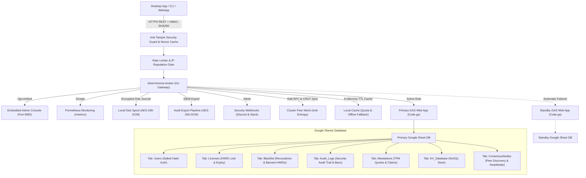

# Sheet-License-Broker

<p align="center">
  <strong>Serverless Authentication, License Entitlement & NoSQL Database Gateway Powered by Google Sheets & Google Apps Script</strong>
</p>

<p align="center">
  
  
  
  
  
  
  
  
  
  
  
  
  
  
  
  
  
  
  
</p>

---

## 💡 Overview

**`sheet-license-broker`** turns any Google Spreadsheet into an authenticated, production-ready serverless backend for desktop applications, CLI utilities, and indie SaaS tools. 

Instead of paying for expensive cloud database instances or managing Docker containers just to handle user logins and software license keys, `sheet-license-broker` pairs a **Google Apps Script (GAS)** cloud engine with a **high-speed Go bridge, confidential computing Intel SGX / AMD SEV-SNP enclave bridges, post-quantum ML-DSA signature chains, distributed Raft quorum consensus, CRDT LWW-Element-Set synchronization, Cloudflare Edge Gateway, cryptographic hardware attestation (TPM 2.0 & Enclaves), multi-tenant namespacing, dual-sheet active-standby high availability, dynamic feature flags & usage metering, encrypted disk spooling, Prometheus metrics, cryptographic HMAC anti-tamper verification, resilient offline caching, and an embedded Web UI**.

### Why Google Sheets as a Backend?
- **Zero Cost ($0/mo)**: Leverages Google Drive and Apps Script free quotas (up to 20,000 requests/day).
- **Confidential Computing & Hardware Enclave Attestation Bridge**: Cryptographically validates Intel SGX Quote v3/v4 ECDSA P-256 signatures and AMD SEV-SNP 1184-byte signed attestation reports against MREnclave/MRSigner/ISVSVN policies. Negotiates ephemeral ECDH P-256 encrypted tunnels with RFC 5869 HKDF-SHA256 key expansion and AES-256-GCM, enabling zero-plaintext in-enclave evaluation where the host OS, hypervisor, and broker transit layers never observe cleartext keys.
- **Post-Quantum Cryptography & ML-DSA Signature Chains (NIST FIPS 204)**: Quantum-resistant module-lattice digital signature verification (ML-DSA-44 / ML-DSA-65) with dual classical ECDSA / lattice hybrid signature chains (`Hybrid-P256-MLDSA65`), zero-downtime key rotation grace windows, and instant emergency revocation kill-switch broadcasts.
- **Behavioral Anomaly Detection & Adaptive Risk Scoring**: Statistical sliding-window Z-Score heartbeat drift tracking (&plusmn;15% jitter tolerance), Haversine velocity impossible travel detection (&gt;950 km/h or concurrent /24 subnets), adaptive risk score calculation with progressive nominal decay, automated re-attestation challenge escalation at risk score &ge; 50, zero-trust automatic quarantine at risk score &ge; 85, and standardized security incident topology graph exporter (`siem-topology-v1`) for enterprise SIEM ingestion.
- **Enterprise Single Sign-On (SSO) & SCIM 2.0 Directory Provisioning**: SAML 2.0 & OIDC identity federation, RFC 7643/7644 directory synchronization, automated license seat allocation, and instant deprovisioning revocation.
- **Zero-Knowledge Proof (ZKP) Anonymous Verification**: Pedersen commitments over NIST P-256 with deterministic hash-to-curve independent generators, non-interactive Sigma presentation proofs (Fiat-Shamir transformed), and spent nullifier replay defense registries protecting client hardware privacy.
- **Distributed Raft Quorum Consensus & CRDT Mesh**: Lightweight leader election, majority log quorum, conflict-free LWW-Element-Set state replication, and SHA-256 Merkle tree state digests for anti-entropy sync across distributed broker nodes.
- **Enterprise Rate-Limiting & Progressive Backoff**: Thread-safe sliding-window throttling per IP and HWID with progressive penalty delays and standard `X-RateLimit-*` headers.
- **Sliding-Window IP/HWID Reputation Cache**: Automatic temporary bans and high-priority incident webhook alerts upon repeated security infractions.
- **Encrypted Audit Token Export for SIEM**: Compliant AES-256-GCM encrypted audit bundles sealed with HMAC signatures for Splunk, Datadog, and AWS CloudWatch ingest.
- **Cryptographic Hardware Attestation & Enclave Binding**: TPM 2.0 PCR quote verification and Apple Secure Enclave / Windows Hello hardware key attestation preventing clone attacks.
- **Client Anti-Debugging & Memory-Tamper Telemetry**: Continuous integrity scoring with instant kill-switch auto-banning devices exhibiting debugger attachment or code section modifications.
- **Dynamic Feature Flags & Usage-Based Tier Metering**: Free, Pro, and Enterprise subscription tiers with runtime feature gating (`client.isFeatureEnabled("analytics")`) and atomic consumption quota tracking persisted directly in Google Sheets.
- **Dual-Sheet Active-Standby Replication**: Automatic failover between primary and standby sheets with collision-free bidirectional reconciliation.
- **Encrypted Local Disk Spool**: AES-256-GCM encrypted journal queue (`spool.bin`) guaranteeing zero data loss during network disruptions.
- **Enterprise Prometheus Telemetry (`/metrics`)**: Built-in scraper endpoint exposing counters, gauges, and latencies in Prometheus format.
- **Incident Alert Webhooks**: Immediate rich security incident notifications dispatched to Discord and Slack channels.
- **Multi-Tenant Namespacing**: Isolate distinct products and tenants with custom prefixes (e.g., `ACME-LIC-XXXX-YYYY`) and independent policies.
- **Cloudflare Edge Gateway**: Sub-millisecond edge license verification via Cloudflare Workers and Workers KV with Web Crypto API.
- **Human-Readable Admin Panel**: Your Google Sheet is your database. View, edit, ban, or grant licenses directly in real-time.
- **Hardware-Locked Protection (HWID)**: Locks license keys to specific machine hardware IDs on first boot.
- **Cryptographic HMAC-SHA256 Anti-Tamper**: Protects incoming client traffic against MITM inspection and reverse-engineered payload spoofing.
- **Sliding-Window Nonce Replay Mitigation**: Prevents request replay attacks with a 5-minute time-drift tolerance window.
- **Instant Remote Revocation & Device Blacklisting**: Kill licenses or ban compromised hardware IDs directly from the web console or Google Sheets tab.
- **Automated Backup & Disaster Recovery**: Point-in-time state export and restore protected with SHA-256 data checksums and AES-256-GCM encryption.
- **Real-Time Lifecycle Webhooks**: Event dispatchers with worker queues and HMAC-signed webhook delivery to tenant and global endpoints.
- **Salted SHA-256 Authentication**: Passwords are cryptographically salted and hashed before persistence.
- **Resilient Local Caching & Offline Grace**: Memory-cached licenses and KV documents protect against Google API rate limits (HTTP 429) and network blips.
- **Embedded Web Dashboard**: Self-contained single binary (`sheet-license-broker.exe`) with an emerald-dark management console.

---

## 🏛️ Architecture



---

## 🚀 Quick Start

### 1. Run the Local Gateway & Dashboard

Ensure Go 1.22+ is installed on your workstation:

```bash
# Clone the repository
git clone https://github.com/kLauncher1/sheet-license-broker.git
cd sheet-license-broker

# Build and run the single binary in standalone mode
go run .
```

Open your browser at **`http://localhost:9082`** to access the live administration console.

### 2. Connect to Live Google Sheets (Proxy Mode)

To wire the broker to your deployed Google Apps Script Web App:

```bash
# Set your Apps Script Web App URL
export GAS_WEBAPP_URL="https://script.google.com/macros/s/.../exec"
export CACHE_TTL_SECONDS="600" # Optional: 10 minutes cache TTL

# Launch the gateway
./sheet-license-broker.exe
```

The server automatically detects the remote URL, forwards incoming queries, caches results locally, and transparently falls back to cached data during network interruptions.

---

## 📋 Google Sheets Setup & Clasp Deployment

### Option A: Clasp CLI Zero-Click Deployment

If you use the `@google/clasp` CLI:

```bash
# 1. Login to your Google account
npx @google/clasp login

# 2. Deploy using the automated helper script
node scripts/deploy_clasp.mjs --script-id <YOUR_APPS_SCRIPT_ID>
```

See [`gas/README.md`](file:///gas/README.md) for full instructions on creating and configuring Clasp projects.

### Option B: Manual Setup (3 Minutes)

1. Open [Google Sheets](https://sheets.new) and create a new blank spreadsheet.
2. In the top menu, navigate to **Extensions > Apps Script**.
3. Replace the default code with the contents of [`gas/Code.gs`](file:///gas/Code.gs).
4. Click **Deploy > New deployment**:
   - Type: **Web app**
   - Execute as: `Me (your email)`
   - Who has access: `Anyone`
5. Click **Deploy** and copy your **Web app URL** (`https://script.google.com/macros/s/.../exec`).

Your Google Sheet will automatically generate three dedicated tabs on the first request:
- **`Users`**: `user_id`, `username`, `password_hash`, `salt`, `role`, `created_at`
- **`Licenses`**: `license_key`, `bound_hwid`, `max_devices`, `status`, `expires_at`, `created_at`
- **`KV_Database`**: `collection`, `doc_id`, `payload`, `updated_at`

---

## 📡 REST API Specification

### Health & Diagnostics

#### Get Service Health & Proxy Status
```http
GET /api/health
```

#### Ping Backend
```http
GET /api/proxy/ping
```

---

### Authentication

#### Register User
```http
POST /api/users/register
Content-Type: application/json

{
  "username": "developer",
  "password": "SecurePassword123!",
  "role": "admin"
}
```

#### Authenticate / Login
```http
POST /api/users/login
Content-Type: application/json

{
  "username": "developer",
  "password": "SecurePassword123!"
}
```

---

### License Management

#### Issue License Key
```http
POST /api/licenses
Content-Type: application/json

{
  "days": 30,
  "max_devices": 1
}
```
**Response:**
```json
{
  "license_key": "KEY-7F2A-9C4B-E108",
  "bound_hwid": "",
  "max_devices": 1,
  "status": "ACTIVE",
  "expires_at": "2026-11-12T12:00:00Z",
  "created_at": "2026-10-13T12:00:00Z"
}
```

#### Validate & Bind HWID
```http
POST /api/licenses/validate
Content-Type: application/json

{
  "license_key": "KEY-7F2A-9C4B-E108",
  "hwid": "WIN-B829-94AA-0123"
}
```
**Response:**
```json
{
  "valid": true,
  "license_key": "KEY-7F2A-9C4B-E108",
  "hwid_bound": "WIN-B829-94AA-0123",
  "expires_at": "2026-11-12T12:00:00Z",
  "source": "remote_gas"
}
```

*Note: If the license is active and unbound, it locks to the submitted `hwid`. Subsequent calls from matching hardware succeed; calls from mismatched hardware are rejected. Responses also indicate whether the result was served from `cache`, `remote_gas`, or `offline_cache`.*

---

### Anti-Tamper & Security

#### HMAC-SHA256 Request Signing
When `HMAC_ENFORCE=true` (or when `HMAC_SECRET` is configured), clients protect requests from MITM interception using standard headers:
- `X-Signature`: Hex-encoded HMAC-SHA256 signature calculated over `METHOD\nPATH\nTIMESTAMP\nNONCE\nSHA256(BODY)`.
- `X-Timestamp`: Current Unix timestamp in seconds (enforces a sliding 5-minute clock drift window).
- `X-Nonce`: Unique cryptographic nonce string per request (prevents replay attacks).

#### Revoke License Key
```http
POST /api/licenses/revoke
Content-Type: application/json

{
  "license_key": "KEY-7F2A-9C4B-E108",
  "reason": "Payment refunded"
}
```

#### Blacklist Device Hardware ID (HWID)
```http
POST /api/security/blacklist
Content-Type: application/json

{
  "type": "device",
  "target": "WIN-B829-94AA-0123",
  "reason": "Fraudulent key sharing"
}
```

#### List Blacklist & Revocation Entries
```http
GET /api/security/blacklist
```

---

### NoSQL Key-Value Store

#### Store Document
```http
POST /api/docs
Content-Type: application/json

{
  "collection": "user_settings",
  "doc_id": "usr_9918",
  "payload": "{\"dark_mode\":true,\"telemetry\":false}"
}
```

#### Fetch All Documents
```http
GET /api/docs
```

---

### Multi-Tenant Namespaces

#### Register Tenant
```http
POST /api/tenants/register
Content-Type: application/json

{
  "id": "tenant-gamehub",
  "name": "GameHub Studio",
  "namespace_prefix": "GHUB",
  "max_licenses": 100,
  "webhook_url": "https://api.gamehub.com/webhooks"
}
```

#### Issue Tenant-Namespaced License
```http
POST /api/licenses
Content-Type: application/json
X-Tenant-ID: tenant-gamehub

{
  "days": 60,
  "max_devices": 2
}
```
*Generates formatted keys conforming to `GHUB-LIC-XXXX-YYYY`.*

---

### Automated Backup & Disaster Recovery

#### Export Encrypted Backup (AES-256-GCM + SHA-256 Integrity)
```http
POST /api/backup/export
Content-Type: application/json

{
  "secret_key": "your-backup-master-passphrase"
}
```

#### Restore From Snapshot
```http
POST /api/backup/restore
Content-Type: application/json

{
  "secret_key": "your-backup-master-passphrase",
  "encrypted_payload": "<hex-encoded-ciphertext>"
}
```

---

### Dynamic Feature Flags & Usage-Based Tier Metering

#### List Standard Feature Catalogue & Tiers
```http
GET /api/features
```
**Response:**
```json
{
  "tiers": {
    "free": {
      "name": "free",
      "features": ["basic_access"],
      "daily_quotas": { "api_calls": 500, "export_rows": 100 }
    },
    "pro": {
      "name": "pro",
      "features": ["basic_access", "analytics", "csv_export", "extended_logs"],
      "daily_quotas": { "api_calls": 50000, "export_rows": 100000 }
    },
    "enterprise": {
      "name": "enterprise",
      "features": ["basic_access", "analytics", "csv_export", "extended_logs", "sso", "audit_export", "unlimited_seats", "priority_support"],
      "daily_quotas": { "api_calls": 10000000, "export_rows": 50000000 }
    }
  }
}
```

#### Check License Feature Entitlement
```http
POST /api/features/check
Content-Type: application/json

{
  "license_key": "KEY-7F2A-9C4B-E108",
  "feature": "analytics"
}
```
**Response:**
```json
{
  "license_key": "KEY-7F2A-9C4B-E108",
  "feature": "analytics",
  "tier": "pro",
  "allowed": true
}
```

#### Record Usage & Enforce Tier Quotas
```http
POST /api/usage/record
Content-Type: application/json

{
  "license_key": "KEY-7F2A-9C4B-E108",
  "metric": "api_calls",
  "units": 1
}
```
**Response:**
```json
{
  "license_key": "KEY-7F2A-9C4B-E108",
  "metric": "api_calls",
  "units": 1,
  "current_usage": 42,
  "daily_quota": 50000,
  "quota_exceeded": false,
  "success": true
}
```

#### Query Usage Statistics
```http
GET /api/usage/stats?license_key=KEY-7F2A-9C4B-E108
```
**Response:**
```json
{
  "license_key": "KEY-7F2A-9C4B-E108",
  "date": "2026-10-14",
  "tier": "pro",
  "metrics": {
    "api_calls": 42
  }
}
```

---

### Hardware Attestation & Anti-Tamper Telemetry

#### Request TPM / Enclave Challenge Nonce
```http
POST /api/attestation/challenge
Content-Type: application/json

{
  "license_key": "KEY-7F2A-9C4B-E108",
  "hwid": "WIN-B829-94AA-0123"
}
```
**Response:**
```json
{
  "status": "success",
  "challenge_id": "9a4f2b1c8e3d",
  "nonce": "e3b0c44298fc1c149afbf4c8996fb92427ae41e4649b934ca495991b7852b855",
  "expires_at": "2026-10-14T12:05:00Z"
}
```

#### Verify TPM 2.0 PCR Quote
```http
POST /api/attestation/verify
Content-Type: application/json

{
  "license_key": "KEY-7F2A-9C4B-E108",
  "hwid": "WIN-B829-94AA-0123",
  "challenge_id": "9a4f2b1c8e3d",
  "attestation_type": "tpm2",
  "tpm_quote": {
    "pcr_values": {
      "0": "e3b0c44298fc1c149afbf4c8996fb92427ae41e4649b934ca495991b7852b855",
      "7": "ba7816bf8f01cfea414140de5dae2223b00361a396177a9cb410ff61f20015ad"
    },
    "pcr_selection": [0, 7],
    "composite_digest": "4a5b6c7d8e9f...",
    "signature": "3045022100...",
    "ak_public_key_pem": "-----BEGIN PUBLIC KEY-----\n..."
  }
}
```

#### Transmit Anti-Debugging & Integrity Telemetry
```http
POST /api/attestation/telemetry
Content-Type: application/json

{
  "license_key": "KEY-7F2A-9C4B-E108",
  "hwid": "WIN-B829-94AA-0123",
  "report": {
    "debugger_present": false,
    "memory_integrity": true,
    "sandbox_detected": false,
    "hooks_detected": false,
    "process_checksum": "a1b2c3d4e5f6...",
    "execution_uptime_s": 3600
  }
}
```

---

### 🛡️ Enterprise Rate Limiting & SIEM Audit Export

#### Rate Limiter & IP Reputation Telemetry
```http
GET /api/security/ratelimit/status
GET /api/security/reputation
```

#### Impose / List Temporary Restrictions
```http
# List active temporary bans
GET /api/security/bans

# Impose temporary restriction
POST /api/security/bans
Content-Type: application/json

{
  "key": "198.51.100.24",
  "reason": "Repeated failed validation attempts",
  "duration_minutes": 15
}

# Lift temporary restriction
POST /api/security/bans/unban
Content-Type: application/json

{
  "key": "198.51.100.24"
}
```

#### Export Encrypted Audit Bundle (for SIEM / SOC Ingestion)
```http
POST /api/security/audit/export
Content-Type: application/json

{
  "secret_key": "enterprise-compliance-secret",
  "limit": 500
}
```

#### Verify & Decrypt Audit Bundle
```http
POST /api/security/audit/verify
Content-Type: application/json

{
  "secret_key": "enterprise-compliance-secret",
  "bundle": { ... }
}
```

---

### 🌐 Distributed Consensus & Multi-Region Quorum Sync

#### Cluster Status & Peer Topology
```http
GET /api/consensus/status
GET /api/consensus/peers
```

Response:
```json
{
  "node_id": "node-1",
  "role": "Leader",
  "current_term": 1,
  "commit_index": 4,
  "peer_count": 2,
  "healthy_peers": 2,
  "has_quorum": true,
  "merkle_digest": "4a7d1ed414474e4033ac29ccb8653d9b...",
  "element_count": 128
}
```

#### Join Cluster Peer
```http
POST /api/consensus/peers/join
Content-Type: application/json

{
  "node_id": "node-2",
  "address": "http://192.168.1.50:9082"
}
```

#### Trigger Anti-Entropy State Synchronization
```http
POST /api/consensus/sync/trigger
```

---

### ⚡ Real-Time WebSocket Streaming & Telemetry Push

#### Bidirectional WebSocket Telemetry Stream
Connect persistent WebSocket clients to `/api/stream/ws` for real-time telemetry streaming and sub-second kill-switch pushes:

```http
GET /api/stream/ws?license_key=SLB-XXXX-XXXX&hwid=HWID-1234 HTTP/1.1
Host: localhost:9082
Upgrade: websocket
Connection: Upgrade
Sec-WebSocket-Key: dGhlIHNhbXBsZSBub25jZQ==
Sec-WebSocket-Version: 13
```

#### Query Connected Streaming Clients & Telemetry
```http
# List active streaming sessions
GET /api/stream/clients

# Query streaming metrics and recent event audit log
GET /api/stream/telemetry
```

#### Execute Instantaneous Remote Kill-Switch
```http
POST /api/stream/kill
Content-Type: application/json

{
  "target": "SLB-XXXX-XXXX",
  "reason": "Suspected device cloning or fraud",
  "immediate": true
}
```
*Note: Target can be a specific License Key, Device HWID, Client ID, or `"ALL"` for emergency broadcast kill-switch execution. Signals are pushed to matching client sockets with sub-second delivery.*

---

### 🕵️ Zero-Knowledge Proof (ZKP) Anonymous Verification

#### Fetch NIST P-256 Public Parameters & Generators
```http
GET /api/zkp/params
```

#### Issue Anonymous Blinded Credential
```http
POST /api/zkp/credential/issue
Content-Type: application/json

{
  "license_key": "LIC-ENTERPRISE-001",
  "tenant_id": "default",
  "hwid": "WIN-B829-94AA-0123",
  "tier": "enterprise",
  "max_seats": 5
}
```

#### Verify Zero-Knowledge Presentation Proof (Sigma Protocol)
```http
POST /api/zkp/verify
Content-Type: application/json

{
  "credential": { ... },
  "required_tier": "enterprise"
}
```

#### Inspect Spent Nullifier Status
```http
GET /api/zkp/nullifiers/check?nullifier=7f2a9c4b...
```

---

### 🔐 Enterprise Single Sign-On (SSO) & SCIM 2.0 Directory Provisioning

#### SAML 2.0 Service Provider Metadata
Download standard SP metadata XML for Okta, Azure AD, or PingFederate:
```http
GET /api/sso/saml/metadata?entity_id=urn:sheet-license-broker:sp
```

#### SAML 2.0 Assertion Consumer Service (ACS)
Process inbound SAML assertions and issue authenticated session tokens:
```http
POST /api/sso/saml/acs
Content-Type: application/x-www-form-urlencoded

SAMLResponse=PHNhbWxwOlJlc3BvbnNlIHhtbG5z...
```

#### OpenID Connect (OIDC) Callback
Validate ID tokens and claims from Google Workspace, Auth0, or Keycloak:
```http
POST /api/sso/oidc/callback
Content-Type: application/json

{
  "sub": "usr_9918",
  "email": "alice@company.com",
  "iss": "https://accounts.google.com",
  "aud": "sheet-license-broker",
  "exp": 1776250000
}
```

#### Identity Provider (IdP) Management
```http
# Register new SAML or OIDC IdP
POST /api/sso/idp
Content-Type: application/json

{
  "id": "okta-corp",
  "protocol": "saml",
  "entity_id": "http://www.okta.com/exk123456",
  "sso_url": "https://company.okta.com/app/sso",
  "tenant_id": "default",
  "enabled": true
}

# List registered IdPs
GET /api/sso/idp
```

#### SCIM 2.0 Directory Provisioning (RFC 7644)
Integrate corporate user lifecycle provisioning directly with Okta, Microsoft Entra ID (Azure AD), or OneLogin:

```http
# Service Provider Configuration
GET /scim/v2/ServiceProviderConfig

# List directory users (paginated)
GET /scim/v2/Users?startIndex=1&count=50

# Provision user (automatically allocates license seat)
POST /scim/v2/Users
Content-Type: application/scim+json

{
  "schemas": ["urn:ietf:params:scim:schemas:core:2.0:User"],
  "userName": "alice@corp.com",
  "emails": [{ "value": "alice@corp.com", "primary": true }],
  "roles": [{ "value": "operator" }],
  "active": true
}

# Deprovision user (instantly revokes allocated license seat and pushes kill-switch)
DELETE /scim/v2/Users/usr-okta-8821
```

#### Ephemeral RBAC Session Tokens
```http
# Mint ephemeral token
POST /api/sso/token/mint
Content-Type: application/json

{
  "user_id": "usr_9918",
  "email": "alice@corp.com",
  "role": "admin",
  "scopes": ["license:read", "license:write", "sso:manage"]
}

# Introspect token and enforce scope permissions
POST /api/sso/token/introspect
Content-Type: application/json

{
  "token": "sso_tok_7f2a9c4b...",
  "required_scope": "license:write"
}
```

---

### ⚛️ Post-Quantum Cryptography & ML-DSA Hybrid Signatures

#### Fetch NIST FIPS 204 Lattice Parameters & Active Key Info
```http
GET /api/pqc/params
```
**Response:**
```json
{
  "status": "success",
  "lattice": { "dimension": 256, "modulus": 8380417, "d": 13 },
  "primary_algorithm": "ML-DSA-65",
  "active_key_id": "pqc-key-9b0d-e626",
  "grace_window_days": 7
}
```

#### List Public Verification Keys
```http
GET /api/pqc/keys
```

#### Issue Hybrid Quantum-Resistant License Signature
```http
POST /api/pqc/sign
Content-Type: application/json

{
  "license_key": "LIC-PRO-2026-99",
  "hwid": "HWID-9B0D-E626-C8D9-6D4B",
  "payload": "entitlement-v1-pro-tier"
}
```
**Response:**
```json
{
  "status": "success",
  "signature": {
    "algorithm": "Hybrid-P256-MLDSA65",
    "key_id": "pqc-key-9b0d-e626",
    "classical_sig_b64": "MEUCIQD...",
    "pqc_sig_hex": "1f8e2a...",
    "payload_hash_hex": "e3b0c44...",
    "created_at": "2026-10-16T19:30:00Z"
  }
}
```

#### Verify Dual Classical & Lattice Signatures
```http
POST /api/pqc/verify
Content-Type: application/json

{
  "payload": "entitlement-v1-pro-tier",
  "signature": {
    "algorithm": "Hybrid-P256-MLDSA65",
    "key_id": "pqc-key-9b0d-e626",
    "classical_sig_b64": "MEUCIQD...",
    "pqc_sig_hex": "1f8e2a..."
  }
}
```
**Response:**
```json
{
  "status": "success",
  "result": {
    "valid": true,
    "algorithm": "Hybrid-P256-MLDSA65",
    "key_id": "pqc-key-9b0d-e626",
    "classical_valid": true,
    "pqc_valid": true
  }
}
```

#### Atomic Key Rotation with Grace Period
```http
POST /api/pqc/rotate
Content-Type: application/json

{
  "algorithm": "ML-DSA-65",
  "grace_days": 7,
  "reason": "Routine cryptographic key rollover"
}
```

#### Emergency Compromise Key Revocation
```http
POST /api/pqc/revoke
Content-Type: application/json

{
  "key_id": "pqc-key-old-compromised",
  "reason": "Private key leakage detected"
}
```

---

### 🛡️ Behavioral Anomaly Detection & Adaptive Risk Scoring

`sheet-license-broker` includes an enterprise-grade behavioral anomaly engine that tracks statistical heartbeat drift, impossible geographic travel, and dynamic risk scoring across client applications.

#### Adaptive Governance Policy
- **Score 0 – 49 (Nominal)**: Normal operation, unrestricted access. Nominal activity progressively decays accumulated risk points over time.
- **Score 50 – 84 (Suspicious)**: Requires challenge escalation. Enforces a 5-minute single-use cryptographic re-attestation challenge (`POST /api/anomaly/challenge/issue` and `/verify`).
- **Score 85 – 100 (High Risk / Compromised)**: Immediate zero-trust quarantine. Verification calls (`POST /api/licenses/verify`) are automatically rejected with HTTP 403 Forbidden, and alerts are broadcast to security webhooks.

#### Record Client Telemetry Observation
```http
POST /api/anomaly/record
Content-Type: application/json

{
  "license_key": "SLB-PRO-2026-99",
  "hwid": "HWID-9B0D-E626-C8D9-6D4B",
  "ip": "198.51.100.24",
  "latitude": 37.5665,
  "longitude": 126.9780
}
```
**Response:**
```json
{
  "status": "recorded",
  "risk_score": {
    "entity_id": "SLB-PRO-2026-99",
    "score": 0,
    "classification": "NOMINAL",
    "challenge_required": false,
    "quarantined": false,
    "last_assessed": "2026-10-16T21:30:00Z"
  }
}
```

#### Query Adaptive Risk Score
```http
GET /api/anomaly/score?license_key=SLB-PRO-2026-99
```

#### Issue & Verify Re-Attestation Challenge
```http
# Issue challenge token
POST /api/anomaly/challenge/issue
Content-Type: application/json

{
  "license_key": "SLB-PRO-2026-99",
  "hwid": "HWID-9B0D-E626-C8D9-6D4B"
}

# Verify challenge token
POST /api/anomaly/challenge/verify
Content-Type: application/json

{
  "challenge_token": "ch_7f2a9c4b..."
}
```

#### Export Security Incident Graph (SIEM Standard Feed)
Export RFC-compliant topological incident nodes and edges formatted for Splunk, Datadog, Elastic, and Microsoft Sentinel:
```http
GET /api/anomaly/graph?min_score=50&limit=50
```
**Response:**
```json
{
  "schema_version": "siem-topology-v1",
  "generated_at": "2026-10-16T21:30:00Z",
  "nodes": [
    { "id": "SLB-PRO-2026-99", "type": "CLIENT", "risk_score": 60, "first_seen": "...", "last_seen": "..." },
    { "id": "198.51.100.0/24", "type": "SUBNET", "risk_score": 30, "first_seen": "...", "last_seen": "..." }
  ],
  "edges": [
    { "id": "edge-1", "source_id": "SLB-PRO-2026-99", "target_id": "198.51.100.0/24", "relationship": "OBSERVED_IN_SUBNET", "weight": 60, "timestamp": "..." }
  ],
  "total_incidents": 1
}
```

#### Engine Telemetry Status
```http
GET /api/anomaly/status
```

---

### 🔒 Confidential Computing & Hardware Enclave Attestation Bridge

`sheet-license-broker` includes a hardware-rooted confidential computing bridge supporting Intel SGX Quote v3/v4 and AMD SEV-SNP 1184-byte cryptographically signed attestation reports with ephemeral ECDH P-256 encrypted tunnels.

#### Architectural Guarantees
- **Hardware-Rooted Trust**: Verifies Intel SGX Quote v3/v4 ECDSA P-256 signatures against MREnclave, MRSigner, and ISVSVN security version policies. Verifies AMD SEV-SNP ECDSA P-384 / P-256 reports against launch measurement digests and guest debug policies (bit 17 enforcement).
- **Ephemeral ECDH Tunnel & HKDF Expansion**: Derives independent client and server 32-byte session keys using native RFC 5869 HKDF Extract-and-Expand with SHA-256 and authenticated AES-256-GCM encryption.
- **Replay Protection**: Strictly monotonic 64-bit sequence counters reject out-of-order or duplicate requests.
- **Zero-Plaintext In-Enclave Evaluation**: Sensitive license keys, hardware identifiers, and feature entitlement policies are evaluated inside secure memory. Neither untrusted host OS, hypervisors, nor intermediary broker transit networks observe cleartext license keys.

#### Request Single-Use Challenge Nonce
```http
POST /api/enclave/challenge
Content-Type: application/json

{}
```
**Response:**
```json
{
  "challenge": "a1b2c3d4e5f60718293a4b5c6d7e8f90a1b2c3d4e5f60718293a4b5c6d7e8f90",
  "expires_in": 300
}
```

#### Attest Hardware Enclave Quote
```http
POST /api/enclave/attest
Content-Type: application/json

{
  "platform": "intel_sgx",
  "quote": "<quote-hex-bytes>",
  "nonce": "a1b2c3d4e5f60718293a4b5c6d7e8f90a1b2c3d4e5f60718293a4b5c6d7e8f90",
  "policy_id": "pol-prod-sgx-01"
}
```
**Response:**
```json
{
  "valid": true,
  "attestation": {
    "valid": true,
    "platform": "intel_sgx",
    "mr_enclave": "aabbccddeeff...",
    "mr_signer": "112233445566...",
    "svn": 2,
    "debug": false,
    "report_data_hex": "..."
  }
}
```

#### Establish Mutual Ephemeral ECDH Encrypted Tunnel
```http
POST /api/enclave/tunnel/handshake
Content-Type: application/json

{
  "platform": "intel_sgx",
  "quote": "<quote-hex-bytes>",
  "nonce": "a1b2c3d4e5f60718293a4b5c6d7e8f90a1b2c3d4e5f60718293a4b5c6d7e8f90",
  "client_public_key": "04..."
}
```
**Response:**
```json
{
  "established": true,
  "session_id": "enclave-sess-...",
  "broker_public_key": "04...",
  "expires_at": "2026-10-18T20:30:00Z"
}
```

#### Submit Zero-Plaintext Encrypted Evaluation Query
```http
POST /api/enclave/tunnel/evaluate
Content-Type: application/json

{
  "session_id": "enclave-sess-...",
  "sequence": 1,
  "nonce": "<12-byte-hex-iv>",
  "payload": "<aes-256-gcm-ciphertext-hex>"
}
```
**Response:**
```json
{
  "session_id": "enclave-sess-...",
  "sequence": 1,
  "nonce": "<12-byte-hex-iv>",
  "payload": "<aes-256-gcm-encrypted-result-hex>"
}
```

#### Query Enclave Status & Telemetry
```http
GET /api/enclave/status
```

---

## ⚡ Cloudflare Edge Gateway

For globally distributed, sub-millisecond edge license verification, deploy the Cloudflare Worker located in `edge/cloudflare/`:

```bash
cd edge/cloudflare
wrangler deploy
```

- **Sub-10ms POP Verification**: Checks valid licenses directly from Cloudflare Workers KV cache.
- **Hardware Web Crypto**: Edge HMAC-SHA256 signature and replay prevention before hitting origin.
- **Automated Origin Fallback**: Uncached queries, key binds, and revocations transparently proxy to the origin server.

---

## 💻 Multi-Language Client SDKs

`sheet-license-broker` includes production-ready client SDKs under `sdk/` supporting automatic hardware ID (HWID) device binding and cryptographic HMAC-SHA256 request signing.

### 🐍 Python Client (`sdk/python/sheet_license_client.py`)

Zero external dependencies (uses standard library `urllib` & `hashlib`):

```python
from sheet_license_client import SheetLicenseClient, get_machine_hwid

client = SheetLicenseClient(base_url="http://localhost:9082", secret_key="your-hmac-secret")

# 1. Verify license key (automatically attaches local machine HWID)
res = client.verify_license("SLB-XXXX-XXXX-XXXX")
if res.get("valid"):
    print("License verified. Tier:", res.get("tier"))

    # 2. Check dynamic feature flag entitlement
    if client.is_feature_enabled("SLB-XXXX-XXXX-XXXX", "analytics"):
        print("Analytics module enabled!")

    # 3. Record consumption towards tier quotas
    client.record_usage("SLB-XXXX-XXXX-XXXX", "api_calls", 1)

    # 4. Enterprise SSO & SCIM directory token check
    sso_status = client.get_sso_status()
    token_info = client.introspect_session_token("sso_tok_...", required_scope="license:write")

    # 5. Behavioral anomaly telemetry & risk scoring
    client.record_anomaly_telemetry("SLB-XXXX-XXXX-XXXX", latitude=37.5665, longitude=126.9780)
    risk = client.get_anomaly_risk_score(license_key="SLB-XXXX-XXXX-XXXX")
else:
    print("Denied:", res.get("message"))
```

### ⚡ C# / .NET & Unity (`sdk/csharp/SheetLicenseClient.cs`)

Single-file helper compatible with Unity Mono/IL2CPP, WPF, and .NET Desktop:

```csharp
using SheetLicenseBroker;

var client = new SheetLicenseClient("http://localhost:9082", "your-hmac-secret");

// Verify license and check tier entitlement
var result = await client.VerifyLicenseAsync("SLB-XXXX-XXXX-XXXX");
if (result.Valid) {
    Console.WriteLine($"Access granted! Tier: {result.Tier}, Expiry: {result.ExpirationDate}");

    // Dynamic feature gating
    if (await client.IsFeatureEnabledAsync("SLB-XXXX-XXXX-XXXX", "analytics")) {
        Console.WriteLine("Analytics initialized.");
    }

    // Record usage
    await client.RecordUsageAsync("SLB-XXXX-XXXX-XXXX", "api_calls", 1);

    // Enterprise SSO & SCIM directory token check
    var ssoStatus = await client.GetSSOStatusAsync();
    var tokenInfo = await client.IntrospectSessionTokenAsync("sso_tok_...", "license:write");

    // Behavioral anomaly telemetry & risk scoring
    await client.RecordAnomalyTelemetryAsync("SLB-XXXX-XXXX-XXXX", 37.5665, 126.9780);
    var risk = await client.GetAnomalyRiskScoreAsync("SLB-XXXX-XXXX-XXXX");
}
```

### 🟩 TypeScript & Node.js (`@sheet-license/client`)

Zero-dependency native ESM package for Node.js backends and Electron apps:

```typescript
import { SheetLicenseClient } from '@sheet-license/client';

const client = new SheetLicenseClient({
  baseUrl: 'http://localhost:9082',
  secretKey: 'your-hmac-secret',
});

const result = await client.verifyLicense('SLB-XXXX-XXXX-XXXX');
if (result.valid) {
  console.log('License active. Tier:', result.tier);

  // Dynamic feature gating
  const hasAnalytics = await client.isFeatureEnabled('SLB-XXXX-XXXX-XXXX', 'analytics');
  if (hasAnalytics) {
    console.log('Analytics feature enabled for client');
  }

  // Record usage metrics
  await client.recordUsage('SLB-XXXX-XXXX-XXXX', 'api_calls', 1);

  // Enterprise SSO & SCIM directory token check
  const ssoStatus = await client.getSSOStatus();
  const tokenInfo = await client.introspectSessionToken('sso_tok_...', 'license:write');

  // Behavioral anomaly telemetry & risk scoring
  await client.recordAnomalyTelemetry('SLB-XXXX-XXXX-XXXX', { latitude: 37.5665, longitude: 126.9780 });
  const risk = await client.getAnomalyRiskScore('SLB-XXXX-XXXX-XXXX');
}
```

### 🔷 Go Client (`sdk/go/client.go`)

```go
package main

import (
	"context"
	"fmt"
	"time"

	"github.com/kLauncher1/sheet-license-broker/sdk/go"
)

func main() {
	client := sdk.NewClient("http://localhost:9082", []byte("your-hmac-secret"), 5*time.Second)

	res, err := client.VerifyLicense(context.Background(), "SLB-XXXX-XXXX-XXXX", "")
	if err == nil && res.Valid {
		fmt.Printf("License valid (Tier: %s). Launching application...\n", res.Tier)

		// Dynamic feature gating
		allowed, _ := client.IsFeatureEnabled(context.Background(), "SLB-XXXX-XXXX-XXXX", "analytics")
		if allowed {
			fmt.Println("Analytics feature enabled.")
		}

		// Record usage consumption
		_ = client.RecordUsage(context.Background(), "SLB-XXXX-XXXX-XXXX", "api_calls", 1)

		// Enterprise SSO & SCIM directory token check
		ssoStatus, _ := client.GetSSOStatus(context.Background())
		tokenInfo, _ := client.IntrospectSessionToken(context.Background(), "sso_tok_...", "license:write")
		_ = ssoStatus
		_ = tokenInfo

		// Behavioral anomaly telemetry & risk scoring
		_ = client.RecordAnomalyTelemetry(context.Background(), sdk.ClientObservation{
			LicenseKey: "SLB-XXXX-XXXX-XXXX",
			Latitude:   37.5665,
			Longitude:  126.9780,
		})
		risk, _ := client.GetAnomalyRiskScore(context.Background(), "SLB-XXXX-XXXX-XXXX", "")
		_ = risk
	}
}
```

---

## 🛠️ Verification & Build

Run the automated verification suite:

```bash
# Execute unit tests across all packages
go test -v ./...

# Compile standalone production binary
go build -ldflags="-s -w" -o sheet-license-broker.exe .
```

---

## 📄 License

Licensed under the [MIT License](LICENSE).
