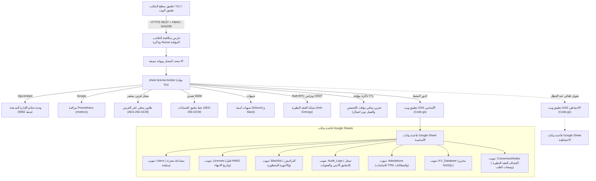

<div align="center">

<!-- 10-Language Navigation Bar -->
<p align="center">
  <a href="../../README.md">🇺🇸 English</a> · <a href="./ko.md">🇰🇷 한국어</a> · <a href="./zh-CN.md">🇨🇳 简体中文</a> · <a href="./ja.md">🇯🇵 日本語</a> · <a href="./es.md">🇪🇸 Español</a><br />
  <a href="./fr.md">🇫🇷 Français</a> · <a href="./ru.md">🇷🇺 Русский</a> · <a href="./pt-BR.md">🇧🇷 Português</a> · <b>🇸🇦 العربية</b> · <a href="./hi.md">🇮🇳 हिन्दी</a>
</p>

# Sheet-License-Broker

<p align="center">
  <strong>بوابة خالية من الخوادم للمصادقة وإدارة التراخيص وقواعد بيانات NoSQL مدعومة بواسطة جداول بيانات Google و Google Apps Script</strong>
</p>

<p align="center">
  
  
  
  
  
  
  
  
  
  
  
  
  
  
  
  
  
  
</p>

</div>

---

## 💡 نظرة عامة (Overview)

يقوم **`sheet-license-broker`** بتحويل أي جدول بيانات Google Sheets إلى واجهة خلفية بدون خادم (Serverless) وجاهزة للإنتاج مع ميزات المصادقة وإدارة التراخيص، مخصصة لتطبيقات سطح المكتب وأدوات الأوامر (CLI) ومشاريع SaaS الفردية.

بدلاً من دفع تكاليف باهظة لمثيلات قواعد البيانات السحابية أو إدارة حاويات Docker لمجرد معالجة تسجيل دخول المستخدمين ومفاتيح تراخيص البرامج، يجمع `sheet-license-broker` بين محرك سحابي قائم على **Google Apps Script (GAS)** مع **بوابة عالية السرعة بلغة Go، وسلاسل توقيع ML-DSA لمرحلة ما بعد الكم، وإجماع نصاب Raft الموزع، ومزامنة CRDT LWW-Element-Set، وبوابة الحافة من Cloudflare Edge Gateway، وإثبات العتاد المشفر (TPM 2.0 و Enclaves)، ومساحات الأسماء متعددة المستأجرين، وجاهزية عالية بتكوين نشط-احتياطي عبر جدولين، وأعلام الميزات الديناميكية وقياس الاستخدام حسب المستوى، وتخزين مؤقت مشفر على القرص المحلي، ومقاييس Prometheus، والتحقق التشفيري ضد التلاعب بـ HMAC، وتخزين مؤقت مرن للعمل دون اتصال، وواجهة مستخدم ويب مدمجة**.

### لماذا استخدام Google Sheets كقاعدة بيانات؟
- **Zero Cost ($0/mo) - تكلفة منعدمة (0$ شهرياً)**: الاستفادة من الحصص المجانية لـ Google Drive و Apps Script (ما يصل إلى 20,000 طلب يومياً).
- **Post-Quantum Cryptography & ML-DSA Signature Chains (NIST FIPS 204)**: التحقق من التواقيع الرقمية القائمة على الشبكات المشبكية (Module-Lattice) والمقاومة للحوسبة الكمومية (ML-DSA-44 / ML-DSA-65) مع سلاسل توقيع هجينة كلاسيكية ECDSA وشبكية (`Hybrid-P256-MLDSA65`)، وفترات سماح لتدوير المفاتيح بدون أي توقف، وبث فوري لإلغاء التراخيص عبر مفتاح إيقاف الطوارئ (Kill-Switch).
- **Behavioral Anomaly Detection & Adaptive Risk Scoring**: تتبع انحراف نبضات القلب إحصائياً عبر نافذة منزلقة Z-Score (مع سماحية تذبذب &plusmn;15%)، واكتشاف السفر المستحيل بسرعة هافرسين (&gt;950 كم/ساعة أو شبكات فرعية متزامنة /24)، وحساب درجات المخاطر التكيفية مع تلاشٍ اسمي تدريجي، وتصعيد تحدي إعادة الإثبات التشفيري آلياً عند وصول درجة الخطر إلى &ge; 50، والحجر التلقائي بمبدأ انعدام الثقة (Zero-Trust) عند وصول درجة الخطر إلى &ge; 85، ومصدّر موحد لرسم طوبولوجيا الحوادث الأمنية (`siem-topology-v1`) للتكامل مع أنظمة SIEM المؤسسية.
- **Enterprise Single Sign-On (SSO) & SCIM 2.0 Directory Provisioning**: اتحاد الهوية عبر SAML 2.0 و OIDC، ومزامنة الأدلة المؤسسية وفقاً لمعايير RFC 7643/7644، وتخصيص مقاعد التراخيص تلقائياً، وإلغاء فوري للتراخيص عند إنهاء التعيين (Deprovisioning).
- **Zero-Knowledge Proof (ZKP) Anonymous Verification**: التزامات Pedersen على منحنى NIST P-256 مع مولدات مستقلة حتمية بطريقة التجزئة إلى المنحنى (Hash-to-Curve)، وبراهين عرض سيغما (Sigma) غير التفاعلية (المحولة عبر Fiat-Shamir)، وسجلات مكافحة إعادة تشغيل المعرفات الفارغة المستهلكة (Nullifiers) لحماية خصوصية عتاد العميل.
- **Distributed Raft Quorum Consensus & CRDT Mesh**: انتخاب قائد خفيف الوزن، وتوافق سجلات الأغلبية، وتكرار الحالة الخالي من التعارض LWW-Element-Set، وخلاصات أشجار ميركل (Merkle Tree) باستخدام SHA-256 لمزامنة مكافحة التشتت (Anti-Entropy) عبر عُقد الوسيط الموزعة.
- **Enterprise Rate-Limiting & Progressive Backoff**: تقييد آمن عبر الخيوط (Thread-safe) بنافذة منزلقة لكل عنوان IP ورمز عتاد (HWID) مع عقوبات تأخير تصاعدية وترويسات معيارية `X-RateLimit-*`.
- **Sliding-Window IP/HWID Reputation Cache**: فرض حظر مؤقت تلقائي وتنبيهات Webhook عالية الأولوية للحوادث الأمنية عند تكرار الانتهاكات.
- **Encrypted Audit Token Export for SIEM**: حزم تدقيق مشفرة متوافقة بـ AES-256-GCM ومختومة بتواقيع HMAC مخصصة للاستيعاب في Splunk و Datadog و AWS CloudWatch.
- **Cryptographic Hardware Attestation & Enclave Binding**: التحقق من اقتباسات سجلات PCR لشريحة TPM 2.0 وإثبات مفاتيح عتاد Apple Secure Enclave / Windows Hello لمنع هجمات الاستنساخ.
- **Client Anti-Debugging & Memory-Tamper Telemetry**: تقييم مستمر للنزاهة مع فرض حظر تلقائي فوري للأجهزة التي يظهر فيها ربط منقح برمجي أو تعديل في أقسام الكود عبر مفتاح إيقاف سريع.
- **Dynamic Feature Flags & Usage-Based Tier Metering**: مستويات اشتراك مجانية ومحترفة ومؤسسية (Free و Pro و Enterprise) مع بوابات تشغيل الميزات في وقت التشغيل (`client.isFeatureEnabled("analytics")`) وتتبع حصص الاستهلاك الذرية المسجلة مباشرة في Google Sheets.
- **Dual-Sheet Active-Standby Replication**: التبديل التلقائي عند الأعطال (Failover) بين الجدولين الأساسي والاحتياطي مع تسوية ثنائية خالية من التصادم.
- **Encrypted Local Disk Spool**: طابور أحداث على القرص مشفر بـ AES-256-GCM (`spool.bin`) يضمن عدم فقدان أي بيانات أثناء انقطاع اتصال الشبكة.
- **Enterprise Prometheus Telemetry (`/metrics`)**: نقطة نهاية مدمجة لتجميع المقاييس تعرض العدادات ومقاييس الأداء وأوقات الاستجابة بتنسيق Prometheus.
- **Incident Alert Webhooks**: إشعارات غنية وفورية بالحوادث الأمنية يتم إرسالها إلى قنوات Discord و Slack.
- **Multi-Tenant Namespacing**: عزل المنتجات والمستأجرين المختلفين ببادئات مخصصة (مثل `ACME-LIC-XXXX-YYYY`) وسياسات مستقلة.
- **Cloudflare Edge Gateway**: تحقق من التراخيص في أجزاء من الميلي ثانية على الحافة عبر Cloudflare Workers و Workers KV مع واجهة Web Crypto API.
- **Human-Readable Admin Panel**: جدول بيانات Google Sheets هو قاعدة بياناتك؛ يمكنك عرض التراخيص أو تعديلها أو حظرها أو منحها مباشرة في الوقت الفعلي.
- **Hardware-Locked Protection (HWID)**: قفل مفاتيح الترخيص على معرّفات عتاد أجهزة محددة عند أول عملية تشغيل.
- **Cryptographic HMAC-SHA256 Anti-Tamper**: حماية حركة مرور العميل الواردة ضد اعتراض الوسيط (MITM) والتزييف بالهندسة العكسية للحمولات.
- **Sliding-Window Nonce Replay Mitigation**: منع هجمات إعادة إرسال الطلبات مع نافذة سماح لانحراف التوقيت الزمني قدرها 5 دقائق.
- **Instant Remote Revocation & Device Blacklisting**: تعطيل التراخيص أو حظر معرّفات العتاد المخترقة مباشرة من وحدة تحكم الويب أو من تبويب Google Sheets.
- **Automated Backup & Disaster Recovery**: تصدير حالة النظام واستعادتها في أي نقطة زمنية مع حماية بـ AES-256-GCM وتجزئة SHA-256 للتحقق من سلامة البيانات.
- **Real-Time Lifecycle Webhooks**: موزعو أحداث مع طوابير معالجة وتسليم خطافات ويب موقعة بـ HMAC إلى نقاط نهاية المستأجر والنقاط العالمية.
- **Salted SHA-256 Authentication**: تمليح كلمات المرور وتجزئتها تشفيرياً قبل تخزينها.
- **Resilient Local Caching & Offline Grace**: تراخيص ومستندات KV مخزنة في الذاكرة للحماية من حدود معدل واجهة Google API (رمز 429) وانقطاعات الشبكة اللحظية.
- **Embedded Web Dashboard**: ملف تنفيذي مفرد قائم بذاته (`sheet-license-broker.exe`) مزود بوحدة تحكم إدارة ذات طابع زمردي داكن.

---

## 🏛️ Architecture



---

## 🚀 Quick Start

### 1. Run the Local Gateway & Dashboard (تشغيل البوابة ولوحة التحكم محلياً)

تأكد من تثبيت بيئة Go 1.22+ على جهاز العمل الخاص بك:

```bash
# استنساخ المستودع
git clone https://github.com/kLauncher1/sheet-license-broker.git
cd sheet-license-broker

# بناء وتشغيل الملف الثنائي المفرد في الوضع المستقل
go run .
```

افتح المتصفح عند الرابط **`http://localhost:9082`** للوصول إلى لوحة التحكم المباشرة للإدارة.

### 2. Connect to Live Google Sheets (Proxy Mode) (الربط مع جداول Google Sheets الحية - وضع البروكسي)

لربط الوسيط بتطبيق الويب المنشور على Google Apps Script لديك:

```bash
# ضبط عنوان URL لتطبيق الويب Apps Script
export GAS_WEBAPP_URL="https://script.google.com/macros/s/.../exec"
export CACHE_TTL_SECONDS="600" # اختياري: مدة التخزين المؤقت 10 دقائق (600 ثانية)

# تشغيل البوابة
./sheet-license-broker.exe
```

يتعرف الخادم تلقائياً على عنوان URL البعيد، ويعيد توجيه الاستعلامات الواردة، ويخزن النتائج مؤقتاً محلياً، ويتراجع بشفافية وسلاسة إلى البيانات المخزنة مؤقتاً أثناء انقطاعات الشبكة.

---

## 📋 Google Sheets Setup & Clasp Deployment

### Option A: Clasp CLI Zero-Click Deployment (الخيار أ: النشر التلقائي بنقرة واحدة عبر Clasp CLI)

إذا كنت تستخدم أداة `@google/clasp` عبر واجهة سطر الأوامر (CLI):

```bash
# 1. تسجيل الدخول إلى حساب Google الخاص بك
npx @google/clasp login

# 2. النشر باستخدام السكربت المساعد الآلي
node scripts/deploy_clasp.mjs --script-id <YOUR_APPS_SCRIPT_ID>
```

راجع [`gas/README.md`](../../gas/README.md) للحصول على التعليمات الكاملة حول إنشاء وتكوين مشاريع Clasp.

### Option B: Manual Setup (3 Minutes) (الخيار ب: الإعداد اليدوي - 3 دقائق)

1. افتح [Google Sheets](https://sheets.new) وأنشئ جدول بيانات فارغاً جديداً.
2. في القائمة العلوية، انتقل إلى **الإضافات (Extensions) > Apps Script**.
3. استبدل الكود الافتراضي بمحتويات ملف [`gas/Code.gs`](../../gas/Code.gs).
4. انقر فوق **نشر (Deploy) > نشر جديد (New deployment)**:
   - النوع: **تطبيق ويب (Web app)**
   - التنفيذ باسم: **أنا (بريدك الإلكتروني) (Me)**
   - من يملك حق الوصول: **الجميع (Anyone)**
5. انقر على **نشر (Deploy)** وانسخ **عنوان URL لتطبيق الويب** الخاص بك (`https://script.google.com/macros/s/.../exec`).

سيعمل جدول Google Sheet الخاص بك تلقائياً على إنشاء ثلاثة تبويبات مخصصة عند استلام أول طلب:
- **`Users`**: `user_id`، `username`، `password_hash`، `salt`، `role`، `created_at`
- **`Licenses`**: `license_key`، `bound_hwid`، `max_devices`، `status`، `expires_at`، `created_at`
- **`KV_Database`**: `collection`، `doc_id`، `payload`، `updated_at`

---

## 📡 REST API Specification

### Health & Diagnostics

#### Get Service Health & Proxy Status
```http
GET /api/health
```

#### Ping Backend
```http
GET /api/proxy/ping
```

---

### Authentication

#### Register User
```http
POST /api/users/register
Content-Type: application/json

{
  "username": "developer",
  "password": "SecurePassword123!",
  "role": "admin"
}
```

#### Authenticate / Login
```http
POST /api/users/login
Content-Type: application/json

{
  "username": "developer",
  "password": "SecurePassword123!"
}
```

---

### License Management

#### Issue License Key
```http
POST /api/licenses
Content-Type: application/json

{
  "days": 30,
  "max_devices": 1
}
```
**Response:**
```json
{
  "license_key": "KEY-7F2A-9C4B-E108",
  "bound_hwid": "",
  "max_devices": 1,
  "status": "ACTIVE",
  "expires_at": "2026-11-12T12:00:00Z",
  "created_at": "2026-10-13T12:00:00Z"
}
```

#### Validate & Bind HWID
```http
POST /api/licenses/validate
Content-Type: application/json

{
  "license_key": "KEY-7F2A-9C4B-E108",
  "hwid": "WIN-B829-94AA-0123"
}
```
**Response:**
```json
{
  "valid": true,
  "license_key": "KEY-7F2A-9C4B-E108",
  "hwid_bound": "WIN-B829-94AA-0123",
  "expires_at": "2026-11-12T12:00:00Z",
  "source": "remote_gas"
}
```

*Note: If the license is active and unbound, it locks to the submitted `hwid`. Subsequent calls from matching hardware succeed; calls from mismatched hardware are rejected. Responses also indicate whether the result was served from `cache`, `remote_gas`, or `offline_cache`.*

---

### Anti-Tamper & Security

#### HMAC-SHA256 Request Signing
When `HMAC_ENFORCE=true` (or when `HMAC_SECRET` is configured), clients protect requests from MITM interception using standard headers:
- `X-Signature`: Hex-encoded HMAC-SHA256 signature calculated over `METHOD\nPATH\nTIMESTAMP\nNONCE\nSHA256(BODY)`.
- `X-Timestamp`: Current Unix timestamp in seconds (enforces a sliding 5-minute clock drift window).
- `X-Nonce`: Unique cryptographic nonce string per request (prevents replay attacks).

#### Revoke License Key
```http
POST /api/licenses/revoke
Content-Type: application/json

{
  "license_key": "KEY-7F2A-9C4B-E108",
  "reason": "Payment refunded"
}
```

#### Blacklist Device Hardware ID (HWID)
```http
POST /api/security/blacklist
Content-Type: application/json

{
  "type": "device",
  "target": "WIN-B829-94AA-0123",
  "reason": "Fraudulent key sharing"
}
```

#### List Blacklist & Revocation Entries
```http
GET /api/security/blacklist
```

---

### NoSQL Key-Value Store

#### Store Document
```http
POST /api/docs
Content-Type: application/json

{
  "collection": "user_settings",
  "doc_id": "usr_9918",
  "payload": "{\"dark_mode\":true,\"telemetry\":false}"
}
```

#### Fetch All Documents
```http
GET /api/docs
```

---

### Multi-Tenant Namespaces

#### Register Tenant
```http
POST /api/tenants/register
Content-Type: application/json

{
  "id": "tenant-gamehub",
  "name": "GameHub Studio",
  "namespace_prefix": "GHUB",
  "max_licenses": 100,
  "webhook_url": "https://api.gamehub.com/webhooks"
}
```

#### Issue Tenant-Namespaced License
```http
POST /api/licenses
Content-Type: application/json
X-Tenant-ID: tenant-gamehub

{
  "days": 60,
  "max_devices": 2
}
```
*Generates formatted keys conforming to `GHUB-LIC-XXXX-YYYY`.*

---

### Automated Backup & Disaster Recovery

#### Export Encrypted Backup (AES-256-GCM + SHA-256 Integrity)
```http
POST /api/backup/export
Content-Type: application/json

{
  "secret_key": "your-backup-master-passphrase"
}
```

#### Restore From Snapshot
```http
POST /api/backup/restore
Content-Type: application/json

{
  "secret_key": "your-backup-master-passphrase",
  "encrypted_payload": "<hex-encoded-ciphertext>"
}
```

---

### Dynamic Feature Flags & Usage-Based Tier Metering

#### List Standard Feature Catalogue & Tiers
```http
GET /api/features
```
**Response:**
```json
{
  "tiers": {
    "free": {
      "name": "free",
      "features": ["basic_access"],
      "daily_quotas": { "api_calls": 500, "export_rows": 100 }
    },
    "pro": {
      "name": "pro",
      "features": ["basic_access", "analytics", "csv_export", "extended_logs"],
      "daily_quotas": { "api_calls": 50000, "export_rows": 100000 }
    },
    "enterprise": {
      "name": "enterprise",
      "features": ["basic_access", "analytics", "csv_export", "extended_logs", "sso", "audit_export", "unlimited_seats", "priority_support"],
      "daily_quotas": { "api_calls": 10000000, "export_rows": 50000000 }
    }
  }
}
```

#### Check License Feature Entitlement
```http
POST /api/features/check
Content-Type: application/json

{
  "license_key": "KEY-7F2A-9C4B-E108",
  "feature": "analytics"
}
```
**Response:**
```json
{
  "license_key": "KEY-7F2A-9C4B-E108",
  "feature": "analytics",
  "tier": "pro",
  "allowed": true
}
```

#### Record Usage & Enforce Tier Quotas
```http
POST /api/usage/record
Content-Type: application/json

{
  "license_key": "KEY-7F2A-9C4B-E108",
  "metric": "api_calls",
  "units": 1
}
```
**Response:**
```json
{
  "license_key": "KEY-7F2A-9C4B-E108",
  "metric": "api_calls",
  "units": 1,
  "current_usage": 42,
  "daily_quota": 50000,
  "quota_exceeded": false,
  "success": true
}
```

#### Query Usage Statistics
```http
GET /api/usage/stats?license_key=KEY-7F2A-9C4B-E108
```
**Response:**
```json
{
  "license_key": "KEY-7F2A-9C4B-E108",
  "date": "2026-10-14",
  "tier": "pro",
  "metrics": {
    "api_calls": 42
  }
}
```

---

### Hardware Attestation & Anti-Tamper Telemetry

#### Request TPM / Enclave Challenge Nonce
```http
POST /api/attestation/challenge
Content-Type: application/json

{
  "license_key": "KEY-7F2A-9C4B-E108",
  "hwid": "WIN-B829-94AA-0123"
}
```
**Response:**
```json
{
  "status": "success",
  "challenge_id": "9a4f2b1c8e3d",
  "nonce": "e3b0c44298fc1c149afbf4c8996fb92427ae41e4649b934ca495991b7852b855",
  "expires_at": "2026-10-14T12:05:00Z"
}
```

#### Verify TPM 2.0 PCR Quote
```http
POST /api/attestation/verify
Content-Type: application/json

{
  "license_key": "KEY-7F2A-9C4B-E108",
  "hwid": "WIN-B829-94AA-0123",
  "challenge_id": "9a4f2b1c8e3d",
  "attestation_type": "tpm2",
  "tpm_quote": {
    "pcr_values": {
      "0": "e3b0c44298fc1c149afbf4c8996fb92427ae41e4649b934ca495991b7852b855",
      "7": "ba7816bf8f01cfea414140de5dae2223b00361a396177a9cb410ff61f20015ad"
    },
    "pcr_selection": [0, 7],
    "composite_digest": "4a5b6c7d8e9f...",
    "signature": "3045022100...",
    "ak_public_key_pem": "-----BEGIN PUBLIC KEY-----\n..."
  }
}
```

#### Transmit Anti-Debugging & Integrity Telemetry
```http
POST /api/attestation/telemetry
Content-Type: application/json

{
  "license_key": "KEY-7F2A-9C4B-E108",
  "hwid": "WIN-B829-94AA-0123",
  "report": {
    "debugger_present": false,
    "memory_integrity": true,
    "sandbox_detected": false,
    "hooks_detected": false,
    "process_checksum": "a1b2c3d4e5f6...",
    "execution_uptime_s": 3600
  }
}
```

---

### 🛡️ Enterprise Rate Limiting & SIEM Audit Export

#### Rate Limiter & IP Reputation Telemetry
```http
GET /api/security/ratelimit/status
GET /api/security/reputation
```

#### Impose / List Temporary Restrictions
```http
# List active temporary bans (عرض قرارات الحظر المؤقت النشطة)
GET /api/security/bans

# Impose temporary restriction (فرض حظر أو قيد مؤقت)
POST /api/security/bans
Content-Type: application/json

{
  "key": "198.51.100.24",
  "reason": "Repeated failed validation attempts",
  "duration_minutes": 15
}

# Lift temporary restriction (رفع الحظر المؤقت)
POST /api/security/bans/unban
Content-Type: application/json

{
  "key": "198.51.100.24"
}
```

#### Export Encrypted Audit Bundle (for SIEM / SOC Ingestion)
```http
POST /api/security/audit/export
Content-Type: application/json

{
  "secret_key": "enterprise-compliance-secret",
  "limit": 500
}
```

#### Verify & Decrypt Audit Bundle
```http
POST /api/security/audit/verify
Content-Type: application/json

{
  "secret_key": "enterprise-compliance-secret",
  "bundle": { ... }
}
```

---

### 🌐 Distributed Consensus & Multi-Region Quorum Sync

#### Cluster Status & Peer Topology
```http
GET /api/consensus/status
GET /api/consensus/peers
```

Response:
```json
{
  "node_id": "node-1",
  "role": "Leader",
  "current_term": 1,
  "commit_index": 4,
  "peer_count": 2,
  "healthy_peers": 2,
  "has_quorum": true,
  "merkle_digest": "4a7d1ed414474e4033ac29ccb8653d9b...",
  "element_count": 128
}
```

#### Join Cluster Peer
```http
POST /api/consensus/peers/join
Content-Type: application/json

{
  "node_id": "node-2",
  "address": "http://192.168.1.50:9082"
}
```

#### Trigger Anti-Entropy State Synchronization
```http
POST /api/consensus/sync/trigger
```

---

### ⚡ Real-Time WebSocket Streaming & Telemetry Push

#### Bidirectional WebSocket Telemetry Stream
قم بربط عملاء WebSocket المستمرين بالمسار `/api/stream/ws` لبث القياسات في الوقت الفعلي ودفع إشارات مفتاح الإيقاف في أجزاء من الثانية:

```http
GET /api/stream/ws?license_key=SLB-XXXX-XXXX&hwid=HWID-1234 HTTP/1.1
Host: localhost:9082
Upgrade: websocket
Connection: Upgrade
Sec-WebSocket-Key: dGhlIHNhbXBsZSBub25jZQ==
Sec-WebSocket-Version: 13
```

#### Query Connected Streaming Clients & Telemetry
```http
# List active streaming sessions (استعراض جلسات البث النشطة)
GET /api/stream/clients

# Query streaming metrics and recent event audit log (الاستعلام عن مقاييس البث وسجل التدقيق الأخير للأحداث)
GET /api/stream/telemetry
```

#### Execute Instantaneous Remote Kill-Switch
```http
POST /api/stream/kill
Content-Type: application/json

{
  "target": "SLB-XXXX-XXXX",
  "reason": "Suspected device cloning or fraud",
  "immediate": true
}
```
*Note: Target can be a specific License Key, Device HWID, Client ID, or `"ALL"` for emergency broadcast kill-switch execution. Signals are pushed to matching client sockets with sub-second delivery.*

*(ملاحظة: يمكن أن يكون الهدف مفتاح ترخيص معين، أو رمز عتاد HWID لجهاز، أو معرّف عميل Client ID، أو `"ALL"` لتنفيذ بث إيقاف طوارئ شامل لكافة الأجهزة. يتم دفع الإشارات إلى مقابس العملاء المتطابقة مع تسليم فوري في أقل من ثانية).*

---

### 🕵️ Zero-Knowledge Proof (ZKP) Anonymous Verification

#### Fetch NIST P-256 Public Parameters & Generators
```http
GET /api/zkp/params
```

#### Issue Anonymous Blinded Credential
```http
POST /api/zkp/credential/issue
Content-Type: application/json

{
  "license_key": "LIC-ENTERPRISE-001",
  "tenant_id": "default",
  "hwid": "WIN-B829-94AA-0123",
  "tier": "enterprise",
  "max_seats": 5
}
```

#### Verify Zero-Knowledge Presentation Proof (Sigma Protocol)
```http
POST /api/zkp/verify
Content-Type: application/json

{
  "credential": { ... },
  "required_tier": "enterprise"
}
```

#### Inspect Spent Nullifier Status
```http
GET /api/zkp/nullifiers/check?nullifier=7f2a9c4b...
```

---

### 🔐 Enterprise Single Sign-On (SSO) & SCIM 2.0 Directory Provisioning

#### SAML 2.0 Service Provider Metadata
قم بتنزيل ملف بيانات التعريف القياسي SP metadata بتنسيق XML لأنظمة Okta أو Azure AD أو PingFederate:
```http
GET /api/sso/saml/metadata?entity_id=urn:sheet-license-broker:sp
```

#### SAML 2.0 Assertion Consumer Service (ACS)
معالجة توكيدات SAML الواردة وإصدار رموز جلسات موثوقة:
```http
POST /api/sso/saml/acs
Content-Type: application/x-www-form-urlencoded

SAMLResponse=PHNhbWxwOlJlc3BvbnNlIHhtbG5z...
```

#### OpenID Connect (OIDC) Callback
التحقق من رموز الهوية (ID Tokens) والمطالبات الصادرة من Google Workspace أو Auth0 أو Keycloak:
```http
POST /api/sso/oidc/callback
Content-Type: application/json

{
  "sub": "usr_9918",
  "email": "alice@company.com",
  "iss": "https://accounts.google.com",
  "aud": "sheet-license-broker",
  "exp": 1776250000
}
```

#### Identity Provider (IdP) Management
```http
# Register new SAML or OIDC IdP (تسجيل مزود هوية جديد بـ SAML أو OIDC)
POST /api/sso/idp
Content-Type: application/json

{
  "id": "okta-corp",
  "protocol": "saml",
  "entity_id": "http://www.okta.com/exk123456",
  "sso_url": "https://company.okta.com/app/sso",
  "tenant_id": "default",
  "enabled": true
}

# List registered IdPs (استعراض مزودي الهوية المسجلين)
GET /api/sso/idp
```

#### SCIM 2.0 Directory Provisioning (RFC 7644)
ربط إدارة دورة حياة مستخدمي الشركات مباشرة مع Okta أو Microsoft Entra ID (Azure AD) أو OneLogin:

```http
# Service Provider Configuration (تكوين مزود الخدمة)
GET /scim/v2/ServiceProviderConfig

# List directory users (paginated) (استعراض مستخدمي الدليل مع دعم الصفحات)
GET /scim/v2/Users?startIndex=1&count=50

# Provision user (automatically allocates license seat) (تخصيص مستخدم مع حجز مقعد ترخيص آلياً)
POST /scim/v2/Users
Content-Type: application/scim+json

{
  "schemas": ["urn:ietf:params:scim:schemas:core:2.0:User"],
  "userName": "alice@corp.com",
  "emails": [{ "value": "alice@corp.com", "primary": true }],
  "roles": [{ "value": "operator" }],
  "active": true
}

# Deprovision user (instantly revokes allocated license seat and pushes kill-switch) (إلغاء تخصيص المستخدم مع إلغاء مقعد الترخيص فوراً ودفع إشارة الإيقاف)
DELETE /scim/v2/Users/usr-okta-8821
```

#### Ephemeral RBAC Session Tokens
```http
# Mint ephemeral token (إنشاء رمز جلسة مؤقت)
POST /api/sso/token/mint
Content-Type: application/json

{
  "user_id": "usr_9918",
  "email": "alice@corp.com",
  "role": "admin",
  "scopes": ["license:read", "license:write", "sso:manage"]
}

# Introspect token and enforce scope permissions (فحص الرمز وفرض صلاحيات النطاق)
POST /api/sso/token/introspect
Content-Type: application/json

{
  "token": "sso_tok_7f2a9c4b...",
  "required_scope": "license:write"
}
```

---

### ⚛️ Post-Quantum Cryptography & ML-DSA Hybrid Signatures

#### Fetch NIST FIPS 204 Lattice Parameters & Active Key Info
```http
GET /api/pqc/params
```
**Response:**
```json
{
  "status": "success",
  "lattice": { "dimension": 256, "modulus": 8380417, "d": 13 },
  "primary_algorithm": "ML-DSA-65",
  "active_key_id": "pqc-key-9b0d-e626",
  "grace_window_days": 7
}
```

#### List Public Verification Keys
```http
GET /api/pqc/keys
```

#### Issue Hybrid Quantum-Resistant License Signature
```http
POST /api/pqc/sign
Content-Type: application/json

{
  "license_key": "LIC-PRO-2026-99",
  "hwid": "HWID-9B0D-E626-C8D9-6D4B",
  "payload": "entitlement-v1-pro-tier"
}
```
**Response:**
```json
{
  "status": "success",
  "signature": {
    "algorithm": "Hybrid-P256-MLDSA65",
    "key_id": "pqc-key-9b0d-e626",
    "classical_sig_b64": "MEUCIQD...",
    "pqc_sig_hex": "1f8e2a...",
    "payload_hash_hex": "e3b0c44...",
    "created_at": "2026-10-16T19:30:00Z"
  }
}
```

#### Verify Dual Classical & Lattice Signatures
```http
POST /api/pqc/verify
Content-Type: application/json

{
  "payload": "entitlement-v1-pro-tier",
  "signature": {
    "algorithm": "Hybrid-P256-MLDSA65",
    "key_id": "pqc-key-9b0d-e626",
    "classical_sig_b64": "MEUCIQD...",
    "pqc_sig_hex": "1f8e2a..."
  }
}
```
**Response:**
```json
{
  "status": "success",
  "result": {
    "valid": true,
    "algorithm": "Hybrid-P256-MLDSA65",
    "key_id": "pqc-key-9b0d-e626",
    "classical_valid": true,
    "pqc_valid": true
  }
}
```

#### Atomic Key Rotation with Grace Period
```http
POST /api/pqc/rotate
Content-Type: application/json

{
  "algorithm": "ML-DSA-65",
  "grace_days": 7,
  "reason": "Routine cryptographic key rollover"
}
```

#### Emergency Compromise Key Revocation
```http
POST /api/pqc/revoke
Content-Type: application/json

{
  "key_id": "pqc-key-old-compromised",
  "reason": "Private key leakage detected"
}
```

---

### 🛡️ Behavioral Anomaly Detection & Adaptive Risk Scoring

يتضمن `sheet-license-broker` محركاً على مستوى المؤسسات لاكتشاف الشذوذ السلوكي يتتبع الانحراف الإحصائي لنبضات القلب، وحركات السفر الجغرافي المستحيل، ويحسب درجات مخاطر ديناميكية عبر تطبيقات العملاء.

#### Adaptive Governance Policy (سياسة الحوكمة التكيفية)
- **Score 0 – 49 (Nominal / اسمي)**: تشغيل طبيعي ووصول غير مقيد. يؤدي النشاط الاسمي المستمر إلى تقليص نقاط المخاطر المتراكمة تدريجياً بمرور الوقت.
- **Score 50 – 84 (Suspicious / مشبوه)**: يتطلب تصعيد التحدي التشفيري. يفرض تحدي إعادة إثبات تشفيري صالح للاستخدام مرة واحدة لمدة 5 دقائق (`POST /api/anomaly/challenge/issue` و `/verify`).
- **Score 85 – 100 (High Risk / Compromised - عالي الخطورة / مخترق)**: حجر فوري بنموذج انعدام الثقة (Zero-Trust). يتم رفض طلبات التحقق (`POST /api/licenses/verify`) تلقائياً بالرمز HTTP 403 Forbidden، وتُبث التنبيهات فوراً إلى خطافات الويب الأمنية.

#### Record Client Telemetry Observation
```http
POST /api/anomaly/record
Content-Type: application/json

{
  "license_key": "SLB-PRO-2026-99",
  "hwid": "HWID-9B0D-E626-C8D9-6D4B",
  "ip": "198.51.100.24",
  "latitude": 37.5665,
  "longitude": 126.9780
}
```
**Response:**
```json
{
  "status": "recorded",
  "risk_score": {
    "entity_id": "SLB-PRO-2026-99",
    "score": 0,
    "classification": "NOMINAL",
    "challenge_required": false,
    "quarantined": false,
    "last_assessed": "2026-10-16T21:30:00Z"
  }
}
```

#### Query Adaptive Risk Score
```http
GET /api/anomaly/score?license_key=SLB-PRO-2026-99
```

#### Issue & Verify Re-Attestation Challenge
```http
# Issue challenge token (إصدار رمز التحدي)
POST /api/anomaly/challenge/issue
Content-Type: application/json

{
  "license_key": "SLB-PRO-2026-99",
  "hwid": "HWID-9B0D-E626-C8D9-6D4B"
}

# Verify challenge token (التحقق من رمز التحدي)
POST /api/anomaly/challenge/verify
Content-Type: application/json

{
  "challenge_token": "ch_7f2a9c4b..."
}
```

#### Export Security Incident Graph (SIEM Standard Feed)
تصدير عقد وروابط الحوادث الطوبولوجية المتوافقة مع معايير RFC والمنسقة لأنظمة Splunk و Datadog و Elastic و Microsoft Sentinel:
```http
GET /api/anomaly/graph?min_score=50&limit=50
```
**Response:**
```json
{
  "schema_version": "siem-topology-v1",
  "generated_at": "2026-10-16T21:30:00Z",
  "nodes": [
    { "id": "SLB-PRO-2026-99", "type": "CLIENT", "risk_score": 60, "first_seen": "...", "last_seen": "..." },
    { "id": "198.51.100.0/24", "type": "SUBNET", "risk_score": 30, "first_seen": "...", "last_seen": "..." }
  ],
  "edges": [
    { "id": "edge-1", "source_id": "SLB-PRO-2026-99", "target_id": "198.51.100.0/24", "relationship": "OBSERVED_IN_SUBNET", "weight": 60, "timestamp": "..." }
  ],
  "total_incidents": 1
}
```

#### Engine Telemetry Status
```http
GET /api/anomaly/status
```

---

## ⚡ Cloudflare Edge Gateway

للتحقق الموزع عالمياً من التراخيص في أجزاء من الميلي ثانية على الحافة، قم بنشر عامل Cloudflare Worker الموجود في المجلد `edge/cloudflare/`:

```bash
cd edge/cloudflare
wrangler deploy
```

- **Sub-10ms POP Verification**: يتحقق من صلاحية التراخيص مباشرة من ذاكرة التخزين المؤقت Cloudflare Workers KV.
- **Hardware Web Crypto**: توقيع HMAC-SHA256 على الحافة ومنع هجمات إعادة التشغيل قبل الوصول إلى الخادم الأصلي.
- **Automated Origin Fallback**: يتم تحويل الاستعلامات غير المخزنة مؤقتاً وعمليات ربط المفاتيح والإلغاء بسلاسة وبشكل شفاف إلى الخادم الأصلي.

---

## 💻 Multi-Language Client SDKs

يتضمن `sheet-license-broker` حزم تطوير برمجيات جاهزة للاستخدام في الإنتاج تحت الدليل `sdk/` تدعم الربط التلقائي بمعرّف عتاد الجهاز (HWID) وتوقيع الطلبات التشفيري بـ HMAC-SHA256.

### 🐍 Python Client (`sdk/python/sheet_license_client.py`)

بدون أي تبعيات خارجية (تعتمد كلياً على المكتبات القياسية `urllib` و `hashlib`):

```python
from sheet_license_client import SheetLicenseClient, get_machine_hwid

client = SheetLicenseClient(base_url="http://localhost:9082", secret_key="your-hmac-secret")

# 1. Verify license key (automatically attaches local machine HWID)
res = client.verify_license("SLB-XXXX-XXXX-XXXX")
if res.get("valid"):
    print("License verified. Tier:", res.get("tier"))

    # 2. Check dynamic feature flag entitlement
    if client.is_feature_enabled("SLB-XXXX-XXXX-XXXX", "analytics"):
        print("Analytics module enabled!")

    # 3. Record consumption towards tier quotas
    client.record_usage("SLB-XXXX-XXXX-XXXX", "api_calls", 1)

    # 4. Enterprise SSO & SCIM directory token check
    sso_status = client.get_sso_status()
    token_info = client.introspect_session_token("sso_tok_...", required_scope="license:write")

    # 5. Behavioral anomaly telemetry & risk scoring
    client.record_anomaly_telemetry("SLB-XXXX-XXXX-XXXX", latitude=37.5665, longitude=126.9780)
    risk = client.get_anomaly_risk_score(license_key="SLB-XXXX-XXXX-XXXX")
else:
    print("Denied:", res.get("message"))
```

### ⚡ C# / .NET & Unity (`sdk/csharp/SheetLicenseClient.cs`)

ملف مساعد مفرد متوافق مع بيئات Unity Mono/IL2CPP و WPF وتطبيقات .NET Desktop:

```csharp
using SheetLicenseBroker;

var client = new SheetLicenseClient("http://localhost:9082", "your-hmac-secret");

// Verify license and check tier entitlement
var result = await client.VerifyLicenseAsync("SLB-XXXX-XXXX-XXXX");
if (result.Valid) {
    Console.WriteLine($"Access granted! Tier: {result.Tier}, Expiry: {result.ExpirationDate}");

    // Dynamic feature gating
    if (await client.IsFeatureEnabledAsync("SLB-XXXX-XXXX-XXXX", "analytics")) {
        Console.WriteLine("Analytics initialized.");
    }

    // Record usage
    await client.RecordUsageAsync("SLB-XXXX-XXXX-XXXX", "api_calls", 1);

    // Enterprise SSO & SCIM directory token check
    var ssoStatus = await client.GetSSOStatusAsync();
    var tokenInfo = await client.IntrospectSessionTokenAsync("sso_tok_...", "license:write");

    // Behavioral anomaly telemetry & risk scoring
    await client.RecordAnomalyTelemetryAsync("SLB-XXXX-XXXX-XXXX", 37.5665, 126.9780);
    var risk = await client.GetAnomalyRiskScoreAsync("SLB-XXXX-XXXX-XXXX");
}
```

### 🟩 TypeScript & Node.js (`@sheet-license/client`)

حزمة ESM أصلية خالية من التبعيات الخارجية مخصصة لخوادم Node.js وتطبيقات Electron:

```typescript
import { SheetLicenseClient } from '@sheet-license/client';

const client = new SheetLicenseClient({
  baseUrl: 'http://localhost:9082',
  secretKey: 'your-hmac-secret',
});

const result = await client.verifyLicense('SLB-XXXX-XXXX-XXXX');
if (result.valid) {
  console.log('License active. Tier:', result.tier);

  // Dynamic feature gating
  const hasAnalytics = await client.isFeatureEnabled('SLB-XXXX-XXXX-XXXX', 'analytics');
  if (hasAnalytics) {
    console.log('Analytics feature enabled for client');
  }

  // Record usage metrics
  await client.recordUsage('SLB-XXXX-XXXX-XXXX', 'api_calls', 1);

  // Enterprise SSO & SCIM directory token check
  const ssoStatus = await client.getSSOStatus();
  const tokenInfo = await client.introspectSessionToken('sso_tok_...', 'license:write');

  // Behavioral anomaly telemetry & risk scoring
  await client.recordAnomalyTelemetry('SLB-XXXX-XXXX-XXXX', { latitude: 37.5665, longitude: 126.9780 });
  const risk = await client.getAnomalyRiskScore('SLB-XXXX-XXXX-XXXX');
}
```

### 🔷 Go Client (`sdk/go/client.go`)

```go
package main

import (
	"context"
	"fmt"
	"time"

	"github.com/kLauncher1/sheet-license-broker/sdk/go"
)

func main() {
	client := sdk.NewClient("http://localhost:9082", []byte("your-hmac-secret"), 5*time.Second)

	res, err := client.VerifyLicense(context.Background(), "SLB-XXXX-XXXX-XXXX", "")
	if err == nil && res.Valid {
		fmt.Printf("License valid (Tier: %s). Launching application...\n", res.Tier)

		// Dynamic feature gating
		allowed, _ := client.IsFeatureEnabled(context.Background(), "SLB-XXXX-XXXX-XXXX", "analytics")
		if allowed {
			fmt.Println("Analytics feature enabled.")
		}

		// Record usage consumption
		_ = client.RecordUsage(context.Background(), "SLB-XXXX-XXXX-XXXX", "api_calls", 1)

		// Enterprise SSO & SCIM directory token check
		ssoStatus, _ := client.GetSSOStatus(context.Background())
		tokenInfo, _ := client.IntrospectSessionToken(context.Background(), "sso_tok_...", "license:write")
		_ = ssoStatus
		_ = tokenInfo

		// Behavioral anomaly telemetry & risk scoring
		_ = client.RecordAnomalyTelemetry(context.Background(), sdk.ClientObservation{
			LicenseKey: "SLB-XXXX-XXXX-XXXX",
			Latitude:   37.5665,
			Longitude:  126.9780,
		})
		risk, _ := client.GetAnomalyRiskScore(context.Background(), "SLB-XXXX-XXXX-XXXX", "")
		_ = risk
	}
}
```

---

## 🛠️ Verification & Build

تشغيل مجموعة اختبارات التحقق الآلية:

```bash
# Execute unit tests across all packages (تنفيذ اختبارات الوحدة عبر جميع الحزم)
go test -v ./...

# Compile standalone production binary (بناء ملف تنفيذي مستقل للإنتاج)
go build -ldflags="-s -w" -o sheet-license-broker.exe .
```

---

## 📄 License

مرخص بموجب [ترخيص MIT](../../LICENSE).
