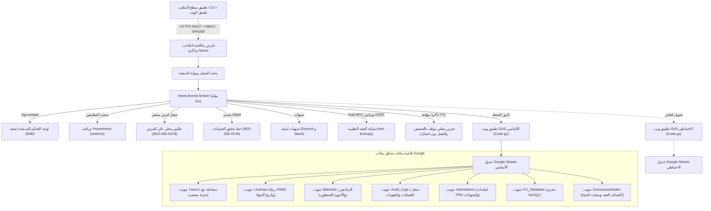

<div align="center">

<!-- 10-Language Navigation Bar -->
<p align="center">
  <a href="../../README.md">🇺🇸 English</a> · <a href="./ko.md">🇰🇷 한국어</a> · <a href="./zh-CN.md">🇨🇳 简体中文</a> · <a href="./ja.md">🇯🇵 日本語</a> · <a href="./es.md">🇪🇸 Español</a><br />
  <a href="./fr.md">🇫🇷 Français</a> · <a href="./ru.md">🇷🇺 Русский</a> · <a href="./pt-BR.md">🇧🇷 Português</a> · <b>🇸🇦 العربية</b> · <a href="./hi.md">🇮🇳 हिन्दी</a>
</p>

# Sheet-License-Broker

<p align="center">
  <strong>بوابة بدون خادم للمصادقة وإدارة التراخيص وقواعد بيانات NoSQL مدعومة بواسطة جداول بيانات Google و Google Apps Script</strong>
</p>

<p align="center">
  
  
  
  
  
  
  
  
  
  
  
  
  
  
  
  
  
  
</p>

</div>

---

## 💡 نظرة عامة (Overview)

يقوم **`sheet-license-broker`** بتحويل أي جدول بيانات في Google Sheets إلى خلفية برمجية سريعة وخالية من الخوادم (Serverless)، ومؤمنة بالكامل وجاهزة للإنتاج، مخصصة لتطبيقات سطح المكتب وأدوات الأوامر (CLI) ومشاريع SaaS الفردية.

لم تعد هناك حاجة لدفع اشتراكات شهرية باهظة لقواعد البيانات السحابية أو إدارة حاويات Docker معقدة لمجرد التحقق من تسجيل الدخول وتراخيص البرامج. يجمع `sheet-license-broker` بين محرك **Google Apps Script (GAS)** السحابي وبوابة فائقة السرعة مكتوبة بلغة **Go، وسلاسل تواقيع ما بعد الكم ML-DSA (NIST FIPS 204)، وإجماع نصاب Raft الموزع، وتزامن خالي من النزاعات CRDT LWW-Element-Set، وبوابة الحافة من Cloudflare، وإثبات عتاد التشفير (TPM 2.0 و Enclaves)، والعزل متعدد المستأجرين، والجاهزية العالية مع تبديل تلقائي بين جداول رئيسية واحتياطية، وأعلام الميزات الديناميكية مع قياس الاستهلاك، وقائمة انتظار مشفرة على القرص المحلي، ومقاييس Prometheus، وتأمين ضد التلاعب بتواقيع HMAC، وتخزين مؤقت مرن في وضع عدم الاتصال، ولوحة تحكم ويب مدمجة**.

### لماذا استخدام Google Sheets كقاعدة بيانات؟
- **تكلفة استضافة منعدمة (0$ شهرياً)**: الاستفادة من الحصص المجانية لحسابات Google Drive و Apps Script (تصل إلى 20,000 طلب يومياً).
- **تشفير ما بعد الكم وتواقيع ML-DSA (NIST FIPS 204)**: التحقق من التواقيع الرقمية المقاومة للحوسبة الكمومية والقائمة على الشبكات المشبكية (ML-DSA-44 / ML-DSA-65) مع سلاسل هجينة ECDSA / شبكات (`Hybrid-P256-MLDSA65`) وفترات سماح لتدوير المفاتيح بدون أي توقف، وبث فوري لإلغاء التراخيص في حالات الطوارئ.
- **كشف الشذوذ السلوكي وحساب المخاطر التكيفي**: تتبع انحراف نبضات القلب Z-Score بنافذة منزلقة (مع سماحية تذبذب &plusmn;15%)، واكتشاف الانتقال الجغرافي المستحيل باستخدام قانون هافرسين (&gt;950 كم/ساعة أو نشاط متزامن من شبكات /24)، وتطبيق نموذج تقليل المخاطر التلقائي، وفرض تحدي تشفير فوري عند وصول درجة الخطر &ge; 50، والعزل التلقائي بنموذج انعدام الثقة (Zero-Trust) عند درجة خطر &ge; 85، وتصدير رسم بياني للأحداث الأمنية متوافق مع معايير SIEM (`siem-topology-v1`).
- **تسجيل الدخول الموحد (SSO) وتخصيص SCIM 2.0 للمؤسسات**: دعم بروتوكولات SAML 2.0 و OIDC، ومزامنة المستخدمين تلقائياً وفقاً لمعيار RFC 7643/7644 مع حجز التراخيص تلقائياً وإلغائها فور إنهاء خدمة الموظف.
- **براهين المعرفة الصفرية (ZKP)**: التزامات Pedersen على منحنى NIST P-256، وبروتوكولات Sigma غير التفاعلية (تحويل Fiat-Shamir)، وسجل مكافحة إعادة استخدام المعرفات الفارغة (Nullifiers) لحماية خصوصية عتاد العميل.
- **إجماع نصاب Raft وشبكة CRDT**: انتخاب خفيف للقيادة، وتكرار السجلات بأغلبية النصاب، وحل النزاعات بدون تصادم، وخلاصات أشجار ميركل SHA-256 للمزامنة المنتظمة بين العقد.
- **تحديد معدل الطلبات وحظر التكرار**: تنظيم آمن للمؤشرات عبر نوافذ منزلقة لكل عنوان IP ورمز جهاز (HWID) مع فرض تأخيرات تصاعدية وترويسات `X-RateLimit-*`.
- **سجل السمعة والحظر التلقائي**: حظر مؤقت للعناوين المخالفة وتنبيهات فورية عبر Webhook للقنوات الأمنية.
- **تصدير حزم التدقيق المشفرة لمنصات SIEM**: حزم تدقيق مشفرة بتقنية AES-256-GCM ومختومة بتوقيع HMAC لتغذية أنظمة Splunk و Datadog و AWS CloudWatch.
- **إثبات عتاد العميل وتأمين الجهاز**: التحقق من قياسات PCR الصادرة عن شريحة TPM 2.0 ومفاتيح Apple Secure Enclave / Windows Hello لمنع استنساخ البرامج والأجهزة الافتراضية المقرصنة.
- **أعلام الميزات وقياس الاستهلاك**: مستويات اشتراك (Free و Pro و Enterprise) مع فحص الصلاحيات البرمجية آنياً (`client.isFeatureEnabled("analytics")`) والخصم التلقائي المسجل في Google Sheets.
- **التبديل التلقائي عند الأعطال (Active-Standby)**: نسخ متزامن بين الجدول الأساسي والاحتياطي مع تسوية ثنائية خالية من التصادم عند عودة الاتصال.
- **طابور قرص محلي مشفر**: طابور أحداث على القرص مشفر بـ AES-256-GCM (`spool.bin`) يضمن عدم فقدان أي معاملة أثناء انقطاع الإنترنت.
- **لوحة تحكم ويب مدمجة**: ملف تنفيذي مستقل فردي (`sheet-license-broker.exe`) يضم لوحة تحكم بالوضع الداكن الزمردي.

---

## 🏛️ البنية التحتية (Architecture)



---

## 🚀 البدء السريع (Quick Start)

### 1. تشغيل البوابة ولوحة التحكم محلياً

تأكد من تثبيت بيئة Go 1.22+ على جهازك:

```bash
# استنساخ المستودع
git clone https://github.com/kLauncher1/sheet-license-broker.git
cd sheet-license-broker

# تشغيل البوابة في الوضع المستقل
go run .
```

افتح المتصفح وتوجه إلى **`http://localhost:9082`** لفتح واجهة الإدارة التفاعلية.

### 2. الربط مع جداول Google Sheets الحية (وضع البروكسي)

قم بضبط متغيرات البيئة لربط البوابة بتطبيق Google Apps Script المنشور لديك:

```bash
# رابط تطبيق الويب الخاص بـ Apps Script
export GAS_WEBAPP_URL="https://script.google.com/macros/s/.../exec"
export CACHE_TTL_SECONDS="600" # اختياري: مدة التخزين المؤقت 10 دقائق

# تشغيل البوابة
./sheet-license-broker.exe
```

سيتعرف الخادم تلقائياً على الرابط، ويقوم بتمرير الطلبات وتخزين الاستجابات محلياً وتقديمها فورياً للعملاء حتى لو انقطع الاتصال بالإنترنت مؤقتاً.

---

## 📋 إعداد Google Sheets ونشر الكود باستخدام Clasp

### الخيار أ: النشر التلقائي عبر Clasp CLI

في حال توفر أداة `@google/clasp` لديك:

```bash
# 1. تسجيل الدخول إلى حساب Google
npx @google/clasp login

# 2. تشغيل سكربت النشر التلقائي
node scripts/deploy_clasp.mjs --script-id <معرف_مشروعك_APPS_SCRIPT_ID>
```

### الخيار ب: الإعداد اليدوي خلال 3 دقائق

1. افتح [Google Sheets](https://sheets.new) وأنشئ جدول بيانات فارغ.
2. من القائمة العلوية، اختر **الإضافات > Apps Script**.
3. امسح المحتوى الافتراضي والصق الكود الموجود في [`gas/Code.gs`](../../gas/Code.gs).
4. اضغط على **نشر > نشر جديد**:
   - النوع: **تطبيق ويب (Web app)**
   - التشغيل باسم: **أنا (بريدك الإلكتروني)**
   - من يملك حق الوصول: **الجميع (Anyone)**
5. اضغط **نشر** وانسخ **رابط تطبيق الويب** الناتج (`https://script.google.com/macros/s/.../exec`).

سيتم إنشاء علامات التبويب المطلوبة (`Users` و `Licenses` و `KV_Database`) تلقائياً بمجرد استلام أول طلب.

---

## 📡 ملخص مواصفات واجهة برمجة التطبيقات (REST API)

| المجال | الطريقة والمسار | الوصف |
| :--- | :--- | :--- |
| **التشخيص** | `GET /api/health` | الاستعلام عن الحالة العامة والتشغيلية للنظام |
| **التشخيص** | `GET /api/proxy/ping` | قياس زمن الاستجابة مع خادم Google Apps Script |
| **المصادقة** | `POST /api/users/register` | تسجيل مستخدم أو مسؤول مع التمليح وتجزئة SHA-256 |
| **المصادقة** | `POST /api/users/login` | التحقق من بيانات تسجيل الدخول |
| **التراخيص** | `POST /api/licenses` | إصدار مفتاح ترخيص جديد (الأيام وعدد الأجهزة) |
| **التراخيص** | `POST /api/licenses/validate` | التحقق من الترخيص وربطه تلقائياً برمز عتاد أول جهاز طالب |
| **التراخيص** | `POST /api/licenses/revoke` | إلغاء مفتاح ترخيص فوري وتعطيله |
| **الأمان** | `POST /api/security/blacklist` | حظر رمز جهاز HWID مسروق أو مفتاح ترخيص |
| **الأمان** | `GET /api/security/blacklist` | استعراض قائمة الحظر الحالية |
| **NoSQL** | `POST /api/docs` | حفظ مستند بتنسيق JSON ضمن مجموعة ومفتاح محدد |
| **NoSQL** | `GET /api/docs` | استرجاع كافة المستندات المحفوظة |
| **تعدد المستأجرين**| `POST /api/tenants/register` | إنشاء مستأجر مع بادئة مخصصة ومسار تنبيهات |
| **النسخ الاحتياطي**| `POST /api/backup/export` | تصدير لقطة مشفرة بـ AES-256-GCM لحالة النظام |
| **النسخ الاحتياطي**| `POST /api/backup/restore` | استرجاع فوري للبيانات من اللقطة المشفرة |
| **الميزات** | `GET /api/features` | استعراض الميزات المتاحة والحصص المحددة للخطط |
| **الميزات** | `POST /api/features/check` | التحقق مما إذا كان الترخيص مخولاً لتشغيل ميزة معينة |
| **عداد الاستهلاك**| `POST /api/usage/record` | تسجيل استهلاك العمليات مثل نداءات واجهة API |
| **إثبات العتاد** | `POST /api/attestation/challenge` | إنشاء تحدي Nonce صالح للاستخدام مرة واحدة لـ TPM 2.0 |
| **إثبات العتاد** | `POST /api/attestation/verify` | التحقق من قياسات PCR الموقعة من شريحة TPM 2.0 |
| **تحديد المعدل** | `GET /api/security/ratelimit/status`| متابعة مؤشرات النوافذ المنزلقة لعناوين IP و HWID |
| **الإجماع** | `GET /api/consensus/status` | مؤشرات إجماع Raft وتزامن بيانات CRDT |
| **البث المباشر** | `GET /api/stream/ws` | اتصال WebSocket ثنائي لإجراءات الحظر السريع |
| **ZKP** | `POST /api/zkp/verify` | فحص براهين المعرفة الصفرية دون الكشف عن البيانات |
| **SSO / SCIM** | `GET /api/sso/saml/metadata` | تنزيل ملف بيانات التعريف SP XML لأنظمة Okta و Azure |
| **SSO / SCIM** | `POST /scim/v2/Users` | إضافة موظف وحجز مقعد ترخيص آلياً عبر SCIM 2.0 |
| **ما بعد الكم** | `POST /api/pqc/sign` | توقيع هجين مقاوم للحواسيب الكمومية بنظام ML-DSA |
| **كشف الشذوذ** | `POST /api/anomaly/record` | إرسال القياسات السلوكية وتحديث تصنيف المخاطر |
| **بيانات SIEM** | `GET /api/anomaly/graph` | توليد رسم بياني لارتباطات الحوادث الأمنية لأنظمة SIEM |

---

## 💻 حزم تطوير البرمجيات للعملاء (SDKs)

### 🐍 عميل بايثون Python (`sdk/python/sheet_license_client.py`)
بدون أي مكتبات خارجية إضافية، يعتمد على مكتبات بايثون القياسية:

```python
from sheet_license_client import SheetLicenseClient

client = SheetLicenseClient(base_url="http://localhost:9082", secret_key="your-hmac-secret")

# 1. التحقق من الترخيص (يتم إرفاق HWID تلقائياً)
res = client.verify_license("SLB-XXXX-XXXX-XXXX")
if res.get("valid"):
    print("تم التحقق من الترخيص بنجاح. المستوى:", res.get("tier"))

    # 2. التحقق من صلاحية ميزة معينة
    if client.is_feature_enabled("SLB-XXXX-XXXX-XXXX", "analytics"):
        print("ميزة التحليلات مفعلة ومتاحة!")

    # 3. تسجيل الاستهلاك
    client.record_usage("SLB-XXXX-XXXX-XXXX", "api_calls", 1)
```

### ⚡ C# / .NET و Unity (`sdk/csharp/SheetLicenseClient.cs`)
متوافق مع Unity Mono/IL2CPP وتطبيقات WPF و .NET:

```csharp
using SheetLicenseBroker;

var client = new SheetLicenseClient("http://localhost:9082", "your-hmac-secret");
var result = await client.VerifyLicenseAsync("SLB-XXXX-XXXX-XXXX");
if (result.Valid) {
    Console.WriteLine($"تم منح الوصول! المستوى: {result.Tier}, ينتهي في: {result.ExpirationDate}");
}
```

### 🟩 TypeScript و Node.js (`@sheet-license/client`)
مناسب لخوادم Node.js وتطبيقات سطح المكتب المبنية بـ Electron:

```typescript
import { SheetLicenseClient } from '@sheet-license/client';

const client = new SheetLicenseClient({
  baseUrl: 'http://localhost:9082',
  secretKey: 'your-hmac-secret',
});

const result = await client.verifyLicense('SLB-XXXX-XXXX-XXXX');
if (result.valid) {
  console.log('الترخيص سارٍ ومفعل. الخطة:', result.tier);
}
```

### 🔷 عميل لغة Go (`sdk/go/client.go`)

```go
package main

import (
	"context"
	"fmt"
	"time"

	"github.com/kLauncher1/sheet-license-broker/sdk/go"
)

func main() {
	client := sdk.NewClient("http://localhost:9082", []byte("your-hmac-secret"), 5*time.Second)
	res, err := client.VerifyLicense(context.Background(), "SLB-XXXX-XXXX-XXXX", "")
	if err == nil && res.Valid {
		fmt.Printf("الترخيص صالح (المستوى: %s). يتم الآن تشغيل البرنامج...\n", res.Tier)
	}
}
```

---

## 🛠️ الاختبار والتحزيم

```bash
# تنفيذ حزمة الاختبارات الشاملة
go test -v ./...

# تصدير ملف تنفيذي موحد وجاهز للإنتاج
go build -ldflags="-s -w" -o sheet-license-broker.exe .
```

---

## 📄 الترخيص (License)

هذا المشروع منشور تحت بنود [ترخيص MIT](../../LICENSE).
