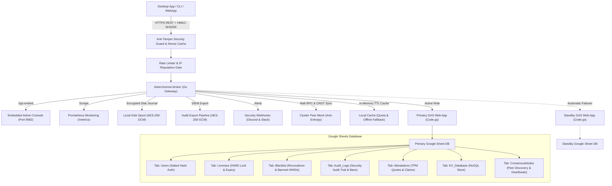

<div align="center">

<!-- 10-Language Navigation Bar -->
<p align="center">
  <b>🇺🇸 English</b> · <a href="./docs/locales/ko.md">🇰🇷 한국어</a> · <a href="./docs/locales/zh-CN.md">🇨🇳 简体中文</a> · <a href="./docs/locales/ja.md">🇯🇵 日本語</a> · <a href="./docs/locales/es.md">🇪🇸 Español</a><br />
  <a href="./docs/locales/fr.md">🇫🇷 Français</a> · <a href="./docs/locales/ru.md">🇷🇺 Русский</a> · <a href="./docs/locales/pt-BR.md">🇧🇷 Português</a> · <a href="./docs/locales/ar.md">🇸🇦 العربية</a> · <a href="./docs/locales/hi.md">🇮🇳 हिन्दी</a>
</p>

# 📑 Sheet-License-Broker

<p align="center">
  <strong>بوابة مصادقة بدون خادم، وإدارة تراخيص، وقاعدة بيانات NoSQL مدعومة بجداول بيانات Google و Google Apps Script</strong>
</p>

<p align="center">
  
  
  
  
  
  
  
  
  
  
  
  
  
  
  
  
  
  
  
  
</p>
</div>

---

<br />

<details open>
<summary><h3>💡 نظرة عامة وبنية النظام الأساسية</h3></summary>

يقوم **`sheet-license-broker`** بتحويل أي جدول بيانات Google Sheets إلى واجهة خلفية بدون خادم (Serverless) مؤمنة وجاهزة للإنتاج لتطبيقات سطح المكتب، وأدوات سطر الأوامر (CLI)، ومنتجات SaaS المستقلة.

بدلاً من دفع تكاليف باهظة لخوادم قواعد البيانات السحابية أو إدارة حاويات Docker المعقدة فقط لمصادقة المستخدمين وتراخيص البرامج، يجمع `sheet-license-broker` بين محرك سحابي **Google Apps Script (GAS)** مع **بوابة Go فائقة السرعة، وتوجيه Anycast جغرافي موزع مع ذاكرة تخزين مؤقت L1 بأقل من ميلي ثانية، وجسور الحوسبة السرية للأجهزة Intel SGX / AMD SEV-SNP، وسلاسل تواقيع ما بعد الكم ML-DSA، وتوافق إجماع Raft الموزع ومزامنة شبكة CRDT، وبوابة Cloudflare Edge، وتصديق الأجهزة المشفر (TPM 2.0 و Enclaves)، وعزل مساحات الأسماء متعددة المستأجرين، وتوافر عالٍ نشط-احتياطي ثنائي، وأعلام الميزات الديناميكية وقياس الاستخدام، وقائمة انتظار أقراص مشفرة، ومقاييس Prometheus، والتحقق ضد التلاعب HMAC، والتخزين المؤقت المحلي المرن، ولوحة تحكم ويب مدمجة**.


### 🏛️ طوبولوجيا بنية النظام



</details>

<br />

<details open>
<summary><h3>⚡ مصفوفة الميزات الكاملة وأبرز الخصائص</h3></summary>

### لماذا استخدام Google Sheets كواجهة خلفية؟
- **Zero Cost ($0/mo)**: Leverages Google Drive and Apps Script free quotas (up to 20,000 requests/day).
- **Geo-Distributed Edge CDN Anycast Routing & Sub-Millisecond L1 Cache**: Routes global requests to the nearest healthy Point of Presence (POP across Ashburn, San Jose, Frankfurt, Tokyo, Singapore, Sao Paulo) via Haversine spherical distance and dynamic active RTT telemetry. Delivers cached license lookups in under 100 microseconds with asynchronous Stale-While-Revalidate (SWR) and issues HMAC-signed emergency mitigation leases during network partitions.
- **Confidential Computing & Hardware Enclave Attestation Bridge**: Cryptographically validates Intel SGX Quote v3/v4 ECDSA P-256 signatures and AMD SEV-SNP 1184-byte signed attestation reports against MREnclave/MRSigner/ISVSVN policies. Negotiates ephemeral ECDH P-256 encrypted tunnels with RFC 5869 HKDF-SHA256 key expansion and AES-256-GCM, enabling zero-plaintext in-enclave evaluation where the host OS, hypervisor, and broker transit layers never observe cleartext keys.
- **Post-Quantum Cryptography & ML-DSA Signature Chains (NIST FIPS 204)**: Quantum-resistant module-lattice digital signature verification (ML-DSA-44 / ML-DSA-65) with dual classical ECDSA / lattice hybrid signature chains (`Hybrid-P256-MLDSA65`), zero-downtime key rotation grace windows, and instant emergency revocation kill-switch broadcasts.
- **Behavioral Anomaly Detection & Adaptive Risk Scoring**: Statistical sliding-window Z-Score heartbeat drift tracking (&plusmn;15% jitter tolerance), Haversine velocity impossible travel detection (&gt;950 km/h or concurrent /24 subnets), adaptive risk score calculation with progressive nominal decay, automated re-attestation challenge escalation at risk score &ge; 50, zero-trust automatic quarantine at risk score &ge; 85, and standardized security incident topology graph exporter (`siem-topology-v1`) for enterprise SIEM ingestion.
- **Enterprise Single Sign-On (SSO) & SCIM 2.0 Directory Provisioning**: SAML 2.0 & OIDC identity federation, RFC 7643/7644 directory synchronization, automated license seat allocation, and instant deprovisioning revocation.
- **Zero-Knowledge Proof (ZKP) Anonymous Verification**: Pedersen commitments over NIST P-256 with deterministic hash-to-curve independent generators, non-interactive Sigma presentation proofs (Fiat-Shamir transformed), and spent nullifier replay defense registries protecting client hardware privacy.
- **Distributed Raft Quorum Consensus & CRDT Mesh**: Lightweight leader election, majority log quorum, conflict-free LWW-Element-Set state replication, and SHA-256 Merkle tree state digests for anti-entropy sync across distributed broker nodes.
- **Enterprise Rate-Limiting & Progressive Backoff**: Thread-safe sliding-window throttling per IP and HWID with progressive penalty delays and standard `X-RateLimit-*` headers.
- **Sliding-Window IP/HWID Reputation Cache**: Automatic temporary bans and high-priority incident webhook alerts upon repeated security infractions.
- **Encrypted Audit Token Export for SIEM**: Compliant AES-256-GCM encrypted audit bundles sealed with HMAC signatures for Splunk, Datadog, and AWS CloudWatch ingest.
- **Cryptographic Hardware Attestation & Enclave Binding**: TPM 2.0 PCR quote verification and Apple Secure Enclave / Windows Hello hardware key attestation preventing clone attacks.
- **Client Anti-Debugging & Memory-Tamper Telemetry**: Continuous integrity scoring with instant kill-switch auto-banning devices exhibiting debugger attachment or code section modifications.
- **Dynamic Feature Flags & Usage-Based Tier Metering**: Free, Pro, and Enterprise subscription tiers with runtime feature gating (`client.isFeatureEnabled("analytics")`) and atomic consumption quota tracking persisted directly in Google Sheets.
- **Dual-Sheet Active-Standby Replication**: Automatic failover between primary and standby sheets with collision-free bidirectional reconciliation.
- **Encrypted Local Disk Spool**: AES-256-GCM encrypted journal queue (`spool.bin`) guaranteeing zero data loss during network disruptions.
- **Enterprise Prometheus Telemetry (`/metrics`)**: Built-in scraper endpoint exposing counters, gauges, and latencies in Prometheus format.
- **Incident Alert Webhooks**: Immediate rich security incident notifications dispatched to Discord and Slack channels.
- **Multi-Tenant Namespacing**: Isolate distinct products and tenants with custom prefixes (e.g., `ACME-LIC-XXXX-YYYY`) and independent policies.
- **Cloudflare Edge Gateway**: Sub-millisecond edge license verification via Cloudflare Workers and Workers KV with Web Crypto API.
- **Human-Readable Admin Panel**: Your Google Sheet is your database. View, edit, ban, or grant licenses directly in real-time.
- **Hardware-Locked Protection (HWID)**: Locks license keys to specific machine hardware IDs on first boot.
- **Cryptographic HMAC-SHA256 Anti-Tamper**: Protects incoming client traffic against MITM inspection and reverse-engineered payload spoofing.
- **Sliding-Window Nonce Replay Mitigation**: Prevents request replay attacks with a 5-minute time-drift tolerance window.
- **Instant Remote Revocation & Device Blacklisting**: Kill licenses or ban compromised hardware IDs directly from the web console or Google Sheets tab.
- **Automated Backup & Disaster Recovery**: Point-in-time state export and restore protected with SHA-256 data checksums and AES-256-GCM encryption.
- **Real-Time Lifecycle Webhooks**: Event dispatchers with worker queues and HMAC-signed webhook delivery to tenant and global endpoints.
- **Salted SHA-256 Authentication**: Passwords are cryptographically salted and hashed before persistence.
- **Resilient Local Caching & Offline Grace**: Memory-cached licenses and KV documents protect against Google API rate limits (HTTP 429) and network blips.
- **Embedded Web Dashboard**: Self-contained single binary (`sheet-license-broker.exe`) with an emerald-dark management console.

### 📊 مصفوفة الميزات ومستويات القدرة

| الميزة الرئيسية / المواصفات | المستوى المجاني (Free) | المستوى الاحترافي (Pro) | مستوى المؤسسات (Enterprise) |
| :--- | :---: | :---: | :---: |
| **الاستضافة والبنية التحتية الأساسية** | $0/mo (GAS Quota) | $0/mo | $0/mo |
| **أقصى عدد للأجهزة لكل ترخيص (قفل HWID)** | 1 Device | 5 Devices | Unlimited / Configurable |
| **التخزين المؤقت في الذاكرة TTL والوضع غير المتصل** | ✅ (600s TTL) | ✅ (Configurable) | ✅ (Sub-ms Fast-Path) |
| **توقيع التشفير HMAC-SHA256 لمنع التلاعب** | ✅ | ✅ | ✅ Enforced |
| **نافذة Nonce لمنع هجمات إعادة التشغيل** | ✅ (5-min drift) | ✅ | ✅ |
| **مخزن مستندات NoSQL مفتاح-قيمة (KV)** | ✅ | ✅ | ✅ |
| **عزل مساحات الأسماء متعددة المستأجرين** | ❌ (Single) | ✅ (Custom Prefix) | ✅ (Full Isolation) |
| **التبديل التلقائي عند الأعطال عالي التوافر ثنائي الأوراق** | ❌ | ✅ | ✅ |
| **طابور قرص مشفر محلي (AES-256-GCM)** | ❌ | ✅ | ✅ |
| **بوابة حافة Cloudflare (أقل من 10 مللي ثانية)** | ❌ | ✅ | ✅ |
| **توجيه Anycast موزع عالمياً (6 نقاط POPs)** | ❌ | ✅ | ✅ Sub-100µs L1 Cache |
| **الحوسبة السرية (Intel SGX / AMD SEV)** | ❌ | ❌ | ✅ Zero-Plaintext Tunnels |
| **تشفير ما بعد الكم (NIST FIPS 204 ML-DSA)** | ❌ | ❌ | ✅ NIST FIPS 204 Hybrid |
| **كشف الشذوذ السلوكي (انحراف نبضات القلب Z-Score)** | ❌ | ❌ | ✅ SIEM Topology Feed |
| **تسجيل الدخول الموحد للشركات (SAML 2.0 / OIDC)** | ❌ | ❌ | ✅ Okta, Azure AD, Google |
| **توفير دليل المستخدمين التلقائي SCIM 2.0** | ❌ | ❌ | ✅ Automated Lifecycle |
| **إثباتات المعرفة الصفرية (NIST P-256 Sigma)** | ❌ | ❌ | ✅ Hardware Privacy |
| **إجماع Raft الموزع ومزامنة CRDT** | ❌ | ❌ | ✅ Multi-Node Consensus |
| **قياسات أداء تشغيل Prometheus (`/metrics`)** | ❌ | ✅ | ✅ Extended Metrics |
| **خطافات تنبيه حوادث الأمان (Discord & Slack)** | ❌ | ✅ | ✅ High-Priority Alerting |

</details>

<br />

<details open>
<summary><h3>🚀 دليل البدء السريع والنشر</h3></summary>

### 1. تشغيل البوابة المحلية ولوحة التحكم

تأكد من تثبيت Go 1.22 أو أحدث على جهاز العمل الخاص بك:

```bash
# استنساخ المستودع
git clone https://github.com/kLauncher1/sheet-license-broker.git
cd sheet-license-broker

# بناء وتشغيل الملف الثنائي المستقل
go run .
```

افتح متصفحك على **`http://localhost:9082`** للوصول إلى لوحة الإدارة المباشرة.

### 2. الاتصال بـ Google Sheets الحقيقي (وضع الوكيل)

لربط البوابة بتطبيق الويب المنشور Google Apps Script الخاص بك:

```bash
# تعيين رابط تطبيق الويب Apps Script الخاص بك
export GAS_WEBAPP_URL="https://script.google.com/macros/s/.../exec"
export CACHE_TTL_SECONDS="600" # اختياري: مدة التخزين المؤقت 10 دقائق (TTL)

# بدء تشغيل البوابة
./sheet-license-broker.exe
```

يكتشف الخادم تلقائياً عنوان URL البعيد، ويعيد توجيه الاستعلامات الواردة، ويخزن النتائج مؤقتاً محلياً، ويتراجع بسلاسة إلى البيانات المخزنة مؤقتاً أثناء انقطاع الشبكة.

---

### 3. إعداد Google Sheets والنشر التلقائي عبر Clasp

### الخيار أ: النشر التلقائي بنقرة واحدة عبر Clasp CLI

إذا كنت تستخدم أداة `@google/clasp` CLI:

```bash
# 1. تسجيل الدخول إلى حساب Google الخاص بك
npx @google/clasp login

# 2. النشر باستخدام البرنامج المساعد التلقائي
node scripts/deploy_clasp.mjs --script-id <YOUR_APPS_SCRIPT_ID>
```

See [`gas/README.md`](file:///gas/README.md) for full instructions on creating and configuring Clasp projects.

### الخيار ب: الإعداد اليدوي (يستغرق 3 دقائق)

1. افتح [Google Sheets](https://sheets.new) وأنشئ جدول بيانات فارغاً جديداً.
2. في القائمة العلوية، انتقل إلى **الإضافات > Apps Script**.
3. استبدل الكود الافتراضي بمحتويات ملف [`gas/Code.gs`](../../gas/Code.gs).
4. انقر على **نشر > نشر جديد**:
   - النوع: **تطبيق ويب (Web app)**
   - التنفيذ باسم: **أنا (بريدك الإلكتروني)**
   - من لديه حق الوصول: **أي شخص (Anyone)**
5. انقر على **نشر** وانسخ **عنوان URL لتطبيق الويب** الخاص بك (`https://script.google.com/macros/s/.../exec`).

سيقوم جدول Google Sheets بإنشاء 3 علامات تبويب مخصصة تلقائياً عند أول طلب:
- **`Users`**: `user_id`, `username`, `password_hash`, `salt`, `role`, `created_at`
- **`Licenses`**: `license_key`, `bound_hwid`, `max_devices`, `status`, `expires_at`, `created_at`
- **`KV_Database`**: `collection`, `doc_id`, `payload`, `updated_at`

---

### 4. نشر بوابة حافة Cloudflare Edge

للتحقق السريع والفوري من التراخيص على مستوى العالم، انشر العامل الموجود في `edge/cloudflare/`:

```bash
cd edge/cloudflare
wrangler deploy
```

- **Sub-10ms POP Verification**: Checks valid licenses directly from Cloudflare Workers KV cache.
- **Hardware Web Crypto**: Edge HMAC-SHA256 signature and replay prevention before hitting origin.
- **Automated Origin Fallback**: Uncached queries, key binds, and revocations transparently proxy to the origin server.

---

### 5. التحقق من الاختبارات وتجميع الملف الثنائي للإنتاج

قم بتشغيل مجموعة اختبارات الوحدة وتجميع الملف الثنائي:

```bash
# تنفيذ اختبارات الوحدة عبر جميع الحزم
go test -v ./...

# تجميع الملف الثنائي الإنتاجي المستقل
go build -ldflags="-s -w" -o sheet-license-broker.exe .
```

</details>

<br />

<details>
<summary><h3>🛡️ الحوسبة السرية وتصديق الجيوب المشفرة للأجهزة</h3></summary>

### 🔒 جسر الحوسبة السرية وتصديق الجيوب المشفرة للأجهزة

`sheet-license-broker` includes a hardware-rooted confidential computing bridge supporting Intel SGX Quote v3/v4 and AMD SEV-SNP 1184-byte cryptographically signed attestation reports with ephemeral ECDH P-256 encrypted tunnels.

#### ضمانات البنية التحتية والأمان
- **Hardware-Rooted Trust**: Verifies Intel SGX Quote v3/v4 ECDSA P-256 signatures against MREnclave, MRSigner, and ISVSVN security version policies. Verifies AMD SEV-SNP ECDSA P-384 / P-256 reports against launch measurement digests and guest debug policies (bit 17 enforcement).
- **Ephemeral ECDH Tunnel & HKDF Expansion**: Derives independent client and server 32-byte session keys using native RFC 5869 HKDF Extract-and-Expand with SHA-256 and authenticated AES-256-GCM encryption.
- **Replay Protection**: Strictly monotonic 64-bit sequence counters reject out-of-order or duplicate requests.
- **Zero-Plaintext In-Enclave Evaluation**: Sensitive license keys, hardware identifiers, and feature entitlement policies are evaluated inside secure memory. Neither untrusted host OS, hypervisors, nor intermediary broker transit networks observe cleartext license keys.

#### طلب Nonce التحدي أحادي الاستخدام
```http
POST /api/enclave/challenge
Content-Type: application/json

{}
```
**Response:**
```json
{
  "challenge": "a1b2c3d4e5f60718293a4b5c6d7e8f90a1b2c3d4e5f60718293a4b5c6d7e8f90",
  "expires_in": 300
}
```

#### التحقق من تقرير Quote لجيب الأجهزة
```http
POST /api/enclave/attest
Content-Type: application/json

{
  "platform": "intel_sgx",
  "quote": "<quote-hex-bytes>",
  "nonce": "a1b2c3d4e5f60718293a4b5c6d7e8f90a1b2c3d4e5f60718293a4b5c6d7e8f90",
  "policy_id": "pol-prod-sgx-01"
}
```
**Response:**
```json
{
  "valid": true,
  "attestation": {
    "valid": true,
    "platform": "intel_sgx",
    "mr_enclave": "aabbccddeeff...",
    "mr_signer": "112233445566...",
    "svn": 2,
    "debug": false,
    "report_data_hex": "..."
  }
}
```

#### إنشاء نفق مشفر متبادل مؤقت ECDH
```http
POST /api/enclave/tunnel/handshake
Content-Type: application/json

{
  "platform": "intel_sgx",
  "quote": "<quote-hex-bytes>",
  "nonce": "a1b2c3d4e5f60718293a4b5c6d7e8f90a1b2c3d4e5f60718293a4b5c6d7e8f90",
  "client_public_key": "04..."
}
```
**Response:**
```json
{
  "established": true,
  "session_id": "enclave-sess-...",
  "broker_public_key": "04...",
  "expires_at": "2026-10-18T20:30:00Z"
}
```

#### إرسال طلب تقييم مشفر بدون نص صريح
```http
POST /api/enclave/tunnel/evaluate
Content-Type: application/json

{
  "session_id": "enclave-sess-...",
  "sequence": 1,
  "nonce": "<12-byte-hex-iv>",
  "payload": "<aes-256-gcm-ciphertext-hex>"
}
```
**Response:**
```json
{
  "session_id": "enclave-sess-...",
  "sequence": 1,
  "nonce": "<12-byte-hex-iv>",
  "payload": "<aes-256-gcm-encrypted-result-hex>"
}
```

#### الاستعلام عن حالة الجيب والقياسات التشغيلية
```http
GET /api/enclave/status
```

---

### تصديق الأجهزة والقياس عن بعد لمكافحة التلاعب

#### طلب تحدي TPM / Enclave Nonce
```http
POST /api/attestation/challenge
Content-Type: application/json

{
  "license_key": "KEY-7F2A-9C4B-E108",
  "hwid": "WIN-B829-94AA-0123"
}
```
**Response:**
```json
{
  "status": "success",
  "challenge_id": "9a4f2b1c8e3d",
  "nonce": "e3b0c44298fc1c149afbf4c8996fb92427ae41e4649b934ca495991b7852b855",
  "expires_at": "2026-10-14T12:05:00Z"
}
```

#### التحقق من سلامة TPM 2.0 PCR Quote
```http
POST /api/attestation/verify
Content-Type: application/json

{
  "license_key": "KEY-7F2A-9C4B-E108",
  "hwid": "WIN-B829-94AA-0123",
  "challenge_id": "9a4f2b1c8e3d",
  "attestation_type": "tpm2",
  "tpm_quote": {
    "pcr_values": {
      "0": "e3b0c44298fc1c149afbf4c8996fb92427ae41e4649b934ca495991b7852b855",
      "7": "ba7816bf8f01cfea414140de5dae2223b00361a396177a9cb410ff61f20015ad"
    },
    "pcr_selection": [0, 7],
    "composite_digest": "4a5b6c7d8e9f...",
    "signature": "3045022100...",
    "ak_public_key_pem": "-----BEGIN PUBLIC KEY-----\n..."
  }
}
```

#### إرسال قياسات مكافحة التصحيح وسلامة الذاكرة
```http
POST /api/attestation/telemetry
Content-Type: application/json

{
  "license_key": "KEY-7F2A-9C4B-E108",
  "hwid": "WIN-B829-94AA-0123",
  "report": {
    "debugger_present": false,
    "memory_integrity": true,
    "sandbox_detected": false,
    "hooks_detected": false,
    "process_checksum": "a1b2c3d4e5f6...",
    "execution_uptime_s": 3600
  }
}
```

</details>

<br />

<details>
<summary><h3>🔐 تشفير ما بعد الكم (PQC) وتواقيع ML-DSA الهجينة</h3></summary>

### ⚛️ تشفير ما بعد الكم وسلسلة تواقيع ML-DSA الهجينة

#### استرداد معلمات الشبكة NIST FIPS 204 ومعلومات المفاتيح النشطة
```http
GET /api/pqc/params
```
**Response:**
```json
{
  "status": "success",
  "lattice": { "dimension": 256, "modulus": 8380417, "d": 13 },
  "primary_algorithm": "ML-DSA-65",
  "active_key_id": "pqc-key-9b0d-e626",
  "grace_window_days": 7
}
```

#### عرض قائمة مفاتيح التحقق العامة
```http
GET /api/pqc/keys
```

#### إصدار توقيع ترخيص هجين مقاوم للحوسبة الكمومية
```http
POST /api/pqc/sign
Content-Type: application/json

{
  "license_key": "LIC-PRO-2026-99",
  "hwid": "HWID-9B0D-E626-C8D9-6D4B",
  "payload": "entitlement-v1-pro-tier"
}
```
**Response:**
```json
{
  "status": "success",
  "signature": {
    "algorithm": "Hybrid-P256-MLDSA65",
    "key_id": "pqc-key-9b0d-e626",
    "classical_sig_b64": "MEUCIQD...",
    "pqc_sig_hex": "1f8e2a...",
    "payload_hash_hex": "e3b0c44...",
    "created_at": "2026-10-16T19:30:00Z"
  }
}
```

#### التحقق المشترك من التواقيع التقليدية والقائمة على الشبكات
```http
POST /api/pqc/verify
Content-Type: application/json

{
  "payload": "entitlement-v1-pro-tier",
  "signature": {
    "algorithm": "Hybrid-P256-MLDSA65",
    "key_id": "pqc-key-9b0d-e626",
    "classical_sig_b64": "MEUCIQD...",
    "pqc_sig_hex": "1f8e2a..."
  }
}
```
**Response:**
```json
{
  "status": "success",
  "result": {
    "valid": true,
    "algorithm": "Hybrid-P256-MLDSA65",
    "key_id": "pqc-key-9b0d-e626",
    "classical_valid": true,
    "pqc_valid": true
  }
}
```

#### تدوير ذري للمفاتيح مع فترة سماح
```http
POST /api/pqc/rotate
Content-Type: application/json

{
  "algorithm": "ML-DSA-65",
  "grace_days": 7,
  "reason": "Routine cryptographic key rollover"
}
```

#### إلغاء طارئ للمفتاح المخترق (Kill-Switch)
```http
POST /api/pqc/revoke
Content-Type: application/json

{
  "key_id": "pqc-key-old-compromised",
  "reason": "Private key leakage detected"
}
```

</details>

<br />

<details>
<summary><h3>👁️ كشف الشذوذ السلوكي ورسم بياني أمان SIEM</h3></summary>

### 🛡️ كشف الشذوذ السلوكي ومحرك تسجيل المخاطر التكيفي

`sheet-license-broker` includes an enterprise-grade behavioral anomaly engine that tracks statistical heartbeat drift, impossible geographic travel, and dynamic risk scoring across client applications.

#### سياسة حوكمة الأمان التكيفية
- **Score 0 – 49 (Nominal)**: Normal operation, unrestricted access. Nominal activity progressively decays accumulated risk points over time.
- **Score 50 – 84 (Suspicious)**: Requires challenge escalation. Enforces a 5-minute single-use cryptographic re-attestation challenge (`POST /api/anomaly/challenge/issue` and `/verify`).
- **Score 85 – 100 (High Risk / Compromised)**: Immediate zero-trust quarantine. Verification calls (`POST /api/licenses/verify`) are automatically rejected with HTTP 403 Forbidden, and alerts are broadcast to security webhooks.

#### تسجيل ملاحظات القياس عن بُعد للعميل
```http
POST /api/anomaly/record
Content-Type: application/json

{
  "license_key": "SLB-PRO-2026-99",
  "hwid": "HWID-9B0D-E626-C8D9-6D4B",
  "ip": "198.51.100.24",
  "latitude": 37.5665,
  "longitude": 126.9780
}
```
**Response:**
```json
{
  "status": "recorded",
  "risk_score": {
    "entity_id": "SLB-PRO-2026-99",
    "score": 0,
    "classification": "NOMINAL",
    "challenge_required": false,
    "quarantined": false,
    "last_assessed": "2026-10-16T21:30:00Z"
  }
}
```

#### الاستعلام عن درجة المخاطر التكيفية الفورية
```http
GET /api/anomaly/score?license_key=SLB-PRO-2026-99
```

#### إصدار والتحقق من تحدي إعادة التصديق
```http
# Issue challenge token
POST /api/anomaly/challenge/issue
Content-Type: application/json

{
  "license_key": "SLB-PRO-2026-99",
  "hwid": "HWID-9B0D-E626-C8D9-6D4B"
}

# Verify challenge token
POST /api/anomaly/challenge/verify
Content-Type: application/json

{
  "challenge_token": "ch_7f2a9c4b..."
}
```

#### تصدير الرسم البياني لحوادث الأمان (تغذية SIEM القياسية)
Export RFC-compliant topological incident nodes and edges formatted for Splunk, Datadog, Elastic, and Microsoft Sentinel:
```http
GET /api/anomaly/graph?min_score=50&limit=50
```
**Response:**
```json
{
  "schema_version": "siem-topology-v1",
  "generated_at": "2026-10-16T21:30:00Z",
  "nodes": [
    { "id": "SLB-PRO-2026-99", "type": "CLIENT", "risk_score": 60, "first_seen": "...", "last_seen": "..." },
    { "id": "198.51.100.0/24", "type": "SUBNET", "risk_score": 30, "first_seen": "...", "last_seen": "..." }
  ],
  "edges": [
    { "id": "edge-1", "source_id": "SLB-PRO-2026-99", "target_id": "198.51.100.0/24", "relationship": "OBSERVED_IN_SUBNET", "weight": 60, "timestamp": "..." }
  ],
  "total_incidents": 1
}
```

#### حالة تشغيل محرك كشف الشذوذ
```http
GET /api/anomaly/status
```

</details>

<br />

<details>
<summary><h3>🔑 تسجيل الدخول الموحد للشركات (SAML/OIDC) وتوفير SCIM 2.0</h3></summary>

### 🔐 تسجيل الدخول الموحد للشركات (SSO) وتوفير SCIM 2.0

#### بيانات تعريف موفر الخدمة (SP) SAML 2.0
Download standard SP metadata XML for Okta, Azure AD, or PingFederate:
```http
GET /api/sso/saml/metadata?entity_id=urn:sheet-license-broker:sp
```

#### خدمة مستهلك التأكيد (ACS) SAML 2.0
Process inbound SAML assertions and issue authenticated session tokens:
```http
POST /api/sso/saml/acs
Content-Type: application/x-www-form-urlencoded

SAMLResponse=PHNhbWxwOlJlc3BvbnNlIHhtbG5z...
```

#### استدعاء مصادقة OpenID Connect (OIDC)
Validate ID tokens and claims from Google Workspace, Auth0, or Keycloak:
```http
POST /api/sso/oidc/callback
Content-Type: application/json

{
  "sub": "usr_9918",
  "email": "alice@company.com",
  "iss": "https://accounts.google.com",
  "aud": "sheet-license-broker",
  "exp": 1776250000
}
```

#### تسجيل وإدارة موفري الهوية (IdP)
```http
# Register new SAML or OIDC IdP
POST /api/sso/idp
Content-Type: application/json

{
  "id": "okta-corp",
  "protocol": "saml",
  "entity_id": "http://www.okta.com/exk123456",
  "sso_url": "https://company.okta.com/app/sso",
  "tenant_id": "default",
  "enabled": true
}

# List registered IdPs
GET /api/sso/idp
```

#### توفير دليل المستخدمين التلقائي SCIM 2.0 (RFC 7644)
Integrate corporate user lifecycle provisioning directly with Okta, Microsoft Entra ID (Azure AD), or OneLogin:

```http
# Service Provider Configuration
GET /scim/v2/ServiceProviderConfig

# List directory users (paginated)
GET /scim/v2/Users?startIndex=1&count=50

# Provision user (automatically allocates license seat)
POST /scim/v2/Users
Content-Type: application/scim+json

{
  "schemas": ["urn:ietf:params:scim:schemas:core:2.0:User"],
  "userName": "alice@corp.com",
  "emails": [{ "value": "alice@corp.com", "primary": true }],
  "roles": [{ "value": "operator" }],
  "active": true
}

# Deprovision user (instantly revokes allocated license seat and pushes kill-switch)
DELETE /scim/v2/Users/usr-okta-8821
```

#### إصدار وفحص رموز جلسات RBAC المؤقتة
```http
# Mint ephemeral token
POST /api/sso/token/mint
Content-Type: application/json

{
  "user_id": "usr_9918",
  "email": "alice@corp.com",
  "role": "admin",
  "scopes": ["license:read", "license:write", "sso:manage"]
}

# Introspect token and enforce scope permissions
POST /api/sso/token/introspect
Content-Type: application/json

{
  "token": "sso_tok_7f2a9c4b...",
  "required_scope": "license:write"
}
```

</details>

<br />

<details>
<summary><h3>🕵️ بنية إثباتات المعرفة الصفرية (ZKP) للتحقق المجهول</h3></summary>

### 🕵️ التحقق المجهول بإثباتات المعرفة الصفرية (ZKP)

#### استرداد معلمات ومولدات NIST P-256 العامة
```http
GET /api/zkp/params
```

#### إصدار بيانات اعتماد عمياء مجهولة (Blinded Credential)
```http
POST /api/zkp/credential/issue
Content-Type: application/json

{
  "license_key": "LIC-ENTERPRISE-001",
  "tenant_id": "default",
  "hwid": "WIN-B829-94AA-0123",
  "tier": "enterprise",
  "max_seats": 5
}
```

#### التحقق من إثبات تقديم المعرفة الصفرية (بروتوكول Sigma)
```http
POST /api/zkp/verify
Content-Type: application/json

{
  "credential": { ... },
  "required_tier": "enterprise"
}
```

#### التحقق من حالة المعرف المستخدم (Nullifier)
```http
GET /api/zkp/nullifiers/check?nullifier=7f2a9c4b...
```

</details>

<br />

<details>
<summary><h3>🌐 إجماع Raft الموزع ومزامنة شبكة CRDT</h3></summary>

### 🌐 الإجماع الموزع ومزامنة النصاب القانوني متعدد المناطق

#### حالة المجموعة وطوبولوجيا النظراء
```http
GET /api/consensus/status
GET /api/consensus/peers
```

Response:
```json
{
  "node_id": "node-1",
  "role": "Leader",
  "current_term": 1,
  "commit_index": 4,
  "peer_count": 2,
  "healthy_peers": 2,
  "has_quorum": true,
  "merkle_digest": "4a7d1ed414474e4033ac29ccb8653d9b...",
  "element_count": 128
}
```

#### انضمام عقدة نظيرة إلى المجموعة
```http
POST /api/consensus/peers/join
Content-Type: application/json

{
  "node_id": "node-2",
  "address": "http://192.168.1.50:9082"
}
```

#### تشغيل مزامنة مكافحة الفوضى للحالة فوراً
```http
POST /api/consensus/sync/trigger
```

---

### ⚡ بث WebSocket في الوقت الفعلي والتعطيل عن بعد

#### دفق قياسات WebSocket ثنائي الاتجاه
Connect persistent WebSocket clients to `/api/stream/ws` for real-time telemetry streaming and sub-second kill-switch pushes:

```http
GET /api/stream/ws?license_key=SLB-XXXX-XXXX&hwid=HWID-1234 HTTP/1.1
Host: localhost:9082
Upgrade: websocket
Connection: Upgrade
Sec-WebSocket-Key: dGhlIHNhbXBsZSBub25jZQ==
Sec-WebSocket-Version: 13
```

#### الاستعلام عن العملاء المتصلين وسجل القياسات
```http
# List active streaming sessions
GET /api/stream/clients

# Query streaming metrics and recent event audit log
GET /api/stream/telemetry
```

#### تنفيذ مفتاح الإيقاف الفوري عن بعد (Kill-Switch)
```http
POST /api/stream/kill
Content-Type: application/json

{
  "target": "SLB-XXXX-XXXX",
  "reason": "Suspected device cloning or fraud",
  "immediate": true
}
```
*Note: Target can be a specific License Key, Device HWID, Client ID, or `"ALL"` for emergency broadcast kill-switch execution. Signals are pushed to matching client sockets with sub-second delivery.*

---

### 🌐 توجيه Anycast الجغرافي الموزع والتخزين المؤقت L1 فائق السرعة

`sheet-license-broker` includes an enterprise-grade Geo-Distributed Anycast Edge Routing and Sub-Millisecond L1 Cache engine (`internal/anycast/`) designed to route incoming global license queries to the lowest-latency healthy Point of Presence (POP) and deliver cached verifications in under 100 microseconds.

#### القدرات المعمارية الأساسية
- **Global 6-Node POP Registry**: Ashburn (IAD / us-east), San Jose (SJC / us-west), Frankfurt (FRA / eu-central), Tokyo (NRT / ap-northeast), Singapore (SIN / ap-southeast), and Sao Paulo (GRU / sa-east).
- **Great-Circle Haversine Routing**: Computes spherical distances from client coordinates (`lat`, `lon`), blends active dynamic telemetry probes (RTT latency, jitter, packet loss), and outputs optimal healthy POP selections with alternative fallbacks.
- **Cryptographically Signed Routing Tokens**: Issues and verifies HMAC-SHA256 signed routing tokens guaranteeing edge affinity and tamper protection.
- **Sub-Millisecond In-Memory L1 Cache**: Serves license checks in <100 microseconds with asynchronous Stale-While-Revalidate (SWR) background cache refreshes to eliminate latency spikes.
- **Geographic Partition Mitigation & Emergency Leases**: During upstream cloud outages or localized network disconnects, automatically issues HMAC-signed emergency lease tokens to keep client applications running smoothly without lockouts.

#### حساب أقرب مسار Anycast
```http
GET /api/anycast/route?lat=37.7749&lon=-122.4194&ip=198.51.100.1&region=us-west
```
**Response:**
```json
{
  "selected_pop": {
    "id": "sjc",
    "name": "San Jose SJC",
    "region": "us-west",
    "country": "US",
    "latitude": 37.3382,
    "longitude": -121.8863,
    "endpoint_url": "https://sjc.edge.broker.internal",
    "weight": 100,
    "avg_rtt_ms": 12.4,
    "status": "healthy"
  },
  "fallback_pops": [
    { "id": "iad", "name": "Ashburn IAD", "region": "us-east", "status": "healthy" }
  ],
  "estimated_latency_ms": 12.4,
  "signed_routing_token": "anycast-tok-7f2a...",
  "timestamp": "2026-10-18T21:40:00Z"
}
```

#### استيعاب مسبار فحص صحة زمن الوصول RTT
```http
POST /api/anycast/probe
Content-Type: application/json

{
  "target_pop_id": "sjc",
  "rtt_ms": 14.2,
  "jitter_ms": 0.8,
  "packet_loss": 0.0,
  "source_ip": "198.51.100.1"
}
```

#### تحقق فائق السرعة من الترخيص بأقل من ميلي ثانية (L1 Cache)
```http
POST /api/anycast/verify
Content-Type: application/json

{
  "license_key": "SLB-PRO-2026-99",
  "hwid": "HWID-9B0D-E626-C8D9-6D4B",
  "preferred_pop": "sjc"
}
```

#### الاستعلام عن قياسات التخزين المؤقت للحافة ونسب الإصابة
```http
GET /api/anycast/cache/stats
```
**Response:**
```json
{
  "hits": 1420,
  "misses": 38,
  "revalidations": 12,
  "lookup_latency_us": 84.5,
  "hit_ratio": 0.973,
  "cached_tier_entries": 4
}
```

#### عرض الحالة العالمية لنقاط Anycast POPs
```http
GET /api/anycast/status
```

</details>

<br />

<details>
<summary><h3>📡 مرجع واجهة برمجة تطبيقات REST الكامل ومواصفات الحمولة</h3></summary>

### 🧭 المرجع الرئيسي لتوجيه نقاط نهاية واجهة برمجة تطبيقات REST

| Method | Path | Subsystem | Description | Authentication / Headers |
| :--- | :--- | :--- | :--- | :--- |
| `GET` | `/api/health` | Diagnostics | System health, proxy status, consensus & subsystem telemetry | Public |
| `GET` | `/api/proxy/ping` | Diagnostics | Active Google Apps Script connectivity probe | Public |
| `POST` | `/api/users/register` | Authentication | Register a new administrative or standard user | Salted SHA-256 |
| `POST` | `/api/users/login` | Authentication | Authenticate user credentials and return role | Salted SHA-256 |
| `POST` | `/api/licenses` | Licensing | Issue new software license key (supports multi-tenant) | Admin / `X-Tenant-ID` |
| `POST` | `/api/licenses/validate` | Licensing | Verify license key & lock/bind machine HWID | `X-Signature` HMAC |
| `POST` | `/api/licenses/revoke` | Licensing | Administratively revoke license key | Admin / Reason |
| `GET` | `/api/security/blacklist` | Security | List all revoked license keys and banned hardware IDs | Admin |
| `POST` | `/api/security/blacklist` | Security | Blacklist hardware ID (HWID) or key | Admin |
| `POST` | `/api/docs` | NoSQL KV | Store or update JSON document in collection | HMAC / Admin |
| `GET` | `/api/docs` | NoSQL KV | Fetch all documents from Google Sheets `KV_Database` | HMAC / Admin |
| `POST` | `/api/tenants/register` | Multi-Tenant | Register isolated tenant product namespace | Admin |
| `POST` | `/api/backup/export` | Disaster Recovery | Export encrypted database snapshot (AES-256-GCM) | Master Passphrase |
| `POST` | `/api/backup/restore` | Disaster Recovery | Restore spreadsheet database from encrypted snapshot | Master Passphrase |
| `GET` | `/api/features` | Entitlement | List feature catalogue and subscription tier definitions | Public |
| `POST` | `/api/features/check` | Entitlement | Verify whether license is entitled to specific feature | License Key |
| `POST` | `/api/usage/record` | Entitlement | Atomically record usage consumption towards tier quotas | License Key |
| `GET` | `/api/usage/stats` | Entitlement | Query real-time daily usage consumption statistics | License Key |
| `GET` | `/api/security/ratelimit/status` | Rate Limiter | Query thread-safe sliding window rate limit metrics | Admin |
| `GET` | `/api/security/reputation` | Rate Limiter | Inspect IP & HWID reputation tracking scores | Admin |
| `GET` | `/api/security/bans` | Rate Limiter | Query active temporary rate-limiting bans | Admin |
| `POST` | `/api/security/bans` | Rate Limiter | Impose temporary ban on suspicious IP or HWID | Admin |
| `POST` | `/api/security/bans/unban` | Rate Limiter | Lift temporary ban from IP or HWID | Admin |
| `POST` | `/api/security/audit/export` | Compliance | Export sealed AES-256-GCM audit log bundle for SIEM | Compliance Secret |
| `POST` | `/api/security/audit/verify` | Compliance | Decrypt and verify HMAC integrity of audit bundle | Compliance Secret |
| `GET` | `/metrics` | Monitoring | Prometheus 0.0.4 scraper metrics endpoint | Public / Scraper |

---

### فحص الصحة والتشخيصات

#### الحصول على حالة الخدمة واتصال الوكيل
```http
GET /api/health
```

#### اختبار اتصال الواجهة الخلفية (Ping)
```http
GET /api/proxy/ping
```

---

### مصادقة المستخدمين

#### تسجيل مستخدم جديد
```http
POST /api/users/register
Content-Type: application/json

{
  "username": "developer",
  "password": "SecurePassword123!",
  "role": "admin"
}
```

#### المصادقة / تسجيل الدخول
```http
POST /api/users/login
Content-Type: application/json

{
  "username": "developer",
  "password": "SecurePassword123!"
}
```

---

### إدارة التراخيص

#### إصدار مفتاح ترخيص جديد
```http
POST /api/licenses
Content-Type: application/json

{
  "days": 30,
  "max_devices": 1
}
```
**Response:**
```json
{
  "license_key": "KEY-7F2A-9C4B-E108",
  "bound_hwid": "",
  "max_devices": 1,
  "status": "ACTIVE",
  "expires_at": "2026-11-12T12:00:00Z",
  "created_at": "2026-10-13T12:00:00Z"
}
```

#### التحقق من الترخيص وربط معرّف الجهاز (HWID)
```http
POST /api/licenses/validate
Content-Type: application/json

{
  "license_key": "KEY-7F2A-9C4B-E108",
  "hwid": "WIN-B829-94AA-0123"
}
```
**Response:**
```json
{
  "valid": true,
  "license_key": "KEY-7F2A-9C4B-E108",
  "hwid_bound": "WIN-B829-94AA-0123",
  "expires_at": "2026-11-12T12:00:00Z",
  "source": "remote_gas"
}
```

*Note: If the license is active and unbound, it locks to the submitted `hwid`. Subsequent calls from matching hardware succeed; calls from mismatched hardware are rejected. Responses also indicate whether the result was served from `cache`, `remote_gas`, or `offline_cache`.*

---

### الأمان ومكافحة التلاعب

#### التحقق من توقيع الطلب HMAC-SHA256
When `HMAC_ENFORCE=true` (or when `HMAC_SECRET` is configured), clients protect requests from MITM interception using standard headers:
- `X-Signature`: Hex-encoded HMAC-SHA256 signature calculated over `METHOD\nPATH\nTIMESTAMP\nNONCE\nSHA256(BODY)`.
- `X-Timestamp`: Current Unix timestamp in seconds (enforces a sliding 5-minute clock drift window).
- `X-Nonce`: Unique cryptographic nonce string per request (prevents replay attacks).

#### إلغاء مفتاح الترخيص فوراً عن بعد
```http
POST /api/licenses/revoke
Content-Type: application/json

{
  "license_key": "KEY-7F2A-9C4B-E108",
  "reason": "Payment refunded"
}
```

#### حظر معرّف الجهاز (HWID) في القائمة السوداء
```http
POST /api/security/blacklist
Content-Type: application/json

{
  "type": "device",
  "target": "WIN-B829-94AA-0123",
  "reason": "Fraudulent key sharing"
}
```

#### عرض إدخالات القائمة السوداء والإلغاءات
```http
GET /api/security/blacklist
```

---

### مخزن مستندات NoSQL مفتاح-قيمة (KV)

#### حفظ / تحديث مستند (Upsert)
```http
POST /api/docs
Content-Type: application/json

{
  "collection": "user_settings",
  "doc_id": "usr_9918",
  "payload": "{\"dark_mode\":true,\"telemetry\":false}"
}
```

#### جلب كافة مستندات المجموعة
```http
GET /api/docs
```

---

### مساحات أسماء متعددة المستأجرين

#### تسجيل مستأجر جديد
```http
POST /api/tenants/register
Content-Type: application/json

{
  "id": "tenant-gamehub",
  "name": "GameHub Studio",
  "namespace_prefix": "GHUB",
  "max_licenses": 100,
  "webhook_url": "https://api.gamehub.com/webhooks"
}
```

#### إصدار ترخيص مخصص لمساحة اسم المستأجر
```http
POST /api/licenses
Content-Type: application/json
X-Tenant-ID: tenant-gamehub

{
  "days": 60,
  "max_devices": 2
}
```
*Generates formatted keys conforming to `GHUB-LIC-XXXX-YYYY`.*

---

### النسخ الاحتياطي التلقائي والتعافي من الكوارث (DR)

#### تصدير نسخة احتياطية مشفرة (AES-256-GCM + SHA-256)
```http
POST /api/backup/export
Content-Type: application/json

{
  "secret_key": "your-backup-master-passphrase"
}
```

#### استعادة النظام من لقطة احتياطية
```http
POST /api/backup/restore
Content-Type: application/json

{
  "secret_key": "your-backup-master-passphrase",
  "encrypted_payload": "<hex-encoded-ciphertext>"
}
```

---

### أعلام الميزات الديناميكية وقياس الاستخدام حسب المستوى

#### قائمة كتالوج الميزات القياسية ومستويات الاشتراك
```http
GET /api/features
```
**Response:**
```json
{
  "tiers": {
    "free": {
      "name": "free",
      "features": ["basic_access"],
      "daily_quotas": { "api_calls": 500, "export_rows": 100 }
    },
    "pro": {
      "name": "pro",
      "features": ["basic_access", "analytics", "csv_export", "extended_logs"],
      "daily_quotas": { "api_calls": 50000, "export_rows": 100000 }
    },
    "enterprise": {
      "name": "enterprise",
      "features": ["basic_access", "analytics", "csv_export", "extended_logs", "sso", "audit_export", "unlimited_seats", "priority_support"],
      "daily_quotas": { "api_calls": 10000000, "export_rows": 50000000 }
    }
  }
}
```

#### التحقق من استحقاق ميزات الترخيص
```http
POST /api/features/check
Content-Type: application/json

{
  "license_key": "KEY-7F2A-9C4B-E108",
  "feature": "analytics"
}
```
**Response:**
```json
{
  "license_key": "KEY-7F2A-9C4B-E108",
  "feature": "analytics",
  "tier": "pro",
  "allowed": true
}
```

#### تسجيل الاستخدام وفرض حصص المستوى
```http
POST /api/usage/record
Content-Type: application/json

{
  "license_key": "KEY-7F2A-9C4B-E108",
  "metric": "api_calls",
  "units": 1
}
```
**Response:**
```json
{
  "license_key": "KEY-7F2A-9C4B-E108",
  "metric": "api_calls",
  "units": 1,
  "current_usage": 42,
  "daily_quota": 50000,
  "quota_exceeded": false,
  "success": true
}
```

#### الاستعلام عن إحصائيات استخدام الميزات
```http
GET /api/usage/stats?license_key=KEY-7F2A-9C4B-E108
```
**Response:**
```json
{
  "license_key": "KEY-7F2A-9C4B-E108",
  "date": "2026-10-14",
  "tier": "pro",
  "metrics": {
    "api_calls": 42
  }
}
```

---

### 🛡️ تحديد معدل الطلبات للشركات وتصدير سجل تدقيق SIEM

#### قياسات محدد المعدل وسمعة عنوان IP
```http
GET /api/security/ratelimit/status
GET /api/security/reputation
```

#### فرض قيود مؤقتة وعرض قائمة العقوبات
```http
# List active temporary bans
GET /api/security/bans

# Impose temporary restriction
POST /api/security/bans
Content-Type: application/json

{
  "key": "198.51.100.24",
  "reason": "Repeated failed validation attempts",
  "duration_minutes": 15
}

# Lift temporary restriction
POST /api/security/bans/unban
Content-Type: application/json

{
  "key": "198.51.100.24"
}
```

#### تصدير حزمة تدقيق مشفرة (لمنصات SIEM / SOC)
```http
POST /api/security/audit/export
Content-Type: application/json

{
  "secret_key": "enterprise-compliance-secret",
  "limit": 500
}
```

#### التحقق وفك تشفير حزمة التدقيق
```http
POST /api/security/audit/verify
Content-Type: application/json

{
  "secret_key": "enterprise-compliance-secret",
  "bundle": { ... }
}
```

</details>

<br />

<details>
<summary><h3>⚙️ متغيرات البيئة ومصفوفة التكوين للإنتاج</h3></summary>

### 📋 مصفوفة تكوين متغيرات البيئة

| اسم المتغير | نوع البيانات | القيمة الافتراضية | وصف الإعداد | مطلوب / اختياري |
| :--- | :---: | :---: | :--- | :---: |
| `PORT` | `integer` | `9082` | HTTP port for gateway server & embedded web dashboard | Optional |
| `GAS_WEBAPP_URL` | `string` | *(empty)* | Primary Google Apps Script Web App exec URL (`https://script.google.com/macros/s/.../exec`) | Optional (Runs offline if omitted) |
| `GAS_STANDBY_WEBAPP_URL` | `string` | *(empty)* | Standby Google Apps Script Web App exec URL for active-standby HA failover | Optional |
| `HA_AUTO_FAILOVER` | `boolean` | `true` | Automatically failover to standby sheet when primary returns errors or timeouts | Optional |
| `OFFLINE_MODE` | `boolean` | `true` | Enforce standalone offline mode (operates purely on local cache and memory DB) | Optional |
| `CACHE_TTL_SECONDS` | `integer` | `600` | In-memory TTL cache expiration duration (in seconds) for license verifications | Optional |
| `HMAC_SECRET` | `string` | *(empty)* | Master cryptographic signing secret for HMAC-SHA256 anti-tamper verification (min 32 chars) | Recommended |
| `HMAC_ENFORCE` | `boolean` | `false` | Strictly reject incoming requests lacking valid `X-Signature` headers | Optional |
| `GLOBAL_WEBHOOK_URL` | `string` | *(empty)* | Endpoint for real-time lifecycle event webhook delivery (license binds, revokes, bans) | Optional |
| `GLOBAL_WEBHOOK_SECRET` | `string` | *(empty)* | Cryptographic HMAC secret for signing outgoing webhook notification payloads | Optional |
| `DISCORD_ALERT_WEBHOOK_URL` | `string` | *(empty)* | Discord webhook URL for high-priority security alerts and quarantine notifications | Optional |
| `SLACK_ALERT_WEBHOOK_URL` | `string` | *(empty)* | Slack incoming webhook URL for enterprise security alerts | Optional |
| `SPOOL_PATH` | `string` | `spool.bin` | Local path to encrypted journal queue file for zero-data-loss network spooling | Optional |
| `SPOOL_SECRET` | `string` | *(empty)* | 32-byte AES-256-GCM encryption key for local disk spool journal | Optional |
| `NODE_ID` | `string` | `node-1` | Unique node identifier for distributed Raft quorum consensus | Optional |
| `CLUSTER_REGION` | `string` | `us-east` | Geographic region code for node (e.g., `us-east`, `us-west`, `eu-central`, `ap-northeast`) | Optional |
| `CLUSTER_ADDRESS` | `string` | `http://localhost:9082` | Advertised HTTP/RPC listening address for consensus peer discovery | Optional |
| `CLUSTER_PEERS` | `string` | *(empty)* | Comma-separated list of peer cluster addresses for initial bootstrap discovery | Optional |

### 🛠️ مثال ملف تكوين الإنتاج `.env`

```env
# الإعدادات الأساسية للخادم والشبكة
PORT=9082
CACHE_TTL_SECONDS=600
OFFLINE_MODE=false

# الواجهة الخلفية لـ Google Apps Script (توافر عالٍ رئيسي واحتياطي)
GAS_WEBAPP_URL=https://script.google.com/macros/s/AKfycb.../exec
GAS_STANDBY_WEBAPP_URL=https://script.google.com/macros/s/AKfycb_standby.../exec
HA_AUTO_FAILOVER=true

# حماية التشفير ضد التلاعب (HMAC-SHA256)
HMAC_SECRET=your-secure-hmac-master-secret-min-32-chars-long
HMAC_ENFORCE=true

# طابور قرص مشفر (عدم فقدان البيانات أثناء الانقطاعات)
SPOOL_PATH=spool.bin
SPOOL_SECRET=your-spool-encryption-key-32-bytes-long!

# خطافات ويب تنبيهات حوادث الأمان (Discord و Slack)
DISCORD_ALERT_WEBHOOK_URL=https://discord.com/api/webhooks/...
SLACK_ALERT_WEBHOOK_URL=https://hooks.slack.com/services/...

# خطافات ويب أحداث دورة الحياة العالمية
GLOBAL_WEBHOOK_URL=https://api.yourdomain.com/webhooks/licenses
GLOBAL_WEBHOOK_SECRET=your-webhook-signing-secret

# إجماع Raft الموزع ومزامنة الشبكة
NODE_ID=node-1
CLUSTER_REGION=us-east
CLUSTER_ADDRESS=http://192.168.1.10:9082
CLUSTER_PEERS=http://192.168.1.11:9082,http://192.168.1.12:9082
```

</details>

<br />

<details>
<summary><h3>💻 حزم SDK للعميل متعددة اللغات (Python, C#, TypeScript, Go)</h3></summary>

`sheet-license-broker` includes production-ready client SDKs under `sdk/` supporting automatic hardware ID (HWID) device binding and cryptographic HMAC-SHA256 request signing.

### 🐍 عميل Python (`sdk/python/sheet_license_client.py`)

Zero external dependencies (uses standard library `urllib` & `hashlib`):

```python
from sheet_license_client import SheetLicenseClient, get_machine_hwid

client = SheetLicenseClient(base_url="http://localhost:9082", secret_key="your-hmac-secret")

# 1. Verify license key (automatically attaches local machine HWID)
res = client.verify_license("SLB-XXXX-XXXX-XXXX")
if res.get("valid"):
    print("License verified. Tier:", res.get("tier"))

    # 2. Check dynamic feature flag entitlement
    if client.is_feature_enabled("SLB-XXXX-XXXX-XXXX", "analytics"):
        print("Analytics module enabled!")

    # 3. Record consumption towards tier quotas
    client.record_usage("SLB-XXXX-XXXX-XXXX", "api_calls", 1)

    # 4. Enterprise SSO & SCIM directory token check
    sso_status = client.get_sso_status()
    token_info = client.introspect_session_token("sso_tok_...", required_scope="license:write")

    # 5. Behavioral anomaly telemetry & risk scoring
    client.record_anomaly_telemetry("SLB-XXXX-XXXX-XXXX", latitude=37.5665, longitude=126.9780)
    risk = client.get_anomaly_risk_score(license_key="SLB-XXXX-XXXX-XXXX")
else:
    print("Denied:", res.get("message"))
```

### ⚡ عميل C# / .NET & Unity (`sdk/csharp/SheetLicenseClient.cs`)

Single-file helper compatible with Unity Mono/IL2CPP, WPF, and .NET Desktop:

```csharp
using SheetLicenseBroker;

var client = new SheetLicenseClient("http://localhost:9082", "your-hmac-secret");

// Verify license and check tier entitlement
var result = await client.VerifyLicenseAsync("SLB-XXXX-XXXX-XXXX");
if (result.Valid) {
    Console.WriteLine($"Access granted! Tier: {result.Tier}, Expiry: {result.ExpirationDate}");

    // Dynamic feature gating
    if (await client.IsFeatureEnabledAsync("SLB-XXXX-XXXX-XXXX", "analytics")) {
        Console.WriteLine("Analytics initialized.");
    }

    // Record usage
    await client.RecordUsageAsync("SLB-XXXX-XXXX-XXXX", "api_calls", 1);

    // Enterprise SSO & SCIM directory token check
    var ssoStatus = await client.GetSSOStatusAsync();
    var tokenInfo = await client.IntrospectSessionTokenAsync("sso_tok_...", "license:write");

    // Behavioral anomaly telemetry & risk scoring
    await client.RecordAnomalyTelemetryAsync("SLB-XXXX-XXXX-XXXX", 37.5665, 126.9780);
    var risk = await client.GetAnomalyRiskScoreAsync("SLB-XXXX-XXXX-XXXX");
}
```

### 🟩 عميل TypeScript & Node.js (`@sheet-license/client`)

Zero-dependency native ESM package for Node.js backends and Electron apps:

```typescript
import { SheetLicenseClient } from '@sheet-license/client';

const client = new SheetLicenseClient({
  baseUrl: 'http://localhost:9082',
  secretKey: 'your-hmac-secret',
});

const result = await client.verifyLicense('SLB-XXXX-XXXX-XXXX');
if (result.valid) {
  console.log('License active. Tier:', result.tier);

  // Dynamic feature gating
  const hasAnalytics = await client.isFeatureEnabled('SLB-XXXX-XXXX-XXXX', 'analytics');
  if (hasAnalytics) {
    console.log('Analytics feature enabled for client');
  }

  // Record usage metrics
  await client.recordUsage('SLB-XXXX-XXXX-XXXX', 'api_calls', 1);

  // Enterprise SSO & SCIM directory token check
  const ssoStatus = await client.getSSOStatus();
  const tokenInfo = await client.introspectSessionToken('sso_tok_...', 'license:write');

  // Behavioral anomaly telemetry & risk scoring
  await client.recordAnomalyTelemetry('SLB-XXXX-XXXX-XXXX', { latitude: 37.5665, longitude: 126.9780 });
  const risk = await client.getAnomalyRiskScore('SLB-XXXX-XXXX-XXXX');
}
```

### 🔷 عميل Go (`sdk/go/client.go`)

```go
package main

import (
	"context"
	"fmt"
	"time"

	"github.com/kLauncher1/sheet-license-broker/sdk/go"
)

func main() {
	client := sdk.NewClient("http://localhost:9082", []byte("your-hmac-secret"), 5*time.Second)

	res, err := client.VerifyLicense(context.Background(), "SLB-XXXX-XXXX-XXXX", "")
	if err == nil && res.Valid {
		fmt.Printf("License valid (Tier: %s). Launching application...\n", res.Tier)

		// Dynamic feature gating
		allowed, _ := client.IsFeatureEnabled(context.Background(), "SLB-XXXX-XXXX-XXXX", "analytics")
		if allowed {
			fmt.Println("Analytics feature enabled.")
		}

		// Record usage consumption
		_ = client.RecordUsage(context.Background(), "SLB-XXXX-XXXX-XXXX", "api_calls", 1)

		// Enterprise SSO & SCIM directory token check
		ssoStatus, _ := client.GetSSOStatus(context.Background())
		tokenInfo, _ := client.IntrospectSessionToken(context.Background(), "sso_tok_...", "license:write")
		_ = ssoStatus
		_ = tokenInfo

		// Behavioral anomaly telemetry & risk scoring
		_ = client.RecordAnomalyTelemetry(context.Background(), sdk.ClientObservation{
			LicenseKey: "SLB-XXXX-XXXX-XXXX",
			Latitude:   37.5665,
			Longitude:  126.9780,
		})
		risk, _ := client.GetAnomalyRiskScore(context.Background(), "SLB-XXXX-XXXX-XXXX", "")
		_ = risk
	}
}
```

</details>

<br />

---

## 📄 الترخيص

مرخص بموجب [ترخيص MIT](../../LICENSE).

<div align="center">
  <sub>تم التوزيع بموجب <b>ترخيص MIT</b> · تم التطوير بواسطة <b>kLauncher1</b></sub>
</div>

