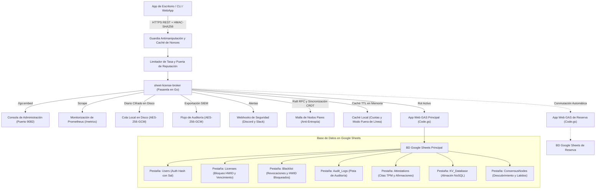

<div align="center">

<!-- 10-Language Navigation Bar -->
<p align="center">
  <a href="../../README.md">🇺🇸 English</a> · <a href="./ko.md">🇰🇷 한국어</a> · <a href="./zh-CN.md">🇨🇳 简体中文</a> · <a href="./ja.md">🇯🇵 日本語</a> · <b>🇪🇸 Español</b><br />
  <a href="./fr.md">🇫🇷 Français</a> · <a href="./ru.md">🇷🇺 Русский</a> · <a href="./pt-BR.md">🇧🇷 Português</a> · <a href="./ar.md">🇸🇦 العربية</a> · <a href="./hi.md">🇮🇳 हिन्दी</a>
</p>

# Sheet-License-Broker

<p align="center">
  <strong>Pasarela Serverless de Autenticación, Licenciamiento y Base de Datos NoSQL Impulsada por Google Sheets y Google Apps Script</strong>
</p>

<p align="center">
  
  
  
  
  
  
  
  
  
  
  
  
  
  
  
  
  
  
</p>

</div>

---

## 💡 Descripción General (Overview)

**`sheet-license-broker`** transforma cualquier hoja de cálculo de Google Sheets en un backend serverless de alto rendimiento, autenticado y listo para producción, diseñado para aplicaciones de escritorio, utilidades CLI y productos SaaS independientes.

En lugar de pagar costosas instancias de bases de datos en la nube o mantener contenedores Docker complejos solo para gestionar inicios de sesión y claves de licencia de software, `sheet-license-broker` une el motor en la nube de **Google Apps Script (GAS)** con un **puente ultrarrápido en Go, cadenas de firmas poscuánticas ML-DSA (NIST FIPS 204), consenso de quórum distribuido Raft, sincronización CRDT LWW-Element-Set, Cloudflare Edge Gateway, atestación criptográfica de hardware (TPM 2.0 y Enclaves), aislamiento multi-inquilino, alta disponibilidad activo-reserva con hojas duales, banderas dinámicas de características y medición de uso, cola en disco cifrada, métricas de Prometheus, verificación antimanipulación HMAC, caché local resistente y un panel de administración web integrado**.

### ¿Por qué utilizar Google Sheets como Backend?
- **Costo Cero ($0/mes)**: Aprovecha las cuotas gratuitas de Google Drive y Google Apps Script (hasta 20,000 solicitudes diarias).
- **Criptografía Poscuántica y Cadenas de Firmas ML-DSA (NIST FIPS 204)**: Verificación de firmas digitales resistentes a la computación cuántica basadas en retículos (ML-DSA-44 / ML-DSA-65) con cadenas híbridas ECDSA / retículo (`Hybrid-P256-MLDSA65`), períodos de gracia para rotación de claves sin interrupción y difusión instantánea de revocación de emergencia.
- **Detección de Anomalías de Comportamiento y Puntuación de Riesgo Adaptativa**: Análisis estadístico con ventana deslizante de desviación de latidos Z-Score (&plusmn;15% tolerancia a jitter), detección de viajes imposibles por fórmula de Haversine (&gt;950 km/h o presencia concurrente en subredes /24), modelo de decaimiento nominal de riesgo, escalado a desafío criptográfico en riesgo &ge; 50, cuarentena automática de confianza cero en riesgo &ge; 85 y exportación de topología de incidentes conforme a estándares SIEM (`siem-topology-v1`).
- **Inicio de Sesión Único Empresarial (SSO) y Aprovisionamiento SCIM 2.0**: Federación de identidades con SAML 2.0 y OIDC, sincronización de usuarios bajo RFC 7643/7644 con asignación automática de licencias y revocación inmediata al desaprovisionar.
- **Pruebas de Conocimiento Cero (ZKP) para Verificación Anónima**: Compromisos de Pedersen sobre la curva NIST P-256, pruebas de presentación no interactivas Sigma (transformación Fiat-Shamir) y registro de anuladores gastados (Nullifiers) para proteger la privacidad del hardware del cliente.
- **Consenso Raft Distribuido y Malla CRDT**: Elección ligera de líderes, quórum de registro por mayoría, replicación sin conflictos de conjuntos LWW y resúmenes de árbol Merkle SHA-256 para sincronización anti-entropía.
- **Límite de Tasa Empresarial y Retroceso Progresivo**: Regulación por ventana deslizante segura para hilos por IP y HWID con retardos progresivos y encabezados estándar `X-RateLimit-*`.
- **Caché de Reputación y Bloqueo Temporal Automático**: Detección de infracciones repetidas con bloqueos temporales automáticos y alertas webhook de alta prioridad.
- **Exportación de Paquetes de Auditoría Cifrados para SIEM**: Paquetes de auditoría cifrados con AES-256-GCM y sellados con HMAC para ingestión en Splunk, Datadog y AWS CloudWatch.
- **Atestación de Hardware y Bloqueo de Dispositivo**: Verificación de citas PCR de TPM 2.0 y atestación de claves de hardware con Apple Secure Enclave y Windows Hello para evitar clonaciones.
- **Banderas Dinámicas de Características y Facturación por Niveles**: Niveles Free, Pro y Enterprise con verificación en tiempo de ejecución (`client.isFeatureEnabled("analytics")`) y conteo atómico persistido en Google Sheets.
- **Conmutación por Error Activo-Reserva Automática**: Replicación continua entre la hoja principal y la de reserva con reconciliación bidireccional libre de colisiones.
- **Cola Cifrada en Disco Local**: Cola en disco protegida con AES-256-GCM (`spool.bin`) que garantiza cero pérdida de datos durante caídas de red.
- **Consola Web Embebida**: Binario autónomo único (`sheet-license-broker.exe`) con interfaz moderna en modo oscuro esmeralda.

---

## 🏛️ Arquitectura (Architecture)



---

## 🚀 Inicio Rápido (Quick Start)

### 1. Ejecutar la Pasarela Local y la Consola

Asegúrese de tener Go 1.22+ instalado:

```bash
# Clonar el repositorio
git clone https://github.com/kLauncher1/sheet-license-broker.git
cd sheet-license-broker

# Compilar y ejecutar en modo autónomo
go run .
```

Abra su navegador en **`http://localhost:9082`** para acceder a la consola interactiva.

### 2. Conectar a Google Sheets en Vivo (Modo Proxy)

Configure las variables de entorno para vincular la pasarela a su aplicación web desplegada en Google Apps Script:

```bash
# Definir la URL de la aplicación web de Apps Script
export GAS_WEBAPP_URL="https://script.google.com/macros/s/.../exec"
export CACHE_TTL_SECONDS="600" # Opcional: TTL de 10 minutos para caché

# Iniciar la pasarela
./sheet-license-broker.exe
```

El servidor detecta automáticamente el endpoint remoto, reenvía las solicitudes, almacena en caché los resultados y responde de forma transparente con datos en caché durante fallos de red.

---

## 📋 Configuración de Google Sheets y Despliegue con Clasp

### Opción A: Despliegue con un Solo Clic usando Clasp CLI

Si dispone de la herramienta `@google/clasp`:

```bash
# 1. Iniciar sesión en su cuenta de Google
npx @google/clasp login

# 2. Ejecutar el script automatizado de despliegue
node scripts/deploy_clasp.mjs --script-id <SU_APPS_SCRIPT_ID>
```

### Opción B: Configuración Manual (3 Minutos)

1. Vaya a [Google Sheets](https://sheets.new) y cree una nueva hoja de cálculo.
2. En el menú superior, seleccione **Extensiones > Apps Script**.
3. Elimine el código existente y pegue el contenido de [`gas/Code.gs`](../../gas/Code.gs).
4. Haga clic en **Implementar > Nueva implementación**:
   - Tipo: **Aplicación web**
   - Ejecutar como: **Yo (su correo de Google)**
   - Quién tiene acceso: **Cualquiera (Anyone)**
5. Haga clic en **Implementar** y copie la **URL de la aplicación web** generada (`https://script.google.com/macros/s/.../exec`).

La hoja creará automáticamente las pestañas necesarias (`Users`, `Licenses`, `KV_Database`) al recibir la primera petición.

---

## 📡 Resumen de Especificación de la API REST

| Categoría | Método y Ruta | Descripción |
| :--- | :--- | :--- |
| **Diagnóstico** | `GET /api/health` | Consulta el estado general del servicio y métricas clave |
| **Diagnóstico** | `GET /api/proxy/ping` | Comprueba la latencia de comunicación con el backend GAS |
| **Autenticación** | `POST /api/users/register` | Registro de usuarios con contraseña hash con sal |
| **Autenticación** | `POST /api/users/login` | Validación de credenciales de usuario |
| **Licencias** | `POST /api/licenses` | Emisión de nueva clave de licencia (días y dispositivos permitidos) |
| **Licencias** | `POST /api/licenses/validate` | Validación de licencia y enlace automático al HWID del cliente |
| **Licencias** | `POST /api/licenses/revoke` | Revocación inmediata de una clave de licencia |
| **Seguridad** | `POST /api/security/blacklist` | Bloqueo de un HWID comprometido o de una clave de licencia |
| **Seguridad** | `GET /api/security/blacklist` | Lista de identificadores en lista negra y claves revocadas |
| **NoSQL** | `POST /api/docs` | Almacena un documento JSON por colección y clave |
| **NoSQL** | `GET /api/docs` | Recupera todos los documentos de la base de datos |
| **Multi-Inquilino** | `POST /api/tenants/register` | Registro de inquilino con prefijo propio y URL de webhook |
| **Copia / Respaldo**| `POST /api/backup/export` | Exportación cifrada con AES-256-GCM del estado global |
| **Copia / Respaldo**| `POST /api/backup/restore` | Restauración inmediata a partir de una instantánea cifrada |
| **Niveles de Uso** | `GET /api/features` | Catálogo de características y cuotas por plan |
| **Niveles de Uso** | `POST /api/features/check` | Verifica si una licencia cuenta con permiso para cierta función |
| **Medición de Uso** | `POST /api/usage/record` | Registra el consumo de métricas como llamadas API |
| **Atestación** | `POST /api/attestation/challenge` | Genera un desafío Nonce de un solo uso para TPM 2.0 |
| **Atestación** | `POST /api/attestation/verify` | Valida citas PCR firmadas por el procesador TPM 2.0 |
| **Límites de Tasa**| `GET /api/security/ratelimit/status`| Consulta el estado de limitación de tasa por IP y HWID |
| **Consenso** | `GET /api/consensus/status` | Estado del clúster Raft y sincronización CRDT |
| **Transmisión** | `GET /api/stream/ws` | Conexión WebSocket bidireccional e interruptor de emergencia |
| **ZKP** | `POST /api/zkp/verify` | Verificación de prueba de conocimiento cero anónima |
| **SSO / SCIM** | `GET /api/sso/saml/metadata` | Descarga de metadatos SP en XML para Okta y Azure AD |
| **SSO / SCIM** | `POST /scim/v2/Users` | Creación de usuario y asignación de asiento de licencia vía SCIM |
| **Poscuántica** | `POST /api/pqc/sign` | Firma híbrida resistente a computación cuántica ML-DSA |
| **Anomalías** | `POST /api/anomaly/record` | Envío de telemetría y actualización adaptativa de riesgo |
| **SIEM** | `GET /api/anomaly/graph` | Exportación de grafo de topología de incidentes de seguridad |

---

## 💻 SDKs de Cliente Multilenguaje

### 🐍 Cliente Python (`sdk/python/sheet_license_client.py`)
Sin dependencias externas, usando exclusivamente la biblioteca estándar:

```python
from sheet_license_client import SheetLicenseClient

client = SheetLicenseClient(base_url="http://localhost:9082", secret_key="your-hmac-secret")

# 1. Verificar licencia (agrega automáticamente el HWID local)
res = client.verify_license("SLB-XXXX-XXXX-XXXX")
if res.get("valid"):
    print("Licencia válida. Nivel:", res.get("tier"))

    # 2. Comprobar bandera de función dinámica
    if client.is_feature_enabled("SLB-XXXX-XXXX-XXXX", "analytics"):
        print("¡Módulo de analítica habilitado!")

    # 3. Registrar consumo de cuota
    client.record_usage("SLB-XXXX-XXXX-XXXX", "api_calls", 1)
```

### ⚡ C# / .NET & Unity (`sdk/csharp/SheetLicenseClient.cs`)
Compatible con Unity Mono/IL2CPP, WPF y .NET:

```csharp
using SheetLicenseBroker;

var client = new SheetLicenseClient("http://localhost:9082", "your-hmac-secret");
var result = await client.VerifyLicenseAsync("SLB-XXXX-XXXX-XXXX");
if (result.Valid) {
    Console.WriteLine($"¡Acceso concedido! Nivel: {result.Tier}, Expira: {result.ExpirationDate}");
}
```

### 🟩 TypeScript y Node.js (`@sheet-license/client`)
Para servidores Node.js y aplicaciones de escritorio Electron:

```typescript
import { SheetLicenseClient } from '@sheet-license/client';

const client = new SheetLicenseClient({
  baseUrl: 'http://localhost:9082',
  secretKey: 'your-hmac-secret',
});

const result = await client.verifyLicense('SLB-XXXX-XXXX-XXXX');
if (result.valid) {
  console.log('Licencia válida. Nivel:', result.tier);
}
```

### 🔷 Cliente en Go (`sdk/go/client.go`)

```go
package main

import (
	"context"
	"fmt"
	"time"

	"github.com/kLauncher1/sheet-license-broker/sdk/go"
)

func main() {
	client := sdk.NewClient("http://localhost:9082", []byte("your-hmac-secret"), 5*time.Second)
	res, err := client.VerifyLicense(context.Background(), "SLB-XXXX-XXXX-XXXX", "")
	if err == nil && res.Valid {
		fmt.Printf("Licencia válida (Nivel: %s). Iniciando programa...\n", res.Tier)
	}
}
```

---

## 🛠️ Pruebas y Compilación

```bash
# Ejecutar todas las pruebas unitarias
go test -v ./...

# Compilar el binario ejecutable independiente de producción
go build -ldflags="-s -w" -o sheet-license-broker.exe .
```

---

## 📄 Licencia (License)

Este proyecto está disponible bajo la [Licencia MIT](../../LICENSE).
