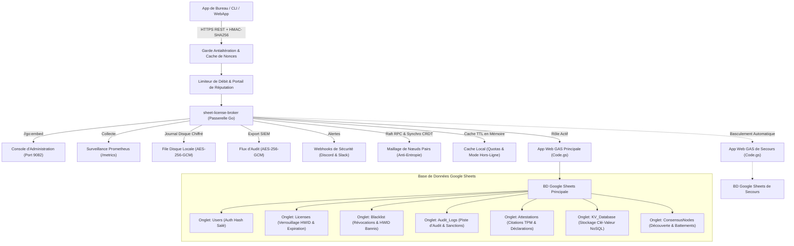

<div align="center">

<!-- 10-Language Navigation Bar -->
<p align="center">
  <a href="../../README.md">🇺🇸 English</a> · <a href="./ko.md">🇰🇷 한국어</a> · <a href="./zh-CN.md">🇨🇳 简体中文</a> · <a href="./ja.md">🇯🇵 日本語</a> · <a href="./es.md">🇪🇸 Español</a><br />
  <b>🇫🇷 Français</b> · <a href="./ru.md">🇷🇺 Русский</a> · <a href="./pt-BR.md">🇧🇷 Português</a> · <a href="./ar.md">🇸🇦 العربية</a> · <a href="./hi.md">🇮🇳 हिन्दी</a>
</p>

# Sheet-License-Broker

<p align="center">
  <strong>Passerelle Sans Serveur d'Authentification, de Gestion des Licences et de Base de Données NoSQL Propulsée par Google Sheets et Google Apps Script</strong>
</p>

<p align="center">
  
  
  
  
  
  
  
  
  
  
  
  
  
  
  
  
  
  
</p>

</div>

---

## 💡 Présentation Générale (Overview)

**`sheet-license-broker`** transforme n'importe quelle feuille de calcul Google Sheets en un backend serverless sécurisé, prêt pour la production et à hautes performances, idéal pour les applications de bureau, les utilitaires CLI et les projets SaaS indépendants.

Inutile de payer des abonnements mensuels onéreux pour des bases de données cloud ou de gérer des clusters de conteneurs Docker simplement pour valider des identifiants et des clés de licence logicielle. `sheet-license-broker` associe le moteur cloud de **Google Apps Script (GAS)** à une **passerelle ultrarapide écrite en Go, des chaînes de signatures post-quantiques ML-DSA (NIST FIPS 204), un consensus distribué de quorum Raft, une synchronisation sans conflit CRDT LWW-Element-Set, une passerelle de bordure Cloudflare, une attestation cryptographique matérielle (TPM 2.0 et Enclaves), un cloisonnement multi-locataires, une haute disponibilité active-secours à feuilles jumelles, des drapeaux dynamiques de fonctionnalités avec mesure de la consommation, une file d'attente chiffrée sur disque, des métriques Prometheus, une protection antialtération HMAC, un cache hors-ligne robuste et une interface web d'administration intégrée**.

### Pourquoi choisir Google Sheets comme Backend ?
- **Coût d'Hébergement Nul (0$/mois)** : Utilise les quotas gratuits de Google Drive et Google Apps Script (jusqu'à 20 000 requêtes par jour).
- **Cryptographie Post-Quantique et Chaînes ML-DSA (NIST FIPS 204)** : Validation de signatures numériques sur réseaux euclidiens (ML-DSA-44 / ML-DSA-65) avec chaînes hybrides ECDSA / réseaux (`Hybrid-P256-MLDSA65`), fenêtres de grâce pour la rotation des clés sans temps d'arrêt et diffusion instantanée de révocation d'urgence.
- **Détection d'Anomalies Comportementales et Score de Risque Adaptatif** : Analyse statistique par fenêtre glissante de la dérive des battements de cœur Z-Score (&plusmn;15% de gigue tolérée), détection de trajets physiques impossibles par formule de Haversine (&gt;950 km/h ou accès simultané depuis des sous-réseaux /24 disjoints), modèle adaptatif de décroissance du risque, déclenchement automatique d'un défi cryptographique dès un score &ge; 50, mise en quarantaine immédiate zéro-confiance à un score &ge; 85 et exportation de graphes topologiques d'incidents compatibles SIEM (`siem-topology-v1`).
- **Authentification Unique d'Entreprise (SSO) et Provisionnement SCIM 2.0** : Fédération d'identités avec SAML 2.0 et OIDC, synchronisation des effectifs selon les normes RFC 7643/7644 avec attribution automatique de sièges de licence et révocation instantanée lors des départs de collaborateurs.
- **Preuves à Divulgation Nulle de Connaissance (ZKP)** : Engagements de Pedersen sur la courbe NIST P-256, protocoles Sigma non interactifs (transformation Fiat-Shamir) et registre anti-rejeu des identifiants nuls dépensés (Nullifiers) pour garantir la confidentialité de l'équipement client.
- **Consensus de Quorum Raft et Maillage CRDT** : Élection légère de leader, validation des journaux à la majorité, réplication d'état sans conflit et condensats d'arbres de Merkle SHA-256 pour la synchronisation anti-entropie entre nœuds répliqués.
- **Limitation de Débit Entreprise et Répétition Progressive** : Contrôle de débit thread-safe par fenêtre glissante par IP et identifiant matériel (HWID), délais de pénalité progressifs et en-têtes standard `X-RateLimit-*`.
- **Cache de Réputation et Bannissement Temporaire Automatique** : Blocage immédiat des adresses récidivistes et déclenchement de webhooks d'incident hautement prioritaires.
- **Export de Lots d'Audit Chiffrés pour SIEM** : Paquets d'audit chiffrés en AES-256-GCM et scellés par signature HMAC prêts pour l'ingestion par Splunk, Datadog ou AWS CloudWatch.
- **Attestation Matérielle et Verrouillage d'Appareil** : Vérification des citations PCR de TPM 2.0 et des clés d'enclave matérielle Apple Secure Enclave / Windows Hello empêchant le clonage logiciel et les machines virtuelles non autorisées.
- **Bannière Dynamique de Fonctionnalités et Facturation par Niveaux** : Niveaux Free, Pro et Enterprise avec vérification à chaud dans le code client (`client.isFeatureEnabled("analytics")`) et décompte atomique persisté dans Google Sheets.
- **Basculement Automatique Actif-Secours** : Réplication continue et réconciliation bidirectionnelle sans collision entre la feuille principale et la feuille miroir.
- **File d'Attente Chiffrée sur Disque Local** : Journal sur disque protégé par AES-256-GCM (`spool.bin`) garantissant l'intégrité intégrale des données en cas de panne réseau.
- **Tableau de Bord Web Embarqué** : Binaire autonome tout-en-un (`sheet-license-broker.exe`) intégrant une interface de gestion en mode sombre émeraude.

---

## 🏛️ Architecture (Architecture)



---

## 🚀 Démarrage Rapide (Quick Start)

### 1. Démarrer la Passerelle Locale et l'Interface

Assurez-vous que Go 1.22+ est présent sur votre machine :

```bash
# Cloner le dépôt
git clone https://github.com/kLauncher1/sheet-license-broker.git
cd sheet-license-broker

# Compiler et lancer en mode autonome
go run .
```

Ouvrez **`http://localhost:9082`** dans votre navigateur pour accéder au tableau de bord.

### 2. Connecter à Google Sheets en Production (Mode Proxy)

Configurez les variables d'environnement vers votre application web Google Apps Script :

```bash
# URL de l'application web Apps Script
export GAS_WEBAPP_URL="https://script.google.com/macros/s/.../exec"
export CACHE_TTL_SECONDS="600" # Optionnel: durée du cache de 10 minutes

# Lancer la passerelle
./sheet-license-broker.exe
```

Le serveur détecte l'adresse distante, transmet les requêtes, conserve les résultats en cache local et bascule automatiquement sur les données locales en cas de déconnexion réseau.

---

## 📋 Déploiement de Google Sheets avec Clasp

### Méthode A : Déploiement en Une Commande avec Clasp CLI

Si vous possédez l'outil `@google/clasp` :

```bash
# 1. Connexion à votre compte Google
npx @google/clasp login

# 2. Exécution du script de déploiement automatique
node scripts/deploy_clasp.mjs --script-id <VOTRE_APPS_SCRIPT_ID>
```

### Méthode B : Configuration Manuelle en 3 Minutes

1. Ouvrez [Google Sheets](https://sheets.new) et créez une feuille vierge.
2. Dans le menu, sélectionnez **Extensions > Apps Script**.
3. Effacez le code existant et collez l'intégralité de [`gas/Code.gs`](../../gas/Code.gs).
4. Cliquez sur **Déployer > Nouveau déploiement** :
   - Type : **Application Web**
   - Exécuter en tant que : **Moi (votre adresse email)**
   - Qui a accès : **Tout le monde (Anyone)**
5. Cliquez sur **Déployer** et notez l'**URL de l'application Web** (`https://script.google.com/macros/s/.../exec`).

Les onglets requis (`Users`, `Licenses`, `KV_Database`) seront automatiquement créés dès le premier appel reçu.

---

## 📡 Spécification Synthétique de l'API REST

| Domaine | Méthode & Point d'accès | Description |
| :--- | :--- | :--- |
| **Diagnostic** | `GET /api/health` | Vérifie la santé globale du service et l'état des sous-systèmes |
| **Diagnostic** | `GET /api/proxy/ping` | Teste le temps de réponse avec le backend Google Apps Script |
| **Authentification** | `POST /api/users/register` | Enregistre un compte d'administrateur ou d'utilisateur (hash salé) |
| **Authentification** | `POST /api/users/login` | Vérifie les identifiants de connexion |
| **Licences** | `POST /api/licenses` | Émet une nouvelle clé de licence (durée, nombre de postes max) |
| **Licences** | `POST /api/licenses/validate` | Valide la licence et la verrouille au premier HWID appelant |
| **Licences** | `POST /api/licenses/revoke` | Révoque immédiatement une clé de licence |
| **Sécurité** | `POST /api/security/blacklist` | Bloque un HWID compromis ou une clé de licence |
| **Sécurité** | `GET /api/security/blacklist` | Consulte les entrées sur liste noire actives |
| **NoSQL** | `POST /api/docs` | Enregistre un document JSON par collection et identifiant |
| **NoSQL** | `GET /api/docs` | Liste l'ensemble des documents NoSQL |
| **Multi-Locataires**| `POST /api/tenants/register` | Déclare un locataire avec préfixe sur mesure et webhook |
| **Sauvegarde** | `POST /api/backup/export` | Exporte un instantané complet chiffré en AES-256-GCM |
| **Sauvegarde** | `POST /api/backup/restore` | Restaure instantanément l'état à partir d'un fichier chiffré |
| **Fonctionnalités**| `GET /api/features` | Fournit le catalogue des fonctions et les quotas par palier |
| **Fonctionnalités**| `POST /api/features/check` | Vérifie l'éligibilité d'une licence pour une fonctionnalité |
| **Mesure d'Usage** | `POST /api/usage/record` | Enregistre la consommation d'unités de métrique |
| **Attestation** | `POST /api/attestation/challenge` | Émet un défi Nonce à usage unique pour TPM 2.0 |
| **Attestation** | `POST /api/attestation/verify` | Valide les mesures PCR signées par la puce TPM 2.0 |
| **Limitation** | `GET /api/security/ratelimit/status`| Affiche l'état de limitation de débit par IP et HWID |
| **Consensus** | `GET /api/consensus/status` | Indique l'état du quorum Raft et de la réplication CRDT |
| **Temps Réel** | `GET /api/stream/ws` | Flux WebSocket bidirectionnel pour coupures d'urgence |
| **ZKP** | `POST /api/zkp/verify` | Validation de preuve Sigma anonyme sans divulgation |
| **SSO / SCIM** | `GET /api/sso/saml/metadata` | Télécharge les métadonnées SP au format XML pour Okta/Azure |
| **SSO / SCIM** | `POST /scim/v2/Users` | Provisionne un collaborateur et alloue une licence via SCIM |
| **Post-Quantique** | `POST /api/pqc/sign` | Signe un jeton avec un schéma hybride post-quantique ML-DSA |
| **Anomalies** | `POST /api/anomaly/record` | Transmet des observations et recalcule le score de risque |
| **SIEM** | `GET /api/anomaly/graph` | Fournit le graphe de corrélation d'incidents au format SIEM |

---

## 💻 SDKs Clients Multi-Langages

### 🐍 Client Python (`sdk/python/sheet_license_client.py`)
Fonctionne sans aucune dépendance externe, basé uniquement sur la bibliothèque standard :

```python
from sheet_license_client import SheetLicenseClient

client = SheetLicenseClient(base_url="http://localhost:9082", secret_key="your-hmac-secret")

# 1. Vérification de licence (liaison automatique de l'identifiant matériel HWID)
res = client.verify_license("SLB-XXXX-XXXX-XXXX")
if res.get("valid"):
    print("Licence valide. Niveau :", res.get("tier"))

    # 2. Vérification des droits d'accès aux modules
    if client.is_feature_enabled("SLB-XXXX-XXXX-XXXX", "analytics"):
        print("Module analytique actif !")

    # 3. Comptabilisation de l'usage
    client.record_usage("SLB-XXXX-XXXX-XXXX", "api_calls", 1)
```

### ⚡ C# / .NET & Unity (`sdk/csharp/SheetLicenseClient.cs`)
Adapté pour Unity Mono/IL2CPP, WPF et solutions bureautiques .NET :

```csharp
using SheetLicenseBroker;

var client = new SheetLicenseClient("http://localhost:9082", "your-hmac-secret");
var result = await client.VerifyLicenseAsync("SLB-XXXX-XXXX-XXXX");
if (result.Valid) {
    Console.WriteLine($"Accès validé ! Palier : {result.Tier}, Échéance : {result.ExpirationDate}");
}
```

### 🟩 TypeScript et Node.js (`@sheet-license/client`)
Pour serveurs Node.js et interfaces de bureau Electron :

```typescript
import { SheetLicenseClient } from '@sheet-license/client';

const client = new SheetLicenseClient({
  baseUrl: 'http://localhost:9082',
  secretKey: 'your-hmac-secret',
});

const result = await client.verifyLicense('SLB-XXXX-XXXX-XXXX');
if (result.valid) {
  console.log('Licence active. Palier :', result.tier);
}
```

### 🔷 Client Go (`sdk/go/client.go`)

```go
package main

import (
	"context"
	"fmt"
	"time"

	"github.com/kLauncher1/sheet-license-broker/sdk/go"
)

func main() {
	client := sdk.NewClient("http://localhost:9082", []byte("your-hmac-secret"), 5*time.Second)
	res, err := client.VerifyLicense(context.Background(), "SLB-XXXX-XXXX-XXXX", "")
	if err == nil && res.Valid {
		fmt.Printf("Licence confirmée (Palier: %s). Lancement de l'application...\n", res.Tier)
	}
}
```

---

## 🛠️ Validation et Compilation

```bash
# Lancer les tests unitaires sur tous les paquets
go test -v ./...

# Compiler le binaire unique pour la production
go build -ldflags="-s -w" -o sheet-license-broker.exe .
```

---

## 📄 Licence (License)

Ce projet est distribué sous les termes de la [Licence MIT](../../LICENSE).
