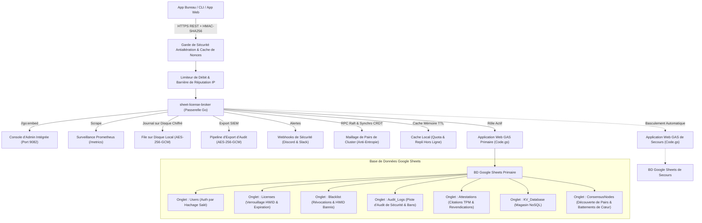

<div align="center">

<!-- 10-Language Navigation Bar -->
<p align="center">
  <a href="../../README.md">🇺🇸 English</a> · <a href="./ko.md">🇰🇷 한국어</a> · <a href="./zh-CN.md">🇨🇳 简体中文</a> · <a href="./ja.md">🇯🇵 日本語</a> · <a href="./es.md">🇪🇸 Español</a><br />
  <b>🇫🇷 Français</b> · <a href="./ru.md">🇷🇺 Русский</a> · <a href="./pt-BR.md">🇧🇷 Português</a> · <a href="./ar.md">🇸🇦 العربية</a> · <a href="./hi.md">🇮🇳 हिन्दी</a>
</p>

# Sheet-License-Broker

<p align="center">
  <strong>Passerelle d'Authentification Serverless, d'Attribution de Licences & de Base de Données NoSQL Propulsée par Google Sheets & Google Apps Script</strong>
</p>

<p align="center">
  
  
  
  
  
  
  
  
  
  
  
  
  
  
  
  
  
  
</p>

</div>

---

## 💡 Présentation Générale

**`sheet-license-broker`** transforme n'importe quelle feuille de calcul Google Sheets en un backend sans serveur (serverless), authentifié et prêt pour la production pour les applications de bureau, les utilitaires CLI et les outils SaaS indépendants.

Au lieu de payer des instances de bases de données cloud onéreuses ou de gérer des conteneurs Docker complexes simplement pour traiter les connexions des utilisateurs et les clés de licence logicielle, `sheet-license-broker` associe un moteur cloud **Google Apps Script (GAS)** à une **passerelle Go haute vitesse, des chaînes de signatures post-quantiques ML-DSA, un consensus de quorum distribué Raft, une synchronisation d'ensembles CRDT LWW-Element-Set, une passerelle de bordure Cloudflare Edge, une attestation cryptographique matérielle (TPM 2.0 & Enclaves), un cloisonnement multi-locataires, une haute disponibilité active-secours à double feuille de calcul, des drapeaux de fonctionnalités dynamiques et une mesure d'utilisation par paliers, une file d'attente chiffrée sur disque, des métriques Prometheus, une vérification antialtération cryptographique HMAC, une mise en cache hors ligne résiliente et une interface Web intégrée**.

### Pourquoi choisir Google Sheets comme Backend ?
- **Coût Nul (0 $/mois)** : Tire parti des quotas gratuits de Google Drive et Apps Script (jusqu'à 20 000 requêtes/jour).
- **Cryptographie Post-Quantique & Chaînes de Signatures ML-DSA (NIST FIPS 204)** : Vérification de signatures numériques sur réseaux euclidiens résistantes aux ordinateurs quantiques (ML-DSA-44 / ML-DSA-65) avec chaînes de signatures hybrides classiques ECDSA / réseaux (`Hybrid-P256-MLDSA65`), fenêtres de grâce pour la rotation des clés sans interruption de service et diffusions de coupe-circuit de révocation d'urgence instantanées.
- **Détection des Anomalies Comportementales & Score de Risque Adaptatif** : Suivi statistique par fenêtre glissante de la dérive des pulsations de vie (heartbeat) par Z-Score (tolérance de gigue &plusmn;15 %), détection de vitesse de déplacement impossible par formule de Haversine (&gt;950 km/h ou sous-réseaux /24 concurrents), calcul de score de risque adaptatif avec décroissance nominale progressive, escalade automatique de défi de ré-attestation pour un score de risque &ge; 50, mise en quarantaine automatique zéro-confiance (zero-trust) pour un score de risque &ge; 85, et exportateur de graphe de topologie d'incidents de sécurité standardisé (`siem-topology-v1`) pour l'ingestion SIEM d'entreprise.
- **Authentification Unique d'Entreprise (SSO) & Provisionnement d'Annuaire SCIM 2.0** : Fédération d'identité SAML 2.0 et OIDC, synchronisation d'annuaire selon RFC 7643/7644, attribution automatisée de sièges de licence et révocation instantanée lors du déprovisionnement.
- **Vérification Anonyme par Preuve à Divulgation Nulle de Connaissance (ZKP)** : Engagements de Pedersen sur courbe NIST P-256 avec générateurs indépendants déterministes par hachage vers la courbe (hash-to-curve), preuves de présentation Sigma non interactives (transformée de Fiat-Shamir) et registres de défense contre le rejeu d'annulateurs consommés (spent nullifiers) protégeant la confidentialité matérielle du client.
- **Consensus de Quorum Raft Distribué & Maillage CRDT** : Élection de leader légère, quorum de journal à la majorité, réplication d'état d'ensemble LWW-Element-Set sans conflit et condensats d'état d'arbre de Merkle SHA-256 pour la synchronisation anti-entropie à travers les nœuds passerelles distribués.
- **Limitation de Débit d'Entreprise & Temporisation Progressive** : Régulation de débit thread-safe par fenêtre glissante par IP et HWID avec délais de pénalité progressifs et en-têtes standard `X-RateLimit-*`.
- **Cache de Réputation IP/HWID par Fenêtre Glissante** : Bannissements temporaires automatiques et alertes webhook d'incidents de haute priorité lors d'infractions de sécurité répétées.
- **Exportation de Jetons d'Audit Chiffrés pour SIEM** : Paquets d'audit chiffrés AES-256-GCM conformes scellés par signatures HMAC pour l'ingestion dans Splunk, Datadog et AWS CloudWatch.
- **Attestation Cryptographique Matérielle & Liaison d'Enclave** : Vérification des citations PCR de TPM 2.0 et attestation de clés matérielles Apple Secure Enclave / Windows Hello empêchant les attaques par clonage.
- **Télémétrie Antidébogage Client & Antialtération de Mémoire** : Notation d'intégrité continue avec coupe-circuit instantané bannissant automatiquement les appareils présentant un débogueur attaché ou des modifications de sections de code.
- **Drapeaux de Fonctionnalités Dynamiques & Mesure de Paliers d'Utilisation** : Paliers d'abonnement Free, Pro et Enterprise avec contrôle d'accès aux fonctionnalités à l'exécution (`client.isFeatureEnabled("analytics")`) et suivi atomique des quotas de consommation persistés directement dans Google Sheets.
- **Réplication Active-Secours à Double Feuille de Calcul** : Basculement automatique (failover) entre les feuilles primaire et de secours avec réconciliation bidirectionnelle sans collision.
- **File d'Attente sur Disque Local Chiffrée** : File d'attente de journal chiffrée en AES-256-GCM (`spool.bin`) garantissant zéro perte de données lors des perturbations réseau.
- **Télémétrie d'Entreprise Prometheus (`/metrics`)** : Point de terminaison de collecte (scraper) intégré exposant les compteurs, jauges et latences au format Prometheus.
- **Webhooks d'Alerte d'Incidents** : Notifications d'incidents de sécurité riches et immédiates envoyées vers les canaux Discord et Slack.
- **Espaces de Noms Multi-Locataires (Multi-Tenant)** : Isolez des produits et des locataires distincts avec des préfixes personnalisés (ex. `ACME-LIC-XXXX-YYYY`) et des politiques indépendantes.
- **Passerelle de Bordure Cloudflare Edge** : Vérification de licence en périphérie (edge) en moins d'une milliseconde via Cloudflare Workers et Workers KV avec l'API Web Crypto.
- **Panneau d'Administration Lisible par l'Humain** : Votre feuille Google Sheets est votre base de données. Consultez, modifiez, bannissez ou accordez des licences directement en temps réel.
- **Protection Verrouillée sur le Matériel (HWID)** : Verrouille les clés de licence sur les identifiants matériels spécifiques des machines lors du premier démarrage.
- **Protection Antialtération Cryptographique HMAC-SHA256** : Protège le trafic client entrant contre l'inspection MITM et l'usurpation de charges utiles rétro-conçues.
- **Atténuation du Rejeu par Nonce à Fenêtre Glissante** : Empêche les attaques par rejeu de requêtes grâce à une fenêtre de tolérance de dérive temporelle de 5 minutes.
- **Révocation à Distance Instantanée & Liste Noire d'Appareils** : Désactivez des licences ou bannissez des identifiants matériels compromis directement depuis la console Web ou l'onglet Google Sheets.
- **Sauvegarde Automatisée & Reprise Après Sinistre** : Exportation et restauration d'état à un instant précis (point-in-time) protégées par des sommes de contrôle de données SHA-256 et un chiffrement AES-256-GCM.
- **Webhooks de Cycle de Vie en Temps Réel** : Dispatchers d'événements avec files d'attente de traitement et distribution de webhooks signés par HMAC vers les points de terminaison des locataires et globaux.
- **Authentification SHA-256 avec Sel** : Les mots de passe sont salés et hachés de manière cryptographique avant leur persistance.
- **Mise en Cache Locale Résiliente & Tolérance Hors Ligne** : Les licences et documents KV mis en cache en mémoire protègent contre les limites de débit de l'API Google (HTTP 429) et les micro-coupures réseau.
- **Tableau de Bord Web Intégré** : Binaire unique autonome (`sheet-license-broker.exe`) avec console d'administration au thème sombre émeraude.

---

## 🏛️ Architecture



---

## 🚀 Démarrage Rapide

### 1. Démarrer la Passerelle Locale et l'Interface

Assurez-vous que Go 1.22+ est installé sur votre poste de travail :

```bash
# Cloner le dépôt
git clone https://github.com/kLauncher1/sheet-license-broker.git
cd sheet-license-broker

# Compiler et exécuter le binaire unique en mode autonome
go run .
```

Ouvrez votre navigateur à l'adresse **`http://localhost:9082`** pour accéder à la console d'administration en direct.

### 2. Connecter à Google Sheets en Production (Mode Proxy)

Pour relier la passerelle à votre application Web Google Apps Script déployée :

```bash
# Définir l'URL de votre application Web Apps Script
export GAS_WEBAPP_URL="https://script.google.com/macros/s/.../exec"
export CACHE_TTL_SECONDS="600" # Optionnel : TTL de cache de 10 minutes

# Lancer la passerelle
./sheet-license-broker.exe
```

Le serveur détecte automatiquement l'URL distante, transmet les requêtes entrantes, met les résultats en cache localement et bascule de manière transparente sur les données en cache lors des interruptions réseau.

---

## 📋 Déploiement de Google Sheets avec Clasp

### Option A : Déploiement en Une Commande avec Clasp CLI

Si vous utilisez le CLI `@google/clasp` :

```bash
# 1. Connectez-vous à votre compte Google
npx @google/clasp login

# 2. Déployez à l'aide du script d'aide automatisé
node scripts/deploy_clasp.mjs --script-id <VOTRE_APPS_SCRIPT_ID>
```

Consultez [`gas/README.md`](../../gas/README.md) pour obtenir des instructions complètes sur la création et la configuration des projets Clasp.

### Option B : Configuration Manuelle (3 Minutes)

1. Ouvrez [Google Sheets](https://sheets.new) et créez une nouvelle feuille de calcul vierge.
2. Dans le menu supérieur, accédez à **Extensions > Apps Script**.
3. Remplacez le code par défaut par le contenu de [`gas/Code.gs`](../../gas/Code.gs).
4. Cliquez sur **Déployer > Nouveau déploiement** :
   - Type : **Application Web**
   - Exécuter en tant que : `Moi (votre adresse e-mail)`
   - Qui a accès : `Tout le monde`
5. Cliquez sur **Déployer** et copiez votre **URL d'application Web** (`https://script.google.com/macros/s/.../exec`).

Votre feuille Google Sheets générera automatiquement trois onglets dédiés lors de la première requête :
- **`Users`** : `user_id`, `username`, `password_hash`, `salt`, `role`, `created_at`
- **`Licenses`** : `license_key`, `bound_hwid`, `max_devices`, `status`, `expires_at`, `created_at`
- **`KV_Database`** : `collection`, `doc_id`, `payload`, `updated_at`

---

## 📡 Spécification de l'API REST

### Santé & Diagnostics

#### Obtenir l'État de Santé du Service & le Statut du Proxy
```http
GET /api/health
```

#### Ping du Backend
```http
GET /api/proxy/ping
```

---

### Authentification

#### Enregistrer un Utilisateur
```http
POST /api/users/register
Content-Type: application/json

{
  "username": "developer",
  "password": "SecurePassword123!",
  "role": "admin"
}
```

#### S'authentifier / Se Connecter
```http
POST /api/users/login
Content-Type: application/json

{
  "username": "developer",
  "password": "SecurePassword123!"
}
```

---

### Gestion des Licences

#### Émettre une Clé de Licence
```http
POST /api/licenses
Content-Type: application/json

{
  "days": 30,
  "max_devices": 1
}
```
**Réponse :**
```json
{
  "license_key": "KEY-7F2A-9C4B-E108",
  "bound_hwid": "",
  "max_devices": 1,
  "status": "ACTIVE",
  "expires_at": "2026-11-12T12:00:00Z",
  "created_at": "2026-10-13T12:00:00Z"
}
```

#### Valider & Lier le HWID
```http
POST /api/licenses/validate
Content-Type: application/json

{
  "license_key": "KEY-7F2A-9C4B-E108",
  "hwid": "WIN-B829-94AA-0123"
}
```
**Réponse :**
```json
{
  "valid": true,
  "license_key": "KEY-7F2A-9C4B-E108",
  "hwid_bound": "WIN-B829-94AA-0123",
  "expires_at": "2026-11-12T12:00:00Z",
  "source": "remote_gas"
}
```

*Remarque : Si la licence est active et non liée, elle se verrouille sur le `hwid` soumis. Les appels ultérieurs provenant du matériel correspondant réussissent ; les appels provenant d'un matériel non correspondant sont rejetés. Les réponses indiquent également si le résultat a été servi depuis `cache`, `remote_gas` ou `offline_cache`.*

---

### Antialtération & Sécurité

#### Signature de Requête HMAC-SHA256
Lorsque `HMAC_ENFORCE=true` (ou lorsque `HMAC_SECRET` est configuré), les clients protègent les requêtes contre l'interception MITM à l'aide d'en-têtes standard :
- `X-Signature` : Signature HMAC-SHA256 encodée en hexadécimal calculée sur `METHOD\nPATH\nTIMESTAMP\nNONCE\nSHA256(BODY)`.
- `X-Timestamp` : Horodatage Unix actuel en secondes (applique une fenêtre de dérive d'horloge de 5 minutes).
- `X-Nonce` : Chaîne de nonce cryptographique unique par requête (empêche les attaques par rejeu).

#### Révoquer une Clé de Licence
```http
POST /api/licenses/revoke
Content-Type: application/json

{
  "license_key": "KEY-7F2A-9C4B-E108",
  "reason": "Payment refunded"
}
```

#### Mettre sur Liste Noire l'Identifiant Matériel d'un Appareil (HWID)
```http
POST /api/security/blacklist
Content-Type: application/json

{
  "type": "device",
  "target": "WIN-B829-94AA-0123",
  "reason": "Fraudulent key sharing"
}
```

#### Lister les Entrées de Liste Noire & de Révocation
```http
GET /api/security/blacklist
```

---

### Magasin Clé-Valeur NoSQL

#### Stocker un Document
```http
POST /api/docs
Content-Type: application/json

{
  "collection": "user_settings",
  "doc_id": "usr_9918",
  "payload": "{\"dark_mode\":true,\"telemetry\":false}"
}
```

#### Récupérer Tous les Documents
```http
GET /api/docs
```

---

### Espaces de Noms Multi-Locataires (Multi-Tenant)

#### Enregistrer un Locataire
```http
POST /api/tenants/register
Content-Type: application/json

{
  "id": "tenant-gamehub",
  "name": "GameHub Studio",
  "namespace_prefix": "GHUB",
  "max_licenses": 100,
  "webhook_url": "https://api.gamehub.com/webhooks"
}
```

#### Émettre une Licence avec Espace de Noms de Locataire
```http
POST /api/licenses
Content-Type: application/json
X-Tenant-ID: tenant-gamehub

{
  "days": 60,
  "max_devices": 2
}
```
*Génère des clés formatées conformes à `GHUB-LIC-XXXX-YYYY`.*

---

### Sauvegarde Automatisée & Reprise Après Sinistre

#### Exporter une Sauvegarde Chiffrée (AES-256-GCM + Intégrité SHA-256)
```http
POST /api/backup/export
Content-Type: application/json

{
  "secret_key": "your-backup-master-passphrase"
}
```

#### Restaurer Depuis un Instantané
```http
POST /api/backup/restore
Content-Type: application/json

{
  "secret_key": "your-backup-master-passphrase",
  "encrypted_payload": "<hex-encoded-ciphertext>"
}
```

---

### Drapeaux de Fonctionnalités Dynamiques & Mesure de Paliers d'Utilisation

#### Lister le Catalogue Standard des Fonctionnalités & Paliers
```http
GET /api/features
```
**Réponse :**
```json
{
  "tiers": {
    "free": {
      "name": "free",
      "features": ["basic_access"],
      "daily_quotas": { "api_calls": 500, "export_rows": 100 }
    },
    "pro": {
      "name": "pro",
      "features": ["basic_access", "analytics", "csv_export", "extended_logs"],
      "daily_quotas": { "api_calls": 50000, "export_rows": 100000 }
    },
    "enterprise": {
      "name": "enterprise",
      "features": ["basic_access", "analytics", "csv_export", "extended_logs", "sso", "audit_export", "unlimited_seats", "priority_support"],
      "daily_quotas": { "api_calls": 10000000, "export_rows": 50000000 }
    }
  }
}
```

#### Vérifier les Droits d'Accès d'une Licence à une Fonctionnalité
```http
POST /api/features/check
Content-Type: application/json

{
  "license_key": "KEY-7F2A-9C4B-E108",
  "feature": "analytics"
}
```
**Réponse :**
```json
{
  "license_key": "KEY-7F2A-9C4B-E108",
  "feature": "analytics",
  "tier": "pro",
  "allowed": true
}
```

#### Enregistrer l'Utilisation & Appliquer les Quotas de Palier
```http
POST /api/usage/record
Content-Type: application/json

{
  "license_key": "KEY-7F2A-9C4B-E108",
  "metric": "api_calls",
  "units": 1
}
```
**Réponse :**
```json
{
  "license_key": "KEY-7F2A-9C4B-E108",
  "metric": "api_calls",
  "units": 1,
  "current_usage": 42,
  "daily_quota": 50000,
  "quota_exceeded": false,
  "success": true
}
```

#### Consulter les Statistiques d'Utilisation
```http
GET /api/usage/stats?license_key=KEY-7F2A-9C4B-E108
```
**Réponse :**
```json
{
  "license_key": "KEY-7F2A-9C4B-E108",
  "date": "2026-10-14",
  "tier": "pro",
  "metrics": {
    "api_calls": 42
  }
}
```

---

### Attestation Matérielle & Télémétrie Antialtération

#### Demander un Nonce de Défi TPM / Enclave
```http
POST /api/attestation/challenge
Content-Type: application/json

{
  "license_key": "KEY-7F2A-9C4B-E108",
  "hwid": "WIN-B829-94AA-0123"
}
```
**Réponse :**
```json
{
  "status": "success",
  "challenge_id": "9a4f2b1c8e3d",
  "nonce": "e3b0c44298fc1c149afbf4c8996fb92427ae41e4649b934ca495991b7852b855",
  "expires_at": "2026-10-14T12:05:00Z"
}
```

#### Vérifier la Citation PCR TPM 2.0
```http
POST /api/attestation/verify
Content-Type: application/json

{
  "license_key": "KEY-7F2A-9C4B-E108",
  "hwid": "WIN-B829-94AA-0123",
  "challenge_id": "9a4f2b1c8e3d",
  "attestation_type": "tpm2",
  "tpm_quote": {
    "pcr_values": {
      "0": "e3b0c44298fc1c149afbf4c8996fb92427ae41e4649b934ca495991b7852b855",
      "7": "ba7816bf8f01cfea414140de5dae2223b00361a396177a9cb410ff61f20015ad"
    },
    "pcr_selection": [0, 7],
    "composite_digest": "4a5b6c7d8e9f...",
    "signature": "3045022100...",
    "ak_public_key_pem": "-----BEGIN PUBLIC KEY-----\n..."
  }
}
```

#### Transmettre la Télémétrie Antidébogage & d'Intégrité
```http
POST /api/attestation/telemetry
Content-Type: application/json

{
  "license_key": "KEY-7F2A-9C4B-E108",
  "hwid": "WIN-B829-94AA-0123",
  "report": {
    "debugger_present": false,
    "memory_integrity": true,
    "sandbox_detected": false,
    "hooks_detected": false,
    "process_checksum": "a1b2c3d4e5f6...",
    "execution_uptime_s": 3600
  }
}
```

---

### 🛡️ Limitation de Débit d'Entreprise & Exportation d'Audit SIEM

#### Télémétrie du Limiteur de Débit & de Réputation IP
```http
GET /api/security/ratelimit/status
GET /api/security/reputation
```

#### Imposer / Lister les Restrictions Temporaires
```http
# Lister les bannissements temporaires actifs
GET /api/security/bans

# Imposer une restriction temporaire
POST /api/security/bans
Content-Type: application/json

{
  "key": "198.51.100.24",
  "reason": "Repeated failed validation attempts",
  "duration_minutes": 15
}

# Lever une restriction temporaire
POST /api/security/bans/unban
Content-Type: application/json

{
  "key": "198.51.100.24"
}
```

#### Exporter un Paquet d'Audit Chiffré (pour Ingestion SIEM / SOC)
```http
POST /api/security/audit/export
Content-Type: application/json

{
  "secret_key": "enterprise-compliance-secret",
  "limit": 500
}
```

#### Vérifier & Déchiffrer un Paquet d'Audit
```http
POST /api/security/audit/verify
Content-Type: application/json

{
  "secret_key": "enterprise-compliance-secret",
  "bundle": { ... }
}
```

---

### 🌐 Consensus Distribué & Synchronisation de Quorum Multi-Région

#### État du Cluster & Topologie des Pairs
```http
GET /api/consensus/status
GET /api/consensus/peers
```

Response:
```json
{
  "node_id": "node-1",
  "role": "Leader",
  "current_term": 1,
  "commit_index": 4,
  "peer_count": 2,
  "healthy_peers": 2,
  "has_quorum": true,
  "merkle_digest": "4a7d1ed414474e4033ac29ccb8653d9b...",
  "element_count": 128
}
```

#### Rejoindre un Pair au Cluster
```http
POST /api/consensus/peers/join
Content-Type: application/json

{
  "node_id": "node-2",
  "address": "http://192.168.1.50:9082"
}
```

#### Déclencher la Synchronisation d'État Anti-Entropie
```http
POST /api/consensus/sync/trigger
```

---

### ⚡ Diffusion WebSocket en Temps Réel & Push de Télémétrie

#### Flux de Télémétrie WebSocket Bidirectionnel
Connectez des clients WebSocket persistants à `/api/stream/ws` pour la diffusion de télémétrie en temps réel et les impulsions de coupe-circuit en une fraction de seconde :

```http
GET /api/stream/ws?license_key=SLB-XXXX-XXXX&hwid=HWID-1234 HTTP/1.1
Host: localhost:9082
Upgrade: websocket
Connection: Upgrade
Sec-WebSocket-Key: dGhlIHNhbXBsZSBub25jZQ==
Sec-WebSocket-Version: 13
```

#### Consulter les Clients Connectés en Streaming & la Télémétrie
```http
# Lister les sessions de streaming actives
GET /api/stream/clients

# Consulter les métriques de streaming et le journal d'audit des événements récents
GET /api/stream/telemetry
```

#### Exécuter un Coupe-Circuit à Distance Instantané
```http
POST /api/stream/kill
Content-Type: application/json

{
  "target": "SLB-XXXX-XXXX",
  "reason": "Suspected device cloning or fraud",
  "immediate": true
}
```
*Remarque : La cible peut être une clé de licence spécifique, un HWID d'appareil, un ID client ou `"ALL"` pour l'exécution d'un coupe-circuit de diffusion d'urgence. Les signaux sont envoyés aux sockets clientes correspondantes avec une latence inférieure à la seconde.*

---

### 🕵️ Vérification Anonyme par Preuve à Divulgation Nulle de Connaissance (ZKP)

#### Récupérer les Paramètres Publics NIST P-256 & les Générateurs
```http
GET /api/zkp/params
```

#### Émettre un Titre d'Identité Masqué Anonyme
```http
POST /api/zkp/credential/issue
Content-Type: application/json

{
  "license_key": "LIC-ENTERPRISE-001",
  "tenant_id": "default",
  "hwid": "WIN-B829-94AA-0123",
  "tier": "enterprise",
  "max_seats": 5
}
```

#### Vérifier la Preuve de Présentation à Divulgation Nulle de Connaissance (Protocole Sigma)
```http
POST /api/zkp/verify
Content-Type: application/json

{
  "credential": { ... },
  "required_tier": "enterprise"
}
```

#### Inspecter le Statut d'un Annulateur Consommé
```http
GET /api/zkp/nullifiers/check?nullifier=7f2a9c4b...
```

---

### 🔐 Authentification Unique d'Entreprise (SSO) & Provisionnement d'Annuaire SCIM 2.0

#### Métadonnées du Fournisseur de Services (SP) SAML 2.0
Téléchargez le fichier XML standard de métadonnées SP pour Okta, Azure AD ou PingFederate :
```http
GET /api/sso/saml/metadata?entity_id=urn:sheet-license-broker:sp
```

#### Service de Consommation d'Assertions (ACS) SAML 2.0
Traitez les assertions SAML entrantes et émettez des jetons de session authentifiés :
```http
POST /api/sso/saml/acs
Content-Type: application/x-www-form-urlencoded

SAMLResponse=PHNhbWxwOlJlc3BvbnNlIHhtbG5z...
```

#### Rappel OpenID Connect (OIDC)
Validez les jetons d'ID et les revendications de Google Workspace, Auth0 ou Keycloak :
```http
POST /api/sso/oidc/callback
Content-Type: application/json

{
  "sub": "usr_9918",
  "email": "alice@company.com",
  "iss": "https://accounts.google.com",
  "aud": "sheet-license-broker",
  "exp": 1776250000
}
```

#### Gestion des Fournisseurs d'Identité (IdP)
```http
# Enregistrer un nouvel IdP SAML ou OIDC
POST /api/sso/idp
Content-Type: application/json

{
  "id": "okta-corp",
  "protocol": "saml",
  "entity_id": "http://www.okta.com/exk123456",
  "sso_url": "https://company.okta.com/app/sso",
  "tenant_id": "default",
  "enabled": true
}

# Lister les IdP enregistrés
GET /api/sso/idp
```

#### Provisionnement d'Annuaire SCIM 2.0 (RFC 7644)
Intégrez le provisionnement du cycle de vie des utilisateurs d'entreprise directement avec Okta, Microsoft Entra ID (Azure AD) ou OneLogin :

```http
# Configuration du Fournisseur de Services
GET /scim/v2/ServiceProviderConfig

# Lister les utilisateurs de l'annuaire (paginé)
GET /scim/v2/Users?startIndex=1&count=50

# Provisionner un utilisateur (alloue automatiquement un siège de licence)
POST /scim/v2/Users
Content-Type: application/scim+json

{
  "schemas": ["urn:ietf:params:scim:schemas:core:2.0:User"],
  "userName": "alice@corp.com",
  "emails": [{ "value": "alice@corp.com", "primary": true }],
  "roles": [{ "value": "operator" }],
  "active": true
}

# Déprovisionner un utilisateur (révoque instantanément le siège de licence alloué et diffuse un coupe-circuit)
DELETE /scim/v2/Users/usr-okta-8821
```

#### Jetons de Session RBAC Éphémères
```http
# Émettre un jeton éphémère
POST /api/sso/token/mint
Content-Type: application/json

{
  "user_id": "usr_9918",
  "email": "alice@corp.com",
  "role": "admin",
  "scopes": ["license:read", "license:write", "sso:manage"]
}

# Introspecter le jeton et appliquer les permissions de portée
POST /api/sso/token/introspect
Content-Type: application/json

{
  "token": "sso_tok_7f2a9c4b...",
  "required_scope": "license:write"
}
```

---

### ⚛️ Cryptographie Post-Quantique & Signatures Hybrides ML-DSA

#### Récupérer les Paramètres de Réseaux NIST FIPS 204 & les Infos de Clé Active
```http
GET /api/pqc/params
```
**Réponse :**
```json
{
  "status": "success",
  "lattice": { "dimension": 256, "modulus": 8380417, "d": 13 },
  "primary_algorithm": "ML-DSA-65",
  "active_key_id": "pqc-key-9b0d-e626",
  "grace_window_days": 7
}
```

#### Lister les Clés Publiques de Vérification
```http
GET /api/pqc/keys
```

#### Émettre une Signature de Licence Hybride Résistante aux Ordinateurs Quantiques
```http
POST /api/pqc/sign
Content-Type: application/json

{
  "license_key": "LIC-PRO-2026-99",
  "hwid": "HWID-9B0D-E626-C8D9-6D4B",
  "payload": "entitlement-v1-pro-tier"
}
```
**Réponse :**
```json
{
  "status": "success",
  "signature": {
    "algorithm": "Hybrid-P256-MLDSA65",
    "key_id": "pqc-key-9b0d-e626",
    "classical_sig_b64": "MEUCIQD...",
    "pqc_sig_hex": "1f8e2a...",
    "payload_hash_hex": "e3b0c44...",
    "created_at": "2026-10-16T19:30:00Z"
  }
}
```

#### Vérifier les Signatures Doubles Classique & Réseaux
```http
POST /api/pqc/verify
Content-Type: application/json

{
  "payload": "entitlement-v1-pro-tier",
  "signature": {
    "algorithm": "Hybrid-P256-MLDSA65",
    "key_id": "pqc-key-9b0d-e626",
    "classical_sig_b64": "MEUCIQD...",
    "pqc_sig_hex": "1f8e2a..."
  }
}
```
**Réponse :**
```json
{
  "status": "success",
  "result": {
    "valid": true,
    "algorithm": "Hybrid-P256-MLDSA65",
    "key_id": "pqc-key-9b0d-e626",
    "classical_valid": true,
    "pqc_valid": true
  }
}
```

#### Rotation Atomique de Clé avec Période de Grâce
```http
POST /api/pqc/rotate
Content-Type: application/json

{
  "algorithm": "ML-DSA-65",
  "grace_days": 7,
  "reason": "Routine cryptographic key rollover"
}
```

#### Révocation de Clé d'Urgence en Cas de Compromission
```http
POST /api/pqc/revoke
Content-Type: application/json

{
  "key_id": "pqc-key-old-compromised",
  "reason": "Private key leakage detected"
}
```

---

### 🛡️ Détection des Anomalies Comportementales & Score de Risque Adaptatif

`sheet-license-broker` inclut un moteur d'anomalies comportementales de niveau entreprise qui suit la dérive statistique des pulsations de vie (heartbeat), les déplacements géographiques impossibles et la notation dynamique des risques sur les applications clientes.

#### Politique de Gouvernance Adaptative
- **Score 0 – 49 (Nominal)** : Fonctionnement normal, accès sans restriction. L'activité nominale réduit progressivement les points de risque accumulés au fil du temps.
- **Score 50 – 84 (Suspect)** : Requiert une escalade de défi. Applique un défi de ré-attestation cryptographique à usage unique d'une durée de validité de 5 minutes (`POST /api/anomaly/challenge/issue` et `/verify`).
- **Score 85 – 100 (Haut Risque / Compromis)** : Quarantaine zéro-confiance immédiate. Les appels de vérification (`POST /api/licenses/verify`) sont automatiquement rejetés avec une réponse HTTP 403 Forbidden, et les alertes sont diffusées vers les webhooks de sécurité.

#### Enregistrer une Observation de Télémétrie Client
```http
POST /api/anomaly/record
Content-Type: application/json

{
  "license_key": "SLB-PRO-2026-99",
  "hwid": "HWID-9B0D-E626-C8D9-6D4B",
  "ip": "198.51.100.24",
  "latitude": 37.5665,
  "longitude": 126.9780
}
```
**Réponse :**
```json
{
  "status": "recorded",
  "risk_score": {
    "entity_id": "SLB-PRO-2026-99",
    "score": 0,
    "classification": "NOMINAL",
    "challenge_required": false,
    "quarantined": false,
    "last_assessed": "2026-10-16T21:30:00Z"
  }
}
```

#### Consulter le Score de Risque Adaptatif
```http
GET /api/anomaly/score?license_key=SLB-PRO-2026-99
```

#### Émettre & Vérifier le Défi de Ré-Attestation
```http
# Émettre un jeton de défi
POST /api/anomaly/challenge/issue
Content-Type: application/json

{
  "license_key": "SLB-PRO-2026-99",
  "hwid": "HWID-9B0D-E626-C8D9-6D4B"
}

# Vérifier le jeton de défi
POST /api/anomaly/challenge/verify
Content-Type: application/json

{
  "challenge_token": "ch_7f2a9c4b..."
}
```

#### Exporter le Graphe d'Incidents de Sécurité (Flux Standard SIEM)
Exportez les nœuds et arêtes d'incidents topologiques conformes aux RFC, formatés pour Splunk, Datadog, Elastic et Microsoft Sentinel :
```http
GET /api/anomaly/graph?min_score=50&limit=50
```
**Réponse :**
```json
{
  "schema_version": "siem-topology-v1",
  "generated_at": "2026-10-16T21:30:00Z",
  "nodes": [
    { "id": "SLB-PRO-2026-99", "type": "CLIENT", "risk_score": 60, "first_seen": "...", "last_seen": "..." },
    { "id": "198.51.100.0/24", "type": "SUBNET", "risk_score": 30, "first_seen": "...", "last_seen": "..." }
  ],
  "edges": [
    { "id": "edge-1", "source_id": "SLB-PRO-2026-99", "target_id": "198.51.100.0/24", "relationship": "OBSERVED_IN_SUBNET", "weight": 60, "timestamp": "..." }
  ],
  "total_incidents": 1
}
```

#### Statut de Télémétrie du Moteur
```http
GET /api/anomaly/status
```

---

## ⚡ Cloudflare Edge Gateway

Pour une vérification de licence en périphérie (edge) distribuée mondialement en moins d'une milliseconde, déployez le Cloudflare Worker situé dans `edge/cloudflare/` :

```bash
cd edge/cloudflare
wrangler deploy
```

- **Vérification POP en moins de 10 ms** : Vérifie les licences valides directement depuis le cache Cloudflare Workers KV.
- **Web Crypto Matérielle** : Signature HMAC-SHA256 en périphérie et prévention du rejeu avant d'atteindre le serveur d'origine.
- **Repli Automatisé vers l'Origine** : Les requêtes non mises en cache, les liaisons de clés et les révocations sont relayées de manière transparente vers le serveur d'origine.

---

## 💻 SDKs Clients Multi-Langages

`sheet-license-broker` inclut des SDKs clients prêts pour la production sous `sdk/`, prenant en charge la liaison automatique d'appareil par identifiant matériel (HWID) et la signature cryptographique des requêtes par HMAC-SHA256.

### 🐍 Client Python (`sdk/python/sheet_license_client.py`)

Zéro dépendance externe (utilise la bibliothèque standard `urllib` & `hashlib`) :

```python
from sheet_license_client import SheetLicenseClient, get_machine_hwid

client = SheetLicenseClient(base_url="http://localhost:9082", secret_key="your-hmac-secret")

# 1. Vérifier la clé de licence (attache automatiquement le HWID de la machine locale)
res = client.verify_license("SLB-XXXX-XXXX-XXXX")
if res.get("valid"):
    print("License verified. Tier:", res.get("tier"))

    # 2. Vérifier l'habilitation du drapeau de fonctionnalité dynamique
    if client.is_feature_enabled("SLB-XXXX-XXXX-XXXX", "analytics"):
        print("Analytics module enabled!")

    # 3. Enregistrer la consommation par rapport aux quotas de palier
    client.record_usage("SLB-XXXX-XXXX-XXXX", "api_calls", 1)

    # 4. Vérification de jeton d'annuaire SSO & SCIM d'entreprise
    sso_status = client.get_sso_status()
    token_info = client.introspect_session_token("sso_tok_...", required_scope="license:write")

    # 5. Télémétrie d'anomalies comportementales & score de risque
    client.record_anomaly_telemetry("SLB-XXXX-XXXX-XXXX", latitude=37.5665, longitude=126.9780)
    risk = client.get_anomaly_risk_score(license_key="SLB-XXXX-XXXX-XXXX")
else:
    print("Denied:", res.get("message"))
```

### ⚡ C# / .NET & Unity (`sdk/csharp/SheetLicenseClient.cs`)

Classe d'aide en fichier unique compatible avec Unity Mono/IL2CPP, WPF et .NET Desktop :

```csharp
using SheetLicenseBroker;

var client = new SheetLicenseClient("http://localhost:9082", "your-hmac-secret");

// Vérifier la licence et vérifier l'habilitation de palier
var result = await client.VerifyLicenseAsync("SLB-XXXX-XXXX-XXXX");
if (result.Valid) {
    Console.WriteLine($"Access granted! Tier: {result.Tier}, Expiry: {result.ExpirationDate}");

    // Contrôle d'accès dynamique aux fonctionnalités
    if (await client.IsFeatureEnabledAsync("SLB-XXXX-XXXX-XXXX", "analytics")) {
        Console.WriteLine("Analytics initialized.");
    }

    // Enregistrer l'utilisation
    await client.RecordUsageAsync("SLB-XXXX-XXXX-XXXX", "api_calls", 1);

    // Vérification de jeton d'annuaire SSO & SCIM d'entreprise
    var ssoStatus = await client.GetSSOStatusAsync();
    var tokenInfo = await client.IntrospectSessionTokenAsync("sso_tok_...", "license:write");

    // Télémétrie d'anomalies comportementales & score de risque
    await client.RecordAnomalyTelemetryAsync("SLB-XXXX-XXXX-XXXX", 37.5665, 126.9780);
    var risk = await client.GetAnomalyRiskScoreAsync("SLB-XXXX-XXXX-XXXX");
}
```

### 🟩 TypeScript & Node.js (`@sheet-license/client`)

Paquet ESM natif sans dépendance pour les backends Node.js et les applications Electron :

```typescript
import { SheetLicenseClient } from '@sheet-license/client';

const client = new SheetLicenseClient({
  baseUrl: 'http://localhost:9082',
  secretKey: 'your-hmac-secret',
});

const result = await client.verifyLicense('SLB-XXXX-XXXX-XXXX');
if (result.valid) {
  console.log('License active. Tier:', result.tier);

  // Contrôle d'accès dynamique aux fonctionnalités
  const hasAnalytics = await client.isFeatureEnabled('SLB-XXXX-XXXX-XXXX', 'analytics');
  if (hasAnalytics) {
    console.log('Analytics feature enabled for client');
  }

  // Enregistrer les métriques d'utilisation
  await client.recordUsage('SLB-XXXX-XXXX-XXXX', 'api_calls', 1);

  // Vérification de jeton d'annuaire SSO & SCIM d'entreprise
  const ssoStatus = await client.getSSOStatus();
  const tokenInfo = await client.introspectSessionToken('sso_tok_...', 'license:write');

  // Télémétrie d'anomalies comportementales & score de risque
  await client.recordAnomalyTelemetry('SLB-XXXX-XXXX-XXXX', { latitude: 37.5665, longitude: 126.9780 });
  const risk = await client.getAnomalyRiskScore('SLB-XXXX-XXXX-XXXX');
}
```

### 🔷 Client Go (`sdk/go/client.go`)

```go
package main

import (
	"context"
	"fmt"
	"time"

	"github.com/kLauncher1/sheet-license-broker/sdk/go"
)

func main() {
	client := sdk.NewClient("http://localhost:9082", []byte("your-hmac-secret"), 5*time.Second)

	res, err := client.VerifyLicense(context.Background(), "SLB-XXXX-XXXX-XXXX", "")
	if err == nil && res.Valid {
		fmt.Printf("License valid (Tier: %s). Launching application...\n", res.Tier)

		// Contrôle d'accès dynamique aux fonctionnalités
		allowed, _ := client.IsFeatureEnabled(context.Background(), "SLB-XXXX-XXXX-XXXX", "analytics")
		if allowed {
			fmt.Println("Analytics feature enabled.")
		}

		// Enregistrer la consommation d'utilisation
		_ = client.RecordUsage(context.Background(), "SLB-XXXX-XXXX-XXXX", "api_calls", 1)

		// Vérification de jeton d'annuaire SSO & SCIM d'entreprise
		ssoStatus, _ := client.GetSSOStatus(context.Background())
		tokenInfo, _ := client.IntrospectSessionToken(context.Background(), "sso_tok_...", "license:write")
		_ = ssoStatus
		_ = tokenInfo

		// Télémétrie d'anomalies comportementales & score de risque
		_ = client.RecordAnomalyTelemetry(context.Background(), sdk.ClientObservation{
			LicenseKey: "SLB-XXXX-XXXX-XXXX",
			Latitude:   37.5665,
			Longitude:  126.9780,
		})
		risk, _ := client.GetAnomalyRiskScore(context.Background(), "SLB-XXXX-XXXX-XXXX", "")
		_ = risk
	}
}
```

---

## 🛠️ Validation & Compilation

Exécutez la suite de vérification automatisée :

```bash
# Exécuter les tests unitaires sur tous les paquets
go test -v ./...

# Compiler le binaire de production autonome
go build -ldflags="-s -w" -o sheet-license-broker.exe .
```

---

## 📄 Licence

Distribué sous la [Licence MIT](../../LICENSE).
