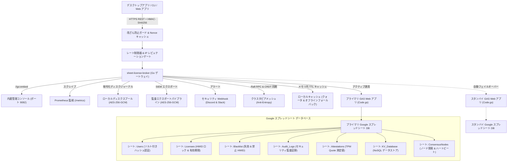

<div align="center">

<!-- 10-Language Navigation Bar -->
<p align="center">
  <a href="../../README.md">🇺🇸 English</a> · <a href="./ko.md">🇰🇷 한국어</a> · <a href="./zh-CN.md">🇨🇳 简体中文</a> · <b>🇯🇵 日本語</b> · <a href="./es.md">🇪🇸 Español</a><br />
  <a href="./fr.md">🇫🇷 Français</a> · <a href="./ru.md">🇷🇺 Русский</a> · <a href="./pt-BR.md">🇧🇷 Português</a> · <a href="./ar.md">🇸🇦 العربية</a> · <a href="./hi.md">🇮🇳 हिन्दी</a>
</p>

# Sheet-License-Broker

<p align="center">
  <strong>Google スプレッドシートと Google Apps Script を活用したサーバーレス認証・ライセンス権限付与・NoSQL データベースゲートウェイ</strong>
</p>

<p align="center">
  
  
  
  
  
  
  
  
  
  
  
  
  
  
  
  
  
  
</p>

</div>

---

## 💡 概要 (Overview)

**`sheet-license-broker`** は、通常の Google スプレッドシートをデスクトップアプリ、CLI ツール、個人開発インディ SaaS 向けの高信頼・本番運用可能なサーバーレスバックエンドへと変換するゲートウェイソリューションです。

ユーザーログインやソフトウェアライセンスキーの管理のためだけに、高価なクラウドデータベースや複雑な Docker コンテナを維持する必要はありません。`sheet-license-broker` は、**Google Apps Script (GAS)** クラウドエンジンと高速 **Go ブリッジ、NIST FIPS 204 耐量子暗号 ML-DSA 署名チェーン、分散 Raft クォーラム合意、CRDT LWW-Element-Set 同期、Cloudflare Edge Gateway、暗号学的ハードウェア構成証明 (TPM 2.0 & Enclave)、マルチテナント分離、デュアルシート・アクティブ/スタンバイ高可用性 (HA)、動的機能フラグと利用量メーター、暗号化ディスクスプール、Prometheus メトリクス、HMAC 改ざん防止検証、弾性オフラインキャッシュ、内蔵 Web 管理コンソール** を完璧に統合します。

### Google スプレッドシートをバックエンドにする利点
- **月額運用コスト完全無料 ($0/月)**: Google ドライブおよび Apps Script の無料クォータ（1 日最大 20,000 件のリクエスト）を活用。
- **耐量子暗号と ML-DSA 署名チェーン (NIST FIPS 204)**: モジュール格子ベースの耐量子電子署名（ML-DSA-44 / ML-DSA-65）と従来の ECDSA ハイブリッド署名チェーン（`Hybrid-P256-MLDSA65`）、ゼロダウンタイムの鍵ローテーション猶予期間、即時緊急失効キルスイッチブロードキャスト。
- **行動異常検知と適応型リスクスコアリング**: 統計的スライディングウィンドウ Z-Score ハートビートドリフト追跡（&plusmn;15% ジッター許容）、大圏航路計算による物理的移動不可能検知（&gt;950 km/h または同時 /24 サブネット検出）、適応型リスクスコア算出、リスク 50 以上での自動再証明チャレンジ発行、リスク 85 以上でのゼロトラスト隔離、SIEM 準拠のトポロジーグラフ（`siem-topology-v1`）出力。
- **エンタープライズ SSO と SCIM 2.0 ディレクトリ連携**: SAML 2.0 および OIDC 認証連携、RFC 7643/7644 準拠のアカウント自動プロビジョニングとライセンス座席割当、退職時の即時キルスイッチ失効。
- **ゼロ知識証明 (ZKP) 匿名認証**: NIST P-256 上の Pedersen コミットメント、非対話型 Sigma 証明（Fiat-Shamir 変換）、無効化識別子（Nullifier）の二重使用防止レジストリによるクライアントハードウェアプライバシー保護。
- **分散 Raft クォーラム合意と CRDT メッシュ**: 軽量リーダー選出、過半数ログ合意、競合フリーな LWW-Element-Set レプリケーション、SHA-256 マークルツリー要約によるブローカーノード間のアンチエントロピー同期。
- **エンタープライズレート制限と段階的バックオフ**: IP および機器識別子（HWID）別のスレッドセーフなスライディングウィンドウ流量制御、段階的ペナルティ遅延、標準 `X-RateLimit-*` レスポンスヘッダー。
- **レピュテーションキャッシュと自動一時遮断**: 繰り返されるセキュリティ違反を自動検知し、一時的アクセス遮断と優先度高インシデント Webhook を送信。
- **SIEM 向け暗号化監査バンドル出力**: Splunk、Datadog、AWS CloudWatch 向けの HMAC 封緘付き AES-256-GCM 暗号化監査ログパッケージ。
- **暗号学的ハードウェア構成証明**: TPM 2.0 PCR Quote 検証および Apple Secure Enclave / Windows Hello 鍵構成証明による不正クローン防御。
- **動的機能フラグと利用量従量課金**: Free, Pro, Enterprise プラン別の実行時権限チェック（`client.isFeatureEnabled("analytics")`）およびスプレッドシートへの原子的クォータ記録。
- **デュアルシート・アクティブ/スタンバイ自動フェイルオーバー**: プライマリシート障害時の瞬時スタンバイ切り替えと復旧時の双方向無衝突データ調停。
- **暗号化ローカルディスクスプール**: ネットワーク切断時にも一切のデータ欠損を防止する AES-256-GCM 暗号化キュー（`spool.bin`）。
- **内蔵 Web ダッシュボード**: スタンドアロン単一バイナリ（`sheet-license-broker.exe`）に組み込まれたダークモード管理 UI。

---

## 🏛️ アーキテクチャ (Architecture)



---

## 🚀 クイックスタート (Quick Start)

### 1. ローカルゲートウェイとダッシュボードの起動

環境に Go 1.22+ がインストールされていることを確認します：

```bash
# リポジトリのクローン
git clone https://github.com/kLauncher1/sheet-license-broker.git
cd sheet-license-broker

# スタンドアロンモードでビルド＆実行
go run .
```

ブラウザで **`http://localhost:9082`** を開き、管理ダッシュボードを表示します。

### 2. 本番 Google スプレッドシートへの接続 (プロキシモード)

デプロイ済みの Google Apps Script Web アプリに接続するための環境変数を設定します：

```bash
# Apps Script Web アプリ URL の設定
export GAS_WEBAPP_URL="https://script.google.com/macros/s/.../exec"
export CACHE_TTL_SECONDS="600" # 任意: 10 分間のキャッシュ有効期限

# ゲートウェイの起動
./sheet-license-broker.exe
```

サーバーはリモートエンドポイントを自動検出し、通信を中継してローカルにキャッシュします。障害発生時には自動的にオフラインキャッシュから透過的に応答を返します。

---

## 📋 Google スプレッドシートの設定手順

### 方法 A: Clasp CLI によるワンコマンド自動デプロイ

`@google/clasp` を利用する場合：

```bash
# 1. Google アカウントにログイン
npx @google/clasp login

# 2. 自動デプロイスクリプトを実行
node scripts/deploy_clasp.mjs --script-id <YOUR_APPS_SCRIPT_ID>
```

### 方法 B: 3 分間の手動セットアップ

1. [Google Sheets](https://sheets.new) にアクセスし、新しい空白シートを作成します。
2. 上部メニューから **拡張機能 > Apps Script** を選択します。
3. エディタの内容をすべて消去し、[`gas/Code.gs`](../../gas/Code.gs) の内容を貼り付けます。
4. **デプロイ > 新しいデプロイ** をクリックします：
   - 種類の選択：**ウェブアプリ (Web app)**
   - 次のユーザーとして実行：**自分 (登録したメールアドレス)**
   - アクセスできるユーザー：**全員 (Anyone)**
5. **デプロイ** を押し、発行された **ウェブアプリ URL**（`https://script.google.com/macros/s/.../exec`）をコピーします。

初回のアクセス時にスプレッドシート内に必要なテーブル（`Users`、`Licenses`、`KV_Database`）が自動生成されます。

---

## 📡 REST API 仕様要約

| カテゴリ | メソッドとエンドポイント | 説明 |
| :--- | :--- | :--- |
| **ヘルス診断** | `GET /api/health` | サービス全体の稼働健全性とテレメトリを確認 |
| **ヘルス診断** | `GET /api/proxy/ping` | Google Apps Script バックエンドとの通信往復試験 |
| **ユーザー認証** | `POST /api/users/register` | 管理者またはユーザーのアカウント登録（ソルト付きハッシュ） |
| **ユーザー認証** | `POST /api/users/login` | ログイン資格情報の検証 |
| **ライセンス** | `POST /api/licenses` | 新規ライセンスキーの発行（日数・最大端末数を指定） |
| **ライセンス** | `POST /api/licenses/validate` | 有効性検証および初回リクエスト端末 HWID への自動固定 |
| **ライセンス** | `POST /api/licenses/revoke` | ライセンスキーの即時無効化 |
| **セキュリティ** | `POST /api/security/blacklist` | 不正な端末 HWID またはライセンスをブラックリストに追加 |
| **セキュリティ** | `GET /api/security/blacklist` | 有効なブラックリスト一覧の取得 |
| **NoSQL** | `POST /api/docs` | コレクション名と ID を指定した JSON ドキュメント保存 |
| **NoSQL** | `GET /api/docs` | 全ドキュメント一覧の取得 |
| **マルチテナント** | `POST /api/tenants/register` | テナント登録（独自プレフィックスと Webhook 設定） |
| **バックアップ** | `POST /api/backup/export` | AES-256-GCM 暗号化スナップショットのエクスポート |
| **バックアップ** | `POST /api/backup/restore` | 暗号化スナップショットからのデータ復旧 |
| **機能フラグ** | `GET /api/features` | 全体機能カタログとプラン別割り当ての取得 |
| **機能フラグ** | `POST /api/features/check` | 特定ライセンスの機能利用資格チェック |
| **利用量メーター**| `POST /api/usage/record` | API 呼び出し等の利用量記録とクォータ判定 |
| **構成証明** | `POST /api/attestation/challenge` | TPM 2.0 / Enclave 検証用ワンタイム Nonce チャレンジ |
| **構成証明** | `POST /api/attestation/verify` | TPM 2.0 PCR Quote 測定値の暗号検証 |
| **レート制限** | `GET /api/security/ratelimit/status`| IP/HWID 単位のスライディングウィンドウ制御状況 |
| **分散合意** | `GET /api/consensus/status` | Raft クォーラムと CRDT クラスタ同期状態 |
| **リアルタイム** | `GET /api/stream/ws` | 双方向 WebSocket ストリームによる瞬時キルスイッチ |
| **ゼロ知識証明** | `POST /api/zkp/verify` | プライバシー保護型 Sigma プロトコル検証 |
| **SSO / SCIM** | `GET /api/sso/saml/metadata` | Okta / Azure AD 連携用 SP メタデータ XML 出力 |
| **SSO / SCIM** | `POST /scim/v2/Users` | SCIM 2.0 による社員プロビジョニングとライセンス自動割当 |
| **耐量子暗号** | `POST /api/pqc/sign` | NIST FIPS 204 ML-DSA 格子暗号ハイブリッド署名 |
| **行動異常検知** | `POST /api/anomaly/record` | クライアント観測値の送信と動的リスクスコア更新 |
| **SIEM 連携** | `GET /api/anomaly/graph` | セキュリティインシデント標準トポロジーグラフ出力 |

---

## 💻 多言語クライアント SDK

`sheet-license-broker` は端末 HWID の自動バインドと HMAC-SHA256 リクエスト署名に対応したクライアントライブラリを提供します。

### 🐍 Python クライアント (`sdk/python/sheet_license_client.py`)
外部依存のない標準ライブラリ（`urllib`、`hashlib`）のみで動作：

```python
from sheet_license_client import SheetLicenseClient

client = SheetLicenseClient(base_url="http://localhost:9082", secret_key="your-hmac-secret")

# 1. ライセンスの検証（端末 HWID が自動付与されます）
res = client.verify_license("SLB-XXXX-XXXX-XXXX")
if res.get("valid"):
    print("ライセンス認証成功。プラン:", res.get("tier"))

    # 2. 機能フラグの有効チェック
    if client.is_feature_enabled("SLB-XXXX-XXXX-XXXX", "analytics"):
        print("アナリティクス機能が有効です！")

    # 3. 利用量メトリクスの記録
    client.record_usage("SLB-XXXX-XXXX-XXXX", "api_calls", 1)
```

### ⚡ C# / .NET & Unity (`sdk/csharp/SheetLicenseClient.cs`)
Unity Mono/IL2CPP や WPF デスクトップアプリに対応：

```csharp
using SheetLicenseBroker;

var client = new SheetLicenseClient("http://localhost:9082", "your-hmac-secret");
var result = await client.VerifyLicenseAsync("SLB-XXXX-XXXX-XXXX");
if (result.Valid) {
    Console.WriteLine($"認証成功！ プラン: {result.Tier}, 有効期限: {result.ExpirationDate}");
}
```

### 🟩 TypeScript & Node.js (`@sheet-license/client`)
Node.js サーバーや Electron アプリに最適：

```typescript
import { SheetLicenseClient } from '@sheet-license/client';

const client = new SheetLicenseClient({
  baseUrl: 'http://localhost:9082',
  secretKey: 'your-hmac-secret',
});

const result = await client.verifyLicense('SLB-XXXX-XXXX-XXXX');
if (result.valid) {
  console.log('ライセンス有効。プラン:', result.tier);
}
```

### 🔷 Go クライアント (`sdk/go/client.go`)

```go
package main

import (
	"context"
	"fmt"
	"time"

	"github.com/kLauncher1/sheet-license-broker/sdk/go"
)

func main() {
	client := sdk.NewClient("http://localhost:9082", []byte("your-hmac-secret"), 5*time.Second)
	res, err := client.VerifyLicense(context.Background(), "SLB-XXXX-XXXX-XXXX", "")
	if err == nil && res.Valid {
		fmt.Printf("ライセンス認証成功 (プラン: %s)。アプリを起動します...\n", res.Tier)
	}
}
```

---

## 🛠️ 検証とビルド

```bash
# 全パッケージのユニットテストを実行
go test -v ./...

# 単一の本番実行可能バイナリをコンパイル
go build -ldflags="-s -w" -o sheet-license-broker.exe .
```

---

## 📄 ライセンス (License)

本プロジェクトは [MIT License](../../LICENSE) に基づいて公開されています。
