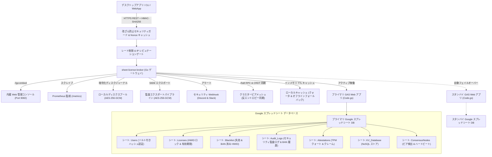

<div align="center">

<!-- 10-Language Navigation Bar -->
<p align="center">
  <a href="../../README.md">🇺🇸 English</a> · <a href="./ko.md">🇰🇷 한국어</a> · <a href="./zh-CN.md">🇨🇳 简体中文</a> · <b>🇯🇵 日本語</b> · <a href="./es.md">🇪🇸 Español</a><br />
  <a href="./fr.md">🇫🇷 Français</a> · <a href="./ru.md">🇷🇺 Русский</a> · <a href="./pt-BR.md">🇧🇷 Português</a> · <a href="./ar.md">🇸🇦 العربية</a> · <a href="./hi.md">🇮🇳 हिन्दी</a>
</p>

# Sheet-License-Broker

<p align="center">
  <strong>Google スプレッドシートと Google Apps Script を活用したサーバーレス認証・ライセンス権限付与・NoSQL データベースゲートウェイ</strong>
</p>

<p align="center">
  
  
  
  
  
  
  
  
  
  
  
  
  
  
  
  
  
  
</p>

</div>

---

## 💡 概要

**`sheet-license-broker`** は、通常の Google スプレッドシートをデスクトップアプリ、CLI ツール、個人開発インディ SaaS 向けの高信頼・本番運用可能なサーバーレスバックエンドへと変換するゲートウェイソリューションです。

ユーザーログインやソフトウェアライセンスキーの管理のためだけに、高価なクラウドデータベースインスタンスを契約したり複雑な Docker コンテナを運用・保守したりする必要はありません。`sheet-license-broker` は、**Google Apps Script (GAS)** クラウドエンジンと、**高速 Go ブリッジ、NIST FIPS 204 耐量子 ML-DSA 署名チェーン、分散 Raft クォーラム合意、CRDT LWW-Element-Set 同期、Cloudflare Edge Gateway、暗号学的ハードウェア構成証明 (TPM 2.0 および Enclave)、マルチテナント分離、デュアルシート・アクティブ/スタンバイ高可用性 (HA)、動的機能フラグおよび利用量メーター、暗号化ローカルディスクスプール、Prometheus メトリクス、暗号学的 HMAC 改ざん防止検証、弾性オフラインキャッシュ、内蔵 Web 管理コンソール** を完璧に統合します。

### Google スプレッドシートをバックエンドにする利点
- **月額運用コスト完全無料 ($0/月)**: Google ドライブおよび Apps Script の無料クォータ（1日最大 20,000 件のリクエスト）を最大限に活用。
- **耐量子暗号と ML-DSA 署名チェーン (NIST FIPS 204)**: モジュール格子ベースの耐量子電子署名検証（ML-DSA-44 / ML-DSA-65）と従来の ECDSA ハイブリッド署名チェーン（`Hybrid-P256-MLDSA65`）、ゼロダウンタイムの鍵ローテーション猶予期間、即時緊急失効キルスイッチブロードキャスト。
- **行動異常検知と適応型リスクスコアリング**: 統計的スライディングウィンドウ Z-Score ハートビートドリフト追跡（&plusmn;15% ジッター許容）、大圏航路（Haversine）速度計算による物理的移動不可能検知（&gt;950 km/h または同時 /24 サブネット検出）、名目活動による段階的減衰を伴う適応型リスクスコア算出、リスクスコア &ge; 50 での自動再構成証明チャレンジ昇格、リスクスコア &ge; 85 でのゼロトラスト自動隔離、エンタープライズ SIEM 取り込み用の標準化セキュリティインシデントトポロジーグラフ（`siem-topology-v1`）エクスポート。
- **エンタープライズシングルサインオン (SSO) と SCIM 2.0 ディレクトリ連携**: SAML 2.0 および OIDC アイデンティティフェデレーション、RFC 7643/7644 ディレクトリ同期、ライセンスシートの自動割り当て、即時プロビジョニング解除（デプロビジョニング）による失効。
- **ゼロ知識証明 (ZKP) 匿名検証**: 決定論的 Hash-to-Curve 独立ジェネレーターを備えた NIST P-256 上の Pedersen コミットメント、非対話型 Sigma 提示証明（Fiat-Shamir 変換）、消費済み Nullifier リプレイ攻撃防御レジストリによるクライアントハードウェアプライバシーの完全保護。
- **分散 Raft クォーラム合意と CRDT メッシュ**: 軽量リーダー選出、過半数ログクォーラム、コンフリクトフリーな LWW-Element-Set 状態レプリケーション、分散ブローカーノード間での反エントロピー同期のための SHA-256 マークルツリー状態ダイジェスト。
- **エンタープライズレート制限と段階的バックオフ**: IP および HWID ごとのスレッドセーフなスライディングウィンドウ型スロットリング、段階的ペナルティ遅延、標準 `X-RateLimit-*` レスポンスヘッダー。
- **スライディングウィンドウ IP/HWID レピュテーションキャッシュ**: 繰り返されるセキュリティ違反に対する自動一時アクセス禁止（BAN）および優先度の高いインシデント Webhook アラート発報。
- **SIEM 向け暗号化監査トークンエクスポート**: Splunk、Datadog、AWS CloudWatch 取り込みに対応した、コンプライアンス準拠の AES-256-GCM 暗号化および HMAC 署名封印済み監査バンドル。
- **暗号学的ハードウェア構成証明と Enclave バインディング**: TPM 2.0 PCR クォート検証および Apple Secure Enclave / Windows Hello ハードウェアキー構成証明によるクローン攻撃の防止。
- **クライアントアンチデバッグおよびメモリ改ざんテレメトリ**: 継続的な整合性スコアリングと、デバッガのアタッチやコードセクションの改ざんが検出されたデバイスに対する即時キルスイッチ自動 BAN。
- **動的機能フラグと利用量ベースのティア従量制**: Free、Pro、Enterprise サブスクリプションティア、ランタイム機能ゲーティング（`client.isFeatureEnabled("analytics")`）、Google スプレッドシートに直接アトミック永続化される消費クォータ追跡。
- **デュアルシート・アクティブ/スタンバイレプリケーション**: プライマリシートとスタンバイシート間の自動フェイルオーバー、およびコンフリクトのない双方向状態調整（Reconciliation）。
- **暗号化ローカルディスクスプール**: ネットワーク障害時のデータ損失をゼロにする AES-256-GCM 暗号化ジャーナルキュー（`spool.bin`）。
- **エンタープライズ Prometheus テレメトリ (`/metrics`)**: Prometheus フォーマットでカウンター、ゲージ、レイテンシを公開する組み込みスクレイパーエンドポイント。
- **インシデントアラート Webhook**: Discord および Slack チャンネルに即座に送信されるリッチなセキュリティインシデント通知。
- **マルチテナント名前空間分離**: 独自のプレフィックス（例: `ACME-LIC-XXXX-YYYY`）と独立したポリシーによる異なるプロダクトおよびテナントの完全分離。
- **Cloudflare Edge Gateway**: Cloudflare Workers および Workers KV と Web Crypto API によるミリ秒未満のエッジライセンス検証。
- **人間が直接読める管理パネル**: Google スプレッドシートそのものがデータベース。リアルタイムで直接閲覧、編集、BAN、ライセンス付与が可能。
- **ハードウェア固定保護 (HWID)**: 初回起動時にライセンスキーを特定マシンのハードウェア ID に自動ロック。
- **暗号学的 HMAC-SHA256 改ざん防止**: 中間者（MITM）傍受やリバースエンジニアリングによるペイロード偽装からクライアント通信を保護。
- **スライディングウィンドウ Nonce リプレイ緩和**: 5分間の許容タイムドリフトウィンドウによるリクエストリプレイ攻撃の防止。
- **即時リモート失効とデバイスブラックリスト**: Web コンソールまたは Google スプレッドシートのタブから直接ライセンスの失効や侵害されたハードウェア ID の BAN を実行。
- **自動バックアップとディザスタリカバリ**: SHA-256 データチェックサムおよび AES-256-GCM 暗号化で保護された特定時点（Point-in-Time）の状態エクスポートとリストア。
- **リアルタイムライフサイクル Webhook**: ワーカーキューと HMAC 署名付き Webhook 配信を備えたテナントおよびグローバルエンドポイント向けイベントディスパッチャー。
- **ソルト付き SHA-256 認証**: パスワードは暗号学的にソルトを付与しハッシュ化されてから永続化。
- **弾力的なローカルキャッシュとオフライン猶予**: メモリキャッシュされたライセンスと KV ドキュメントにより、Google API のレート制限 (HTTP 429) やネットワーク瞬断から保護。
- **組み込み Web ダッシュボード**: エメラルドダーク調の管理コンソールを内蔵した自己完結型の単一バイナリ（`sheet-license-broker.exe`）。

---

## 🏛️ アーキテクチャ



---

## 🚀 クイックスタート

### 1. ローカルゲートウェイとダッシュボードの起動

ワークステーションに Go 1.22 以上がインストールされていることを確認してください:

```bash
# リポジトリをクローン
git clone https://github.com/kLauncher1/sheet-license-broker.git
cd sheet-license-broker

# スタンドアロンモードで単一バイナリをビルドして実行
go run .
```

ブラウザで **`http://localhost:9082`** にアクセスし、リアルタイム管理コンソールを開きます。

### 2. 本番 Google スプレッドシートへの接続 (プロキシモード)

ブローカーをデプロイ済みの Google Apps Script Web アプリに接続するには:

```bash
# Apps Script Web アプリの URL を設定
export GAS_WEBAPP_URL="https://script.google.com/macros/s/.../exec"
export CACHE_TTL_SECONDS="600" # オプション: 10 分間のキャッシュ TTL (600秒)

# ゲートウェイを起動
./sheet-license-broker.exe
```

サーバーはリモート URL を自動検知して受信クエリを転送し、結果をローカルにキャッシュします。ネットワーク切断時にはキャッシュされたデータへ透過的にフォールバックします。

---

## 📋 Google スプレッドシートの設定と Clasp デプロイ

### オプション A: Clasp CLI 自動デプロイ

`@google/clasp` CLI を使用する場合:

```bash
# 1. Google アカウントにログイン
npx @google/clasp login

# 2. 自動ヘルパースクリプトを使用してデプロイ
node scripts/deploy_clasp.mjs --script-id <YOUR_APPS_SCRIPT_ID>
```

Clasp プロジェクトの作成および構成の詳細な手順については、[`gas/README.md`](../../gas/README.md) を参照してください。

### オプション B: 3分間の手動セットアップ

1. [Google Sheets](https://sheets.new) にアクセスし、新しい空白シートを作成します。
2. 上部メニューから **拡張機能 > Apps Script** を選択します。
3. エディタのデフォルトコードをすべて消去し、[`gas/Code.gs`](../../gas/Code.gs) の内容を貼り付けます。
4. **デプロイ > 新しいデプロイ** をクリックします:
   - 種類の選択: **ウェブアプリ**
   - 次のユーザーとして実行: **自分 (登録したメールアドレス)**
   - アクセスできるユーザー: **全員**
5. **デプロイ** をクリックし、発行された **ウェブアプリ URL**（`https://script.google.com/macros/s/.../exec`）をコピーします。

初回のアクセス時にスプレッドシート内に必要な 3 つの専用タブが自動生成されます:
- **`Users`**: `user_id`, `username`, `password_hash`, `salt`, `role`, `created_at`
- **`Licenses`**: `license_key`, `bound_hwid`, `max_devices`, `status`, `expires_at`, `created_at`
- **`KV_Database`**: `collection`, `doc_id`, `payload`, `updated_at`

---

## 📡 REST API 仕様詳細

### Health & Diagnostics

#### サービスヘルスとプロキシステータスの取得
```http
GET /api/health
```

#### バックエンドへの Ping
```http
GET /api/proxy/ping
```

---

### Authentication

#### ユーザー登録
```http
POST /api/users/register
Content-Type: application/json

{
  "username": "developer",
  "password": "SecurePassword123!",
  "role": "admin"
}
```

#### 認証 / ログイン
```http
POST /api/users/login
Content-Type: application/json

{
  "username": "developer",
  "password": "SecurePassword123!"
}
```

---

### License Management

#### 新規ライセンスキーの発行
```http
POST /api/licenses
Content-Type: application/json

{
  "days": 30,
  "max_devices": 1
}
```
**レスポンス:**
```json
{
  "license_key": "KEY-7F2A-9C4B-E108",
  "bound_hwid": "",
  "max_devices": 1,
  "status": "ACTIVE",
  "expires_at": "2026-11-12T12:00:00Z",
  "created_at": "2026-10-13T12:00:00Z"
}
```

#### HWID の検証および自動バインド
```http
POST /api/licenses/validate
Content-Type: application/json

{
  "license_key": "KEY-7F2A-9C4B-E108",
  "hwid": "WIN-B829-94AA-0123"
}
```
**レスポンス:**
```json
{
  "valid": true,
  "license_key": "KEY-7F2A-9C4B-E108",
  "hwid_bound": "WIN-B829-94AA-0123",
  "expires_at": "2026-11-12T12:00:00Z",
  "source": "remote_gas"
}
```

*注意: ライセンスがアクティブかつ未バインドの場合、送信された `hwid` に自動固定されます。一致するハードウェアからの後続の呼び出しは成功し、不一致のハードウェアからの呼び出しは拒否されます。また、レスポンスには結果が `cache`、`remote_gas`、`offline_cache` のいずれから返されたかも示されます。*

---

### Anti-Tamper & Security

#### HMAC-SHA256 リクエスト署名
`HMAC_ENFORCE=true` の場合（または `HMAC_SECRET` が設定されている場合）、クライアントは標準ヘッダーを使用して MITM 傍受からリクエストを保護します:
- `X-Signature`: `METHOD\nPATH\nTIMESTAMP\nNONCE\nSHA256(BODY)` に対して算出された 16 進エンコードの HMAC-SHA256 署名。
- `X-Timestamp`: 現在の Unix タイムスタンプ（秒単位、5分間のスライディングクロックドリフトウィンドウを強制）。
- `X-Nonce`: リクエストごとの一意な暗号学的 Nonce 文字列（リプレイ攻撃を防止）。

#### ライセンスキーの失効
```http
POST /api/licenses/revoke
Content-Type: application/json

{
  "license_key": "KEY-7F2A-9C4B-E108",
  "reason": "Payment refunded"
}
```

#### デバイスハードウェア ID (HWID) のブラックリスト登録
```http
POST /api/security/blacklist
Content-Type: application/json

{
  "type": "device",
  "target": "WIN-B829-94AA-0123",
  "reason": "Fraudulent key sharing"
}
```

#### ブラックリストおよび失効エントリの一覧取得
```http
GET /api/security/blacklist
```

---

### NoSQL Key-Value Store

#### ドキュメントの保存
```http
POST /api/docs
Content-Type: application/json

{
  "collection": "user_settings",
  "doc_id": "usr_9918",
  "payload": "{\"dark_mode\":true,\"telemetry\":false}"
}
```

#### 全ドキュメントの取得
```http
GET /api/docs
```

---

### Multi-Tenant Namespaces

#### テナントの登録
```http
POST /api/tenants/register
Content-Type: application/json

{
  "id": "tenant-gamehub",
  "name": "GameHub Studio",
  "namespace_prefix": "GHUB",
  "max_licenses": 100,
  "webhook_url": "https://api.gamehub.com/webhooks"
}
```

#### テナント名前空間付きライセンスの発行
```http
POST /api/licenses
Content-Type: application/json
X-Tenant-ID: tenant-gamehub

{
  "days": 60,
  "max_devices": 2
}
```
*`GHUB-LIC-XXXX-YYYY` のフォーマットに準拠したキーを生成します。*

---

### Automated Backup & Disaster Recovery

#### 暗号化バックアップのエクスポート (AES-256-GCM + SHA-256 完全性検証)
```http
POST /api/backup/export
Content-Type: application/json

{
  "secret_key": "your-backup-master-passphrase"
}
```

#### スナップショットからのリストア
```http
POST /api/backup/restore
Content-Type: application/json

{
  "secret_key": "your-backup-master-passphrase",
  "encrypted_payload": "<hex-encoded-ciphertext>"
}
```

---

### Dynamic Feature Flags & Usage-Based Tier Metering

#### 標準機能カタログとティア一覧の取得
```http
GET /api/features
```
**レスポンス:**
```json
{
  "tiers": {
    "free": {
      "name": "free",
      "features": ["basic_access"],
      "daily_quotas": { "api_calls": 500, "export_rows": 100 }
    },
    "pro": {
      "name": "pro",
      "features": ["basic_access", "analytics", "csv_export", "extended_logs"],
      "daily_quotas": { "api_calls": 50000, "export_rows": 100000 }
    },
    "enterprise": {
      "name": "enterprise",
      "features": ["basic_access", "analytics", "csv_export", "extended_logs", "sso", "audit_export", "unlimited_seats", "priority_support"],
      "daily_quotas": { "api_calls": 10000000, "export_rows": 50000000 }
    }
  }
}
```

#### ライセンスの機能権限チェック
```http
POST /api/features/check
Content-Type: application/json

{
  "license_key": "KEY-7F2A-9C4B-E108",
  "feature": "analytics"
}
```
**レスポンス:**
```json
{
  "license_key": "KEY-7F2A-9C4B-E108",
  "feature": "analytics",
  "tier": "pro",
  "allowed": true
}
```

#### 利用量の記録とティア別クォータ強制
```http
POST /api/usage/record
Content-Type: application/json

{
  "license_key": "KEY-7F2A-9C4B-E108",
  "metric": "api_calls",
  "units": 1
}
```
**レスポンス:**
```json
{
  "license_key": "KEY-7F2A-9C4B-E108",
  "metric": "api_calls",
  "units": 1,
  "current_usage": 42,
  "daily_quota": 50000,
  "quota_exceeded": false,
  "success": true
}
```

#### 利用量統計のクエリ
```http
GET /api/usage/stats?license_key=KEY-7F2A-9C4B-E108
```
**レスポンス:**
```json
{
  "license_key": "KEY-7F2A-9C4B-E108",
  "date": "2026-10-14",
  "tier": "pro",
  "metrics": {
    "api_calls": 42
  }
}
```

---

### Hardware Attestation & Anti-Tamper Telemetry

#### TPM / Enclave チャレンジ Nonce の要求
```http
POST /api/attestation/challenge
Content-Type: application/json

{
  "license_key": "KEY-7F2A-9C4B-E108",
  "hwid": "WIN-B829-94AA-0123"
}
```
**レスポンス:**
```json
{
  "status": "success",
  "challenge_id": "9a4f2b1c8e3d",
  "nonce": "e3b0c44298fc1c149afbf4c8996fb92427ae41e4649b934ca495991b7852b855",
  "expires_at": "2026-10-14T12:05:00Z"
}
```

#### TPM 2.0 PCR クォートの検証
```http
POST /api/attestation/verify
Content-Type: application/json

{
  "license_key": "KEY-7F2A-9C4B-E108",
  "hwid": "WIN-B829-94AA-0123",
  "challenge_id": "9a4f2b1c8e3d",
  "attestation_type": "tpm2",
  "tpm_quote": {
    "pcr_values": {
      "0": "e3b0c44298fc1c149afbf4c8996fb92427ae41e4649b934ca495991b7852b855",
      "7": "ba7816bf8f01cfea414140de5dae2223b00361a396177a9cb410ff61f20015ad"
    },
    "pcr_selection": [0, 7],
    "composite_digest": "4a5b6c7d8e9f...",
    "signature": "3045022100...",
    "ak_public_key_pem": "-----BEGIN PUBLIC KEY-----\n..."
  }
}
```

#### アンチデバッグおよび整合性テレメトリの送信
```http
POST /api/attestation/telemetry
Content-Type: application/json

{
  "license_key": "KEY-7F2A-9C4B-E108",
  "hwid": "WIN-B829-94AA-0123",
  "report": {
    "debugger_present": false,
    "memory_integrity": true,
    "sandbox_detected": false,
    "hooks_detected": false,
    "process_checksum": "a1b2c3d4e5f6...",
    "execution_uptime_s": 3600
  }
}
```

---

### 🛡️ Enterprise Rate Limiting & SIEM Audit Export

#### レート制限および IP レピュテーションテレメトリ
```http
GET /api/security/ratelimit/status
GET /api/security/reputation
```

#### 一時的な利用制限の適用 / 一覧取得
```http
# 有効な一時 BAN の一覧取得
GET /api/security/bans

# 一時的な利用制限を適用
POST /api/security/bans
Content-Type: application/json

{
  "key": "198.51.100.24",
  "reason": "Repeated failed validation attempts",
  "duration_minutes": 15
}

# 一時的な利用制限を解除
POST /api/security/bans/unban
Content-Type: application/json

{
  "key": "198.51.100.24"
}
```

#### 暗号化監査バンドルのエクスポート (SIEM / SOC 取り込み用)
```http
POST /api/security/audit/export
Content-Type: application/json

{
  "secret_key": "enterprise-compliance-secret",
  "limit": 500
}
```

#### 監査バンドルの検証と復号
```http
POST /api/security/audit/verify
Content-Type: application/json

{
  "secret_key": "enterprise-compliance-secret",
  "bundle": { ... }
}
```

---

### 🌐 Distributed Consensus & Multi-Region Quorum Sync

#### クラスターステータスとピアトポロジー
```http
GET /api/consensus/status
GET /api/consensus/peers
```

レスポンス:
```json
{
  "node_id": "node-1",
  "role": "Leader",
  "current_term": 1,
  "commit_index": 4,
  "peer_count": 2,
  "healthy_peers": 2,
  "has_quorum": true,
  "merkle_digest": "4a7d1ed414474e4033ac29ccb8653d9b...",
  "element_count": 128
}
```

#### クラスターピアへの参加
```http
POST /api/consensus/peers/join
Content-Type: application/json

{
  "node_id": "node-2",
  "address": "http://192.168.1.50:9082"
}
```

#### 反エントロピー状態同期のトリガー
```http
POST /api/consensus/sync/trigger
```

---

### ⚡ Real-Time WebSocket Streaming & Telemetry Push

#### 双方向 WebSocket テレメトリストリーム
リアルタイムのテレメトリストリーミングと 1 秒未満でのキルスイッチプッシュを行うため、持続的な WebSocket クライアントを `/api/stream/ws` に接続します:

```http
GET /api/stream/ws?license_key=SLB-XXXX-XXXX&hwid=HWID-1234 HTTP/1.1
Host: localhost:9082
Upgrade: websocket
Connection: Upgrade
Sec-WebSocket-Key: dGhlIHNhbXBsZSBub25jZQ==
Sec-WebSocket-Version: 13
```

#### 接続中ストリーミングクライアントとテレメトリのクエリ
```http
# アクティブなストリーミングセッションの一覧取得
GET /api/stream/clients

# ストリーミングメトリクスと直近のイベント監査ログのクエリ
GET /api/stream/telemetry
```

#### 即時リモートキルスイッチの実行
```http
POST /api/stream/kill
Content-Type: application/json

{
  "target": "SLB-XXXX-XXXX",
  "reason": "Suspected device cloning or fraud",
  "immediate": true
}
```
*注意: ターゲットには特定のライセンスキー、デバイス HWID、クライアント ID、または緊急一斉キルスイッチブロードキャスト実行のための `"ALL"` を指定できます。シグナルは一致するクライアントソケットへ 1 秒未満で即座にプッシュされます。*

---

### 🕵️ Zero-Knowledge Proof (ZKP) Anonymous Verification

#### NIST P-256 公開パラメータとジェネレーターの取得
```http
GET /api/zkp/params
```

#### 匿名ブラインドクレデンシャルの発行
```http
POST /api/zkp/credential/issue
Content-Type: application/json

{
  "license_key": "LIC-ENTERPRISE-001",
  "tenant_id": "default",
  "hwid": "WIN-B829-94AA-0123",
  "tier": "enterprise",
  "max_seats": 5
}
```

#### ゼロ知識提示証明の検証 (Sigma プロトコル)
```http
POST /api/zkp/verify
Content-Type: application/json

{
  "credential": { ... },
  "required_tier": "enterprise"
}
```

#### 消費済み Nullifier ステータスの検査
```http
GET /api/zkp/nullifiers/check?nullifier=7f2a9c4b...
```

---

### 🔐 Enterprise Single Sign-On (SSO) & SCIM 2.0 Directory Provisioning

#### SAML 2.0 サービスプロバイダーメタデータ
Okta、Azure AD、PingFederate 向けの標準 SP メタデータ XML をダウンロード:
```http
GET /api/sso/saml/metadata?entity_id=urn:sheet-license-broker:sp
```

#### SAML 2.0 Assertion Consumer Service (ACS)
受信した SAML アサーションを処理し、認証済みセッショントークンを発行:
```http
POST /api/sso/saml/acs
Content-Type: application/x-www-form-urlencoded

SAMLResponse=PHNhbWxwOlJlc3BvbnNlIHhtbG5z...
```

#### OpenID Connect (OIDC) コールバック
Google Workspace、Auth0、Keycloak からの ID トークンおよびクレームを検証:
```http
POST /api/sso/oidc/callback
Content-Type: application/json

{
  "sub": "usr_9918",
  "email": "alice@company.com",
  "iss": "https://accounts.google.com",
  "aud": "sheet-license-broker",
  "exp": 1776250000
}
```

#### アイデンティティプロバイダー (IdP) 管理
```http
# 新しい SAML または OIDC IdP の登録
POST /api/sso/idp
Content-Type: application/json

{
  "id": "okta-corp",
  "protocol": "saml",
  "entity_id": "http://www.okta.com/exk123456",
  "sso_url": "https://company.okta.com/app/sso",
  "tenant_id": "default",
  "enabled": true
}

# 登録済み IdP の一覧取得
GET /api/sso/idp
```

#### SCIM 2.0 ディレクトリプロビジョニング (RFC 7644)
Okta、Microsoft Entra ID (Azure AD)、OneLogin と直接連携して企業ユーザーのライフサイクルプロビジョニングを自動化:

```http
# サービスプロバイダー構成の取得
GET /scim/v2/ServiceProviderConfig

# ディレクトリユーザーの一覧取得 (ページネーション対応)
GET /scim/v2/Users?startIndex=1&count=50

# ユーザーのプロビジョニング (ライセンスシートを自動割り当て)
POST /scim/v2/Users
Content-Type: application/scim+json

{
  "schemas": ["urn:ietf:params:scim:schemas:core:2.0:User"],
  "userName": "alice@corp.com",
  "emails": [{ "value": "alice@corp.com", "primary": true }],
  "roles": [{ "value": "operator" }],
  "active": true
}

# ユーザーのプロビジョニング解除 (割り当て済みライセンスシートを即時失効しキルスイッチを発火)
DELETE /scim/v2/Users/usr-okta-8821
```

#### 一時的 RBAC セッショントークン
```http
# 一時セッショントークンの発行 (Mint)
POST /api/sso/token/mint
Content-Type: application/json

{
  "user_id": "usr_9918",
  "email": "alice@corp.com",
  "role": "admin",
  "scopes": ["license:read", "license:write", "sso:manage"]
}

# トークンのイントロスペクションとスコープ権限の強制
POST /api/sso/token/introspect
Content-Type: application/json

{
  "token": "sso_tok_7f2a9c4b...",
  "required_scope": "license:write"
}
```

---

### ⚛️ Post-Quantum Cryptography & ML-DSA Hybrid Signatures

#### NIST FIPS 204 格子パラメータとアクティブ鍵情報の取得
```http
GET /api/pqc/params
```
**レスポンス:**
```json
{
  "status": "success",
  "lattice": { "dimension": 256, "modulus": 8380417, "d": 13 },
  "primary_algorithm": "ML-DSA-65",
  "active_key_id": "pqc-key-9b0d-e626",
  "grace_window_days": 7
}
```

#### 公開検証鍵の一覧取得
```http
GET /api/pqc/keys
```

#### ハイブリッド耐量子ライセンス署名の発行
```http
POST /api/pqc/sign
Content-Type: application/json

{
  "license_key": "LIC-PRO-2026-99",
  "hwid": "HWID-9B0D-E626-C8D9-6D4B",
  "payload": "entitlement-v1-pro-tier"
}
```
**レスポンス:**
```json
{
  "status": "success",
  "signature": {
    "algorithm": "Hybrid-P256-MLDSA65",
    "key_id": "pqc-key-9b0d-e626",
    "classical_sig_b64": "MEUCIQD...",
    "pqc_sig_hex": "1f8e2a...",
    "payload_hash_hex": "e3b0c44...",
    "created_at": "2026-10-16T19:30:00Z"
  }
}
```

#### 従来暗号と格子暗号のデュアル署名検証
```http
POST /api/pqc/verify
Content-Type: application/json

{
  "payload": "entitlement-v1-pro-tier",
  "signature": {
    "algorithm": "Hybrid-P256-MLDSA65",
    "key_id": "pqc-key-9b0d-e626",
    "classical_sig_b64": "MEUCIQD...",
    "pqc_sig_hex": "1f8e2a..."
  }
}
```
**レスポンス:**
```json
{
  "status": "success",
  "result": {
    "valid": true,
    "algorithm": "Hybrid-P256-MLDSA65",
    "key_id": "pqc-key-9b0d-e626",
    "classical_valid": true,
    "pqc_valid": true
  }
}
```

#### 猶予期間を伴うアトミックな鍵ローテーション
```http
POST /api/pqc/rotate
Content-Type: application/json

{
  "algorithm": "ML-DSA-65",
  "grace_days": 7,
  "reason": "Routine cryptographic key rollover"
}
```

#### 侵害時の緊急鍵失効
```http
POST /api/pqc/revoke
Content-Type: application/json

{
  "key_id": "pqc-key-old-compromised",
  "reason": "Private key leakage detected"
}
```

---

### 🛡️ Behavioral Anomaly Detection & Adaptive Risk Scoring

`sheet-license-broker` には、統計的ハートビートドリフト、物理的に不可能な地理的移動、およびクライアントアプリケーション全体での動的リスクスコアリングを追跡するエンタープライズグレードの行動異常エンジンが搭載されています。

#### 適応型ガバナンスポリシー
- **スコア 0 ～ 49 (正常 - Nominal)**: 通常運用、無制限アクセス。正常なアクティビティにより、時間の経過とともに蓄積されたリスクポイントが段階的に減衰します。
- **スコア 50 ～ 84 (不審 - Suspicious)**: チャレンジ昇格が必要。5分間有効な1回限りの暗号学的再構成証明チャレンジを強制実行します（`POST /api/anomaly/challenge/issue` および `/verify`）。
- **スコア 85 ～ 100 (高リスク / 侵害 - High Risk / Compromised)**: 即時ゼロトラスト隔離。検証呼び出し（`POST /api/licenses/verify`）は自動的に HTTP 403 Forbidden で拒否され、セキュリティ Webhook へアラートが一斉送信されます。

#### クライアントテレメトリ観測値の記録
```http
POST /api/anomaly/record
Content-Type: application/json

{
  "license_key": "SLB-PRO-2026-99",
  "hwid": "HWID-9B0D-E626-C8D9-6D4B",
  "ip": "198.51.100.24",
  "latitude": 37.5665,
  "longitude": 126.9780
}
```
**レスポンス:**
```json
{
  "status": "recorded",
  "risk_score": {
    "entity_id": "SLB-PRO-2026-99",
    "score": 0,
    "classification": "NOMINAL",
    "challenge_required": false,
    "quarantined": false,
    "last_assessed": "2026-10-16T21:30:00Z"
  }
}
```

#### 適応型リスクスコアのクエリ
```http
GET /api/anomaly/score?license_key=SLB-PRO-2026-99
```

#### 再構成証明チャレンジの発行と検証
```http
# チャレンジトークンの発行
POST /api/anomaly/challenge/issue
Content-Type: application/json

{
  "license_key": "SLB-PRO-2026-99",
  "hwid": "HWID-9B0D-E626-C8D9-6D4B"
}

# チャレンジトークンの検証
POST /api/anomaly/challenge/verify
Content-Type: application/json

{
  "challenge_token": "ch_7f2a9c4b..."
}
```

#### セキュリティインシデントグラフのエクスポート (SIEM 標準フィード)
Splunk、Datadog、Elastic、Microsoft Sentinel 向けにフォーマットされた RFC 準拠のトポロジーインシデントノードおよびエッジをエクスポート:
```http
GET /api/anomaly/graph?min_score=50&limit=50
```
**レスポンス:**
```json
{
  "schema_version": "siem-topology-v1",
  "generated_at": "2026-10-16T21:30:00Z",
  "nodes": [
    { "id": "SLB-PRO-2026-99", "type": "CLIENT", "risk_score": 60, "first_seen": "...", "last_seen": "..." },
    { "id": "198.51.100.0/24", "type": "SUBNET", "risk_score": 30, "first_seen": "...", "last_seen": "..." }
  ],
  "edges": [
    { "id": "edge-1", "source_id": "SLB-PRO-2026-99", "target_id": "198.51.100.0/24", "relationship": "OBSERVED_IN_SUBNET", "weight": 60, "timestamp": "..." }
  ],
  "total_incidents": 1
}
```

#### エンジンテレメトリステータス
```http
GET /api/anomaly/status
```

---

## ⚡ Cloudflare Edge Gateway

グローバルに分散された 10 ミリ秒未満のエッジライセンス検証を実現するには、`edge/cloudflare/` に配置されている Cloudflare Worker をデプロイします:

```bash
cd edge/cloudflare
wrangler deploy
```

- **10 ミリ秒未満の POP 検証**: Cloudflare Workers KV キャッシュから有効なライセンスを直接高速判定。
- **ハードウェア Web Crypto**: オリジン到達前にエッジで HMAC-SHA256 署名検証およびリプレイ攻撃防止を実施。
- **自動オリジンフォールバック**: 未キャッシュのクエリ、新規キーバインド、失効処理はオリジンサーバーへ透過的にプロキシ。

---

## 💻 多言語クライアント SDK

`sheet-license-broker` には、ハードウェア ID (HWID) の自動デバイスバインディングと暗号学的 HMAC-SHA256 リクエスト署名をサポートする本番環境対応のクライアント SDK が `sdk/` 配下に用意されています。

### 🐍 Python クライアント (`sdk/python/sheet_license_client.py`)

外部依存関係ゼロ（標準ライブラリ `urllib` および `hashlib` のみを使用）:

```python
from sheet_license_client import SheetLicenseClient, get_machine_hwid

client = SheetLicenseClient(base_url="http://localhost:9082", secret_key="your-hmac-secret")

# 1. ライセンスキーの検証（ローカルマシンの HWID を自動付与）
res = client.verify_license("SLB-XXXX-XXXX-XXXX")
if res.get("valid"):
    print("License verified. Tier:", res.get("tier"))

    # 2. 動的機能フラグの利用資格をチェック
    if client.is_feature_enabled("SLB-XXXX-XXXX-XXXX", "analytics"):
        print("Analytics module enabled!")

    # 3. ティア別クォータに対する利用消費を記録
    client.record_usage("SLB-XXXX-XXXX-XXXX", "api_calls", 1)

    # 4. エンタープライズ SSO & SCIM ディレクトリトークンの検証
    sso_status = client.get_sso_status()
    token_info = client.introspect_session_token("sso_tok_...", required_scope="license:write")

    # 5. 行動異常テレメトリの送信とリスクスコアリング
    client.record_anomaly_telemetry("SLB-XXXX-XXXX-XXXX", latitude=37.5665, longitude=126.9780)
    risk = client.get_anomaly_risk_score(license_key="SLB-XXXX-XXXX-XXXX")
else:
    print("Denied:", res.get("message"))
```

### ⚡ C# / .NET & Unity (`sdk/csharp/SheetLicenseClient.cs`)

Unity Mono/IL2CPP、WPF、.NET デスクトップに対応した単一ファイルヘルパー:

```csharp
using SheetLicenseBroker;

var client = new SheetLicenseClient("http://localhost:9082", "your-hmac-secret");

// ライセンスを検証し、ティアの利用資格をチェック
var result = await client.VerifyLicenseAsync("SLB-XXXX-XXXX-XXXX");
if (result.Valid) {
    Console.WriteLine($"Access granted! Tier: {result.Tier}, Expiry: {result.ExpirationDate}");

    // 動的機能ゲーティング
    if (await client.IsFeatureEnabledAsync("SLB-XXXX-XXXX-XXXX", "analytics")) {
        Console.WriteLine("Analytics initialized.");
    }

    // 利用量の記録
    await client.RecordUsageAsync("SLB-XXXX-XXXX-XXXX", "api_calls", 1);

    // エンタープライズ SSO & SCIM ディレクトリトークンの検証
    var ssoStatus = await client.GetSSOStatusAsync();
    var tokenInfo = await client.IntrospectSessionTokenAsync("sso_tok_...", "license:write");

    // 行動異常テレメトリの送信とリスクスコアリング
    await client.RecordAnomalyTelemetryAsync("SLB-XXXX-XXXX-XXXX", 37.5665, 126.9780);
    var risk = await client.GetAnomalyRiskScoreAsync("SLB-XXXX-XXXX-XXXX");
}
```

### 🟩 TypeScript & Node.js (`@sheet-license/client`)

Node.js バックエンドおよび Electron アプリ向けの依存関係ゼロのネイティブ ESM パッケージ:

```typescript
import { SheetLicenseClient } from '@sheet-license/client';

const client = new SheetLicenseClient({
  baseUrl: 'http://localhost:9082',
  secretKey: 'your-hmac-secret',
});

const result = await client.verifyLicense('SLB-XXXX-XXXX-XXXX');
if (result.valid) {
  console.log('License active. Tier:', result.tier);

  // 動的機能ゲーティング
  const hasAnalytics = await client.isFeatureEnabled('SLB-XXXX-XXXX-XXXX', 'analytics');
  if (hasAnalytics) {
    console.log('Analytics feature enabled for client');
  }

  // 利用量メトリクスの記録
  await client.recordUsage('SLB-XXXX-XXXX-XXXX', 'api_calls', 1);

  // エンタープライズ SSO & SCIM ディレクトリトークンの検証
  const ssoStatus = await client.getSSOStatus();
  const tokenInfo = await client.introspectSessionToken('sso_tok_...', 'license:write');

  // 行動異常テレメトリの送信とリスクスコアリング
  await client.recordAnomalyTelemetry('SLB-XXXX-XXXX-XXXX', { latitude: 37.5665, longitude: 126.9780 });
  const risk = await client.getAnomalyRiskScore('SLB-XXXX-XXXX-XXXX');
}
```

### 🔷 Go クライアント (`sdk/go/client.go`)

```go
package main

import (
	"context"
	"fmt"
	"time"

	"github.com/kLauncher1/sheet-license-broker/sdk/go"
)

func main() {
	client := sdk.NewClient("http://localhost:9082", []byte("your-hmac-secret"), 5*time.Second)

	res, err := client.VerifyLicense(context.Background(), "SLB-XXXX-XXXX-XXXX", "")
	if err == nil && res.Valid {
		fmt.Printf("License valid (Tier: %s). Launching application...\n", res.Tier)

		// 動的機能ゲーティング
		allowed, _ := client.IsFeatureEnabled(context.Background(), "SLB-XXXX-XXXX-XXXX", "analytics")
		if allowed {
			fmt.Println("Analytics feature enabled.")
		}

		// 利用消費の記録
		_ = client.RecordUsage(context.Background(), "SLB-XXXX-XXXX-XXXX", "api_calls", 1)

		// エンタープライズ SSO & SCIM ディレクトリトークンの検証
		ssoStatus, _ := client.GetSSOStatus(context.Background())
		tokenInfo, _ := client.IntrospectSessionToken(context.Background(), "sso_tok_...", "license:write")
		_ = ssoStatus
		_ = tokenInfo

		// 行動異常テレメトリの送信とリスクスコアリング
		_ = client.RecordAnomalyTelemetry(context.Background(), sdk.ClientObservation{
			LicenseKey: "SLB-XXXX-XXXX-XXXX",
			Latitude:   37.5665,
			Longitude:  126.9780,
		})
		risk, _ := client.GetAnomalyRiskScore(context.Background(), "SLB-XXXX-XXXX-XXXX", "")
		_ = risk
	}
}
```

---

## 🛠️ 検証とビルド

自動検証テストスイートを実行します:

```bash
# 全パッケージのユニットテストを実行
go test -v ./...

# 単独実行可能な本番バイナリをコンパイル
go build -ldflags="-s -w" -o sheet-license-broker.exe .
```

---

## 📄 ライセンス

このプロジェクトは [MIT License](../../LICENSE) の下で公開されています。
