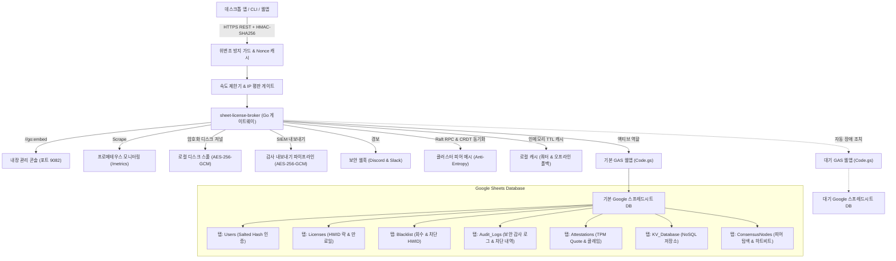

<div align="center">

<!-- 10-Language Navigation Bar -->
<p align="center">
  <a href="../../README.md">🇺🇸 English</a> · <b>🇰🇷 한국어</b> · <a href="./zh-CN.md">🇨🇳 简体中文</a> · <a href="./ja.md">🇯🇵 日本語</a> · <a href="./es.md">🇪🇸 Español</a><br />
  <a href="./fr.md">🇫🇷 Français</a> · <a href="./ru.md">🇷🇺 Русский</a> · <a href="./pt-BR.md">🇧🇷 Português</a> · <a href="./ar.md">🇸🇦 العربية</a> · <a href="./hi.md">🇮🇳 हिन्दी</a>
</p>

# Sheet-License-Broker

<p align="center">
  <strong>Google 스프레드시트 및 Google Apps Script 기반 서버리스 인증, 라이선스 권한 부여 및 NoSQL 데이터베이스 게이트웨이</strong>
</p>

<p align="center">
  
  
  
  
  
  
  
  
  
  
  
  
  
  
  
  
  
  
</p>

</div>

---

## 💡 개요 (Overview)

**`sheet-license-broker`**는 일반 Google 스프레드시트를 데스크톱 애플리케이션, CLI 도구, 1인 인디 SaaS를 위한 프로덕션급 고성능 서버리스 백엔드로 변환해 주는 게이트웨이 솔루션입니다.

사용자 로그인과 소프트웨어 라이선스 키 관리를 위해 매달 고비용 클라우드 데이터베이스 인스턴스를 구독하거나 복잡한 Docker 컨테이너를 운영할 필요가 없습니다. `sheet-license-broker`는 **Google Apps Script (GAS)** 클라우드 엔진과 초고속 **Go 브리지, NIST FIPS 204 양자 내성 ML-DSA 서명 체인, 분산 Raft 쿼럼 합의, CRDT LWW-Element-Set 동기화, Cloudflare Edge Gateway, 암호학적 하드웨어 증명 (TPM 2.0 및 Enclave), 멀티테넌트 네임스페이스, 듀얼 시트 액티브-스탠바이 고가용성(HA), 동적 기능 플래그 및 사용량 측정, 암호화된 디스크 스풀링, 프로메테우스 메트릭, 암호학적 HMAC 위변조 방지, 탄력적 오프라인 캐시, 내장 웹 UI 콘솔**을 하나로 완벽하게 통합합니다.

### 왜 Google 스프레드시트 백엔드인가?
- **월 유지비용 0원 ($0/mo)**: Google 드라이브 및 Apps Script 무료 쿼터(일일 최대 20,000건 요청) 활용.
- **양자 내성 암호 및 ML-DSA 서명 체인 (NIST FIPS 204)**: 격자 기반 디지털 서명(ML-DSA-44 / ML-DSA-65)과 고전 ECDSA 하이브리드 서명 체인(`Hybrid-P256-MLDSA65`), 무중단 키 로테이션 유예 기간, 즉각적인 비상 폐기 킬스위치 브로드캐스트 지원.
- **행동 이상 탐지 및 적응형 리스크 점수 산정**: 통계적 슬라이딩 윈도우 Z-Score 하트비트 드리프트 추적(&plusmn;15% 지터 허용), Haversine 구면 삼각법 기반 불가능한 물리적 이동 감지(&gt;950 km/h 또는 동시 /24 서브넷 감지), 적응형 위험 점수 산정, 위험도 50 이상 시 자동 재증명 챌린지 에스컬레이션, 위험도 85 이상 시 제로 트러스트 자동 격리 및 엔터프라이즈 SIEM 표준 토폴로지 그래프(`siem-topology-v1`) 출력.
- **엔터프라이즈 SSO 및 SCIM 2.0 디렉터리 동기화**: SAML 2.0 및 OIDC 신원 연합, RFC 7643/7644 디렉터리 사용자 자동 프로비저닝 및 라이선스 좌석 할당, 계정 비활성화 시 즉각적인 킬스위치 회수.
- **영지식 증명(ZKP) 익명 검증**: NIST P-256 상의 Pedersen 커밋먼트, 비대화형 Sigma 증명(Fiat-Shamir 변환), 소진된 Nullifier 재생 공격 방지 레지스트리로 클라이언트 하드웨어 프라이버시 보호.
- **분산 Raft 쿼럼 합의 및 CRDT 메시**: 경량 리더 선출, 과반수 로그 쿼럼, 충돌 없는 LWW-Element-Set 상태 복제 및 SHA-256 머클 트리 상태 요약을 통한 분산 브로커 노드 간 안티 엔트로피 동기화.
- **엔터프라이즈 속도 제한 및 점진적 백오프**: IP 및 HWID별 스레드 안전 슬라이딩 윈도우 스로틀링, 점진적 지연 페널티 및 표준 `X-RateLimit-*` 헤더 제공.
- **슬라이딩 윈도우 IP/HWID 평판 캐시**: 반복적인 보안 위반 시 자동 임시 차단 및 고우선순위 인시던트 웹훅 알림 전송.
- **SIEM용 암호화 감사 토큰 내보내기**: Splunk, Datadog, AWS CloudWatch 수집을 위한 규정 준수 AES-256-GCM 암호화 감사 번들(HMAC 서명 밀봉).
- **암호학적 하드웨어 증명 및 엔클레이브 바인딩**: TPM 2.0 PCR 인용(Quote) 검증 및 Apple Secure Enclave / Windows Hello 하드웨어 키 증명을 통한 복제 공격 방지.
- **클라이언트 안티 디버깅 및 메모리 변조 텔레메트리**: 무결성 점수를 실시간 추적하고 디버거 연결이나 코드 섹션 변조 감지 시 즉각적인 킬스위치 자동 차단 실행.
- **동적 기능 플래그 및 사용량 기반 티어 측정**: Free, Pro, Enterprise 구독 티어별 런타임 기능 제한(`client.isFeatureEnabled("analytics")`) 및 Google 스프레드시트에 원자적으로 영구 기록되는 소비 쿼터 추적.
- **듀얼 시트 액티브-스탠바이 복제**: 기본 시트와 대기 시트 간의 자동 장애 조치(Failover) 및 충돌 없는 양방향 상태 조정(Reconciliation).
- **암호화된 로컬 디스크 스풀**: 네트워크 단절 시에도 단 1건의 데이터 손실도 발생하지 않도록 보장하는 AES-256-GCM 암호화 저널 큐(`spool.bin`).
- **엔터프라이즈 프로메테우스 텔레메트리 (`/metrics`)**: 카운터, 게이지, 지연 시간을 표준 프로메테우스 포맷으로 노출하는 내장 스크래퍼 엔드포인트.
- **인시던트 알림 웹훅**: Discord 및 Slack 채널로 즉시 발송되는 상세 보안 인시던트 알림.
- **멀티테넌트 네임스페이스**: 커스텀 접두사(예: `ACME-LIC-XXXX-YYYY`)와 독립 정책을 통해 여러 제품군 및 테넌트를 완벽히 분리 격리.
- **Cloudflare Edge Gateway**: Web Crypto API를 탑재한 Cloudflare Workers 및 Workers KV 기반의 1ms 미만 엣지 라이선스 검증.
- **사람이 읽기 쉬운 관리자 패널**: Google 스프레드시트 자체가 데이터베이스 역할을 하므로 별도의 도구 없이 실시간으로 행을 편집, 삭제, 차단할 수 있습니다.
- **하드웨어 고정 보호 (HWID)**: 첫 실행 시 라이선스 키를 클라이언트 기기의 고유 하드웨어 ID에 자동 바인딩.
- **HMAC-SHA256 암호 위변조 방지**: MITM 패킷 감청 및 리버스 엔지니어링된 위조 페이로드로부터 클라이언트 트래픽을 완벽 보호.
- **슬라이딩 윈도우 Nonce 재생 공격 방지**: 5분 드리프트 허용 오차 윈도우로 요청 재전송 공격 차단.
- **실시간 원격 회수 및 기기 블랙리스트**: 관리자 웹 콘솔 또는 스프레드시트 탭에서 단 한 번의 클릭으로 라이선스를 즉각 무효화하거나 불량 HWID를 차단.
- **자동 백업 및 재해 복구**: SHA-256 무결성 체크섬과 AES-256-GCM 암호화로 보호되는 시점별 상태 내보내기 및 복원.
- **내장 웹 대시보드**: 단일 실행 바이너리(`sheet-license-broker.exe`) 내에 번들링된 에메랄드 다크 모드 관리 콘솔.

---

## 🏛️ 아키텍처 (Architecture)



---

## 🚀 빠른 시작 (Quick Start)

### 1. 로컬 게이트웨이 및 대시보드 실행

작업 환경에 Go 1.22+가 설치되어 있는지 확인합니다:

```bash
# 저장소 복제
git clone https://github.com/kLauncher1/sheet-license-broker.git
cd sheet-license-broker

# 단독(Standalone) 모드로 빌드 및 실행
go run .
```

브라우저에서 **`http://localhost:9082`**에 접속하여 실시간 관리 콘솔을 확인합니다.

### 2. 실제 Google 스프레드시트 연동 (프록시 모드)

배포된 Google Apps Script Web App과 연동하려면 환경 변수를 설정합니다:

```bash
# Apps Script 웹앱 URL 설정
export GAS_WEBAPP_URL="https://script.google.com/macros/s/.../exec"
export CACHE_TTL_SECONDS="600" # 선택 사항: 10분 캐시 TTL

# 게이트웨이 실행
./sheet-license-broker.exe
```

서버는 원격 URL을 자동 감지하여 요청을 전달하고, 결과를 로컬에 캐싱하며, 네트워크 장애 시 캐시된 데이터를 투명하게 활용합니다.

---

## 📋 Google 스프레드시트 설정 및 Clasp 배포

### 옵션 A: Clasp CLI 제로 클릭 자동 배포

`@google/clasp` CLI 도구를 사용하는 경우:

```bash
# 1. Google 계정 로그인
npx @google/clasp login

# 2. 자동 배포 헬퍼 스크립트 실행
node scripts/deploy_clasp.mjs --script-id <YOUR_APPS_SCRIPT_ID>
```

### 옵션 B: 3분 수동 설정

1. [Google Sheets](https://sheets.new)에서 새 스프레드시트를 만듭니다.
2. 상단 메뉴에서 **확장 프로그램 > Apps Script**를 클릭합니다.
3. 기본 코드를 지우고 [`gas/Code.gs`](../../gas/Code.gs)의 내용을 붙여넣습니다.
4. **배포 > 새 배포**를 클릭합니다:
   - 유형: **웹 앱 (Web app)**
   - 다음 사용자로 실행: **나 (내 이메일)**
   - 액세스 권한이 있는 사용자: **모든 사용자 (Anyone)**
5. **배포**를 클릭하고 생성된 **웹 앱 URL**(`https://script.google.com/macros/s/.../exec`)을 복사합니다.

스프레드시트는 첫 요청 시 필요한 탭(`Users`, `Licenses`, `KV_Database`)을 자동 생성합니다.

---

## 📡 REST API 규격 요약

| 분류 | 메서드 & 엔드포인트 | 설명 |
| :--- | :--- | :--- |
| **상태 진단** | `GET /api/health` | 서비스 종합 상태 및 텔레메트리 확인 |
| **상태 진단** | `GET /api/proxy/ping` | 백엔드 Google Apps Script 왕복 응답 테스트 |
| **인증** | `POST /api/users/register` | 관리자 및 일반 사용자 등록 (솔트 해시) |
| **인증** | `POST /api/users/login` | 사용자 로그인 및 인증 확인 |
| **라이선스** | `POST /api/licenses` | 신규 라이선스 키 발급 (일수, 최대 디바이스 수 지정) |
| **라이선스** | `POST /api/licenses/validate` | 라이선스 검증 및 클라이언트 HWID 최초 1회 자동 락인 |
| **라이선스** | `POST /api/licenses/revoke` | 라이선스 키 즉각 회수 및 무효화 |
| **보안** | `POST /api/security/blacklist` | 악성 기기 HWID 또는 라이선스 영구 블랙리스트 등록 |
| **보안** | `GET /api/security/blacklist` | 현재 등록된 블랙리스트 및 회수 목록 조회 |
| **NoSQL** | `POST /api/docs` | 컬렉션/문서 ID 기반 JSON 데이터 저장 |
| **NoSQL** | `GET /api/docs` | 전체 문서 목록 조회 |
| **멀티테넌트** | `POST /api/tenants/register` | 테넌트 등록 (커스텀 키 접두사 및 웹훅 지정) |
| **백업/복구** | `POST /api/backup/export` | AES-256-GCM 암호화 상태 백업 내보내기 |
| **백업/복구** | `POST /api/backup/restore` | 백업 스냅샷을 통한 즉각적인 재해 복구 |
| **기능 플래그** | `GET /api/features` | 글로벌 기능 카탈로그 및 티어별 쿼터 조회 |
| **기능 플래그** | `POST /api/features/check` | 라이선스별 특정 기능 권한 여부 확인 |
| **사용량 측정** | `POST /api/usage/record` | API 호출 등 메트릭 사용량 기록 및 일일 쿼터 검사 |
| **하드웨어 증명** | `POST /api/attestation/challenge` | TPM 2.0 / Enclave 증명용 일회용 Nonce 챌린지 발급 |
| **하드웨어 증명** | `POST /api/attestation/verify` | TPM 2.0 PCR 인용값 및 암호학적 서명 검증 |
| **속도 제한** | `GET /api/security/ratelimit/status`| IP 및 HWID별 슬라이딩 윈도우 스로틀링 상태 확인 |
| **분산 합의** | `GET /api/consensus/status` | Raft 쿼럼 및 CRDT LWW-Element-Set 클러스터 상태 |
| **실시간 스트림**| `GET /api/stream/ws` | 실시간 웹소켓 양방향 텔레메트리 및 킬스위치 스트림 |
| **영지식 증명** | `POST /api/zkp/verify` | 프라이버시 보존형 ZKP 시그마 증명 검증 |
| **SSO / SCIM** | `GET /api/sso/saml/metadata` | Okta, Azure AD 연동용 SP 메타데이터 XML 다운로드 |
| **SSO / SCIM** | `POST /scim/v2/Users` | SCIM 2.0 사용자 계정 생성 및 라이선스 좌석 자동 할당 |
| **양자 내성** | `POST /api/pqc/sign` | NIST FIPS 204 ML-DSA 격자 기반 양자 내성 하이브리드 서명 |
| **행동 이상 탐지**| `POST /api/anomaly/record` | 하트비트 지터 및 물리적 이동 거리 기록, 리스크 점수 산정 |
| **SIEM 토폴로지**| `GET /api/anomaly/graph` | SIEM 수집용 표준 보안 인시던트 토폴로지 그래프 출력 |

---

## 💻 멀티 언어 클라이언트 SDK

`sheet-license-broker`는 자동 HWID 기기 바인딩과 HMAC-SHA256 암호 서명을 기본 지원하는 완성형 클라이언트 SDK를 제공합니다.

### 🐍 Python 클라이언트 (`sdk/python/sheet_license_client.py`)
외부 서드파티 라이브러리 의존성이 전혀 없는 표준 라이브러리(`urllib`, `hashlib`) 기반 구현:

```python
from sheet_license_client import SheetLicenseClient

client = SheetLicenseClient(base_url="http://localhost:9082", secret_key="your-hmac-secret")

# 1. 라이선스 검증 (기기 고유 HWID 자동 첨부)
res = client.verify_license("SLB-XXXX-XXXX-XXXX")
if res.get("valid"):
    print("라이선스 검증 완료. 티어:", res.get("tier"))

    # 2. 동적 기능 플래그 확인
    if client.is_feature_enabled("SLB-XXXX-XXXX-XXXX", "analytics"):
        print("고급 분석 모듈 활성화됨!")

    # 3. 사용량 기록 및 쿼터 차감
    client.record_usage("SLB-XXXX-XXXX-XXXX", "api_calls", 1)
```

### ⚡ C# / .NET & Unity (`sdk/csharp/SheetLicenseClient.cs`)
Unity Mono/IL2CPP, WPF, 콘솔 애플리케이션과 호환되는 단일 소스 파일 SDK:

```csharp
using SheetLicenseBroker;

var client = new SheetLicenseClient("http://localhost:9082", "your-hmac-secret");
var result = await client.VerifyLicenseAsync("SLB-XXXX-XXXX-XXXX");
if (result.Valid) {
    Console.WriteLine($"인증 성공! 티어: {result.Tier}, 만료일: {result.ExpirationDate}");
}
```

### 🟩 TypeScript & Node.js (`@sheet-license/client`)
Node.js 백엔드 및 Electron 데스크톱 앱을 위한 ESM 패키지:

```typescript
import { SheetLicenseClient } from '@sheet-license/client';

const client = new SheetLicenseClient({
  baseUrl: 'http://localhost:9082',
  secretKey: 'your-hmac-secret',
});

const result = await client.verifyLicense('SLB-XXXX-XXXX-XXXX');
if (result.valid) {
  console.log('라이선스 유효. 티어:', result.tier);
}
```

### 🔷 Go 클라이언트 (`sdk/go/client.go`)

```go
package main

import (
	"context"
	"fmt"
	"time"

	"github.com/kLauncher1/sheet-license-broker/sdk/go"
)

func main() {
	client := sdk.NewClient("http://localhost:9082", []byte("your-hmac-secret"), 5*time.Second)
	res, err := client.VerifyLicense(context.Background(), "SLB-XXXX-XXXX-XXXX", "")
	if err == nil && res.Valid {
		fmt.Printf("라이선스 유효 (티어: %s). 프로그램을 실행합니다...\n", res.Tier)
	}
}
```

---

## 🛠️ 검증 및 빌드

```bash
# 전체 패키지 단위 테스트 실행
go test -v ./...

# 단독 실행 프로덕션 바이너리 빌드
go build -ldflags="-s -w" -o sheet-license-broker.exe .
```

---

## 📄 라이선스 (License)

이 프로젝트는 [MIT License](../../LICENSE)에 따라 자유롭게 사용 및 수정할 수 있습니다.
