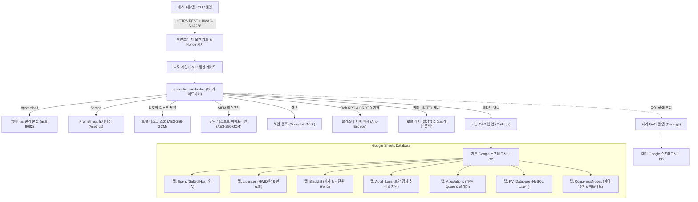

<div align="center">

<!-- 10-Language Navigation Bar -->
<p align="center">
  <a href="../../README.md">🇺🇸 English</a> · <b>🇰🇷 한국어</b> · <a href="./zh-CN.md">🇨🇳 简体中文</a> · <a href="./ja.md">🇯🇵 日本語</a> · <a href="./es.md">🇪🇸 Español</a><br />
  <a href="./fr.md">🇫🇷 Français</a> · <a href="./ru.md">🇷🇺 Русский</a> · <a href="./pt-BR.md">🇧🇷 Português</a> · <a href="./ar.md">🇸🇦 العربية</a> · <a href="./hi.md">🇮🇳 हिन्दी</a>
</p>

# Sheet-License-Broker

<p align="center">
  <strong>Google 스프레드시트 및 Google Apps Script 기반 서버리스 인증, 라이선스 권한 부여 및 NoSQL 데이터베이스 게이트웨이</strong>
</p>

<p align="center">
  
  
  
  
  
  
  
  
  
  
  
  
  
  
  
  
  
  
</p>

</div>

---

## 💡 개요

**`sheet-license-broker`**는 일반 Google 스프레드시트를 데스크톱 애플리케이션, CLI 도구 및 인디 SaaS 제품을 위한 인증 기능을 갖춘 프로덕션급 서버리스 백엔드로 변환합니다. 

단순히 사용자 로그인과 소프트웨어 라이선스 키를 처리하기 위해 고비용 클라우드 데이터베이스 인스턴스 비용을 지불하거나 Docker 컨테이너를 관리할 필요가 없습니다. `sheet-license-broker`는 **Google Apps Script (GAS)** 클라우드 엔진과 **초고속 Go 브리지, 양자 내성 ML-DSA 서명 체인, 분산 Raft 쿼럼 합의, CRDT LWW-Element-Set 동기화, Cloudflare Edge Gateway, 암호학적 하드웨어 증명 (TPM 2.0 및 Enclave), 멀티테넌트 네임스페이스, 듀얼 시트 액티브-스탠바이 고가용성(HA), 동적 기능 플래그 및 사용량 측정, 암호화된 디스크 스풀링, Prometheus 메트릭, 암호학적 HMAC 위변조 방지 검증, 탄력적 오프라인 캐싱 및 임베디드 웹 UI**를 결합하여 제공합니다.

### 왜 Google 스프레드시트 백엔드인가?
- **비용 제로 ($0/월)**: Google Drive 및 Apps Script 무료 할당량(일일 최대 20,000건 요청)을 활용합니다.
- **양자 내성 암호화 및 ML-DSA 서명 체인 (NIST FIPS 204)**: 이중 고전 ECDSA / 격자 하이브리드 서명 체인(`Hybrid-P256-MLDSA65`), 무중단 키 교체 유예 윈도우, 즉각적인 비상 폐기 킬스위치 브로드캐스트를 지원하는 양자 내성 모듈 격자 기반 디지털 서명 검증(ML-DSA-44 / ML-DSA-65).
- **행동 이상 탐지 및 적응형 리스크 점수화**: 통계적 슬라이딩 윈도우 Z-Score 하트비트 드리프트 추적(허용 지터 &plusmn;15%), Haversine 속도 기반 물리적으로 불가능한 이동 감지(시속 950km 초과 또는 동시 /24 서브넷 감지), 점진적 정상 감쇠가 적용된 적응형 위험 점수 계산, 위험 점수 50 이상 시 자동 재증명 챌린지 에스컬레이션, 위험 점수 85 이상 시 제로 트러스트 자동 격리, 엔터프라이즈 SIEM 수집을 위한 표준 보안 인시던트 토폴로지 그래프 익스포터(`siem-topology-v1`).
- **엔터프라이즈 단일 로그인 (SSO) 및 SCIM 2.0 디렉터리 프로비저닝**: SAML 2.0 및 OIDC 신원 연합, RFC 7643/7644 디렉터리 동기화, 자동 라이선스 좌석 할당 및 디프로비저닝 시 즉각적인 킬스위치 폐기.
- **영지식 증명 (ZKP) 익명 검증**: 클라이언트 하드웨어 프라이버시를 보호하는 결정론적 hash-to-curve 독립 생성기를 갖춘 NIST P-256 기반 Pedersen 커밋먼트, 비대화형 Sigma 증명(Fiat-Shamir 변환 적용), 소진된 Nullifier 재생 방지 레지스트리.
- **분산 Raft 쿼럼 합의 및 CRDT 메시**: 분산 브로커 노드 전반의 안티 엔트로피 동기화를 위한 경량 리더 선출, 과반수 로그 쿼럼, 충돌 없는 LWW-Element-Set 상태 복제 및 SHA-256 Merkle 트리 상태 다이제스트.
- **엔터프라이즈 속도 제한 및 점진적 백오프**: 점진적 페널티 지연 및 표준 `X-RateLimit-*` 헤더가 포함된 IP 및 HWID별 스레드 안전 슬라이딩 윈도우 스로틀링.
- **슬라이딩 윈도우 IP/HWID 평판 캐시**: 반복적인 보안 위반 발생 시 자동 임시 차단 및 고우선순위 인시던트 웹훅 경보 발송.
- **SIEM용 암호화 감사 토큰 익스포트**: Splunk, Datadog 및 AWS CloudWatch 수집을 위해 HMAC 서명으로 밀봉된 규정 준수 AES-256-GCM 암호화 감사 번들.
- **암호학적 하드웨어 증명 및 Enclave 바인딩**: 복제 공격을 방지하는 TPM 2.0 PCR 인용(Quote) 검증 및 Apple Secure Enclave / Windows Hello 하드웨어 키 증명.
- **클라이언트 안티 디버깅 및 메모리 변조 원격 측정**: 디버거 연결이나 코드 섹션 변조가 감지된 장치를 즉각적인 킬스위치로 자동 차단하는 지속적인 무결성 점수화.
- **동적 기능 플래그 및 사용량 기반 티어 측정**: Google 스프레드시트에 직접 원자적으로 유지되는 소비 쿼터 추적 및 런타임 기능 게이팅(`client.isFeatureEnabled("analytics")`)을 갖춘 Free, Pro 및 Enterprise 구독 티어.
- **듀얼 시트 액티브-스탠바이 복제**: 충돌 없는 양방향 상태 조정을 통한 기본 시트와 대기 시트 간의 자동 장애 조치(Failover).
- **암호화된 로컬 디스크 스풀**: 네트워크 장애 발생 시에도 데이터 무손실을 보장하는 AES-256-GCM 암호화 저널 큐(`spool.bin`).
- **엔터프라이즈 Prometheus 텔레메트리 (`/metrics`)**: Prometheus 형식으로 카운터, 게이지 및 지연 시간을 노출하는 내장 스크래퍼 엔드포인트.
- **인시던트 경보 웹훅**: Discord 및 Slack 채널로 즉시 전송되는 리치 보안 인시던트 알림.
- **멀티테넌트 네임스페이스**: 커스텀 접두사(예: `ACME-LIC-XXXX-YYYY`) 및 독립 정책을 통해 개별 제품 및 테넌트 격리.
- **Cloudflare Edge Gateway**: Cloudflare Workers 및 Workers KV와 Web Crypto API를 통한 서브 밀리초(Sub-millisecond) 엣지 라이선스 검증.
- **사람이 읽을 수 있는 관리자 패널**: Google 스프레드시트 자체가 데이터베이스입니다. 실시간으로 직접 라이선스를 조회, 수정, 차단 또는 부여할 수 있습니다.
- **하드웨어 락 보호 (HWID)**: 첫 실행 시 특정 머신의 하드웨어 ID에 라이선스 키를 고정 바인딩합니다.
- **암호학적 HMAC-SHA256 위변조 방지**: MITM 감청 및 역공학된 페이로드 스푸핑으로부터 들어오는 클라이언트 트래픽을 보호합니다.
- **슬라이딩 윈도우 Nonce 재생 공격 완화**: 5분 시간 드리프트 허용 오차 윈도우를 통해 요청 재생 공격을 차단합니다.
- **즉각적인 원격 폐기 및 장치 블랙리스트**: 웹 콘솔 또는 Google 스프레드시트 탭에서 직접 라이선스를 폐기하거나 침해된 하드웨어 ID를 차단합니다.
- **자동 백업 및 재해 복구**: SHA-256 데이터 체크섬과 AES-256-GCM 암호화로 보호되는 특정 시점 상태 익스포트 및 복구.
- **실시간 라이프사이클 웹훅**: 테넌트 및 글로벌 엔드포인트로 워커 큐 및 HMAC 서명 웹훅 전송을 수행하는 이벤트 디스패처.
- **Salted SHA-256 인증**: 영구 저장 전 비밀번호를 암호학적으로 솔팅 및 해싱 처리합니다.
- **탄력적 로컬 캐싱 및 오프라인 유예**: 메모리 캐시된 라이선스 및 KV 문서를 통해 Google API 속도 제한(HTTP 429) 및 일시적 네트워크 장애를 방어합니다.
- **임베디드 웹 대시보드**: 에메랄드 다크 관리 콘솔을 내장한 자체 완비형 단일 바이너리(`sheet-license-broker.exe`).

---

## 🏛️ 아키텍처



---

## 🚀 빠른 시작

### 1. 로컬 게이트웨이 및 대시보드 실행

워크스테이션에 Go 1.22 이상이 설치되어 있는지 확인합니다:

```bash
# 저장소 복제
git clone https://github.com/kLauncher1/sheet-license-broker.git
cd sheet-license-broker

# 독립형 모드로 단일 바이너리 빌드 및 실행
go run .
```

브라우저에서 **`http://localhost:9082`**를 열어 라이브 관리 콘솔에 접속합니다.

### 2. 실제 Google 스프레드시트 연동 (프록시 모드)

배포된 Google Apps Script 웹 앱에 브로커를 연결하려면 다음과 같이 환경변수를 설정합니다:

```bash
# Apps Script 웹 앱 URL 설정
export GAS_WEBAPP_URL="https://script.google.com/macros/s/.../exec"
export CACHE_TTL_SECONDS="600" # 선택 사항: 10분 캐시 TTL

# 게이트웨이 실행
./sheet-license-broker.exe
```

서버는 원격 URL을 자동으로 감지하고, 수신된 쿼리를 전달하며, 결과를 로컬에 캐시하고, 네트워크 단절 시 캐시된 데이터로 투명하게 대체 작동합니다.

---

## 📋 Google 스프레드시트 설정 및 Clasp 배포

### 옵션 A: Clasp CLI 제로 클릭 자동 배포

`@google/clasp` CLI를 사용하는 경우:

```bash
# 1. Google 계정 로그인
npx @google/clasp login

# 2. 자동화 헬퍼 스크립트를 사용하여 배포
node scripts/deploy_clasp.mjs --script-id <YOUR_APPS_SCRIPT_ID>
```

Clasp 프로젝트 생성 및 구성에 대한 전체 지침은 [`gas/README.md`](../../gas/README.md)를 참조하십시오.

### 옵션 B: 3분 수동 설정

1. [Google Sheets](https://sheets.new)를 열고 빈 스프레드시트를 새로 만듭니다.
2. 상단 메뉴에서 **확장 프로그램 > Apps Script**로 이동합니다.
3. 기본 코드를 [`gas/Code.gs`](../../gas/Code.gs)의 내용으로 교체합니다.
4. **배포 > 새 배포**를 클릭합니다:
   - 유형: **웹 앱**
   - 다음 사용자로 실행: **나 (본인 이메일)**
   - 액세스 권한이 있는 사용자: **모든 사용자**
5. **배포**를 클릭하고 **웹 앱 URL**(`https://script.google.com/macros/s/.../exec`)을 복사합니다.

Google 스프레드시트는 첫 번째 요청 시 3개의 전용 탭을 자동으로 생성합니다:
- **`Users`**: `user_id`, `username`, `password_hash`, `salt`, `role`, `created_at`
- **`Licenses`**: `license_key`, `bound_hwid`, `max_devices`, `status`, `expires_at`, `created_at`
- **`KV_Database`**: `collection`, `doc_id`, `payload`, `updated_at`

---

## 📡 REST API 명세

### 헬스체크 및 진단

#### 서비스 상태 및 프록시 상태 조회
```http
GET /api/health
```

#### 백엔드 Ping
```http
GET /api/proxy/ping
```

---

### 인증

#### 사용자 등록
```http
POST /api/users/register
Content-Type: application/json

{
  "username": "developer",
  "password": "SecurePassword123!",
  "role": "admin"
}
```

#### 인증 / 로그인
```http
POST /api/users/login
Content-Type: application/json

{
  "username": "developer",
  "password": "SecurePassword123!"
}
```

---

### 라이선스 관리

#### 라이선스 키 발급
```http
POST /api/licenses
Content-Type: application/json

{
  "days": 30,
  "max_devices": 1
}
```
**응답:**
```json
{
  "license_key": "KEY-7F2A-9C4B-E108",
  "bound_hwid": "",
  "max_devices": 1,
  "status": "ACTIVE",
  "expires_at": "2026-11-12T12:00:00Z",
  "created_at": "2026-10-13T12:00:00Z"
}
```

#### 라이선스 검증 및 HWID 바인딩
```http
POST /api/licenses/validate
Content-Type: application/json

{
  "license_key": "KEY-7F2A-9C4B-E108",
  "hwid": "WIN-B829-94AA-0123"
}
```
**응답:**
```json
{
  "valid": true,
  "license_key": "KEY-7F2A-9C4B-E108",
  "hwid_bound": "WIN-B829-94AA-0123",
  "expires_at": "2026-11-12T12:00:00Z",
  "source": "remote_gas"
}
```

*참고: 라이선스가 활성 상태이고 바인딩되지 않은 경우, 제출된 `hwid`에 고정 락이 걸립니다. 일치하는 하드웨어의 후속 호출은 성공하며, 일치하지 않는 하드웨어의 호출은 거부됩니다. 또한 응답에는 결과가 `cache`, `remote_gas` 또는 `offline_cache` 중 어디서 제공되었는지가 표시됩니다.*

---

### 위변조 방지 및 보안

#### HMAC-SHA256 요청 서명
`HMAC_ENFORCE=true`인 경우(또는 `HMAC_SECRET`이 구성된 경우), 클라이언트는 표준 헤더를 사용하여 중간자(MITM) 감청으로부터 요청을 보호합니다:
- `X-Signature`: `METHOD\nPATH\nTIMESTAMP\nNONCE\nSHA256(BODY)`에 대해 계산된 16진수(Hex) 인코딩 HMAC-SHA256 서명.
- `X-Timestamp`: 초 단위의 현재 Unix 타임스탬프 (슬라이딩 5분 클록 드리프트 윈도우 적용).
- `X-Nonce`: 요청당 고유한 암호학적 Nonce 문자열 (재생 공격 방지).

#### 라이선스 키 폐기
```http
POST /api/licenses/revoke
Content-Type: application/json

{
  "license_key": "KEY-7F2A-9C4B-E108",
  "reason": "Payment refunded"
}
```

#### 기기 하드웨어 ID (HWID) 블랙리스트 등록
```http
POST /api/security/blacklist
Content-Type: application/json

{
  "type": "device",
  "target": "WIN-B829-94AA-0123",
  "reason": "Fraudulent key sharing"
}
```

#### 블랙리스트 및 폐기 항목 목록 조회
```http
GET /api/security/blacklist
```

---

### NoSQL 키-값 스토어

#### 문서 저장
```http
POST /api/docs
Content-Type: application/json

{
  "collection": "user_settings",
  "doc_id": "usr_9918",
  "payload": "{\"dark_mode\":true,\"telemetry\":false}"
}
```

#### 모든 문서 조회
```http
GET /api/docs
```

---

### 멀티테넌트 네임스페이스

#### 테넌트 등록
```http
POST /api/tenants/register
Content-Type: application/json

{
  "id": "tenant-gamehub",
  "name": "GameHub Studio",
  "namespace_prefix": "GHUB",
  "max_licenses": 100,
  "webhook_url": "https://api.gamehub.com/webhooks"
}
```

#### 테넌트 네임스페이스 라이선스 발급
```http
POST /api/licenses
Content-Type: application/json
X-Tenant-ID: tenant-gamehub

{
  "days": 60,
  "max_devices": 2
}
```
*`GHUB-LIC-XXXX-YYYY` 형식에 부합하는 포맷팅된 키를 생성합니다.*

---

### 자동 백업 및 재해 복구

#### 암호화된 백업 익스포트 (AES-256-GCM + SHA-256 무결성)
```http
POST /api/backup/export
Content-Type: application/json

{
  "secret_key": "your-backup-master-passphrase"
}
```

#### 스냅샷으로부터 복원
```http
POST /api/backup/restore
Content-Type: application/json

{
  "secret_key": "your-backup-master-passphrase",
  "encrypted_payload": "<hex-encoded-ciphertext>"
}
```

---

### 동적 기능 플래그 및 사용량 기반 티어 측정

#### 표준 기능 카탈로그 및 티어 목록 조회
```http
GET /api/features
```
**응답:**
```json
{
  "tiers": {
    "free": {
      "name": "free",
      "features": ["basic_access"],
      "daily_quotas": { "api_calls": 500, "export_rows": 100 }
    },
    "pro": {
      "name": "pro",
      "features": ["basic_access", "analytics", "csv_export", "extended_logs"],
      "daily_quotas": { "api_calls": 50000, "export_rows": 100000 }
    },
    "enterprise": {
      "name": "enterprise",
      "features": ["basic_access", "analytics", "csv_export", "extended_logs", "sso", "audit_export", "unlimited_seats", "priority_support"],
      "daily_quotas": { "api_calls": 10000000, "export_rows": 50000000 }
    }
  }
}
```

#### 라이선스 기능 권한 확인
```http
POST /api/features/check
Content-Type: application/json

{
  "license_key": "KEY-7F2A-9C4B-E108",
  "feature": "analytics"
}
```
**응답:**
```json
{
  "license_key": "KEY-7F2A-9C4B-E108",
  "feature": "analytics",
  "tier": "pro",
  "allowed": true
}
```

#### 사용량 기록 및 티어 할당량 적용
```http
POST /api/usage/record
Content-Type: application/json

{
  "license_key": "KEY-7F2A-9C4B-E108",
  "metric": "api_calls",
  "units": 1
}
```
**응답:**
```json
{
  "license_key": "KEY-7F2A-9C4B-E108",
  "metric": "api_calls",
  "units": 1,
  "current_usage": 42,
  "daily_quota": 50000,
  "quota_exceeded": false,
  "success": true
}
```

#### 사용량 통계 쿼리
```http
GET /api/usage/stats?license_key=KEY-7F2A-9C4B-E108
```
**응답:**
```json
{
  "license_key": "KEY-7F2A-9C4B-E108",
  "date": "2026-10-14",
  "tier": "pro",
  "metrics": {
    "api_calls": 42
  }
}
```

---

### 하드웨어 증명 및 위변조 방지 원격 측정

#### TPM / Enclave 챌린지 Nonce 요청
```http
POST /api/attestation/challenge
Content-Type: application/json

{
  "license_key": "KEY-7F2A-9C4B-E108",
  "hwid": "WIN-B829-94AA-0123"
}
```
**응답:**
```json
{
  "status": "success",
  "challenge_id": "9a4f2b1c8e3d",
  "nonce": "e3b0c44298fc1c149afbf4c8996fb92427ae41e4649b934ca495991b7852b855",
  "expires_at": "2026-10-14T12:05:00Z"
}
```

#### TPM 2.0 PCR Quote 검증
```http
POST /api/attestation/verify
Content-Type: application/json

{
  "license_key": "KEY-7F2A-9C4B-E108",
  "hwid": "WIN-B829-94AA-0123",
  "challenge_id": "9a4f2b1c8e3d",
  "attestation_type": "tpm2",
  "tpm_quote": {
    "pcr_values": {
      "0": "e3b0c44298fc1c149afbf4c8996fb92427ae41e4649b934ca495991b7852b855",
      "7": "ba7816bf8f01cfea414140de5dae2223b00361a396177a9cb410ff61f20015ad"
    },
    "pcr_selection": [0, 7],
    "composite_digest": "4a5b6c7d8e9f...",
    "signature": "3045022100...",
    "ak_public_key_pem": "-----BEGIN PUBLIC KEY-----\n..."
  }
}
```

#### 안티 디버깅 및 무결성 텔레메트리 전송
```http
POST /api/attestation/telemetry
Content-Type: application/json

{
  "license_key": "KEY-7F2A-9C4B-E108",
  "hwid": "WIN-B829-94AA-0123",
  "report": {
    "debugger_present": false,
    "memory_integrity": true,
    "sandbox_detected": false,
    "hooks_detected": false,
    "process_checksum": "a1b2c3d4e5f6...",
    "execution_uptime_s": 3600
  }
}
```

---

### 🛡️ 엔터프라이즈 속도 제한 및 SIEM 감사 익스포트

#### 속도 제한기 및 IP 평판 텔레메트리
```http
GET /api/security/ratelimit/status
GET /api/security/reputation
```

#### 임시 제재 부과 / 목록 조회
```http
# 활성 임시 차단 목록 조회
GET /api/security/bans

# 임시 제재 부과
POST /api/security/bans
Content-Type: application/json

{
  "key": "198.51.100.24",
  "reason": "Repeated failed validation attempts",
  "duration_minutes": 15
}

# 임시 제재 해제
POST /api/security/bans/unban
Content-Type: application/json

{
  "key": "198.51.100.24"
}
```

#### 암호화된 감사 번들 익스포트 (SIEM / SOC 수집용)
```http
POST /api/security/audit/export
Content-Type: application/json

{
  "secret_key": "enterprise-compliance-secret",
  "limit": 500
}
```

#### 감사 번들 검증 및 복호화
```http
POST /api/security/audit/verify
Content-Type: application/json

{
  "secret_key": "enterprise-compliance-secret",
  "bundle": { ... }
}
```

---

### 🌐 분산 합의 및 멀티 리전 쿼럼 동기화

#### 클러스터 상태 및 피어 토폴로지
```http
GET /api/consensus/status
GET /api/consensus/peers
```

응답:
```json
{
  "node_id": "node-1",
  "role": "Leader",
  "current_term": 1,
  "commit_index": 4,
  "peer_count": 2,
  "healthy_peers": 2,
  "has_quorum": true,
  "merkle_digest": "4a7d1ed414474e4033ac29ccb8653d9b...",
  "element_count": 128
}
```

#### 클러스터 피어 참여
```http
POST /api/consensus/peers/join
Content-Type: application/json

{
  "node_id": "node-2",
  "address": "http://192.168.1.50:9082"
}
```

#### 안티 엔트로피 상태 동기화 트리거
```http
POST /api/consensus/sync/trigger
```

---

### ⚡ 실시간 WebSocket 스트리밍 및 텔레메트리 푸시

#### 양방향 WebSocket 텔레메트리 스트림
실시간 텔레메트리 스트리밍 및 서브 초 단위 킬스위치 푸시를 위해 영구 WebSocket 클라이언트를 `/api/stream/ws`에 연결합니다:

```http
GET /api/stream/ws?license_key=SLB-XXXX-XXXX&hwid=HWID-1234 HTTP/1.1
Host: localhost:9082
Upgrade: websocket
Connection: Upgrade
Sec-WebSocket-Key: dGhlIHNhbXBsZSBub25jZQ==
Sec-WebSocket-Version: 13
```

#### 연결된 스트리밍 클라이언트 및 텔레메트리 쿼리
```http
# 활성 스트리밍 세션 목록 조회
GET /api/stream/clients

# 스트리밍 메트릭 및 최근 이벤트 감사 로그 쿼리
GET /api/stream/telemetry
```

#### 즉각적인 원격 킬스위치 실행
```http
POST /api/stream/kill
Content-Type: application/json

{
  "target": "SLB-XXXX-XXXX",
  "reason": "Suspected device cloning or fraud",
  "immediate": true
}
```
*참고: 대상(Target)은 특정 라이선스 키, 기기 HWID, 클라이언트 ID 또는 비상 브로드캐스트 킬스위치 실행을 위한 `"ALL"`이 될 수 있습니다. 신호는 서브 초 단위의 지연 시간으로 일치하는 클라이언트 소켓에 즉시 푸시됩니다.*

---

### 🕵️ 영지식 증명 (ZKP) 익명 검증

#### NIST P-256 공개 파라미터 및 생성기 가져오기
```http
GET /api/zkp/params
```

#### 익명 블라인드 크리덴셜 발급
```http
POST /api/zkp/credential/issue
Content-Type: application/json

{
  "license_key": "LIC-ENTERPRISE-001",
  "tenant_id": "default",
  "hwid": "WIN-B829-94AA-0123",
  "tier": "enterprise",
  "max_seats": 5
}
```

#### 영지식 프레젠테이션 증명 (Sigma 프로토콜) 검증
```http
POST /api/zkp/verify
Content-Type: application/json

{
  "credential": { ... },
  "required_tier": "enterprise"
}
```

#### 소진된 Nullifier 상태 점검
```http
GET /api/zkp/nullifiers/check?nullifier=7f2a9c4b...
```

---

### 🔐 엔터프라이즈 단일 로그인 (SSO) 및 SCIM 2.0 디렉터리 프로비저닝

#### SAML 2.0 서비스 공급자 (SP) 메타데이터
Okta, Azure AD 또는 PingFederate용 표준 SP 메타데이터 XML 다운로드:
```http
GET /api/sso/saml/metadata?entity_id=urn:sheet-license-broker:sp
```

#### SAML 2.0 어설션 컨슈머 서비스 (ACS)
수신된 SAML 어설션을 처리하고 인증된 세션 토큰 발급:
```http
POST /api/sso/saml/acs
Content-Type: application/x-www-form-urlencoded

SAMLResponse=PHNhbWxwOlJlc3BvbnNlIHhtbG5z...
```

#### OpenID Connect (OIDC) 콜백
Google Workspace, Auth0 또는 Keycloak의 ID 토큰 및 클레임 검증:
```http
POST /api/sso/oidc/callback
Content-Type: application/json

{
  "sub": "usr_9918",
  "email": "alice@company.com",
  "iss": "https://accounts.google.com",
  "aud": "sheet-license-broker",
  "exp": 1776250000
}
```

#### 신원 제공자 (IdP) 관리
```http
# 신규 SAML 또는 OIDC IdP 등록
POST /api/sso/idp
Content-Type: application/json

{
  "id": "okta-corp",
  "protocol": "saml",
  "entity_id": "http://www.okta.com/exk123456",
  "sso_url": "https://company.okta.com/app/sso",
  "tenant_id": "default",
  "enabled": true
}

# 등록된 IdP 목록 조회
GET /api/sso/idp
```

#### SCIM 2.0 디렉터리 프로비저닝 (RFC 7644)
기업 사용자 라이프사이클 프로비저닝을 Okta, Microsoft Entra ID (Azure AD) 또는 OneLogin과 직접 연동:

```http
# 서비스 공급자 구성
GET /scim/v2/ServiceProviderConfig

# 디렉터리 사용자 목록 조회 (페이지네이션)
GET /scim/v2/Users?startIndex=1&count=50

# 사용자 프로비저닝 (라이선스 좌석 자동 할당)
POST /scim/v2/Users
Content-Type: application/scim+json

{
  "schemas": ["urn:ietf:params:scim:schemas:core:2.0:User"],
  "userName": "alice@corp.com",
  "emails": [{ "value": "alice@corp.com", "primary": true }],
  "roles": [{ "value": "operator" }],
  "active": true
}

# 사용자 디프로비저닝 (할당된 라이선스 좌석 즉각 회수 및 킬스위치 푸시)
DELETE /scim/v2/Users/usr-okta-8821
```

#### 단기 임시 RBAC 세션 토큰
```http
# 임시 토큰 발급
POST /api/sso/token/mint
Content-Type: application/json

{
  "user_id": "usr_9918",
  "email": "alice@corp.com",
  "role": "admin",
  "scopes": ["license:read", "license:write", "sso:manage"]
}

# 토큰 검사 및 스코프 권한 적용
POST /api/sso/token/introspect
Content-Type: application/json

{
  "token": "sso_tok_7f2a9c4b...",
  "required_scope": "license:write"
}
```

---

### ⚛️ 양자 내성 암호 및 ML-DSA 하이브리드 서명

#### NIST FIPS 204 격자 파라미터 및 활성 키 정보 조회
```http
GET /api/pqc/params
```
**응답:**
```json
{
  "status": "success",
  "lattice": { "dimension": 256, "modulus": 8380417, "d": 13 },
  "primary_algorithm": "ML-DSA-65",
  "active_key_id": "pqc-key-9b0d-e626",
  "grace_window_days": 7
}
```

#### 공개 검증 키 목록 조회
```http
GET /api/pqc/keys
```

#### 하이브리드 양자 내성 라이선스 서명 발급
```http
POST /api/pqc/sign
Content-Type: application/json

{
  "license_key": "LIC-PRO-2026-99",
  "hwid": "HWID-9B0D-E626-C8D9-6D4B",
  "payload": "entitlement-v1-pro-tier"
}
```
**응답:**
```json
{
  "status": "success",
  "signature": {
    "algorithm": "Hybrid-P256-MLDSA65",
    "key_id": "pqc-key-9b0d-e626",
    "classical_sig_b64": "MEUCIQD...",
    "pqc_sig_hex": "1f8e2a...",
    "payload_hash_hex": "e3b0c44...",
    "created_at": "2026-10-16T19:30:00Z"
  }
}
```

#### 이중 고전 및 격자 서명 검증
```http
POST /api/pqc/verify
Content-Type: application/json

{
  "payload": "entitlement-v1-pro-tier",
  "signature": {
    "algorithm": "Hybrid-P256-MLDSA65",
    "key_id": "pqc-key-9b0d-e626",
    "classical_sig_b64": "MEUCIQD...",
    "pqc_sig_hex": "1f8e2a..."
  }
}
```
**응답:**
```json
{
  "status": "success",
  "result": {
    "valid": true,
    "algorithm": "Hybrid-P256-MLDSA65",
    "key_id": "pqc-key-9b0d-e626",
    "classical_valid": true,
    "pqc_valid": true
  }
}
```

#### 유예 기간을 둔 원자적 키 교체
```http
POST /api/pqc/rotate
Content-Type: application/json

{
  "algorithm": "ML-DSA-65",
  "grace_days": 7,
  "reason": "Routine cryptographic key rollover"
}
```

#### 침해된 키 비상 폐기
```http
POST /api/pqc/revoke
Content-Type: application/json

{
  "key_id": "pqc-key-old-compromised",
  "reason": "Private key leakage detected"
}
```

---

### 🛡️ 행동 이상 탐지 및 적응형 리스크 점수화

`sheet-license-broker`에는 클라이언트 애플리케이션 전반에서 통계적 하트비트 드리프트, 물리적으로 불가능한 지리적 이동 및 동적 위험 점수를 추적하는 엔터프라이즈급 행동 이상 감지 엔진이 포함되어 있습니다.

#### 적응형 거버넌스 정책
- **점수 0 – 49 (정상 / Nominal)**: 정상 작동, 무제한 액세스. 정상 활동이 지속되면 누적된 위험 점수가 시간에 따라 점진적으로 감쇠됩니다.
- **점수 50 – 84 (의심 / Suspicious)**: 챌린지 에스컬레이션이 필요합니다. 5분 유효 기간의 1회용 암호학적 재증명 챌린지(`POST /api/anomaly/challenge/issue` 및 `/verify`)를 적용합니다.
- **점수 85 – 100 (고위험 / 침해 / High Risk / Compromised)**: 즉각적인 제로 트러스트 격리. 검증 호출(`POST /api/licenses/verify`)이 HTTP 403 Forbidden으로 자동 거부되며 보안 웹훅으로 경보가 브로드캐스트됩니다.

#### 클라이언트 원격 측정 관측 기록
```http
POST /api/anomaly/record
Content-Type: application/json

{
  "license_key": "SLB-PRO-2026-99",
  "hwid": "HWID-9B0D-E626-C8D9-6D4B",
  "ip": "198.51.100.24",
  "latitude": 37.5665,
  "longitude": 126.9780
}
```
**응답:**
```json
{
  "status": "recorded",
  "risk_score": {
    "entity_id": "SLB-PRO-2026-99",
    "score": 0,
    "classification": "NOMINAL",
    "challenge_required": false,
    "quarantined": false,
    "last_assessed": "2026-10-16T21:30:00Z"
  }
}
```

#### 적응형 위험 점수 쿼리
```http
GET /api/anomaly/score?license_key=SLB-PRO-2026-99
```

#### 재증명 챌린지 발급 및 검증
```http
# 챌린지 토큰 발급
POST /api/anomaly/challenge/issue
Content-Type: application/json

{
  "license_key": "SLB-PRO-2026-99",
  "hwid": "HWID-9B0D-E626-C8D9-6D4B"
}

# 챌린지 토큰 검증
POST /api/anomaly/challenge/verify
Content-Type: application/json

{
  "challenge_token": "ch_7f2a9c4b..."
}
```

#### 보안 인시던트 그래프 익스포트 (SIEM 표준 피드)
Splunk, Datadog, Elastic 및 Microsoft Sentinel용으로 포맷팅된 RFC 준수 위상 인시던트 노드 및 엣지 익스포트:
```http
GET /api/anomaly/graph?min_score=50&limit=50
```
**응답:**
```json
{
  "schema_version": "siem-topology-v1",
  "generated_at": "2026-10-16T21:30:00Z",
  "nodes": [
    { "id": "SLB-PRO-2026-99", "type": "CLIENT", "risk_score": 60, "first_seen": "...", "last_seen": "..." },
    { "id": "198.51.100.0/24", "type": "SUBNET", "risk_score": 30, "first_seen": "...", "last_seen": "..." }
  ],
  "edges": [
    { "id": "edge-1", "source_id": "SLB-PRO-2026-99", "target_id": "198.51.100.0/24", "relationship": "OBSERVED_IN_SUBNET", "weight": 60, "timestamp": "..." }
  ],
  "total_incidents": 1
}
```

#### 엔진 텔레메트리 상태
```http
GET /api/anomaly/status
```

---

## ⚡ Cloudflare Edge Gateway

전 세계에 분산된 서브 밀리초 엣지 라이선스 검증을 위해 `edge/cloudflare/`에 위치한 Cloudflare Worker를 배포합니다:

```bash
cd edge/cloudflare
wrangler deploy
```

- **10ms 미만 POP 검증**: Cloudflare Workers KV 캐시에서 직접 유효한 라이선스를 확인합니다.
- **하드웨어 Web Crypto**: 원본 서버에 도달하기 전 엣지에서 HMAC-SHA256 서명 및 재생 방지를 수행합니다.
- **자동 원본 폴백**: 캐시되지 않은 쿼리, 키 바인딩 및 폐기는 원본 서버로 투명하게 프록시됩니다.

---

## 💻 멀티 언어 클라이언트 SDK

`sheet-license-broker`는 자동 하드웨어 ID (HWID) 기기 바인딩 및 암호학적 HMAC-SHA256 요청 서명을 지원하는 프로덕션 지원 클라이언트 SDK를 `sdk/` 디렉터리에 포함하고 있습니다.

### 🐍 Python 클라이언트 (`sdk/python/sheet_license_client.py`)

외부 서드파티 의존성이 전혀 없는 표준 라이브러리(`urllib` & `hashlib`) 기반 구현:

```python
from sheet_license_client import SheetLicenseClient, get_machine_hwid

client = SheetLicenseClient(base_url="http://localhost:9082", secret_key="your-hmac-secret")

# 1. 라이선스 키 검증 (로컬 머신 HWID 자동 첨부)
res = client.verify_license("SLB-XXXX-XXXX-XXXX")
if res.get("valid"):
    print("License verified. Tier:", res.get("tier"))

    # 2. 동적 기능 플래그 권한 확인
    if client.is_feature_enabled("SLB-XXXX-XXXX-XXXX", "analytics"):
        print("Analytics module enabled!")

    # 3. 티어 할당량에 대한 소비량 기록
    client.record_usage("SLB-XXXX-XXXX-XXXX", "api_calls", 1)

    # 4. 엔터프라이즈 SSO & SCIM 디렉터리 토큰 확인
    sso_status = client.get_sso_status()
    token_info = client.introspect_session_token("sso_tok_...", required_scope="license:write")

    # 5. 행동 이상 텔레메트리 & 위험 점수화
    client.record_anomaly_telemetry("SLB-XXXX-XXXX-XXXX", latitude=37.5665, longitude=126.9780)
    risk = client.get_anomaly_risk_score(license_key="SLB-XXXX-XXXX-XXXX")
else:
    print("Denied:", res.get("message"))
```

### ⚡ C# / .NET & Unity (`sdk/csharp/SheetLicenseClient.cs`)

Unity Mono/IL2CPP, WPF 및 .NET Desktop과 호환되는 단일 파일 헬퍼:

```csharp
using SheetLicenseBroker;

var client = new SheetLicenseClient("http://localhost:9082", "your-hmac-secret");

// 라이선스 검증 및 티어 권한 확인
var result = await client.VerifyLicenseAsync("SLB-XXXX-XXXX-XXXX");
if (result.Valid) {
    Console.WriteLine($"Access granted! Tier: {result.Tier}, Expiry: {result.ExpirationDate}");

    // 동적 기능 게이팅
    if (await client.IsFeatureEnabledAsync("SLB-XXXX-XXXX-XXXX", "analytics")) {
        Console.WriteLine("Analytics initialized.");
    }

    // 사용량 기록
    await client.RecordUsageAsync("SLB-XXXX-XXXX-XXXX", "api_calls", 1);

    // 엔터프라이즈 SSO & SCIM 디렉터리 토큰 확인
    var ssoStatus = await client.GetSSOStatusAsync();
    var tokenInfo = await client.IntrospectSessionTokenAsync("sso_tok_...", "license:write");

    // 행동 이상 텔레메트리 & 위험 점수화
    await client.RecordAnomalyTelemetryAsync("SLB-XXXX-XXXX-XXXX", 37.5665, 126.9780);
    var risk = await client.GetAnomalyRiskScoreAsync("SLB-XXXX-XXXX-XXXX");
}
```

### 🟩 TypeScript & Node.js (`@sheet-license/client`)

Node.js 백엔드 및 Electron 앱을 위한 제로 의존성 네이티브 ESM 패키지:

```typescript
import { SheetLicenseClient } from '@sheet-license/client';

const client = new SheetLicenseClient({
  baseUrl: 'http://localhost:9082',
  secretKey: 'your-hmac-secret',
});

const result = await client.verifyLicense('SLB-XXXX-XXXX-XXXX');
if (result.valid) {
  console.log('License active. Tier:', result.tier);

  // 동적 기능 게이팅
  const hasAnalytics = await client.isFeatureEnabled('SLB-XXXX-XXXX-XXXX', 'analytics');
  if (hasAnalytics) {
    console.log('Analytics feature enabled for client');
  }

  // 사용량 메트릭 기록
  await client.recordUsage('SLB-XXXX-XXXX-XXXX', 'api_calls', 1);

  // 엔터프라이즈 SSO & SCIM 디렉터리 토큰 확인
  const ssoStatus = await client.getSSOStatus();
  const tokenInfo = await client.introspectSessionToken('sso_tok_...', 'license:write');

  // 행동 이상 텔레메트리 & 위험 점수화
  await client.recordAnomalyTelemetry('SLB-XXXX-XXXX-XXXX', { latitude: 37.5665, longitude: 126.9780 });
  const risk = await client.getAnomalyRiskScore('SLB-XXXX-XXXX-XXXX');
}
```

### 🔷 Go 클라이언트 (`sdk/go/client.go`)

```go
package main

import (
	"context"
	"fmt"
	"time"

	"github.com/kLauncher1/sheet-license-broker/sdk/go"
)

func main() {
	client := sdk.NewClient("http://localhost:9082", []byte("your-hmac-secret"), 5*time.Second)

	res, err := client.VerifyLicense(context.Background(), "SLB-XXXX-XXXX-XXXX", "")
	if err == nil && res.Valid {
		fmt.Printf("License valid (Tier: %s). Launching application...\n", res.Tier)

		// 동적 기능 게이팅
		allowed, _ := client.IsFeatureEnabled(context.Background(), "SLB-XXXX-XXXX-XXXX", "analytics")
		if allowed {
			fmt.Println("Analytics feature enabled.")
		}

		// 사용량 소비 기록
		_ = client.RecordUsage(context.Background(), "SLB-XXXX-XXXX-XXXX", "api_calls", 1)

		// 엔터프라이즈 SSO & SCIM 디렉터리 토큰 확인
		ssoStatus, _ := client.GetSSOStatus(context.Background())
		tokenInfo, _ := client.IntrospectSessionToken(context.Background(), "sso_tok_...", "license:write")
		_ = ssoStatus
		_ = tokenInfo

		// 행동 이상 텔레메트리 & 위험 점수화
		_ = client.RecordAnomalyTelemetry(context.Background(), sdk.ClientObservation{
			LicenseKey: "SLB-XXXX-XXXX-XXXX",
			Latitude:   37.5665,
			Longitude:  126.9780,
		})
		risk, _ := client.GetAnomalyRiskScore(context.Background(), "SLB-XXXX-XXXX-XXXX", "")
		_ = risk
	}
}
```

---

## 🛠️ 검증 및 빌드

자동화된 검증 스위트 실행:

```bash
# 모든 패키지에 걸쳐 단위 테스트 실행
go test -v ./...

# 독립형 프로덕션 바이너리 컴파일
go build -ldflags="-s -w" -o sheet-license-broker.exe .
```

---

## 📄 라이선스

[MIT License](../../LICENSE)에 따라 라이선스가 부여됩니다.
