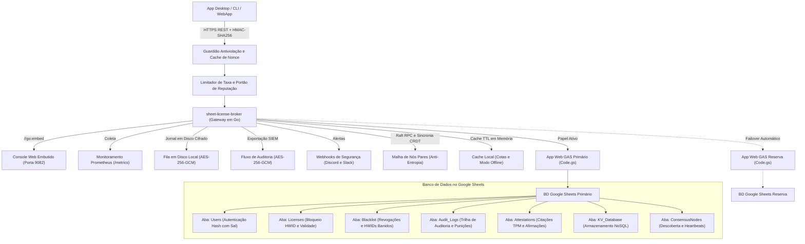

<div align="center">

<!-- 10-Language Navigation Bar -->
<p align="center">
  <a href="../../README.md">🇺🇸 English</a> · <a href="./ko.md">🇰🇷 한국어</a> · <a href="./zh-CN.md">🇨🇳 简体中文</a> · <a href="./ja.md">🇯🇵 日本語</a> · <a href="./es.md">🇪🇸 Español</a><br />
  <a href="./fr.md">🇫🇷 Français</a> · <a href="./ru.md">🇷🇺 Русский</a> · <b>🇧🇷 Português</b> · <a href="./ar.md">🇸🇦 العربية</a> · <a href="./hi.md">🇮🇳 हिन्दी</a>
</p>

# Sheet-License-Broker

<p align="center">
  <strong>Gateway Serverless de Autenticação, Gestão de Licenças e Banco de Dados NoSQL Impulsionado por Google Sheets e Google Apps Script</strong>
</p>

<p align="center">
  
  
  
  
  
  
  
  
  
  
  
  
  
  
  
  
  
  
</p>

</div>

---

## 💡 Visão Geral (Overview)

O **`sheet-license-broker`** transforma qualquer planilha do Google Sheets em um backend serverless de alta performance, autenticado e pronto para produção, feito sob medida para aplicativos desktop, utilitários CLI e ferramentas SaaS independentes.

Não é mais necessário pagar mensalidades pesadas em instâncias de bancos de dados na nuvem ou gerenciar contêineres Docker complexos apenas para validar logins e chaves de licença de software. O `sheet-license-broker` conecta o motor em nuvem do **Google Apps Script (GAS)** a uma **ponte ultrarrápida em Go, cadeias de assinaturas pós-quânticas ML-DSA (NIST FIPS 204), consenso distribuído de quórum Raft, sincronização CRDT LWW-Element-Set, Cloudflare Edge Gateway, atestação criptográfica de hardware (TPM 2.0 e Enclaves), isolamento multilocatário, alta disponibilidade ativo-reserva com planilhas duplas, flags dinâmicas de recursos e medição de cotas, fila em disco criptografada, métricas Prometheus, verificação antiviolação HMAC, cache local resiliente e painel de administração web embutido**.

### Por que Google Sheets como Backend?
- **Custo Zero ($0/mês)**: Utiliza as cotas gratuitas do Google Drive e do Google Apps Script (até 20.000 requisições diárias).
- **Criptografia Pós-Quântica e Assinaturas ML-DSA (NIST FIPS 204)**: Verificação de assinaturas digitais resistentes a computadores quânticos baseadas em reticulados (ML-DSA-44 / ML-DSA-65) com cadeias híbridas ECDSA / reticulado (`Hybrid-P256-MLDSA65`), períodos de carência para rotação de chaves sem downtime e transmissão imediata de cancelamento emergencial.
- **Detecção de Anomalias Comportamentais e Pontuação Adaptativa de Risco**: Monitoramento estatístico de drift de batimentos cardíacos Z-Score com janela deslizante (&plusmn;15% de jitter tolerado), cálculo de deslocamento geográfico impossível por Haversine (&gt;950 km/h ou atividade simultânea em sub-redes /24), modelo adaptativo de atenuação de risco, emissão automática de desafio com risco &ge; 50, quarentena automática zero-trust com risco &ge; 85 e exportação de topologia de incidentes no padrão SIEM (`siem-topology-v1`).
- **Autenticação Única Corporativa (SSO) e Provisionamento SCIM 2.0**: Federação de identidades com SAML 2.0 e OIDC, sincronização de usuários via RFC 7643/7644 com alocação automática de assentos de licença e cancelamento instantâneo em desligamentos de funcionários.
- **Provas de Conhecimento Zero (ZKP)**: Compromissos de Pedersen na curva NIST P-256, protocolos Sigma não interativos (transformação Fiat-Shamir) e registro de nulificadores gastos (Nullifiers) para blindar a privacidade do hardware do cliente.
- **Consenso Raft e Malha CRDT**: Eleição leve de líderes, quórum de log por maioria simples, replicação sem colisões e resumos Merkle SHA-256 para sincronização anti-entropia.
- **Controle de Vazão e Backoff Progressivo**: Modulação thread-safe por janelas deslizantes para IP e HWID com penalidades crescentes e cabeçalhos padrão `X-RateLimit-*`.
- **Cache de Reputação e Bloqueio Automático**: Banimento temporário de endereços reincidentes com notificação imediata via webhooks.
- **Exportação de Lotes de Auditoria Criptografados para SIEM**: Pacotes com criptografia AES-256-GCM selados por HMAC para integração com Splunk, Datadog e AWS CloudWatch.
- **Atestação de Hardware e Proteção Contra Clonagem**: Validação de medições PCR de TPM 2.0 e chaves Apple Secure Enclave / Windows Hello.
- **Flags Dinâmicas e Faturamento por Níveis**: Planos Free, Pro e Enterprise com checagem em tempo real (`client.isFeatureEnabled("analytics")`) e controle de consumo no Google Sheets.
- **Failover Automático Ativo-Reserva**: Troca contínua entre planilhas primária e secundária com reconciliação bidirecional sem perda de dados.
- **Fila em Disco Criptografada**: Fila local em disco com AES-256-GCM (`spool.bin`) garantindo zero perda de informações durante instabilidades de rede.
- **Console Web Integrado**: Binário único e independente (`sheet-license-broker.exe`) com interface moderna em tema escuro esmeralda.

---

## 🏛️ Arquitetura (Architecture)



---

## 🚀 Início Rápido (Quick Start)

### 1. Iniciar o Gateway Local e a Interface

Verifique se o Go 1.22+ está instalado em seu computador:

```bash
# Clonar o repositório
git clone https://github.com/kLauncher1/sheet-license-broker.git
cd sheet-license-broker

# Compilar e executar em modo autônomo
go run .
```

Abra **`http://localhost:9082`** no navegador para acessar o painel administrativo.

### 2. Conectar ao Google Sheets Real (Modo Proxy)

Defina as variáveis de ambiente para conectar o gateway ao seu Apps Script publicado:

```bash
# URL do aplicativo web do Apps Script
export GAS_WEBAPP_URL="https://script.google.com/macros/s/.../exec"
export CACHE_TTL_SECONDS="600" # Opcional: tempo de vida do cache de 10 minutos

# Iniciar o gateway
./sheet-license-broker.exe
```

O servidor detectará automaticamente a URL remota, encaminhará as chamadas, fará o cache das respostas e usará os dados em cache de maneira transparente se a conexão cair.

---

## 📋 Configuração do Google Sheets e Deploy com Clasp

### Opção A: Deploy Automático via Clasp CLI

Caso tenha instalado o `@google/clasp`:

```bash
# 1. Login na sua conta Google
npx @google/clasp login

# 2. Executar o script automatizado
node scripts/deploy_clasp.mjs --script-id <SEU_APPS_SCRIPT_ID>
```

### Opção B: Configuração Manual em 3 Minutos

1. Abra o [Google Sheets](https://sheets.new) e inicie uma planilha em branco.
2. No menu superior, clique em **Extensões > Apps Script**.
3. Remova todo o código existente e cole o arquivo [`gas/Code.gs`](../../gas/Code.gs).
4. Clique em **Implantar > Nova implantação**:
   - Tipo: **App da Web (Web app)**
   - Executar como: **Eu (seu email)**
   - Quem pode acessar: **Qualquer pessoa (Anyone)**
5. Conclua clicando em **Implantar** e copie a **URL do app da Web** (`https://script.google.com/macros/s/.../exec`).

As abas necessárias (`Users`, `Licenses`, `KV_Database`) serão montadas automaticamente no primeiro request.

---

## 📡 Resumo da Especificação da API REST

| Área | Método e Rota | Descrição |
| :--- | :--- | :--- |
| **Diagnóstico** | `GET /api/health` | Verifica a saúde e a telemetria global do serviço |
| **Diagnóstico** | `GET /api/proxy/ping` | Testa a latência de ida e volta até o Google Apps Script |
| **Autenticação** | `POST /api/users/register` | Cadastra contas de usuário (com hash e sal criptográfico) |
| **Autenticação** | `POST /api/users/login` | Valida credenciais de login |
| **Licenças** | `POST /api/licenses` | Cria nova chave de licença (dias e limite de dispositivos) |
| **Licenças** | `POST /api/licenses/validate` | Valida a licença e atrela ao HWID do primeiro dispositivo |
| **Licenças** | `POST /api/licenses/revoke` | Cancela e invalida uma chave de licença imediatamente |
| **Segurança** | `POST /api/security/blacklist` | Bloqueia um dispositivo HWID ou chave na lista negra |
| **Segurança** | `GET /api/security/blacklist` | Consulta a lista de dispositivos e chaves bloqueadas |
| **NoSQL** | `POST /api/docs` | Salva um documento JSON por coleção e ID |
| **NoSQL** | `GET /api/docs` | Lista todos os documentos armazenados |
| **Multilocatário**| `POST /api/tenants/register` | Cria inquilino com prefixo próprio e webhook de eventos |
| **Backup** | `POST /api/backup/export` | Exporta snapshot completo criptografado em AES-256-GCM |
| **Backup** | `POST /api/backup/restore` | Restaura os dados instantaneamente a partir do snapshot |
| **Planos e Cotas** | `GET /api/features` | Catálogo de funcionalidades e cotas por nível |
| **Planos e Cotas** | `POST /api/features/check` | Confere se uma licença tem acesso a um determinado recurso |
| **Medição de Uso**| `POST /api/usage/record` | Computa e debita o consumo de cotas de métricas |
| **Atestação** | `POST /api/attestation/challenge` | Gera desafio Nonce descartável para TPM 2.0 |
| **Atestação** | `POST /api/attestation/verify` | Valida medições PCR assinadas pelo chip TPM 2.0 |
| **Limite de Taxa** | `GET /api/security/ratelimit/status`| Status de janelas deslizantes por IP e HWID |
| **Consenso** | `GET /api/consensus/status` | Saúde do quórum Raft e sincronização de dados CRDT |
| **Tempo Real** | `GET /api/stream/ws` | Conexão WebSocket bidirecional para comandos de emergência |
| **ZKP** | `POST /api/zkp/verify` | Validação de prova Sigma com preservação total de sigilo |
| **SSO / SCIM** | `GET /api/sso/saml/metadata` | Baixa metadados XML de provedor de serviço (Okta/Azure) |
| **SSO / SCIM** | `POST /scim/v2/Users` | Cria usuário corporativo e aloca assento via SCIM 2.0 |
| **Pós-Quântica** | `POST /api/pqc/sign` | Assina licenças com reticulados pós-quânticos ML-DSA |
| **Anomalias** | `POST /api/anomaly/record` | Envia telemetria e calcula pontuação adaptativa de risco |
| **SIEM** | `GET /api/anomaly/graph` | Gera grafo no padrão SIEM com correlação de incidentes |

---

## 💻 SDKs para Clientes

### 🐍 Cliente Python (`sdk/python/sheet_license_client.py`)
Sem dependências externas, usando apenas a biblioteca padrão:

```python
from sheet_license_client import SheetLicenseClient

client = SheetLicenseClient(base_url="http://localhost:9082", secret_key="your-hmac-secret")

# 1. Validar licença (associa automaticamente o HWID do computador)
res = client.verify_license("SLB-XXXX-XXXX-XXXX")
if res.get("valid"):
    print("Licença validada. Nível:", res.get("tier"))

    # 2. Checar permissão de recurso
    if client.is_feature_enabled("SLB-XXXX-XXXX-XXXX", "analytics"):
        print("Módulo de relatórios ativado!")

    # 3. Registrar consumo
    client.record_usage("SLB-XXXX-XXXX-XXXX", "api_calls", 1)
```

### ⚡ C# / .NET & Unity (`sdk/csharp/SheetLicenseClient.cs`)
Compatível com Unity Mono/IL2CPP, WPF e apps .NET:

```csharp
using SheetLicenseBroker;

var client = new SheetLicenseClient("http://localhost:9082", "your-hmac-secret");
var result = await client.VerifyLicenseAsync("SLB-XXXX-XXXX-XXXX");
if (result.Valid) {
    Console.WriteLine($"Acesso concedido! Nível: {result.Tier}, Expira em: {result.ExpirationDate}");
}
```

### 🟩 TypeScript e Node.js (`@sheet-license/client`)
Perfeito para servidores Node.js e apps desktop Electron:

```typescript
import { SheetLicenseClient } from '@sheet-license/client';

const client = new SheetLicenseClient({
  baseUrl: 'http://localhost:9082',
  secretKey: 'your-hmac-secret',
});

const result = await client.verifyLicense('SLB-XXXX-XXXX-XXXX');
if (result.valid) {
  console.log('Licença ativa. Plano:', result.tier);
}
```

### 🔷 Cliente em Go (`sdk/go/client.go`)

```go
package main

import (
	"context"
	"fmt"
	"time"

	"github.com/kLauncher1/sheet-license-broker/sdk/go"
)

func main() {
	client := sdk.NewClient("http://localhost:9082", []byte("your-hmac-secret"), 5*time.Second)
	res, err := client.VerifyLicense(context.Background(), "SLB-XXXX-XXXX-XXXX", "")
	if err == nil && res.Valid {
		fmt.Printf("Licença confirmada (Nível: %s). Iniciando programa...\n", res.Tier)
	}
}
```

---

## 🛠️ Validação e Build

```bash
# Executar todos os testes unitários do repositório
go test -v ./...

# Compilar o executável de produção otimizado
go build -ldflags="-s -w" -o sheet-license-broker.exe .
```

---

## 📄 Licença (License)

Este projeto está disponível sob a [Licença MIT](../../LICENSE).
