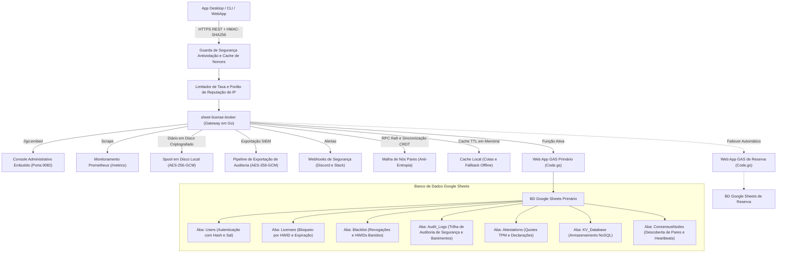

<div align="center">

<!-- 10-Language Navigation Bar -->
<p align="center">
  <a href="../../README.md">🇺🇸 English</a> · <a href="./ko.md">🇰🇷 한국어</a> · <a href="./zh-CN.md">🇨🇳 简体中文</a> · <a href="./ja.md">🇯🇵 日本語</a> · <a href="./es.md">🇪🇸 Español</a><br />
  <a href="./fr.md">🇫🇷 Français</a> · <a href="./ru.md">🇷🇺 Русский</a> · <b>🇧🇷 Português</b> · <a href="./ar.md">🇸🇦 العربية</a> · <a href="./hi.md">🇮🇳 हिन्दी</a>
</p>

# Sheet-License-Broker

<p align="center">
  <strong>Gateway Serverless de Autenticação, Direitos de Licença e Banco de Dados NoSQL Baseado em Google Sheets e Google Apps Script</strong>
</p>

<p align="center">
  
  
  
  
  
  
  
  
  
  
  
  
  
  
  
  
  
  
</p>

</div>

---

## 💡 Visão Geral

O **`sheet-license-broker`** transforma qualquer planilha do Google Sheets em um backend serverless autenticado e pronto para produção para aplicativos desktop, utilitários CLI e ferramentas SaaS indie. 

Em vez de pagar por instâncias caras de bancos de dados em nuvem ou gerenciar contêineres Docker apenas para lidar com logins de usuários e chaves de licença de software, o `sheet-license-broker` combina um motor em nuvem **Google Apps Script (GAS)** com uma **ponte Go de alta velocidade, cadeias de assinaturas pós-quânticas ML-DSA, consenso distribuído de quórum Raft, sincronização CRDT LWW-Element-Set, Cloudflare Edge Gateway, atestação criptográfica de hardware (TPM 2.0 e Enclaves), isolamento multilocatário (multi-tenant), alta disponibilidade ativo-reserva em planilha dupla, flags dinâmicas de recursos e medição de uso, spooling de disco criptografado, métricas Prometheus, verificação antiviolação criptográfica HMAC, cache offline resiliente e uma interface Web embutida**.

### Por que Google Sheets como Backend?
- **Custo Zero ($0/mês)**: Aproveita as cotas gratuitas do Google Drive e do Apps Script (até 20.000 requisições/dia).
- **Criptografia Pós-Quântica e Cadeias de Assinatura ML-DSA (NIST FIPS 204)**: Verificação de assinaturas digitais baseadas em reticulados (module-lattice) resistentes a computadores quânticos (ML-DSA-44 / ML-DSA-65) com cadeias de assinatura híbridas clássicas ECDSA / reticulado (`Hybrid-P256-MLDSA65`), janelas de carência para rotação de chaves sem tempo de inatividade (zero-downtime) e transmissões de cancelamento emergencial (kill-switch) instantâneas.
- **Detecção de Anomalias Comportamentais e Pontuação Adaptativa de Risco**: Rastreamento estatístico de drift de batimentos cardíacos (heartbeat) por janela deslizante Z-Score (tolerância a jitter de &plusmn;15%), detecção de viagem impossível por velocidade Haversine (&gt;950 km/h ou sub-redes /24 concorrentes), cálculo adaptativo de pontuação de risco com decaimento nominal progressivo, escalonamento automatizado de desafio de reatestação para pontuações de risco &ge; 50, quarentena automática zero-trust para pontuações de risco &ge; 85 e exportador padronizado de grafo de topologia de incidentes de segurança (`siem-topology-v1`) para ingestão por SIEM corporativo.
- **Autenticação Única Corporativa (SSO) e Provisionamento de Diretório SCIM 2.0**: Federação de identidade SAML 2.0 e OIDC, sincronização de diretório RFC 7643/7644, alocação automatizada de assentos de licença e revogação instantânea em desprovisionamento.
- **Verificação Anônima por Prova de Conhecimento Zero (ZKP)**: Compromissos de Pedersen sobre NIST P-256 com geradores independentes determinísticos hash-to-curve, provas de apresentação Sigma não interativas (transformadas via Fiat-Shamir) e registros de defesa contra repetição de nulificadores gastos (spent nullifiers) protegendo a privacidade do hardware do cliente.
- **Consenso Distribuído por Quórum Raft e Malha CRDT**: Eleição leve de líder, quórum de log por maioria simples, replicação de estado livre de conflitos LWW-Element-Set e resumos de árvore Merkle SHA-256 para sincronização anti-entropia entre nós distribuídos do broker.
- **Controle de Taxa Corporativo e Backoff Progressivo**: Throttling thread-safe por janela deslizante por IP e HWID com atrasos de penalidade progressivos e cabeçalhos padrão `X-RateLimit-*`.
- **Cache de Reputação de IP/HWID por Janela Deslizante**: Banimentos temporários automáticos e alertas de webhook de incidentes de alta prioridade mediante infrações repetidas de segurança.
- **Exportação de Tokens de Auditoria Criptografados para SIEM**: Pacotes de auditoria em conformidade criptografados em AES-256-GCM selados com assinaturas HMAC para ingestão no Splunk, Datadog e AWS CloudWatch.
- **Atestação Criptográfica de Hardware e Vinculação a Enclave**: Verificação de quote PCR do TPM 2.0 e atestação de chave de hardware Apple Secure Enclave / Windows Hello prevenindo ataques de clonagem.
- **Telemetria Antidepuração e Antiviolação de Memória no Cliente**: Pontuação contínua de integridade com banimento automático imediato via kill-switch de dispositivos apresentando anexação de depurador ou modificações na seção de código.
- **Flags de Recursos Dinâmicas e Medição de Nível Baseada em Uso**: Níveis de assinatura Free, Pro e Enterprise com restrição de recursos em tempo de execução (`client.isFeatureEnabled("analytics")`) e rastreamento atômico de cotas de consumo persistido diretamente no Google Sheets.
- **Replicação Ativo-Reserva em Planilha Dupla**: Failover automático entre planilhas primária e de reserva com reconciliação bidirecional livre de colisões.
- **Fila em Disco Local Criptografada**: Fila de diário criptografada em AES-256-GCM (`spool.bin`) garantindo zero perda de dados durante interrupções de rede.
- **Telemetria Corporativa Prometheus (`/metrics`)**: Endpoint interno para coleta expondo contadores, medidores e latências no formato Prometheus.
- **Webhooks de Alerta de Incidentes**: Notificações ricas e imediatas de incidentes de segurança enviadas para canais do Discord e Slack.
- **Isolamento Multilocatário (Multi-Tenant)**: Isole produtos e locatários distintos com prefixos personalizados (ex.: `ACME-LIC-XXXX-YYYY`) e políticas independentes.
- **Cloudflare Edge Gateway**: Verificação de licença na borda (edge) em submilisegundos via Cloudflare Workers e Workers KV com a Web Crypto API.
- **Painel Administrativo Legível por Humanos**: Sua planilha do Google Sheets é o seu banco de dados. Visualize, edite, bana ou conceda licenças diretamente em tempo real.
- **Proteção Bloqueada por Hardware (HWID)**: Bloqueia chaves de licença a IDs de hardware específicos da máquina na primeira inicialização.
- **Antiviolação Criptográfica HMAC-SHA256**: Protege o tráfego de entrada dos clientes contra interceptação MITM e falsificação de cargas úteis por engenharia reversa.
- **Mitigação de Repetição por Nonce em Janela Deslizante**: Previne ataques de repetição de requisições com uma janela de tolerância de dessincronização de relógio de 5 minutos.
- **Revogação Remota Instantânea e Lista Negra de Dispositivos**: Invalide licenças ou bana IDs de hardware comprometidos diretamente do console web ou da aba do Google Sheets.
- **Backup Automatizado e Recuperação de Desastres**: Exportação e restauração de estado point-in-time protegidas com somas de verificação SHA-256 e criptografia AES-256-GCM.
- **Webhooks de Ciclo de Vida em Tempo Real**: Despachantes de eventos com filas de trabalho e entrega de webhooks assinados por HMAC para endpoints do locatário e globais.
- **Autenticação com Hash SHA-256 e Sal**: As senhas recebem sal criptográfico e hash antes da persistência.
- **Cache Local Resiliente e Tolerância Offline**: Licenças e documentos KV em cache de memória protegem contra limites de taxa da API do Google (HTTP 429) e falhas momentâneas de rede.
- **Painel Web Embutido**: Binário único autocontido (`sheet-license-broker.exe`) com console de gerenciamento em tema escuro esmeralda.

---

## 🏛️ Arquitetura



---

## 🚀 Início Rápido

### 1. Iniciar o Gateway Local e a Interface

Certifique-se de que o Go 1.22+ esteja instalado em sua estação de trabalho:

```bash
# Clonar o repositório
git clone https://github.com/kLauncher1/sheet-license-broker.git
cd sheet-license-broker

# Compilar e executar o binário único em modo independente
go run .
```

Abra o seu navegador em **`http://localhost:9082`** para acessar o console de administração em tempo real.

### 2. Conectar ao Google Sheets Real (Modo Proxy)

Para conectar o broker ao seu Web App implantado no Google Apps Script:

```bash
# Defina a URL do seu Web App no Apps Script
export GAS_WEBAPP_URL="https://script.google.com/macros/s/.../exec"
export CACHE_TTL_SECONDS="600" # Opcional: TTL de cache de 10 minutos

# Iniciar o gateway
./sheet-license-broker.exe
```

O servidor detecta automaticamente a URL remota, encaminha as consultas recebidas, armazena os resultados localmente em cache e recorre de forma transparente aos dados em cache durante interrupções de rede.

---

## 📋 Configuração do Google Sheets e Deploy com Clasp

### Opção A: Deploy Automático via Clasp CLI

Se você utiliza o CLI `@google/clasp`:

```bash
# 1. Faça login na sua conta do Google
npx @google/clasp login

# 2. Implante usando o script auxiliar automatizado
node scripts/deploy_clasp.mjs --script-id <SEU_APPS_SCRIPT_ID>
```

Consulte [`gas/README.md`](../../gas/README.md) para obter instruções completas sobre criação e configuração de projetos Clasp.

### Opção B: Configuração Manual em 3 Minutos

1. Abra o [Google Sheets](https://sheets.new) e crie uma nova planilha em branco.
2. No menu superior, navegue até **Extensões > Apps Script**.
3. Substitua o código padrão pelo conteúdo de [`gas/Code.gs`](../../gas/Code.gs).
4. Clique em **Implantar > Nova implantação**:
   - Tipo: **App da Web**
   - Executar como: **Eu (seu email)**
   - Quem tem acesso: **Qualquer pessoa**
5. Clique em **Implantar** e copie a sua **URL do app da Web** (`https://script.google.com/macros/s/.../exec`).

Sua planilha do Google Sheets gerará automaticamente três abas dedicadas na primeira requisição:
- **`Users`**: `user_id`, `username`, `password_hash`, `salt`, `role`, `created_at`
- **`Licenses`**: `license_key`, `bound_hwid`, `max_devices`, `status`, `expires_at`, `created_at`
- **`KV_Database`**: `collection`, `doc_id`, `payload`, `updated_at`

---

## 📡 Especificação da API REST

### Saúde e Diagnósticos

#### Obter Integridade do Serviço e Status do Proxy
```http
GET /api/health
```

#### Ping no Backend
```http
GET /api/proxy/ping
```

---

### Autenticação

#### Registrar Usuário
```http
POST /api/users/register
Content-Type: application/json

{
  "username": "developer",
  "password": "SecurePassword123!",
  "role": "admin"
}
```

#### Autenticar / Login
```http
POST /api/users/login
Content-Type: application/json

{
  "username": "developer",
  "password": "SecurePassword123!"
}
```

---

### Gerenciamento de Licenças

#### Emitir Chave de Licença
```http
POST /api/licenses
Content-Type: application/json

{
  "days": 30,
  "max_devices": 1
}
```
**Resposta:**
```json
{
  "license_key": "KEY-7F2A-9C4B-E108",
  "bound_hwid": "",
  "max_devices": 1,
  "status": "ACTIVE",
  "expires_at": "2026-11-12T12:00:00Z",
  "created_at": "2026-10-13T12:00:00Z"
}
```

#### Validar e Vincular HWID
```http
POST /api/licenses/validate
Content-Type: application/json

{
  "license_key": "KEY-7F2A-9C4B-E108",
  "hwid": "WIN-B829-94AA-0123"
}
```
**Resposta:**
```json
{
  "valid": true,
  "license_key": "KEY-7F2A-9C4B-E108",
  "hwid_bound": "WIN-B829-94AA-0123",
  "expires_at": "2026-11-12T12:00:00Z",
  "source": "remote_gas"
}
```

*Nota: Se a licença estiver ativa e desvinculada, ela é bloqueada ao `hwid` enviado. Chamadas subsequentes a partir do hardware correspondente serão bem-sucedidas; chamadas de hardware diferente serão rejeitadas. As respostas também indicam se o resultado foi servido a partir de `cache`, `remote_gas` ou `offline_cache`.*

---

### Antiviolação e Segurança

#### Assinatura de Requisições HMAC-SHA256
Quando `HMAC_ENFORCE=true` (ou quando `HMAC_SECRET` estiver configurado), os clientes protegem as requisições contra interceptação MITM utilizando cabeçalhos padrão:
- `X-Signature`: Assinatura HMAC-SHA256 codificada em hexadecimal calculada sobre `METHOD\nPATH\nTIMESTAMP\nNONCE\nSHA256(BODY)`.
- `X-Timestamp`: Timestamp Unix atual em segundos (impõe uma janela de dessincronização de relógio de 5 minutos).
- `X-Nonce`: String de nonce criptográfico exclusivo por requisição (previne ataques de repetição).

#### Revogar Chave de Licença
```http
POST /api/licenses/revoke
Content-Type: application/json

{
  "license_key": "KEY-7F2A-9C4B-E108",
  "reason": "Payment refunded"
}
```

#### Inserir ID de Hardware do Dispositivo (HWID) na Lista Negra
```http
POST /api/security/blacklist
Content-Type: application/json

{
  "type": "device",
  "target": "WIN-B829-94AA-0123",
  "reason": "Fraudulent key sharing"
}
```

#### Listar Entradas da Lista Negra e Revogações
```http
GET /api/security/blacklist
```

---

### Armazenamento Chave-Valor NoSQL

#### Armazenar Documento
```http
POST /api/docs
Content-Type: application/json

{
  "collection": "user_settings",
  "doc_id": "usr_9918",
  "payload": "{\"dark_mode\":true,\"telemetry\":false}"
}
```

#### Obter Todos os Documentos
```http
GET /api/docs
```

---

### Namespaces Multilocatários

#### Registrar Locatário
```http
POST /api/tenants/register
Content-Type: application/json

{
  "id": "tenant-gamehub",
  "name": "GameHub Studio",
  "namespace_prefix": "GHUB",
  "max_licenses": 100,
  "webhook_url": "https://api.gamehub.com/webhooks"
}
```

#### Emitir Licença no Namespace do Locatário
```http
POST /api/licenses
Content-Type: application/json
X-Tenant-ID: tenant-gamehub

{
  "days": 60,
  "max_devices": 2
}
```
*Gera chaves formatadas em conformidade com o padrão `GHUB-LIC-XXXX-YYYY`.*

---

### Backup Automatizado e Recuperação de Desastres

#### Exportar Backup Criptografado (AES-256-GCM + Integridade SHA-256)
```http
POST /api/backup/export
Content-Type: application/json

{
  "secret_key": "your-backup-master-passphrase"
}
```

#### Restaurar a Partir de Snapshot
```http
POST /api/backup/restore
Content-Type: application/json

{
  "secret_key": "your-backup-master-passphrase",
  "encrypted_payload": "<hex-encoded-ciphertext>"
}
```

---

### Flags de Recursos Dinâmicas e Medição de Nível Baseada em Uso

#### Listar Catálogo Padrão de Recursos e Níveis
```http
GET /api/features
```
**Resposta:**
```json
{
  "tiers": {
    "free": {
      "name": "free",
      "features": ["basic_access"],
      "daily_quotas": { "api_calls": 500, "export_rows": 100 }
    },
    "pro": {
      "name": "pro",
      "features": ["basic_access", "analytics", "csv_export", "extended_logs"],
      "daily_quotas": { "api_calls": 50000, "export_rows": 100000 }
    },
    "enterprise": {
      "name": "enterprise",
      "features": ["basic_access", "analytics", "csv_export", "extended_logs", "sso", "audit_export", "unlimited_seats", "priority_support"],
      "daily_quotas": { "api_calls": 10000000, "export_rows": 50000000 }
    }
  }
}
```

#### Verificar Direito a Recurso da Licença
```http
POST /api/features/check
Content-Type: application/json

{
  "license_key": "KEY-7F2A-9C4B-E108",
  "feature": "analytics"
}
```
**Resposta:**
```json
{
  "license_key": "KEY-7F2A-9C4B-E108",
  "feature": "analytics",
  "tier": "pro",
  "allowed": true
}
```

#### Registrar Uso e Aplicar Cotas do Nível
```http
POST /api/usage/record
Content-Type: application/json

{
  "license_key": "KEY-7F2A-9C4B-E108",
  "metric": "api_calls",
  "units": 1
}
```
**Resposta:**
```json
{
  "license_key": "KEY-7F2A-9C4B-E108",
  "metric": "api_calls",
  "units": 1,
  "current_usage": 42,
  "daily_quota": 50000,
  "quota_exceeded": false,
  "success": true
}
```

#### Consultar Estatísticas de Uso
```http
GET /api/usage/stats?license_key=KEY-7F2A-9C4B-E108
```
**Resposta:**
```json
{
  "license_key": "KEY-7F2A-9C4B-E108",
  "date": "2026-10-14",
  "tier": "pro",
  "metrics": {
    "api_calls": 42
  }
}
```

---

### Atestação de Hardware e Telemetria Antiviolação

#### Solicitar Nonce de Desafio de TPM / Enclave
```http
POST /api/attestation/challenge
Content-Type: application/json

{
  "license_key": "KEY-7F2A-9C4B-E108",
  "hwid": "WIN-B829-94AA-0123"
}
```
**Resposta:**
```json
{
  "status": "success",
  "challenge_id": "9a4f2b1c8e3d",
  "nonce": "e3b0c44298fc1c149afbf4c8996fb92427ae41e4649b934ca495991b7852b855",
  "expires_at": "2026-10-14T12:05:00Z"
}
```

#### Verificar Quote PCR do TPM 2.0
```http
POST /api/attestation/verify
Content-Type: application/json

{
  "license_key": "KEY-7F2A-9C4B-E108",
  "hwid": "WIN-B829-94AA-0123",
  "challenge_id": "9a4f2b1c8e3d",
  "attestation_type": "tpm2",
  "tpm_quote": {
    "pcr_values": {
      "0": "e3b0c44298fc1c149afbf4c8996fb92427ae41e4649b934ca495991b7852b855",
      "7": "ba7816bf8f01cfea414140de5dae2223b00361a396177a9cb410ff61f20015ad"
    },
    "pcr_selection": [0, 7],
    "composite_digest": "4a5b6c7d8e9f...",
    "signature": "3045022100...",
    "ak_public_key_pem": "-----BEGIN PUBLIC KEY-----\n..."
  }
}
```

#### Transmitir Telemetria Antidepuração e de Integridade
```http
POST /api/attestation/telemetry
Content-Type: application/json

{
  "license_key": "KEY-7F2A-9C4B-E108",
  "hwid": "WIN-B829-94AA-0123",
  "report": {
    "debugger_present": false,
    "memory_integrity": true,
    "sandbox_detected": false,
    "hooks_detected": false,
    "process_checksum": "a1b2c3d4e5f6...",
    "execution_uptime_s": 3600
  }
}
```

---

### 🛡️ Limitação de Taxa Corporativa e Exportação de Auditoria para SIEM

#### Telemetria do Limitador de Taxa e Reputação de IP
```http
GET /api/security/ratelimit/status
GET /api/security/reputation
```

#### Impor / Listar Restrições Temporárias
```http
# Listar banimentos temporários ativos
GET /api/security/bans

# Impor restrição temporária
POST /api/security/bans
Content-Type: application/json

{
  "key": "198.51.100.24",
  "reason": "Repeated failed validation attempts",
  "duration_minutes": 15
}

# Remover restrição temporária
POST /api/security/bans/unban
Content-Type: application/json

{
  "key": "198.51.100.24"
}
```

#### Exportar Pacote de Auditoria Criptografado (para Ingestão em SIEM / SOC)
```http
POST /api/security/audit/export
Content-Type: application/json

{
  "secret_key": "enterprise-compliance-secret",
  "limit": 500
}
```

#### Verificar e Descriptografar Pacote de Auditoria
```http
POST /api/security/audit/verify
Content-Type: application/json

{
  "secret_key": "enterprise-compliance-secret",
  "bundle": { ... }
}
```

---

### 🌐 Consenso Distribuído e Sincronização de Quórum Multirregional

#### Status do Cluster e Topologia de Nós Pares
```http
GET /api/consensus/status
GET /api/consensus/peers
```

Resposta:
```json
{
  "node_id": "node-1",
  "role": "Leader",
  "current_term": 1,
  "commit_index": 4,
  "peer_count": 2,
  "healthy_peers": 2,
  "has_quorum": true,
  "merkle_digest": "4a7d1ed414474e4033ac29ccb8653d9b...",
  "element_count": 128
}
```

#### Ingressar Nó Par no Cluster
```http
POST /api/consensus/peers/join
Content-Type: application/json

{
  "node_id": "node-2",
  "address": "http://192.168.1.50:9082"
}
```

#### Disparar Sincronização de Estado Anti-Entropia
```http
POST /api/consensus/sync/trigger
```

---

### ⚡ Streaming WebSocket em Tempo Real e Envio de Telemetria

#### Fluxo Bidirecional de Telemetria via WebSocket
Conecte clientes WebSocket persistentes a `/api/stream/ws` para streaming de telemetria em tempo real e envio de comandos de desligamento emergencial (kill-switch) em submilisegundos:

```http
GET /api/stream/ws?license_key=SLB-XXXX-XXXX&hwid=HWID-1234 HTTP/1.1
Host: localhost:9082
Upgrade: websocket
Connection: Upgrade
Sec-WebSocket-Key: dGhlIHNhbXBsZSBub25jZQ==
Sec-WebSocket-Version: 13
```

#### Consultar Clientes Conectados ao Streaming e Telemetria
```http
# Listar sessões de streaming ativas
GET /api/stream/clients

# Consultar métricas de streaming e log de auditoria de eventos recentes
GET /api/stream/telemetry
```

#### Executar Kill-Switch Remoto Instantâneo
```http
POST /api/stream/kill
Content-Type: application/json

{
  "target": "SLB-XXXX-XXXX",
  "reason": "Suspected device cloning or fraud",
  "immediate": true
}
```
*Nota: O alvo (`target`) pode ser uma chave de licença específica, o HWID de um dispositivo, o ID de um cliente ou `"ALL"` para a execução emergencial de kill-switch em broadcast geral. Os sinais são enviados para os sockets de clientes correspondentes com entrega em menos de um segundo.*

---

### 🕵️ Verificação Anônima por Prova de Conhecimento Zero (ZKP)

#### Obter Parâmetros Públicos e Geradores NIST P-256
```http
GET /api/zkp/params
```

#### Emitir Credencial Cega Anônima
```http
POST /api/zkp/credential/issue
Content-Type: application/json

{
  "license_key": "LIC-ENTERPRISE-001",
  "tenant_id": "default",
  "hwid": "WIN-B829-94AA-0123",
  "tier": "enterprise",
  "max_seats": 5
}
```

#### Verificar Prova de Apresentação de Conhecimento Zero (Protocolo Sigma)
```http
POST /api/zkp/verify
Content-Type: application/json

{
  "credential": { ... },
  "required_tier": "enterprise"
}
```

#### Inspecionar Status de Nulificador Gasto (Spent Nullifier)
```http
GET /api/zkp/nullifiers/check?nullifier=7f2a9c4b...
```

---

### 🔐 Autenticação Única Corporativa (SSO) e Provisionamento de Diretório SCIM 2.0

#### Metadados do Provedor de Serviços (SP) SAML 2.0
Baixe o XML de metadados padrão do SP para Okta, Azure AD ou PingFederate:
```http
GET /api/sso/saml/metadata?entity_id=urn:sheet-license-broker:sp
```

#### Serviço de Consumo de Declarações (ACS) SAML 2.0
Processe asserções SAML de entrada e emita tokens de sessão autenticados:
```http
POST /api/sso/saml/acs
Content-Type: application/x-www-form-urlencoded

SAMLResponse=PHNhbWxwOlJlc3BvbnNlIHhtbG5z...
```

#### Retorno de Chamada (Callback) OpenID Connect (OIDC)
Valide tokens de ID e reivindicações do Google Workspace, Auth0 ou Keycloak:
```http
POST /api/sso/oidc/callback
Content-Type: application/json

{
  "sub": "usr_9918",
  "email": "alice@company.com",
  "iss": "https://accounts.google.com",
  "aud": "sheet-license-broker",
  "exp": 1776250000
}
```

#### Gerenciamento de Provedores de Identidade (IdP)
```http
# Registrar novo IdP SAML ou OIDC
POST /api/sso/idp
Content-Type: application/json

{
  "id": "okta-corp",
  "protocol": "saml",
  "entity_id": "http://www.okta.com/exk123456",
  "sso_url": "https://company.okta.com/app/sso",
  "tenant_id": "default",
  "enabled": true
}

# Listar IdPs registrados
GET /api/sso/idp
```

#### Provisionamento de Diretório SCIM 2.0 (RFC 7644)
Integre o ciclo de vida de provisionamento de usuários corporativos diretamente com Okta, Microsoft Entra ID (Azure AD) ou OneLogin:

```http
# Configuração do Provedor de Serviços
GET /scim/v2/ServiceProviderConfig

# Listar usuários do diretório (paginado)
GET /scim/v2/Users?startIndex=1&count=50

# Provisionar usuário (aloca assento de licença automaticamente)
POST /scim/v2/Users
Content-Type: application/scim+json

{
  "schemas": ["urn:ietf:params:scim:schemas:core:2.0:User"],
  "userName": "alice@corp.com",
  "emails": [{ "value": "alice@corp.com", "primary": true }],
  "roles": [{ "value": "operator" }],
  "active": true
}

# Desprovisionar usuário (revoga instantaneamente o assento alocado e envia comando de kill-switch)
DELETE /scim/v2/Users/usr-okta-8821
```

#### Tokens de Sessão RBAC Efêmeros
```http
# Emitir token efêmero
POST /api/sso/token/mint
Content-Type: application/json

{
  "user_id": "usr_9918",
  "email": "alice@corp.com",
  "role": "admin",
  "scopes": ["license:read", "license:write", "sso:manage"]
}

# Inspecionar token e validar permissões de escopo
POST /api/sso/token/introspect
Content-Type: application/json

{
  "token": "sso_tok_7f2a9c4b...",
  "required_scope": "license:write"
}
```

---

### ⚛️ Criptografia Pós-Quântica e Assinaturas Híbridas ML-DSA

#### Obter Parâmetros de Reticulados NIST FIPS 204 e Informações da Chave Ativa
```http
GET /api/pqc/params
```
**Resposta:**
```json
{
  "status": "success",
  "lattice": { "dimension": 256, "modulus": 8380417, "d": 13 },
  "primary_algorithm": "ML-DSA-65",
  "active_key_id": "pqc-key-9b0d-e626",
  "grace_window_days": 7
}
```

#### Listar Chaves Públicas de Verificação
```http
GET /api/pqc/keys
```

#### Emitir Assinatura de Licença Híbrida Resistente a Quânticos
```http
POST /api/pqc/sign
Content-Type: application/json

{
  "license_key": "LIC-PRO-2026-99",
  "hwid": "HWID-9B0D-E626-C8D9-6D4B",
  "payload": "entitlement-v1-pro-tier"
}
```
**Resposta:**
```json
{
  "status": "success",
  "signature": {
    "algorithm": "Hybrid-P256-MLDSA65",
    "key_id": "pqc-key-9b0d-e626",
    "classical_sig_b64": "MEUCIQD...",
    "pqc_sig_hex": "1f8e2a...",
    "payload_hash_hex": "e3b0c44...",
    "created_at": "2026-10-16T19:30:00Z"
  }
}
```

#### Verificar Assinaturas Duplas Clássica e de Reticulado
```http
POST /api/pqc/verify
Content-Type: application/json

{
  "payload": "entitlement-v1-pro-tier",
  "signature": {
    "algorithm": "Hybrid-P256-MLDSA65",
    "key_id": "pqc-key-9b0d-e626",
    "classical_sig_b64": "MEUCIQD...",
    "pqc_sig_hex": "1f8e2a..."
  }
}
```
**Resposta:**
```json
{
  "status": "success",
  "result": {
    "valid": true,
    "algorithm": "Hybrid-P256-MLDSA65",
    "key_id": "pqc-key-9b0d-e626",
    "classical_valid": true,
    "pqc_valid": true
  }
}
```

#### Rotação Atômica de Chaves com Período de Carência
```http
POST /api/pqc/rotate
Content-Type: application/json

{
  "algorithm": "ML-DSA-65",
  "grace_days": 7,
  "reason": "Routine cryptographic key rollover"
}
```

#### Revogação Emergencial de Chave Comprometida
```http
POST /api/pqc/revoke
Content-Type: application/json

{
  "key_id": "pqc-key-old-compromised",
  "reason": "Private key leakage detected"
}
```

---

### 🛡️ Detecção de Anomalias Comportamentais e Pontuação Adaptativa de Risco

O `sheet-license-broker` inclui um motor de anomalias comportamentais de nível corporativo que rastreia desvio estatístico de batimentos cardíacos, viagens geográficas impossíveis e pontuação dinâmica de risco em aplicativos clientes.

#### Política Adaptativa de Governança
- **Pontuação 0 – 49 (Nominal)**: Operação normal, acesso irrestrito. A atividade nominal dissipa progressivamente os pontos de risco acumulados ao longo do tempo.
- **Pontuação 50 – 84 (Suspeita)**: Exige escalonamento de desafio. Impõe um desafio criptográfico de reatestação de uso único com validade de 5 minutos (`POST /api/anomaly/challenge/issue` e `/verify`).
- **Pontuação 85 – 100 (Alto Risco / Comprometido)**: Quarentena imediata com zero-trust. Chamadas de verificação (`POST /api/licenses/verify`) são rejeitadas automaticamente com HTTP 403 Forbidden, e alertas são transmitidos para os webhooks de segurança.

#### Registrar Observação de Telemetria do Cliente
```http
POST /api/anomaly/record
Content-Type: application/json

{
  "license_key": "SLB-PRO-2026-99",
  "hwid": "HWID-9B0D-E626-C8D9-6D4B",
  "ip": "198.51.100.24",
  "latitude": 37.5665,
  "longitude": 126.9780
}
```
**Resposta:**
```json
{
  "status": "recorded",
  "risk_score": {
    "entity_id": "SLB-PRO-2026-99",
    "score": 0,
    "classification": "NOMINAL",
    "challenge_required": false,
    "quarantined": false,
    "last_assessed": "2026-10-16T21:30:00Z"
  }
}
```

#### Consultar Pontuação Adaptativa de Risco
```http
GET /api/anomaly/score?license_key=SLB-PRO-2026-99
```

#### Emitir e Verificar Desafio de Reatestação
```http
# Emitir token de desafio
POST /api/anomaly/challenge/issue
Content-Type: application/json

{
  "license_key": "SLB-PRO-2026-99",
  "hwid": "HWID-9B0D-E626-C8D9-6D4B"
}

# Verificar token de desafio
POST /api/anomaly/challenge/verify
Content-Type: application/json

{
  "challenge_token": "ch_7f2a9c4b..."
}
```

#### Exportar Grafo de Incidentes de Segurança (Feed Padrão SIEM)
Exporte nós e arestas topológicas de incidentes em conformidade com as normas RFC, formatados para ingestão em Splunk, Datadog, Elastic e Microsoft Sentinel:
```http
GET /api/anomaly/graph?min_score=50&limit=50
```
**Resposta:**
```json
{
  "schema_version": "siem-topology-v1",
  "generated_at": "2026-10-16T21:30:00Z",
  "nodes": [
    { "id": "SLB-PRO-2026-99", "type": "CLIENT", "risk_score": 60, "first_seen": "...", "last_seen": "..." },
    { "id": "198.51.100.0/24", "type": "SUBNET", "risk_score": 30, "first_seen": "...", "last_seen": "..." }
  ],
  "edges": [
    { "id": "edge-1", "source_id": "SLB-PRO-2026-99", "target_id": "198.51.100.0/24", "relationship": "OBSERVED_IN_SUBNET", "weight": 60, "timestamp": "..." }
  ],
  "total_incidents": 1
}
```

#### Status de Telemetria do Motor
```http
GET /api/anomaly/status
```

---

## ⚡ Cloudflare Edge Gateway

Para verificação de licença na borda distribuída globalmente em submilisegundos, implante o Cloudflare Worker localizado em `edge/cloudflare/`:

```bash
cd edge/cloudflare
wrangler deploy
```

- **Verificação no POP em menos de 10ms**: Verifica licenças válidas diretamente a partir do cache do Cloudflare Workers KV.
- **Criptografia Web de Hardware**: Assinatura HMAC-SHA256 na borda e prevenção contra repetição antes de atingir a origem.
- **Fallback Automatizado para a Origem**: Consultas não armazenadas em cache, vinculações de chaves e revogações são encaminhadas de forma transparente para o servidor de origem.

---

## 💻 Multi-Language Client SDKs

O `sheet-license-broker` inclui SDKs de cliente prontos para produção sob `sdk/`, oferecendo suporte a vinculação automática de dispositivos por ID de hardware (HWID) e assinatura criptográfica de requisições HMAC-SHA256.

### 🐍 Python Client (`sdk/python/sheet_license_client.py`)

Zero dependências externas (utiliza a biblioteca padrão `urllib` e `hashlib`):

```python
from sheet_license_client import SheetLicenseClient, get_machine_hwid

client = SheetLicenseClient(base_url="http://localhost:9082", secret_key="your-hmac-secret")

# 1. Verificar chave de licença (anexa automaticamente o HWID da máquina local)
res = client.verify_license("SLB-XXXX-XXXX-XXXX")
if res.get("valid"):
    print("Licença verificada. Nível:", res.get("tier"))

    # 2. Verificar direito da flag de recurso dinâmica
    if client.is_feature_enabled("SLB-XXXX-XXXX-XXXX", "analytics"):
        print("Módulo de analytics habilitado!")

    # 3. Registrar consumo em relação às cotas do nível
    client.record_usage("SLB-XXXX-XXXX-XXXX", "api_calls", 1)

    # 4. Verificação de token de diretório Enterprise SSO & SCIM
    sso_status = client.get_sso_status()
    token_info = client.introspect_session_token("sso_tok_...", required_scope="license:write")

    # 5. Telemetria de anomalia comportamental e pontuação de risco
    client.record_anomaly_telemetry("SLB-XXXX-XXXX-XXXX", latitude=37.5665, longitude=126.9780)
    risk = client.get_anomaly_risk_score(license_key="SLB-XXXX-XXXX-XXXX")
else:
    print("Negado:", res.get("message"))
```

### ⚡ C# / .NET & Unity (`sdk/csharp/SheetLicenseClient.cs`)

Auxiliar em arquivo único compatível com Unity Mono/IL2CPP, WPF e .NET Desktop:

```csharp
using SheetLicenseBroker;

var client = new SheetLicenseClient("http://localhost:9082", "your-hmac-secret");

// Verificar licença e checar direito do nível
var result = await client.VerifyLicenseAsync("SLB-XXXX-XXXX-XXXX");
if (result.Valid) {
    Console.WriteLine($"Acesso concedido! Nível: {result.Tier}, Expiração: {result.ExpirationDate}");

    // Controle dinâmico de recursos
    if (await client.IsFeatureEnabledAsync("SLB-XXXX-XXXX-XXXX", "analytics")) {
        Console.WriteLine("Analytics inicializado.");
    }

    // Registrar uso
    await client.RecordUsageAsync("SLB-XXXX-XXXX-XXXX", "api_calls", 1);

    // Verificação de token de diretório Enterprise SSO & SCIM
    var ssoStatus = await client.GetSSOStatusAsync();
    var tokenInfo = await client.IntrospectSessionTokenAsync("sso_tok_...", "license:write");

    // Telemetria de anomalia comportamental e pontuação de risco
    await client.RecordAnomalyTelemetryAsync("SLB-XXXX-XXXX-XXXX", 37.5665, 126.9780);
    var risk = await client.GetAnomalyRiskScoreAsync("SLB-XXXX-XXXX-XXXX");
}
```

### 🟩 TypeScript & Node.js (`@sheet-license/client`)

Pacote ESM nativo com zero dependências para backends Node.js e aplicativos Electron:

```typescript
import { SheetLicenseClient } from '@sheet-license/client';

const client = new SheetLicenseClient({
  baseUrl: 'http://localhost:9082',
  secretKey: 'your-hmac-secret',
});

const result = await client.verifyLicense('SLB-XXXX-XXXX-XXXX');
if (result.valid) {
  console.log('Licença ativa. Nível:', result.tier);

  // Controle dinâmico de recursos
  const hasAnalytics = await client.isFeatureEnabled('SLB-XXXX-XXXX-XXXX', 'analytics');
  if (hasAnalytics) {
    console.log('Recurso de analytics ativado para o cliente');
  }

  // Registrar métricas de uso
  await client.recordUsage('SLB-XXXX-XXXX-XXXX', 'api_calls', 1);

  // Verificação de token de diretório Enterprise SSO & SCIM
  const ssoStatus = await client.getSSOStatus();
  const tokenInfo = await client.introspectSessionToken('sso_tok_...', 'license:write');

  // Telemetria de anomalia comportamental e pontuação de risco
  await client.recordAnomalyTelemetry('SLB-XXXX-XXXX-XXXX', { latitude: 37.5665, longitude: 126.9780 });
  const risk = await client.getAnomalyRiskScore('SLB-XXXX-XXXX-XXXX');
}
```

### 🔷 Go Client (`sdk/go/client.go`)

```go
package main

import (
	"context"
	"fmt"
	"time"

	"github.com/kLauncher1/sheet-license-broker/sdk/go"
)

func main() {
	client := sdk.NewClient("http://localhost:9082", []byte("your-hmac-secret"), 5*time.Second)

	res, err := client.VerifyLicense(context.Background(), "SLB-XXXX-XXXX-XXXX", "")
	if err == nil && res.Valid {
		fmt.Printf("Licença válida (Nível: %s). Iniciando aplicação...\n", res.Tier)

		// Controle dinâmico de recursos
		allowed, _ := client.IsFeatureEnabled(context.Background(), "SLB-XXXX-XXXX-XXXX", "analytics")
		if allowed {
			fmt.Println("Recurso de analytics habilitado.")
		}

		// Registrar consumo de uso
		_ = client.RecordUsage(context.Background(), "SLB-XXXX-XXXX-XXXX", "api_calls", 1)

		// Verificação de token de diretório Enterprise SSO & SCIM
		ssoStatus, _ := client.GetSSOStatus(context.Background())
		tokenInfo, _ := client.IntrospectSessionToken(context.Background(), "sso_tok_...", "license:write")
		_ = ssoStatus
		_ = tokenInfo

		// Telemetria de anomalia comportamental e pontuação de risco
		_ = client.RecordAnomalyTelemetry(context.Background(), sdk.ClientObservation{
			LicenseKey: "SLB-XXXX-XXXX-XXXX",
			Latitude:   37.5665,
			Longitude:  126.9780,
		})
		risk, _ := client.GetAnomalyRiskScore(context.Background(), "SLB-XXXX-XXXX-XXXX", "")
		_ = risk
	}
}
```

---

## 🛠️ Verificação e Build

Execute a suíte de verificação automatizada:

```bash
# Executar testes unitários em todos os pacotes
go test -v ./...

# Compilar binário de produção independente
go build -ldflags="-s -w" -o sheet-license-broker.exe .
```

---

## 📄 Licença

Licenciado sob a [Licença MIT](../../LICENSE).
