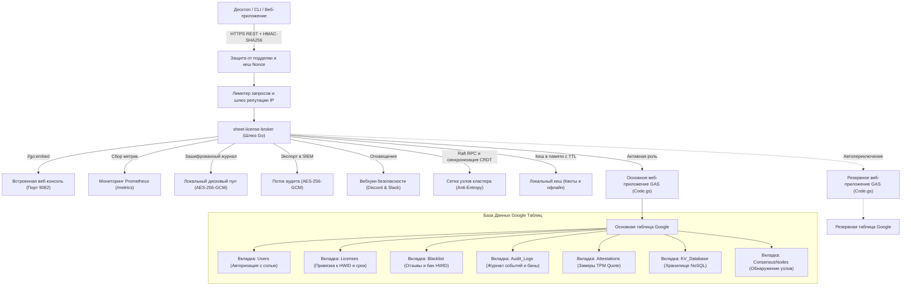

<div align="center">

<!-- 10-Language Navigation Bar -->
<p align="center">
  <a href="../../README.md">🇺🇸 English</a> · <a href="./ko.md">🇰🇷 한국어</a> · <a href="./zh-CN.md">🇨🇳 简体中文</a> · <a href="./ja.md">🇯🇵 日本語</a> · <a href="./es.md">🇪🇸 Español</a><br />
  <a href="./fr.md">🇫🇷 Français</a> · <b>🇷🇺 Русский</b> · <a href="./pt-BR.md">🇧🇷 Português</a> · <a href="./ar.md">🇸🇦 العربية</a> · <a href="./hi.md">🇮🇳 हिन्दी</a>
</p>

# Sheet-License-Broker

<p align="center">
  <strong>Бессерверный шлюз аутентификации, лицензирования и NoSQL баз данных на базе Google Таблиц и Google Apps Script</strong>
</p>

<p align="center">
  
  
  
  
  
  
  
  
  
  
  
  
  
  
  
  
  
  
</p>

</div>

---

## 💡 Обзор (Overview)

**`sheet-license-broker`** превращает любую электронную таблицу Google в высокопроизводительный, аутентифицированный и готовый к промышленной эксплуатации бессерверный бэкенд для настольных приложений, CLI-инструментов и инди-SaaS проектов.

Больше не нужно оплачивать дорогие экземпляры облачных баз данных или поддерживать сложные контейнеры Docker исключительно ради проверки логинов и лицензионных ключей. `sheet-license-broker` объединяет облачный движок **Google Apps Script (GAS)** со сверхбыстрым **мостом на Go, постквантовыми цепочками подписей ML-DSA (NIST FIPS 204), распределенным кворумным консенсусом Raft, бесконфликтной синхронизацией CRDT LWW-Element-Set, пограничным шлюзом Cloudflare, аппаратной криптографической аттестацией (TPM 2.0 и Enclave), мультиарендным разделением, отказоустойчивостью с активной и резервной таблицами, динамическими флагами функций с учетом квот, зашифрованным локальным буфером на диске, метриками Prometheus, защитой от подделки HMAC, надежным автономным кешированием и встроенной панелью управления**.

### Преимущества использования Google Таблиц в роли бэкенда
- **Нулевая стоимость хостинга (0$/мес)**: Использование бесплатных квот Google Drive и Apps Script (до 20 000 вызовов в день).
- **Постквантовая криптография и цепочки подписей ML-DSA (NIST FIPS 204)**: Проверка цифровых подписей на модульных решетках (ML-DSA-44 / ML-DSA-65) с гибридными схемами ECDSA / решетка (`Hybrid-P256-MLDSA65`), льготными окнами ротации ключей без простоев и мгновенным широковещанием аварийного отзыва.
- **Обнаружение поведенческих аномалий и адаптивная оценка рисков**: Статистический анализ дрейфа контрольных сигналов Z-Score в скользящем окне (&plusmn;15% джиттера), выявление физически невозможных перемещений по формуле гаверсинусов (&gt;950 км/ч или одновременная активность в подсетях /24), адаптивное снижение риска, эскалация проверки при риске &ge; 50, изоляция нулевого доверия при риске &ge; 85 и генерация стандартного графа инцидентов (`siem-topology-v1`) для SIEM.
- **Корпоративный SSO и учетные записи SCIM 2.0**: Федерация удостоверений по протоколам SAML 2.0 и OIDC, синхронизация каталогов RFC 7643/7644 с автоматическим выделением рабочих мест и отзывом лицензий при увольнении.
- **Доказательства с нулевым разглашением (ZKP)**: Обязательства Педерсена на кривой NIST P-256, неинтерактивные доказательства Сигма (преобразование Фиата-Шамира) и реестр использованных нуллификаторов для защиты аппаратной конфиденциальности.
- **Распределенный консенсус Raft и сеть CRDT**: Выборы лидера с минимальными накладными расходами, кворумная репликация журнала, объединение состояний без конфликтов и хеш-деревья Меркла SHA-256 для антиэнтропийного обмена.
- **Корпоративное ограничение частоты запросов**: Потокобезопасное регулирование по IP и HWID со скользящими окнами, прогрессивными задержками и заголовками `X-RateLimit-*`.
- **Кеш репутации и автоматическая блокировка**: Выявление повторяющихся нарушений с временным баном и отправкой срочных оповещений через вебхуки.
- **Зашифрованный экспорт аудита для SIEM**: Соответствующие регуляторным требованиям пакеты аудита в формате AES-256-GCM с HMAC-подписью для Splunk, Datadog и AWS CloudWatch.
- **Аппаратная аттестация и привязка к оборудованию**: Проверка замеров TPM 2.0 PCR Quote и аппаратных ключей Apple Secure Enclave / Windows Hello для предотвращения клонирования.
- **Динамические флаги возможностей и тарификация**: Тарифные планы Free, Pro, Enterprise с проверкой прав в реальном времени (`client.isFeatureEnabled("analytics")`) и атомарным учетом лимитов в Google Таблицах.
- **Автоматическое переключение при сбое (Active-Standby)**: Синхронизация между основной и резервной таблицами с бесконфликтным двусторонним объединением данных.
- **Локальная зашифрованная очередь на диске**: Журнал событий с шифрованием AES-256-GCM (`spool.bin`), обеспечивающий сохранность транзакций при сбоях связи.
- **Встроенная веб-панель**: Автономный исполняемый файл (`sheet-license-broker.exe`) с темно-изумрудным интерфейсом управления.

---

## 🏛️ Архитектура (Architecture)



---

## 🚀 Быстрый старт (Quick Start)

### 1. Запуск локального шлюза и панели

Убедитесь, что установлена среда Go 1.22+:

```bash
# Клонирование репозитория
git clone https://github.com/kLauncher1/sheet-license-broker.git
cd sheet-license-broker

# Компиляция и запуск в автономном режиме
go run .
```

Перейдите по адресу **`http://localhost:9082`** в браузере для работы с веб-консолью.

### 2. Подключение к реальным Google Таблицам (Режим Прокси)

Задайте переменные окружения для связи с развернутым скриптом Google Apps Script:

```bash
# Адрес веб-приложения Apps Script
export GAS_WEBAPP_URL="https://script.google.com/macros/s/.../exec"
export CACHE_TTL_SECONDS="600" # Опционально: время жизни кеша 10 минут

# Запуск шлюза
./sheet-license-broker.exe
```

Сервер автоматически обнаружит удаленный URL, начнет транслировать запросы, кешировать ответы и бесперебойно обслуживать клиентов из кеша при неполадках в сети.

---

## 📋 Развертывание Google Таблиц через Clasp

### Вариант A: Автоматическое развертывание с помощью Clasp CLI

Если у вас установлен инструмент `@google/clasp`:

```bash
# 1. Авторизация в аккаунте Google
npx @google/clasp login

# 2. Запуск скрипта автоматического деплоя
node scripts/deploy_clasp.mjs --script-id <ВАШ_APPS_SCRIPT_ID>
```

### Вариант B: Ручная настройка за 3 минуты

1. Создайте пустую таблицу на [Google Sheets](https://sheets.new).
2. В верхнем меню выберите **Расширения > Apps Script**.
3. Замените исходный код содержимым файла [`gas/Code.gs`](../../gas/Code.gs).
4. Нажмите **Развернуть > Новое развертывание**:
   - Тип: **Веб-приложение**
   - Запуск от имени: **Я (ваш адрес почты)**
   - Доступ: **Все (Anyone)**
5. Нажмите **Развернуть** и сохраните полученный **URL веб-приложения** (`https://script.google.com/macros/s/.../exec`).

Все необходимые вкладки (`Users`, `Licenses`, `KV_Database`) будут автоматически созданы при первом поступившем запросе.

---

## 📡 Спецификация REST API

| Область | Метод и Маршрут | Описание |
| :--- | :--- | :--- |
| **Диагностика** | `GET /api/health` | Комплексная проверка здоровья сервиса и компонентов |
| **Диагностика** | `GET /api/proxy/ping` | Проверка времени отклика бэкенда Google Apps Script |
| **Аутентификация**| `POST /api/users/register` | Регистрация пользователей с хешированием пароля с солью |
| **Аутентификация**| `POST /api/users/login` | Проверка учетных данных пользователя |
| **Лицензии** | `POST /api/licenses` | Выпуск лицензии с указанием срока и лимита устройств |
| **Лицензии** | `POST /api/licenses/validate` | Валидация и автоматическая привязка к первому HWID |
| **Лицензии** | `POST /api/licenses/revoke` | Мгновенный отзыв лицензионного ключа |
| **Безопасность** | `POST /api/security/blacklist` | Внесение скомпрометированного HWID или ключа в черный список |
| **Безопасность** | `GET /api/security/blacklist` | Просмотр активного черного списка |
| **NoSQL** | `POST /api/docs` | Сохранение JSON-документа по коллекции и идентификатору |
| **NoSQL** | `GET /api/docs` | Получение списка всех сохраненных документов |
| **Мультиаренда** | `POST /api/tenants/register` | Регистрация арендатора с префиксом ключа и вебхуком |
| **Резервирование**| `POST /api/backup/export` | Экспорт зашифрованного снимка состояния (AES-256-GCM) |
| **Резервирование**| `POST /api/backup/restore` | Моментальное восстановление из зашифрованной копии |
| **Функционал** | `GET /api/features` | Каталог доступных функций и лимитов по тарифным планам |
| **Функционал** | `POST /api/features/check` | Проверка доступности конкретной функции для ключа |
| **Учет расхода** | `POST /api/usage/record` | Регистрация и списание единиц использования ресурсов |
| **Аттестация** | `POST /api/attestation/challenge` | Генерация одноразового Nonce для проверки TPM 2.0 |
| **Аттестация** | `POST /api/attestation/verify` | Проверка криптографических замеров PCR чипа TPM 2.0 |
| **Лимиты** | `GET /api/security/ratelimit/status`| Статистика скользящих окон лимитирования по IP и HWID |
| **Консенсус** | `GET /api/consensus/status` | Состояние кворума Raft и репликации CRDT |
| **Стриминг** | `GET /api/stream/ws` | Двустороннее WebSocket-соединение для экстренных блокировок |
| **ZKP** | `POST /api/zkp/verify` | Проверка доказательства Сигма без раскрытия данных |
| **SSO / SCIM** | `GET /api/sso/saml/metadata` | Экспорт XML-метаданных поставщика услуг для Okta/Azure |
| **SSO / SCIM** | `POST /scim/v2/Users` | Управление пользователями и автовыделение лицензий SCIM |
| **Постквантовое** | `POST /api/pqc/sign` | Создание гибридной постквантовой подписи ML-DSA |
| **Аномалии** | `POST /api/anomaly/record` | Отправка телеметрии и расчет адаптивного рейтинга риска |
| **Топология SIEM**| `GET /api/anomaly/graph` | Экспорт графа корреляции инцидентов для систем SIEM |

---

## 💻 Клиентские библиотеки SDK

`sheet-license-broker` поставляется с готовыми библиотеками для быстрой интеграции:

### 🐍 Клиент для Python (`sdk/python/sheet_license_client.py`)
Полностью автономен, использует стандартную библиотеку:

```python
from sheet_license_client import SheetLicenseClient

client = SheetLicenseClient(base_url="http://localhost:9082", secret_key="your-hmac-secret")

# 1. Проверка лицензии (HWID текущего ПК привязывается автоматически)
res = client.verify_license("SLB-XXXX-XXXX-XXXX")
if res.get("valid"):
    print("Лицензия подтверждена. Тариф:", res.get("tier"))

    # 2. Проверка флага функции
    if client.is_feature_enabled("SLB-XXXX-XXXX-XXXX", "analytics"):
        print("Модуль аналитики активирован!")

    # 3. Учет потребления
    client.record_usage("SLB-XXXX-XXXX-XXXX", "api_calls", 1)
```

### ⚡ C# / .NET & Unity (`sdk/csharp/SheetLicenseClient.cs`)
Поддерживает Unity Mono/IL2CPP, WPF и консольные приложения:

```csharp
using SheetLicenseBroker;

var client = new SheetLicenseClient("http://localhost:9082", "your-hmac-secret");
var result = await client.VerifyLicenseAsync("SLB-XXXX-XXXX-XXXX");
if (result.Valid) {
    Console.WriteLine($"Доступ разрешен! Тариф: {result.Tier}, Срок: {result.ExpirationDate}");
}
```

### 🟩 TypeScript и Node.js (`@sheet-license/client`)
Для серверов Node.js и настольных приложений Electron:

```typescript
import { SheetLicenseClient } from '@sheet-license/client';

const client = new SheetLicenseClient({
  baseUrl: 'http://localhost:9082',
  secretKey: 'your-hmac-secret',
});

const result = await client.verifyLicense('SLB-XXXX-XXXX-XXXX');
if (result.valid) {
  console.log('Лицензия активна. Тариф:', result.tier);
}
```

### 🔷 Клиент на Go (`sdk/go/client.go`)

```go
package main

import (
	"context"
	"fmt"
	"time"

	"github.com/kLauncher1/sheet-license-broker/sdk/go"
)

func main() {
	client := sdk.NewClient("http://localhost:9082", []byte("your-hmac-secret"), 5*time.Second)
	res, err := client.VerifyLicense(context.Background(), "SLB-XXXX-XXXX-XXXX", "")
	if err == nil && res.Valid {
		fmt.Printf("Лицензия действительна (Тариф: %s). Запуск программы...\n", res.Tier)
	}
}
```

---

## 🛠️ Тестирование и сборка

```bash
# Запуск полного набора модульных тестов
go test -v ./...

# Компиляция готового исполняемого файла
go build -ldflags="-s -w" -o sheet-license-broker.exe .
```

---

## 📄 Лицензия (License)

Проект распространяется на условиях [Лицензии MIT](../../LICENSE).
