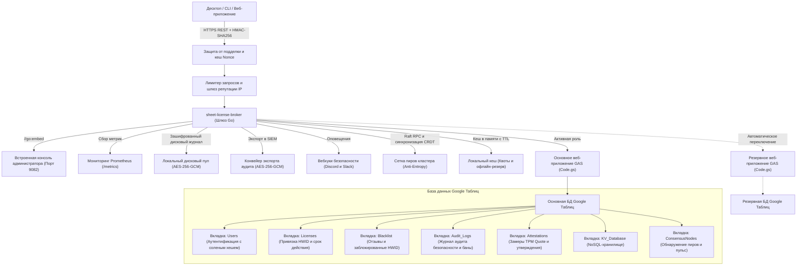

<div align="center">

<!-- 10-Language Navigation Bar -->
<p align="center">
  <a href="../../README.md">🇺🇸 English</a> · <a href="./ko.md">🇰🇷 한국어</a> · <a href="./zh-CN.md">🇨🇳 简体中文</a> · <a href="./ja.md">🇯🇵 日本語</a> · <a href="./es.md">🇪🇸 Español</a><br />
  <a href="./fr.md">🇫🇷 Français</a> · <b>🇷🇺 Русский</b> · <a href="./pt-BR.md">🇧🇷 Português</a> · <a href="./ar.md">🇸🇦 العربية</a> · <a href="./hi.md">🇮🇳 हिन्दी</a>
</p>

# Sheet-License-Broker

<p align="center">
  <strong>Бессерверный шлюз аутентификации, лицензирования и NoSQL баз данных на базе Google Таблиц и Google Apps Script</strong>
</p>

<p align="center">
  
  
  
  
  
  
  
  
  
  
  
  
  
  
  
  
  
  
</p>

</div>

---

## 💡 Обзор

**`sheet-license-broker`** превращает любую электронную таблицу Google в аутентифицированный, готовый к промышленной эксплуатации бессерверный бэкенд для настольных приложений, CLI-утилит и инди-SaaS инструментов. 

Вместо того чтобы оплачивать дорогостоящие инстансы облачных баз данных или управлять контейнерами Docker только ради обработки входа пользователей и лицензионных ключей программного обеспечения, `sheet-license-broker` объединяет облачный движок **Google Apps Script (GAS)** с **высокоскоростным мостом на Go, постквантовыми цепочками подписей ML-DSA, распределенным кворумным консенсусом Raft, синхронизацией CRDT LWW-Element-Set, пограничным шлюзом Cloudflare Edge Gateway, криптографической аппаратной аттестацией (TPM 2.0 и анклавы), мультиарендной изоляцией пространств имен, отказоустойчивостью с двумя таблицами Active-Standby, динамическими флагами функций и учетом использования, зашифрованным дисковым пулом, метриками Prometheus, криптографической проверкой подлинности HMAC против подделки, устойчивым офлайн-кешированием и встроенным веб-интерфейсом**.

### Преимущества использования Google Таблиц в роли бэкенда
- **Нулевая стоимость ($0/мес)**: Использование бесплатных квот Google Диска и Apps Script (до 20 000 запросов в день).
- **Постквантовая криптография и цепочки подписей ML-DSA (NIST FIPS 204)**: Квантово-устойчивая проверка цифровых подписей на основе модульных решеток (ML-DSA-44 / ML-DSA-65) с двойными гибридными цепочками классической подписи ECDSA и решеточной подписи (`Hybrid-P256-MLDSA65`), льготными окнами ротации ключей без простоев и мгновенной широковещательной рассылкой аварийного отзыва (kill-switch).
- **Обнаружение поведенческих аномалий и адаптивная оценка рисков**: Статистическое отслеживание дрейфа контрольных сигналов (heartbeat) Z-Score по скользящему окну (допуск джиттера &plusmn;15%), выявление физически невозможных перемещений по скорости гаверсинусов (&gt;950 км/ч или одновременная активность в подсетях /24), адаптивный расчет показателя риска с прогрессивным номинальным затуханием, автоматическая эскалация повторной криптографической аттестации при оценке риска &ge; 50, автоматический карантин нулевого доверия при оценке риска &ge; 85 и стандартизированный экспортер графа топологии инцидентов безопасности (`siem-topology-v1`) для корпоративных систем SIEM.
- **Корпоративный Single Sign-On (SSO) и автоматическое управление каталогами SCIM 2.0**: Федерация удостоверений SAML 2.0 и OIDC, синхронизация каталогов по спецификациям RFC 7643/7644, автоматическое выделение лицензионных мест и мгновенный отзыв при деактивации учетных записей.
- **Анонимная верификация с доказательствами с нулевым разглашением (ZKP)**: Обязательства Педерсена на эллиптической кривой NIST P-256 с детерминированными независимыми генераторами hash-to-curve, неинтерактивные доказательства предъявления Сигма (преобразование Фиата-Шамира) и реестры использованных нуллификаторов для защиты от повторного воспроизведения, обеспечивающие полную конфиденциальность аппаратных данных клиента.
- **Распределенный кворумный консенсус Raft и сетка CRDT**: Легковесные выборы лидера, кворум журналов большинства, репликация бесконфликтных состояний LWW-Element-Set и дайджесты состояний на основе деревьев Меркла SHA-256 для антиэнтропийной синхронизации между распределенными узлами брокера.
- **Корпоративное ограничение частоты запросов и прогрессивная задержка**: Потокобезопасное регулирование частоты запросов (rate limiting) по скользящему окну для каждого IP и HWID с прогрессивными штрафными задержками и стандартными заголовками `X-RateLimit-*`.
- **Кеш репутации IP/HWID со скользящим окном**: Автоматические временные блокировки и отправка высокоприоритетных оповещений об инцидентах через вебхуки при повторных нарушениях безопасности.
- **Экспорт зашифрованных токенов аудита для SIEM**: Соответствующие нормативным требованиям зашифрованные пакеты аудита AES-256-GCM, запечатанные подписями HMAC для загрузки в Splunk, Datadog и AWS CloudWatch.
- **Криптографическая аппаратная аттестация и привязка к анклаву**: Проверка замеров TPM 2.0 PCR Quote и аппаратная аттестация ключей Apple Secure Enclave / Windows Hello, предотвращающая атаки клонирования.
- **Телеметрия защиты от отладки и модификации памяти на клиенте**: Непрерывный скоринг целостности с мгновенным автоматическим баном (kill-switch) устройств, на которых обнаружено подключение отладчика или изменение секций кода.
- **Динамические флаги возможностей и тарификация на основе использования**: Тарифные планы Free, Pro и Enterprise с проверкой прав доступа в рантайме (`client.isFeatureEnabled("analytics")`) и атомарным учетом лимитов потребления, сохраняемым непосредственно в Google Таблицах.
- **Репликация между двумя таблицами Active-Standby**: Автоматическое аварийное переключение между основной и резервной таблицами с бесконфликтным двусторонним согласованием данных.
- **Локальный зашифрованный буфер на диске**: Журнал очередей, зашифрованный по стандарту AES-256-GCM (`spool.bin`), гарантирующий нулевую потерю данных при сетевых сбоях.
- **Корпоративная телеметрия Prometheus (`/metrics`)**: Встроенная конечная точка сбора метрик, экспортирующая счетчики, калибры (gauges) и задержки в стандартном формате Prometheus.
- **Вебхуки оповещения об инцидентах**: Мгновенная отправка подробных уведомлений об инцидентах безопасности в каналы Discord и Slack.
- **Мультиарендная изоляция пространств имен (Multi-Tenant)**: Разделение различных продуктов и клиентов с помощью настраиваемых префиксов (например, `ACME-LIC-XXXX-YYYY`) и независимых политик.
- **Пограничный шлюз Cloudflare (Edge Gateway)**: Проверка лицензий на периферии с задержкой менее миллисекунды с использованием Cloudflare Workers и Workers KV на базе Web Crypto API.
- **Человекочитаемая панель администратора**: Ваша таблица Google Sheets — это ваша база данных. Просматривайте, редактируйте, блокируйте или выдавайте лицензии в реальном времени.
- **Аппаратная привязка к оборудованию (HWID)**: Привязка лицензионных ключей к уникальным идентификаторам оборудования конкретного компьютера при первом запуске.
- **Криптографическая защита от подделки HMAC-SHA256**: Защита входящего клиентского трафика от атак перехвата (MITM) и подделки полезной нагрузки путем обратной разработки.
- **Защита от повторного воспроизведения со скользящим окном Nonce**: Предотвращение атак повторного воспроизведения запросов (replay attacks) с 5-минутным допустимым окном расхождения времени.
- **Мгновенный удаленный отзыв и черный список устройств**: Блокировка лицензий или занесение скомпрометированных HWID в черный список напрямую из веб-консоли или вкладки Google Таблиц.
- **Автоматическое резервное копирование и аварийное восстановление**: Экспорт и восстановление снимков состояния на определенный момент времени с проверкой контрольных сумм SHA-256 и шифрованием AES-256-GCM.
- **Вебхуки жизненного цикла в реальном времени**: Диспетчеры событий с очередями воркеров и доставкой подписанных HMAC вебхуков на глобальные конечные точки и эндпоинты арендаторов.
- **Аутентификация с соленым SHA-256**: Пароли криптографически солятся и хешируются перед сохранением.
- **Устойчивое локальное кеширование и автономный режим**: Лицензии и KV-документы в памяти защищают от превышения лимитов Google API (HTTP 429) и кратковременных сетевых сбоев.
- **Встроенный веб-дашборд**: Автономный монолитный исполняемый файл (`sheet-license-broker.exe`) с консолью управления в темно-изумрудной теме.

---

## 🏛️ Архитектура



---

## 🚀 Быстрый старт

### 1. Запуск локального шлюза и панели

Убедитесь, что на вашей рабочей станции установлена среда Go 1.22+:

```bash
# Клонирование репозитория
git clone https://github.com/kLauncher1/sheet-license-broker.git
cd sheet-license-broker

# Сборка и запуск единого бинарного файла в автономном режиме
go run .
```

Откройте браузер по адресу **`http://localhost:9082`** для доступа к интерактивной консоли администрирования.

### 2. Подключение к реальным Google Таблицам (Режим Прокси)

Для подключения брокера к развернутому веб-приложению Google Apps Script:

```bash
# Укажите URL веб-приложения Apps Script
export GAS_WEBAPP_URL="https://script.google.com/macros/s/.../exec"
export CACHE_TTL_SECONDS="600" # Опционально: время жизни кеша 10 минут

# Запуск шлюза
./sheet-license-broker.exe
```

Сервер автоматически распознает удаленный URL, перенаправляет входящие запросы, кеширует результаты локально и прозрачно возвращается к кешированным данным во время сетевых сбоев.

---

## 📋 Развертывание Google Таблиц через Clasp

### Вариант A: Автоматическое развертывание в один клик через Clasp CLI

Если вы используете CLI `@google/clasp`:

```bash
# 1. Авторизуйтесь в аккаунте Google
npx @google/clasp login

# 2. Разверните проект с помощью скрипта автоматизации
node scripts/deploy_clasp.mjs --script-id <YOUR_APPS_SCRIPT_ID>
```

Полные инструкции по созданию и настройке проектов Clasp приведены в файле [`gas/README.md`](../../gas/README.md).

### Вариант B: Ручная настройка (за 3 минуты)

1. Откройте [Google Таблицы](https://sheets.new) и создайте новую пустую таблицу.
2. В верхнем меню перейдите в **Расширения > Apps Script**.
3. Замените код по умолчанию содержимым файла [`gas/Code.gs`](../../gas/Code.gs).
4. Нажмите **Развернуть > Новое развертывание**:
   - Тип: **Веб-приложение**
   - Запуск от имени: **Я (ваш адрес электронной почты)**
   - Кто имеет доступ: **Все (Anyone)**
5. Нажмите **Развернуть** и скопируйте полученный **URL веб-приложения** (`https://script.google.com/macros/s/.../exec`).

Ваша таблица Google Sheets автоматически создаст три выделенные вкладки при первом поступившем запросе:
- **`Users`**: `user_id`, `username`, `password_hash`, `salt`, `role`, `created_at`
- **`Licenses`**: `license_key`, `bound_hwid`, `max_devices`, `status`, `expires_at`, `created_at`
- **`KV_Database`**: `collection`, `doc_id`, `payload`, `updated_at`

---

## 📡 Спецификация REST API

### Диагностика и проверка работоспособности

#### Проверка состояния сервиса и статуса прокси
```http
GET /api/health
```

#### Проверка связи с бэкендом (Ping)
```http
GET /api/proxy/ping
```

---

### Аутентификация

#### Регистрация пользователя
```http
POST /api/users/register
Content-Type: application/json

{
  "username": "developer",
  "password": "SecurePassword123!",
  "role": "admin"
}
```

#### Аутентификация / Вход в систему
```http
POST /api/users/login
Content-Type: application/json

{
  "username": "developer",
  "password": "SecurePassword123!"
}
```

---

### Управление лицензиями

#### Выпуск лицензионного ключа
```http
POST /api/licenses
Content-Type: application/json

{
  "days": 30,
  "max_devices": 1
}
```
**Ответ:**
```json
{
  "license_key": "KEY-7F2A-9C4B-E108",
  "bound_hwid": "",
  "max_devices": 1,
  "status": "ACTIVE",
  "expires_at": "2026-11-12T12:00:00Z",
  "created_at": "2026-10-13T12:00:00Z"
}
```

#### Валидация и привязка к аппаратному ID (HWID)
```http
POST /api/licenses/validate
Content-Type: application/json

{
  "license_key": "KEY-7F2A-9C4B-E108",
  "hwid": "WIN-B829-94AA-0123"
}
```
**Ответ:**
```json
{
  "valid": true,
  "license_key": "KEY-7F2A-9C4B-E108",
  "hwid_bound": "WIN-B829-94AA-0123",
  "expires_at": "2026-11-12T12:00:00Z",
  "source": "remote_gas"
}
```

*Примечание: Если лицензия активна и еще не привязана, она привязывается к переданному `hwid`. Последующие вызовы с совпадающего оборудования завершаются успешно; вызовы с несовпадающего оборудования отклоняются. В ответе также указывается источник результата: `cache`, `remote_gas` или `offline_cache`.*

---

### Защита от несанкционированного доступа и безопасность

#### Подпись запросов HMAC-SHA256
Когда включен параметр `HMAC_ENFORCE=true` (или настроен `HMAC_SECRET`), клиенты защищают запросы от перехвата MITM с помощью стандартных заголовков:
- `X-Signature`: Шестнадцатеричная подпись HMAC-SHA256, вычисленная по формуле `METHOD\nPATH\nTIMESTAMP\nNONCE\nSHA256(BODY)`.
- `X-Timestamp`: Текущая временная метка Unix в секундах (обеспечивает 5-минутное скользящее окно допустимого расхождения часов).
- `X-Nonce`: Уникальная криптографическая строка nonce для каждого запроса (предотвращает атаки повторного воспроизведения).

#### Отзыв лицензионного ключа
```http
POST /api/licenses/revoke
Content-Type: application/json

{
  "license_key": "KEY-7F2A-9C4B-E108",
  "reason": "Payment refunded"
}
```

#### Внесение аппаратного ID устройства (HWID) в черный список
```http
POST /api/security/blacklist
Content-Type: application/json

{
  "type": "device",
  "target": "WIN-B829-94AA-0123",
  "reason": "Fraudulent key sharing"
}
```

#### Получение списка записей черного списка и отзывов
```http
GET /api/security/blacklist
```

---

### Хранилище документов NoSQL Key-Value

#### Сохранение документа
```http
POST /api/docs
Content-Type: application/json

{
  "collection": "user_settings",
  "doc_id": "usr_9918",
  "payload": "{\"dark_mode\":true,\"telemetry\":false}"
}
```

#### Получение всех документов
```http
GET /api/docs
```

---

### Мультиарендные пространства имен (Multi-Tenant)

#### Регистрация арендатора
```http
POST /api/tenants/register
Content-Type: application/json

{
  "id": "tenant-gamehub",
  "name": "GameHub Studio",
  "namespace_prefix": "GHUB",
  "max_licenses": 100,
  "webhook_url": "https://api.gamehub.com/webhooks"
}
```

#### Выпуск лицензии в пространстве имен арендатора
```http
POST /api/licenses
Content-Type: application/json
X-Tenant-ID: tenant-gamehub

{
  "days": 60,
  "max_devices": 2
}
```
*Генерирует отформатированные ключи вида `GHUB-LIC-XXXX-YYYY`.*

---

### Автоматическое резервное копирование и аварийное восстановление

#### Экспорт зашифрованной резервной копии (AES-256-GCM + контроль целостности SHA-256)
```http
POST /api/backup/export
Content-Type: application/json

{
  "secret_key": "your-backup-master-passphrase"
}
```

#### Восстановление из снимка состояния
```http
POST /api/backup/restore
Content-Type: application/json

{
  "secret_key": "your-backup-master-passphrase",
  "encrypted_payload": "<hex-encoded-ciphertext>"
}
```

---

### Динамические флаги возможностей и тарификация на основе использования

#### Каталог стандартных функций и уровней подписки
```http
GET /api/features
```
**Ответ:**
```json
{
  "tiers": {
    "free": {
      "name": "free",
      "features": ["basic_access"],
      "daily_quotas": { "api_calls": 500, "export_rows": 100 }
    },
    "pro": {
      "name": "pro",
      "features": ["basic_access", "analytics", "csv_export", "extended_logs"],
      "daily_quotas": { "api_calls": 50000, "export_rows": 100000 }
    },
    "enterprise": {
      "name": "enterprise",
      "features": ["basic_access", "analytics", "csv_export", "extended_logs", "sso", "audit_export", "unlimited_seats", "priority_support"],
      "daily_quotas": { "api_calls": 10000000, "export_rows": 50000000 }
    }
  }
}
```

#### Проверка прав лицензии на использование функции
```http
POST /api/features/check
Content-Type: application/json

{
  "license_key": "KEY-7F2A-9C4B-E108",
  "feature": "analytics"
}
```
**Ответ:**
```json
{
  "license_key": "KEY-7F2A-9C4B-E108",
  "feature": "analytics",
  "tier": "pro",
  "allowed": true
}
```

#### Регистрация использования и контроль лимитов тарифа
```http
POST /api/usage/record
Content-Type: application/json

{
  "license_key": "KEY-7F2A-9C4B-E108",
  "metric": "api_calls",
  "units": 1
}
```
**Ответ:**
```json
{
  "license_key": "KEY-7F2A-9C4B-E108",
  "metric": "api_calls",
  "units": 1,
  "current_usage": 42,
  "daily_quota": 50000,
  "quota_exceeded": false,
  "success": true
}
```

#### Запрос статистики использования
```http
GET /api/usage/stats?license_key=KEY-7F2A-9C4B-E108
```
**Ответ:**
```json
{
  "license_key": "KEY-7F2A-9C4B-E108",
  "date": "2026-10-14",
  "tier": "pro",
  "metrics": {
    "api_calls": 42
  }
}
```

---

### Аппаратная аттестация и телеметрия защиты от взлома

#### Запрос Nonce для подтверждения подлинности TPM / анклава
```http
POST /api/attestation/challenge
Content-Type: application/json

{
  "license_key": "KEY-7F2A-9C4B-E108",
  "hwid": "WIN-B829-94AA-0123"
}
```
**Ответ:**
```json
{
  "status": "success",
  "challenge_id": "9a4f2b1c8e3d",
  "nonce": "e3b0c44298fc1c149afbf4c8996fb92427ae41e4649b934ca495991b7852b855",
  "expires_at": "2026-10-14T12:05:00Z"
}
```

#### Проверка замера TPM 2.0 PCR Quote
```http
POST /api/attestation/verify
Content-Type: application/json

{
  "license_key": "KEY-7F2A-9C4B-E108",
  "hwid": "WIN-B829-94AA-0123",
  "challenge_id": "9a4f2b1c8e3d",
  "attestation_type": "tpm2",
  "tpm_quote": {
    "pcr_values": {
      "0": "e3b0c44298fc1c149afbf4c8996fb92427ae41e4649b934ca495991b7852b855",
      "7": "ba7816bf8f01cfea414140de5dae2223b00361a396177a9cb410ff61f20015ad"
    },
    "pcr_selection": [0, 7],
    "composite_digest": "4a5b6c7d8e9f...",
    "signature": "3045022100...",
    "ak_public_key_pem": "-----BEGIN PUBLIC KEY-----\n..."
  }
}
```

#### Передача телеметрии защиты от отладки и проверки целостности
```http
POST /api/attestation/telemetry
Content-Type: application/json

{
  "license_key": "KEY-7F2A-9C4B-E108",
  "hwid": "WIN-B829-94AA-0123",
  "report": {
    "debugger_present": false,
    "memory_integrity": true,
    "sandbox_detected": false,
    "hooks_detected": false,
    "process_checksum": "a1b2c3d4e5f6...",
    "execution_uptime_s": 3600
  }
}
```

---

### 🛡️ Корпоративное ограничение частоты запросов и экспорт аудита SIEM

#### Телеметрия лимитера частоты запросов и репутации IP
```http
GET /api/security/ratelimit/status
GET /api/security/reputation
```

#### Наложение / Просмотр временных ограничений
```http
# Список активных временных блокировок
GET /api/security/bans

# Наложение временного ограничения
POST /api/security/bans
Content-Type: application/json

{
  "key": "198.51.100.24",
  "reason": "Repeated failed validation attempts",
  "duration_minutes": 15
}

# Снятие временного ограничения
POST /api/security/bans/unban
Content-Type: application/json

{
  "key": "198.51.100.24"
}
```

#### Экспорт зашифрованного пакета аудита (для импорта в SIEM / SOC)
```http
POST /api/security/audit/export
Content-Type: application/json

{
  "secret_key": "enterprise-compliance-secret",
  "limit": 500
}
```

#### Проверка и расшифровка пакета аудита
```http
POST /api/security/audit/verify
Content-Type: application/json

{
  "secret_key": "enterprise-compliance-secret",
  "bundle": { ... }
}
```

---

### 🌐 Распределенный консенсус и синхронизация кворума между регионами

#### Состояние кластера и топология пиров
```http
GET /api/consensus/status
GET /api/consensus/peers
```

Ответ:
```json
{
  "node_id": "node-1",
  "role": "Leader",
  "current_term": 1,
  "commit_index": 4,
  "peer_count": 2,
  "healthy_peers": 2,
  "has_quorum": true,
  "merkle_digest": "4a7d1ed414474e4033ac29ccb8653d9b...",
  "element_count": 128
}
```

#### Подключение узла к кластеру
```http
POST /api/consensus/peers/join
Content-Type: application/json

{
  "node_id": "node-2",
  "address": "http://192.168.1.50:9082"
}
```

#### Запуск антиэнтропийной синхронизации состояния
```http
POST /api/consensus/sync/trigger
```

---

### ⚡ Потоковая передача через WebSocket в реальном времени и рассылка телеметрии

#### Двусторонний поток телеметрии WebSocket
Подключите постоянных клиентов WebSocket к `/api/stream/ws` для передачи телеметрии в реальном времени и отправки сигналов экстренной блокировки (kill-switch) за доли секунды:

```http
GET /api/stream/ws?license_key=SLB-XXXX-XXXX&hwid=HWID-1234 HTTP/1.1
Host: localhost:9082
Upgrade: websocket
Connection: Upgrade
Sec-WebSocket-Key: dGhlIHNhbXBsZSBub25jZQ==
Sec-WebSocket-Version: 13
```

#### Запрос подключенных стриминг-клиентов и телеметрии
```http
# Список активных сеансов потоковой передачи
GET /api/stream/clients

# Запрос метрик стриминга и журнала недавних событий аудита
GET /api/stream/telemetry
```

#### Мгновенное удаленное срабатывание аварийной блокировки (Kill-Switch)
```http
POST /api/stream/kill
Content-Type: application/json

{
  "target": "SLB-XXXX-XXXX",
  "reason": "Suspected device cloning or fraud",
  "immediate": true
}
```
*Примечание: Целью (target) может быть конкретный лицензионный ключ, аппаратный HWID устройства, ID клиента или `"ALL"` для экстренной широковещательной блокировки. Сигналы передаются на соответствующие клиентские сокеты со временем доставки менее секунды.*

---

### 🕵️ Анонимная верификация с доказательствами с нулевым разглашением (ZKP)

#### Получение открытых параметров и генераторов NIST P-256
```http
GET /api/zkp/params
```

#### Выпуск анонимных ослепленных учетных данных (Blinded Credential)
```http
POST /api/zkp/credential/issue
Content-Type: application/json

{
  "license_key": "LIC-ENTERPRISE-001",
  "tenant_id": "default",
  "hwid": "WIN-B829-94AA-0123",
  "tier": "enterprise",
  "max_seats": 5
}
```

#### Проверка доказательства предъявления с нулевым разглашением (Протокол Сигма)
```http
POST /api/zkp/verify
Content-Type: application/json

{
  "credential": { ... },
  "required_tier": "enterprise"
}
```

#### Проверка статуса использованных нуллификаторов
```http
GET /api/zkp/nullifiers/check?nullifier=7f2a9c4b...
```

---

### 🔐 Корпоративный Single Sign-On (SSO) и автоматическое управление каталогами SCIM 2.0

#### Метаданные поставщика услуг SAML 2.0
Загрузка стандартного XML-файла метаданных SP для Okta, Azure AD или PingFederate:
```http
GET /api/sso/saml/metadata?entity_id=urn:sheet-license-broker:sp
```

#### Сервис обработки утверждений SAML 2.0 (ACS)
Обработка входящих утверждений SAML и выпуск аутентифицированных сессионных токенов:
```http
POST /api/sso/saml/acs
Content-Type: application/x-www-form-urlencoded

SAMLResponse=PHNhbWxwOlJlc3BvbnNlIHhtbG5z...
```

#### Обратный вызов OpenID Connect (OIDC) Callback
Валидация токенов ID и утверждений (claims) от Google Workspace, Auth0 или Keycloak:
```http
POST /api/sso/oidc/callback
Content-Type: application/json

{
  "sub": "usr_9918",
  "email": "alice@company.com",
  "iss": "https://accounts.google.com",
  "aud": "sheet-license-broker",
  "exp": 1776250000
}
```

#### Управление поставщиками удостоверений (IdP)
```http
# Регистрация нового SAML или OIDC IdP
POST /api/sso/idp
Content-Type: application/json

{
  "id": "okta-corp",
  "protocol": "saml",
  "entity_id": "http://www.okta.com/exk123456",
  "sso_url": "https://company.okta.com/app/sso",
  "tenant_id": "default",
  "enabled": true
}

# Список зарегистрированных IdP
GET /api/sso/idp
```

#### Синхронизация каталогов пользователей по стандарту SCIM 2.0 (RFC 7644)
Интеграция корпоративного жизненного цикла пользователей напрямую с Okta, Microsoft Entra ID (Azure AD) или OneLogin:

```http
# Конфигурация поставщика услуг (Service Provider Configuration)
GET /scim/v2/ServiceProviderConfig

# Список пользователей каталога (с пагинацией)
GET /scim/v2/Users?startIndex=1&count=50

# Создание пользователя (автоматически выделяет лицензионное рабочее место)
POST /scim/v2/Users
Content-Type: application/scim+json

{
  "schemas": ["urn:ietf:params:scim:schemas:core:2.0:User"],
  "userName": "alice@corp.com",
  "emails": [{ "value": "alice@corp.com", "primary": true }],
  "roles": [{ "value": "operator" }],
  "active": true
}

# Удаление пользователя (мгновенно отзывает выделенную лицензию и активирует kill-switch)
DELETE /scim/v2/Users/usr-okta-8821
```

#### Эфемерные сессионные токены RBAC
```http
# Выпуск эфемерного токена
POST /api/sso/token/mint
Content-Type: application/json

{
  "user_id": "usr_9918",
  "email": "alice@corp.com",
  "role": "admin",
  "scopes": ["license:read", "license:write", "sso:manage"]
}

# Интроспекция токена и проверка прав доступа scope
POST /api/sso/token/introspect
Content-Type: application/json

{
  "token": "sso_tok_7f2a9c4b...",
  "required_scope": "license:write"
}
```

---

### ⚛️ Постквантовая криптография и гибридные подписи ML-DSA

#### Получение параметров решетки NIST FIPS 204 и информации об активном ключе
```http
GET /api/pqc/params
```
**Ответ:**
```json
{
  "status": "success",
  "lattice": { "dimension": 256, "modulus": 8380417, "d": 13 },
  "primary_algorithm": "ML-DSA-65",
  "active_key_id": "pqc-key-9b0d-e626",
  "grace_window_days": 7
}
```

#### Список открытых ключей проверки
```http
GET /api/pqc/keys
```

#### Выпуск гибридной квантово-устойчивой подписи лицензии
```http
POST /api/pqc/sign
Content-Type: application/json

{
  "license_key": "LIC-PRO-2026-99",
  "hwid": "HWID-9B0D-E626-C8D9-6D4B",
  "payload": "entitlement-v1-pro-tier"
}
```
**Ответ:**
```json
{
  "status": "success",
  "signature": {
    "algorithm": "Hybrid-P256-MLDSA65",
    "key_id": "pqc-key-9b0d-e626",
    "classical_sig_b64": "MEUCIQD...",
    "pqc_sig_hex": "1f8e2a...",
    "payload_hash_hex": "e3b0c44...",
    "created_at": "2026-10-16T19:30:00Z"
  }
}
```

#### Проверка двойных классических и решеточных подписей
```http
POST /api/pqc/verify
Content-Type: application/json

{
  "payload": "entitlement-v1-pro-tier",
  "signature": {
    "algorithm": "Hybrid-P256-MLDSA65",
    "key_id": "pqc-key-9b0d-e626",
    "classical_sig_b64": "MEUCIQD...",
    "pqc_sig_hex": "1f8e2a..."
  }
}
```
**Ответ:**
```json
{
  "status": "success",
  "result": {
    "valid": true,
    "algorithm": "Hybrid-P256-MLDSA65",
    "key_id": "pqc-key-9b0d-e626",
    "classical_valid": true,
    "pqc_valid": true
  }
}
```

#### Атомарная ротация ключей с льготным периодом (Grace Period)
```http
POST /api/pqc/rotate
Content-Type: application/json

{
  "algorithm": "ML-DSA-65",
  "grace_days": 7,
  "reason": "Routine cryptographic key rollover"
}
```

#### Экстренный отзыв скомпрометированного ключа
```http
POST /api/pqc/revoke
Content-Type: application/json

{
  "key_id": "pqc-key-old-compromised",
  "reason": "Private key leakage detected"
}
```

---

### 🛡️ Обнаружение поведенческих аномалий и адаптивная оценка рисков

`sheet-license-broker` оснащен механизмом обнаружения поведенческих аномалий корпоративного класса, который отслеживает статистический дрейф контрольных сигналов, физически невозможные географические перемещения и динамическую оценку рисков во всех клиентских приложениях.

#### Политика адаптивного управления
- **Оценка 0 – 49 (Штатный режим / Nominal)**: Обычная эксплуатация, неограниченный доступ. Штатная активность со временем постепенно снижает накопленные баллы риска.
- **Оценка 50 – 84 (Подозрительный / Suspicious)**: Требуется эскалация проверки. Задействуется 5-минутный одноразовый криптографический запрос повторной аттестации (`POST /api/anomaly/challenge/issue` и `/verify`).
- **Оценка 85 – 100 (Высокий риск / Скомпрометирован)**: Немедленный карантин в режиме нулевого доверия (Zero-Trust Quarantine). Запросы верификации (`POST /api/licenses/verify`) автоматически отклоняются с кодом HTTP 403 Forbidden, а предупреждения отправляются через вебхуки безопасности.

#### Регистрация наблюдений телеметрии клиента
```http
POST /api/anomaly/record
Content-Type: application/json

{
  "license_key": "SLB-PRO-2026-99",
  "hwid": "HWID-9B0D-E626-C8D9-6D4B",
  "ip": "198.51.100.24",
  "latitude": 37.5665,
  "longitude": 126.9780
}
```
**Ответ:**
```json
{
  "status": "recorded",
  "risk_score": {
    "entity_id": "SLB-PRO-2026-99",
    "score": 0,
    "classification": "NOMINAL",
    "challenge_required": false,
    "quarantined": false,
    "last_assessed": "2026-10-16T21:30:00Z"
  }
}
```

#### Запрос показателя адаптивной оценки риска
```http
GET /api/anomaly/score?license_key=SLB-PRO-2026-99
```

#### Запрос и проверка токена повторной аттестации
```http
# Запрос токена проверки
POST /api/anomaly/challenge/issue
Content-Type: application/json

{
  "license_key": "SLB-PRO-2026-99",
  "hwid": "HWID-9B0D-E626-C8D9-6D4B"
}

# Подтверждение токена проверки
POST /api/anomaly/challenge/verify
Content-Type: application/json

{
  "challenge_token": "ch_7f2a9c4b..."
}
```

#### Экспорт графа инцидентов безопасности (Стандартный поток данных SIEM)
Экспорт топологических узлов и ребер инцидентов, совместимых с RFC, в форматах для Splunk, Datadog, Elastic и Microsoft Sentinel:
```http
GET /api/anomaly/graph?min_score=50&limit=50
```
**Ответ:**
```json
{
  "schema_version": "siem-topology-v1",
  "generated_at": "2026-10-16T21:30:00Z",
  "nodes": [
    { "id": "SLB-PRO-2026-99", "type": "CLIENT", "risk_score": 60, "first_seen": "...", "last_seen": "..." },
    { "id": "198.51.100.0/24", "type": "SUBNET", "risk_score": 30, "first_seen": "...", "last_seen": "..." }
  ],
  "edges": [
    { "id": "edge-1", "source_id": "SLB-PRO-2026-99", "target_id": "198.51.100.0/24", "relationship": "OBSERVED_IN_SUBNET", "weight": 60, "timestamp": "..." }
  ],
  "total_incidents": 1
}
```

#### Состояние телеметрии движка
```http
GET /api/anomaly/status
```

---

## ⚡ Пограничный шлюз Cloudflare (Edge Gateway)

Для глобально распределенной проверки лицензий на периферии сети с задержкой менее миллисекунды разверните воркер Cloudflare, расположенный в `edge/cloudflare/`:

```bash
cd edge/cloudflare
wrangler deploy
```

- **Проверка на POP-узлах со временем отклика менее 10 мс**: Проверка действительных лицензий напрямую из кеша Cloudflare Workers KV.
- **Аппаратный Web Crypto API**: Формирование подписи HMAC-SHA256 и защита от повторных атак на границе сети до обращения к серверу-источнику.
- **Автоматический переход на источник (Origin Fallback)**: Некешированные запросы, привязка ключей и отзывы прозрачно проксируются на основной сервер.

---

## 💻 Клиентские библиотеки SDK

`sheet-license-broker` включает готовые к использованию в продакшене клиентские SDK в каталоге `sdk/`, поддерживающие автоматическую привязку к аппаратному ID устройства (HWID) и криптографическую подпись запросов HMAC-SHA256.

### 🐍 Клиент для Python (`sdk/python/sheet_license_client.py`)

Полное отсутствие внешних зависимостей (используются модули стандартной библиотеки `urllib` и `hashlib`):

```python
from sheet_license_client import SheetLicenseClient, get_machine_hwid

client = SheetLicenseClient(base_url="http://localhost:9082", secret_key="your-hmac-secret")

# 1. Проверка лицензионного ключа (автоматически прикрепляет HWID локальной машины)
res = client.verify_license("SLB-XXXX-XXXX-XXXX")
if res.get("valid"):
    print("Лицензия подтверждена. Тариф:", res.get("tier"))

    # 2. Проверка прав на использование динамического флага функции
    if client.is_feature_enabled("SLB-XXXX-XXXX-XXXX", "analytics"):
        print("Модуль аналитики активирован!")

    # 3. Регистрация потребления в рамках лимитов тарифа
    client.record_usage("SLB-XXXX-XXXX-XXXX", "api_calls", 1)

    # 4. Проверка токена каталога корпоративного SSO и SCIM
    sso_status = client.get_sso_status()
    token_info = client.introspect_session_token("sso_tok_...", required_scope="license:write")

    # 5. Телеметрия поведенческих аномалий и оценка рисков
    client.record_anomaly_telemetry("SLB-XXXX-XXXX-XXXX", latitude=37.5665, longitude=126.9780)
    risk = client.get_anomaly_risk_score(license_key="SLB-XXXX-XXXX-XXXX")
else:
    print("Отклонено:", res.get("message"))
```

### ⚡ C# / .NET & Unity (`sdk/csharp/SheetLicenseClient.cs`)

Однофайловый вспомогательный класс, совместимый с Unity Mono/IL2CPP, WPF и .NET Desktop:

```csharp
using SheetLicenseBroker;

var client = new SheetLicenseClient("http://localhost:9082", "your-hmac-secret");

// Проверка лицензии и уровня тарифного плана
var result = await client.VerifyLicenseAsync("SLB-XXXX-XXXX-XXXX");
if (result.Valid) {
    Console.WriteLine($"Доступ разрешен! Тариф: {result.Tier}, Срок: {result.ExpirationDate}");

    // Динамическое управление доступом к функциям
    if (await client.IsFeatureEnabledAsync("SLB-XXXX-XXXX-XXXX", "analytics")) {
        Console.WriteLine("Аналитика инициализирована.");
    }

    // Регистрация использования
    await client.RecordUsageAsync("SLB-XXXX-XXXX-XXXX", "api_calls", 1);

    // Проверка токена каталога корпоративного SSO и SCIM
    var ssoStatus = await client.GetSSOStatusAsync();
    var tokenInfo = await client.IntrospectSessionTokenAsync("sso_tok_...", "license:write");

    // Телеметрия поведенческих аномалий и оценка рисков
    await client.RecordAnomalyTelemetryAsync("SLB-XXXX-XXXX-XXXX", 37.5665, 126.9780);
    var risk = await client.GetAnomalyRiskScoreAsync("SLB-XXXX-XXXX-XXXX");
}
```

### 🟩 TypeScript & Node.js (`@sheet-license/client`)

Нативный пакет ESM без внешних зависимостей для серверов Node.js и настольных приложений Electron:

```typescript
import { SheetLicenseClient } from '@sheet-license/client';

const client = new SheetLicenseClient({
  baseUrl: 'http://localhost:9082',
  secretKey: 'your-hmac-secret',
});

const result = await client.verifyLicense('SLB-XXXX-XXXX-XXXX');
if (result.valid) {
  console.log('Лицензия активна. Тариф:', result.tier);

  // Динамическое управление доступом к функциям
  const hasAnalytics = await client.isFeatureEnabled('SLB-XXXX-XXXX-XXXX', 'analytics');
  if (hasAnalytics) {
    console.log('Функция аналитики включена для клиента');
  }

  // Регистрация метрик использования
  await client.recordUsage('SLB-XXXX-XXXX-XXXX', 'api_calls', 1);

  // Проверка токена каталога корпоративного SSO и SCIM
  const ssoStatus = await client.getSSOStatus();
  const tokenInfo = await client.introspectSessionToken('sso_tok_...', 'license:write');

  // Телеметрия поведенческих аномалий и оценка рисков
  await client.recordAnomalyTelemetry('SLB-XXXX-XXXX-XXXX', { latitude: 37.5665, longitude: 126.9780 });
  const risk = await client.getAnomalyRiskScore('SLB-XXXX-XXXX-XXXX');
}
```

### 🔷 Клиент Go (`sdk/go/client.go`)

```go
package main

import (
	"context"
	"fmt"
	"time"

	"github.com/kLauncher1/sheet-license-broker/sdk/go"
)

func main() {
	client := sdk.NewClient("http://localhost:9082", []byte("your-hmac-secret"), 5*time.Second)

	res, err := client.VerifyLicense(context.Background(), "SLB-XXXX-XXXX-XXXX", "")
	if err == nil && res.Valid {
		fmt.Printf("Лицензия действительна (Тариф: %s). Запуск приложения...\n", res.Tier)

		// Динамическое управление доступом к функциям
		allowed, _ := client.IsFeatureEnabled(context.Background(), "SLB-XXXX-XXXX-XXXX", "analytics")
		if allowed {
			fmt.Println("Функция аналитики активирована.")
		}

		// Регистрация потребления ресурсов
		_ = client.RecordUsage(context.Background(), "SLB-XXXX-XXXX-XXXX", "api_calls", 1)

		// Проверка токена каталога корпоративного SSO и SCIM
		ssoStatus, _ := client.GetSSOStatus(context.Background())
		tokenInfo, _ := client.IntrospectSessionToken(context.Background(), "sso_tok_...", "license:write")
		_ = ssoStatus
		_ = tokenInfo

		// Телеметрия поведенческих аномалий и оценка рисков
		_ = client.RecordAnomalyTelemetry(context.Background(), sdk.ClientObservation{
			LicenseKey: "SLB-XXXX-XXXX-XXXX",
			Latitude:   37.5665,
			Longitude:  126.9780,
		})
		risk, _ := client.GetAnomalyRiskScore(context.Background(), "SLB-XXXX-XXXX-XXXX", "")
		_ = risk
	}
}
```

---

## 🛠️ Тестирование и сборка

Запустите автоматизированный набор проверок:

```bash
# Выполнение модульных тестов для всех пакетов
go test -v ./...

# Компиляция автономного исполняемого файла для продакшена
go build -ldflags="-s -w" -o sheet-license-broker.exe .
```

---

## 📄 Лицензия

Распространяется под [Лицензией MIT](../../LICENSE).
