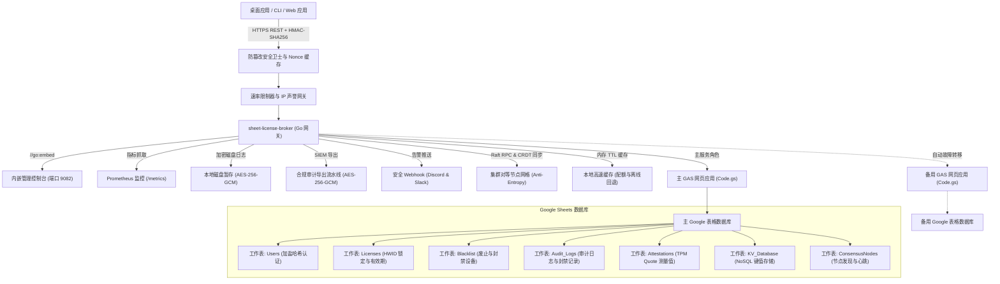

<div align="center">

<!-- 10-Language Navigation Bar -->
<p align="center">
  <a href="../../README.md">🇺🇸 English</a> · <a href="./ko.md">🇰🇷 한국어</a> · <b>🇨🇳 简体中文</b> · <a href="./ja.md">🇯🇵 日本語</a> · <a href="./es.md">🇪🇸 Español</a><br />
  <a href="./fr.md">🇫🇷 Français</a> · <a href="./ru.md">🇷🇺 Русский</a> · <a href="./pt-BR.md">🇧🇷 Português</a> · <a href="./ar.md">🇸🇦 العربية</a> · <a href="./hi.md">🇮🇳 हिन्दी</a>
</p>

# Sheet-License-Broker

<p align="center">
  <strong>基于 Google 表格与 Google Apps Script 构建的无服务器认证、许可证授权与 NoSQL 数据库网关</strong>
</p>

<p align="center">
  
  
  
  
  
  
  
  
  
  
  
  
  
  
  
  
  
  
</p>

</div>

---

## 💡 概述 (Overview)

**`sheet-license-broker`** 将普通的 Google 电子表格转化为适用于桌面应用、命令行 CLI 工具和个人独立 SaaS 项目的高性能、生产就绪型无服务器后端网关。

无需支付昂贵的云数据库月租费用，也无需维护复杂的 Docker 容器集群。`sheet-license-broker` 将 **Google Apps Script (GAS)** 云端引擎与高速 **Go 桥接网关、NIST FIPS 204 后量子 ML-DSA 签名链、分布式 Raft 法定人数共识、CRDT LWW-Element-Set 状态同步、Cloudflare 边缘网关、加密硬件认证 (TPM 2.0 & Enclave)、多租户命名空间、双表格主备高可用 (HA)、动态功能标记与用量计量、加密磁盘排队、Prometheus 指标监控、HMAC 防篡改验证、高弹性本地离线缓存以及内置管理仪表盘** 深度集成。

### 为什么选择 Google 表格作为后端？
- **零托管成本 ($0/月)**：充分利用 Google Drive 和 Apps Script 的免费配额（每日高达 20,000 次 API 调用）。
- **后量子密码学与 ML-DSA 签名链 (NIST FIPS 204)**：基于模块格的抗量子数字签名验证（ML-DSA-44 / ML-DSA-65）与传统 ECDSA 混合签名链（`Hybrid-P256-MLDSA65`），支持零停机密钥轮换宽限期和全网即时紧急废止广播。
- **行为异常检测与自适应风险评分**：统计滑动窗口心跳漂移分析（&plusmn;15% 抖动容限）、球面大圆航线不可行极速移动检测（&gt;950 km/h 或跨 /24 子网并发）、自适应风险评分衰减模型、风险分达到 50 时触发自动二次挑战、达到 85 时执行零信任自动隔离，并生成符合 SIEM 规范的拓扑图谱（`siem-topology-v1`）。
- **企业级单点登录 (SSO) 与 SCIM 2.0 目录预配**：集成 SAML 2.0 与 OIDC 身份联合验证，遵循 RFC 7643/7644 规范自动分配许可证席位，在员工离职时秒级执行撤销与急停操作。
- **零知识证明 (ZKP) 匿名校验**：基于 NIST P-256 曲线的 Pedersen 承诺模型、非交互式 Sigma 证明（Fiat-Shamir 启发式转换）与防重放作废号（Nullifier）注册表，保障客户端硬件隐私。
- **分布式 Raft 仲裁与 CRDT 复制网格**：轻量级领导者选举、过半数日志提交、无冲突状态复制与 SHA-256 Merkle 树状态摘要，实现跨集群节点的反熵（Anti-Entropy）同步。
- **企业级速率限制与渐进式退避**：按 IP 和设备硬件标识符（HWID）线程安全滑动窗口限流，提供递增惩罚延迟与标准 `X-RateLimit-*` 响应头。
- **声誉缓存与自动封禁**：滑动窗口内监测重复违规，自动执行临时封禁并通过高优先级 Webhook 告警。
- **加密审计凭据导出 (SIEM / SOC)**：提供密封 HMAC 签名的 AES-256-GCM 加密审计包，兼容 Splunk、Datadog 和 AWS CloudWatch。
- **硬件级设备锁定与防克隆**：校验 TPM 2.0 PCR Quote 测量值及 Apple Secure Enclave / Windows Hello 硬件密钥，杜绝授权盗用和虚拟机克隆。
- **客户端防调试与内存篡改遥测**：持续评估客户端完整性评分，一旦检测到调试器挂载或代码段篡改，立即触发急停机制实施设备拉黑。
- **动态功能标记与分级计量**：支持 Free、Pro、Enterprise 多级套餐，提供运行时代码级授权检测（`client.isFeatureEnabled("analytics")`）并于表格中原子记录调用配额。
- **双表格主备自动容灾**：自动在主备表格间实现无缝故障转移，并在恢复后执行无冲突双向数据合并。
- **加密本地磁盘暂存池**：采用 AES-256-GCM 加密日志队列（`spool.bin`），在网络完全中断时仍确保零数据丢失。
- **内嵌 Web 控制台**：单文件独立二进制（`sheet-license-broker.exe`）内置现代化暗黑系管理后台。

---

## 🏛️ 系统架构 (Architecture)



---

## 🚀 快速上手 (Quick Start)

### 1. 运行本地网关与控制台

确认本地已安装 Go 1.22+：

```bash
# 克隆代码仓库
git clone https://github.com/kLauncher1/sheet-license-broker.git
cd sheet-license-broker

# 以独立运行模式启动
go run .
```

打开浏览器访问 **`http://localhost:9082`**，即可使用内嵌可视化管理后台。

### 2. 连接线上 Google 表格 (代理模式)

配置环境变量以连接已部署的 Google Apps Script 网页应用：

```bash
# 配置 Apps Script 网页应用 URL
export GAS_WEBAPP_URL="https://script.google.com/macros/s/.../exec"
export CACHE_TTL_SECONDS="600" # 可选: 10 分钟本地缓存 TTL

# 启动服务
./sheet-license-broker.exe
```

网关将自动识别远程端点，透传写入指令，缓存热点数据，并在外部网络波动时平滑降级至本地缓存。

---

## 📋 Google 表格与 Clasp 部署流程

### 方式 A: Clasp CLI 全自动部署

如果使用 `@google/clasp`：

```bash
# 1. 登录 Google 账号
npx @google/clasp login

# 2. 运行自动化部署脚本
node scripts/deploy_clasp.mjs --script-id <YOUR_APPS_SCRIPT_ID>
```

### 方式 B: 3 分钟手动部署

1. 访问 [Google Sheets](https://sheets.new) 新建一份空白表格。
2. 在顶部菜单栏点击 **扩展程序 > Apps Script**。
3. 清空编辑器原有代码，复制粘贴 [`gas/Code.gs`](../../gas/Code.gs) 的全部内容。
4. 点击 **部署 > 新建部署**：
   - 种类：**网页应用 (Web app)**
   - 执行身份：**我 (您的 Google 账号)**
   - 谁可以访问：**所有人 (Anyone)**
5. 点击 **部署**，复制生成的 **网页应用 URL**（形如 `https://script.google.com/macros/s/.../exec`）。

表格将在接收到首次请求时自动生成所有核心标签页（`Users`、`Licenses`、`KV_Database`）。

---

## 📡 REST API 核心规格

| 功能领域 | 方法与路径 | 说明 |
| :--- | :--- | :--- |
| **健康诊断** | `GET /api/health` | 查询系统综合运行状态与各子系统状态 |
| **健康诊断** | `GET /api/proxy/ping` | 测试到 Google Apps Script 后端的往返通信延迟 |
| **用户认证** | `POST /api/users/register` | 注册管理或普通账户（加盐 SHA-256 哈希） |
| **用户认证** | `POST /api/users/login` | 校验用户登录凭据 |
| **许可管理** | `POST /api/licenses` | 签发新许可证（设置有效天数、设备绑定数限制） |
| **许可管理** | `POST /api/licenses/validate` | 校验许可有效性并自动绑定首次请求的客户端 HWID |
| **许可管理** | `POST /api/licenses/revoke` | 即时吊销指定许可证 |
| **安全风控** | `POST /api/security/blacklist` | 拉黑违规设备 HWID 或许可证密钥 |
| **安全风控** | `GET /api/security/blacklist` | 获取当前生效的黑名单与吊销清单 |
| **键值存储** | `POST /api/docs` | 按集合与文档标识存储 JSON 数据 |
| **键值存储** | `GET /api/docs` | 读取集合中的所有文档数据 |
| **多租户** | `POST /api/tenants/register` | 注册独立租户（配置专属自定义前缀与 Webhook） |
| **容灾备份** | `POST /api/backup/export` | 导出 AES-256-GCM 加密的全量状态快照 |
| **容灾备份** | `POST /api/backup/restore` | 从指定加密快照即时还原数据状态 |
| **功能分级** | `GET /api/features` | 获取功能目录及各套餐等级调用配额 |
| **功能分级** | `POST /api/features/check` | 检查特定许可证是否具备某功能使用权限 |
| **用量计量** | `POST /api/usage/record` | 上报并原子累计 API 调用等使用指标 |
| **硬件证明** | `POST /api/attestation/challenge` | 生成单次有效的 TPM 2.0 证明 Nonce 质询 |
| **硬件证明** | `POST /api/attestation/verify` | 校验 TPM 2.0 PCR 签名测量值 |
| **速率限制** | `GET /api/security/ratelimit/status`| 检索 IP 与 HWID 滑动窗口限流统计 |
| **分布式** | `GET /api/consensus/status` | 查询 Raft 选举与 CRDT 数据同步健康度 |
| **实时推送** | `GET /api/stream/ws` | 双向 WebSocket 长连接，实现亚秒级急停与数据广播 |
| **零知识证明**| `POST /api/zkp/verify` | 隐私保护型 Sigma 协议证明零知识校验 |
| **单点登录** | `GET /api/sso/saml/metadata` | 导出对接 Okta、Azure AD 的标准 SP XML 元数据 |
| **单点登录** | `POST /scim/v2/Users` | SCIM 2.0 目录预配新员工并自动分配许可席位 |
| **后量子** | `POST /api/pqc/sign` | 生成 NIST FIPS 204 ML-DSA 格密码混合签名 |
| **行为异常** | `POST /api/anomaly/record` | 上报客户端行为观察数据并更新风险分值 |
| **SIEM 拓扑**| `GET /api/anomaly/graph` | 输出标准网络安全事件实体关联图谱 |

---

## 💻 多语言客户端 SDK

`sheet-license-broker` 在 `sdk/` 目录下提供了开箱即用的多语言集成库：

### 🐍 Python 客户端 (`sdk/python/sheet_license_client.py`)
无需任何第三方依赖，纯标准库实现：

```python
from sheet_license_client import SheetLicenseClient

client = SheetLicenseClient(base_url="http://localhost:9082", secret_key="your-hmac-secret")

# 1. 验证许可证（自动绑定并提交当前机器 HWID）
res = client.verify_license("SLB-XXXX-XXXX-XXXX")
if res.get("valid"):
    print("许可证已通过验证。等级:", res.get("tier"))

    # 2. 检查动态功能标记权限
    if client.is_feature_enabled("SLB-XXXX-XXXX-XXXX", "analytics"):
        print("高级分析功能模块已启用！")

    # 3. 记录资源消费用量
    client.record_usage("SLB-XXXX-XXXX-XXXX", "api_calls", 1)
```

### ⚡ C# / .NET & Unity (`sdk/csharp/SheetLicenseClient.cs`)
兼容 Unity Mono/IL2CPP 及 WPF 桌面项目：

```csharp
using SheetLicenseBroker;

var client = new SheetLicenseClient("http://localhost:9082", "your-hmac-secret");
var result = await client.VerifyLicenseAsync("SLB-XXXX-XXXX-XXXX");
if (result.Valid) {
    Console.WriteLine($"授权成功！等级: {result.Tier}, 到期日: {result.ExpirationDate}");
}
```

### 🟩 TypeScript & Node.js (`@sheet-license/client`)
适用于 Electron 客户端与 Node.js 服务端应用：

```typescript
import { SheetLicenseClient } from '@sheet-license/client';

const client = new SheetLicenseClient({
  baseUrl: 'http://localhost:9082',
  secretKey: 'your-hmac-secret',
});

const result = await client.verifyLicense('SLB-XXXX-XXXX-XXXX');
if (result.valid) {
  console.log('许可证有效。套餐等级:', result.tier);
}
```

### 🔷 Go 客户端 (`sdk/go/client.go`)

```go
package main

import (
	"context"
	"fmt"
	"time"

	"github.com/kLauncher1/sheet-license-broker/sdk/go"
)

func main() {
	client := sdk.NewClient("http://localhost:9082", []byte("your-hmac-secret"), 5*time.Second)
	res, err := client.VerifyLicense(context.Background(), "SLB-XXXX-XXXX-XXXX", "")
	if err == nil && res.Valid {
		fmt.Printf("许可证有效（等级: %s）。启动应用程序...\n", res.Tier)
	}
}
```

---

## 🛠️ 测试与编译

```bash
# 运行全局单元测试套件
go test -v ./...

# 构建独立生产环境二进制执行文件
go build -ldflags="-s -w" -o sheet-license-broker.exe .
```

---

## 📄 开源许可证 (License)

本项目基于 [MIT 许可证](../../LICENSE) 开源发布。
